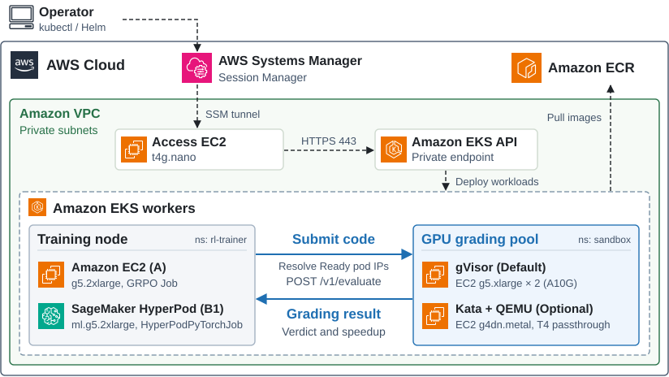
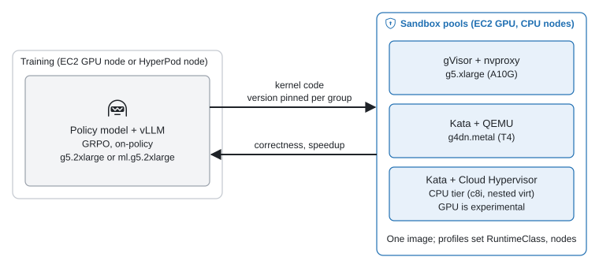

[한국어](README.md) | **English**

# GPU Sandbox on AWS

This AWS lab runs model-generated GPU kernels in sandboxes separate from the training node. During GRPO training, the reward reflects whether a kernel produces the correct output and how fast it runs compared with the reference implementation.

[Quickstart](#getting-started) | [Guidebook](https://daekeun-ml.github.io/gpu-sandbox-on-aws/en/) | [Replay demo](https://dohbsn4kn34ya.cloudfront.net/?lang=en) | [Scripts](SCRIPTS.en.md) | [Troubleshooting](TROUBLESHOOTING.en.md)

<a href="docs/images/figures/index--aws-architecture.en.svg">
  <picture>
    <source media="(max-width: 544px)" srcset="docs/images/figures/index--aws-architecture-compact.en.svg">
    
  </picture>
</a>

The diagram shows **A** training on EC2 and **B1** training on SageMaker HyperPod. Both send code to sandboxes on EC2 for grading. In **B2**, HyperPod runs the system, training and grading workers. [B2 architecture and hands-on guide](https://daekeun-ml.github.io/gpu-sandbox-on-aws/en/handson/scenarios/b/b2/)

<details>
<summary><b>Follow one grading request</b></summary>

The training node sends a generated kernel to the selected sandbox pool. The trainer keeps the pool version fixed while grading the answers generated for one prompt. The sandbox returns correctness and speedup, which the trainer uses to calculate the reward.



</details>

| Goal | Start here |
|---|---|
| Understand how execution and training fit together | [Beginner guide](https://daekeun-ml.github.io/gpu-sandbox-on-aws/en/beginner/) |
| Grade code on your computer | [Local exercise](https://daekeun-ml.github.io/gpu-sandbox-on-aws/en/beginner/05_hands_on/) (no AWS account or GPU needed) |
| Compare runtimes on AWS | [CPU-only exercise](https://daekeun-ml.github.io/gpu-sandbox-on-aws/en/handson/scenarios/c/) (billed) |
| Connect GPU grading to training | [Hands-on overview](https://daekeun-ml.github.io/gpu-sandbox-on-aws/en/handson/), starting with A |

## Architecture

A, B1 and C use the CDK stack with a private EKS API. Managed B2 creates the control plane and workers from the SageMaker HyperPod EKS wizard. C runs scoring and version changes on CPU sandboxes.

### Scenario A: EC2 GPU (default)


*Takeaway: The trainer and the gVisor pools both run on EC2 nodes of EKS, and the model comes from Hugging Face Hub through the NAT.*

<details>
<summary><b>Scenario B1: training on HyperPod</b></summary>


*Takeaway: Only the trainer moves to a HyperPod instance group (ml.g5.2xlarge), booted with lifecycle scripts from S3; the sandboxes stay on the same EC2 gVisor nodes as in A.*

</details>

<details>
<summary><b>Scenario B2: training and sandboxes on HyperPod</b></summary>


*EKS schedules the training job. The HyperPod `trainer` sends code to the `sandbox` group on the right, and the CPU worker in `system` sends benchmark requests to the same grading pool.*

[B2 hands-on](https://daekeun-ml.github.io/gpu-sandbox-on-aws/en/handson/scenarios/b/b2/), [Earlier worker overview](diagrams/variants/b2-worker-overview/scenario-b2.drawio.png)

</details>

<details>
<summary><b>Scenario C: CPU only</b></summary>


*Takeaway: With no GPU node, the pools of three runtimes share one c8i.2xlarge, and a simulate Job on the system nodes sends golden code in place of the trainer.*

</details>

### Request path

- Each time the trainer sends requests to the sandbox, it picks the runtime and version from a snapshot of the routing ConfigMap (`sandbox-routing`), and it takes all results of one reward batch from one pool.
    - **If you switch to v2 during training**: when the batch has completions that still need scoring, cached results from the previous pool that fall in the same batch are scored again on the v2 pool.
    - **When every completion in a batch is already cached from one pool**: the trainer uses those results without calling the sandbox, even after a switch.
    - **If the routing switches more than once within one batch**: the third request sends the whole batch to one pool, so one batch is always scored by one version.
- The trainer resolves the headless Service through CoreDNS and sends `POST /v1/evaluate` straight to each Ready pod. A busy pod answers `503`, and the trainer retries another pod.
- Each request carries a projected ServiceAccount token with the audience `gpu-sandbox`, which the pod verifies offline against the JWKS. The `sandbox` namespace is default-deny, so only labelled pods from `rl-trainer` can connect.

The production layout (Karpenter NodePools, sandbox gateway, veRL on KubeRay) is in [Production 00 Architecture](https://daekeun-ml.github.io/gpu-sandbox-on-aws/en/production/00_architecture/), and node groups, namespaces and a reading of each arrow are in [Hands-on 00 Overview](https://daekeun-ml.github.io/gpu-sandbox-on-aws/en/handson/). The diagram sources (`.drawio`) are in [`diagrams/`](diagrams/).

## Getting started

Clone the project and run the quickstart script. Choose your scenario from the menu. The script shows each command before it runs. Press Enter to run it or type `q` to stop.

```bash
git clone https://github.com/daekeun-ml/gpu-sandbox-on-aws.git
cd gpu-sandbox-on-aws
./scripts/quickstart.sh
```

For the AWS labs, sign in to your lab account with the AWS CLI and install Bash, Python 3, `jq`, `kubectl`, Helm and Docker Buildx. A, B1 and C also need uv, Node.js, the AWS CDK CLI and the Session Manager plugin. Use Bash 4 or newer for B2.

| Scenario | What you run | Start the walkthrough |
|---|---|---|
| C (CPU only) | Verify three CPU grading runtimes and switch pools during a simulation. | `./scripts/quickstart.sh C` |
| A (EC2 GPUs) | Grade code on EC2 and run five GRPO training steps. | `./scripts/quickstart.sh A` |
| B1 (HyperPod training, EC2 grading) | Run one training step on HyperPod with EC2 graders. | `./scripts/quickstart.sh B1` |
| B2 (all workers on HyperPod) | Train and grade on HyperPod, then benchmark 32 requests each from the system and training nodes. | `./scripts/quickstart.sh B2` |

To try CPU grading without an AWS account, install [uv](https://docs.astral.sh/uv/) and choose `local` from the menu. Look for `PASSED` at the end.

For example, the complete B2 workflow is:

```bash
./scripts/quickstart.sh B2 plan    # list the steps
./scripts/quickstart.sh B2         # Enter runs the next step, q stops
./scripts/quickstart.sh B2 cleanup # remove compute after reviewing results
```

The `init` step checks the account and Region and creates `.quickstart/B2/config.env`. Set `AWS_PROFILE` before starting if you use a named profile. B2 defaults to `us-east-1`; the other scenarios default to `us-west-2`. Review the configuration and quotas before `infra` creates billable resources. To pick up later, run a named step. For example, after B2 training, `./scripts/quickstart.sh B2 bench` runs just the benchmark. When retrying `images`, the script reuses tags already present in ECR. Change `IMAGE_TAG` in the scenario configuration to rebuild after editing the code.

For A, B1 and C, `connect` asks you to keep the scenario's `tunnel` command open in another terminal, for example `./scripts/quickstart.sh C tunnel`. After C grades its first v1 batch, run `./scripts/quickstart.sh C switch` in a separate work terminal to switch to v2. B2 connects directly to the EKS API.

Run `cleanup` separately when finished. ECR images, logs and the dedicated B2 lifecycle bucket can still incur storage charges. [Cost estimates](https://daekeun-ml.github.io/gpu-sandbox-on-aws/en/concepts/04_platforms_and_instances/) and [how to check for remaining resources](https://daekeun-ml.github.io/gpu-sandbox-on-aws/en/handson/cleanup/)

## Further reading

- **Isolation** Compare GPU access and node requirements in [gVisor and Kata](https://daekeun-ml.github.io/gpu-sandbox-on-aws/en/concepts/02_isolation_runtimes/).
- **Multi-turn grading** The [Agent Sandbox exercise](https://daekeun-ml.github.io/gpu-sandbox-on-aws/en/handson/extensions/multi_turn/) sends an episode's submissions to the same sandbox.
- **Production** See the [reference architecture](https://daekeun-ml.github.io/gpu-sandbox-on-aws/en/production/00_architecture/) and [security design](https://daekeun-ml.github.io/gpu-sandbox-on-aws/en/production/02_security/).

## Validation status

The AWS exercises verified EC2 GPU training (A), CPU grading and version switching (C), and GPU passthrough with Kata + QEMU. The Kata + Cloud Hypervisor CPU pool passed in scenario C. Its GPU experiment timed out while starting the VM. A one-step HyperPod B1 job scored 12 submissions on two EC2 gVisor sandboxes. Managed B2 completed one GRPO step and 64 benchmark evaluations with all workers on HyperPod. [Run records and measurement scope](https://daekeun-ml.github.io/gpu-sandbox-on-aws/en/reference/sources/#aws-run-record)

## License

Code and documentation are [MIT](LICENSE). Models and datasets have their own licenses.

This repository records the author's personal views and research. It does not represent official documentation or the position of the author's employer.
