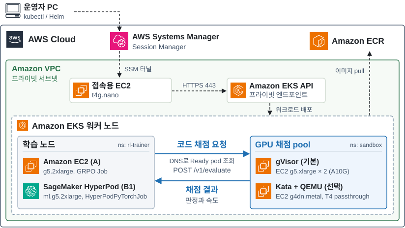
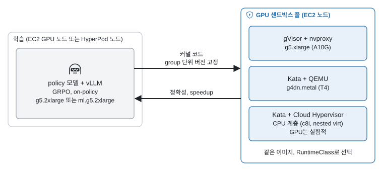
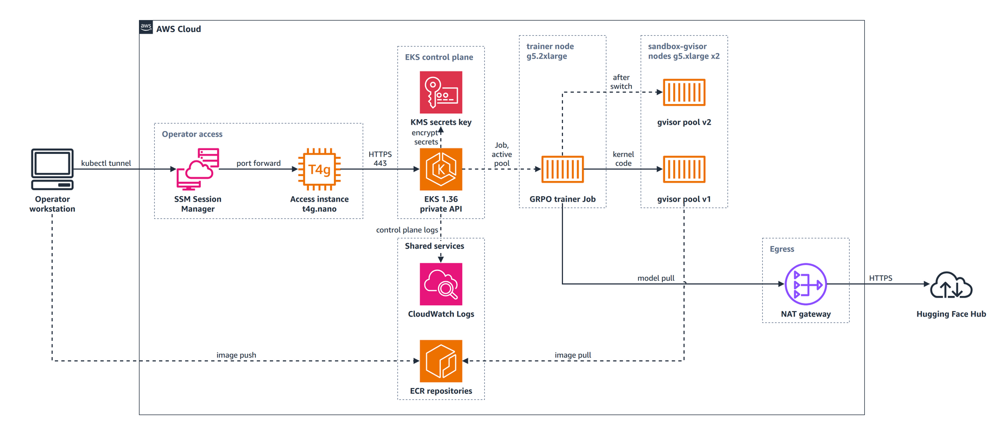

**한국어** | [English](README.en.md)

# GPU Sandbox on AWS

모델이 작성한 GPU 커널을 학습 노드와 분리된 샌드박스에서 실행하는 AWS 실습입니다. GRPO 학습에서는 커널이 정답을 냈는지, 기준 구현보다 얼마나 빨랐는지를 보상에 반영합니다.

[빠른 시작](#시작하기) | [가이드북](https://daekeun-ml.github.io/gpu-sandbox-on-aws/) | [리플레이 데모](https://dohbsn4kn34ya.cloudfront.net/) | [스크립트](SCRIPTS.md) | [문제 해결](TROUBLESHOOTING.md)

<a href="docs/images/figures/index--aws-architecture.ko.svg">
  <picture>
    <source media="(max-width: 544px)" srcset="docs/images/figures/index--aws-architecture-compact.ko.svg">
    
  </picture>
</a>

그림의 학습 노드는 **A**에서는 EC2 인스턴스이고 **B1**에서는 SageMaker HyperPod 워커입니다. 두 구성 모두 EC2의 샌드박스가 코드를 채점합니다. **B2**에서는 시스템 CPU와 학습용 GPU와 채점용 GPU를 모두 HyperPod에 둡니다. [B2 구성도와 실습](https://daekeun-ml.github.io/gpu-sandbox-on-aws/handson/scenarios/b/b2/)

<details>
<summary><b>채점 요청 한 건 따라가기</b></summary>

모델이 커널 코드를 생성하면 학습 노드가 해당 코드를 지정된 샌드박스 pool로 보냅니다. 같은 프롬프트에서 나온 답안 묶음은 같은 버전의 pool에서 채점합니다. 샌드박스가 정확도와 속도 향상 값을 돌려주면 트레이너는 이를 바탕으로 학습 보상을 계산합니다.



</details>

| 하고 싶은 일 | 어디서 시작할까요? |
|---|---|
| 샌드박스와 학습의 관계 이해하기 | [초심자 가이드](https://daekeun-ml.github.io/gpu-sandbox-on-aws/beginner/) |
| 내 PC에서 채점해 보기 | [로컬 실습](https://daekeun-ml.github.io/gpu-sandbox-on-aws/beginner/05_hands_on/) (AWS 계정과 GPU 불필요) |
| AWS에서 런타임 비교하기 | [CPU 전용 핸즈온](https://daekeun-ml.github.io/gpu-sandbox-on-aws/handson/scenarios/c/) (과금 발생) |
| GPU 채점과 모델 학습 연결하기 | [핸즈온 전체 흐름](https://daekeun-ml.github.io/gpu-sandbox-on-aws/handson/) (시나리오 A부터) |

## 아키텍처

A, B1, C는 프라이빗 EKS API를 제공하는 CDK 스택을 사용합니다. 관리형 B2에서는 CloudFormation 스택 하나로 EKS 클러스터와 HyperPod 워커를 함께 만듭니다. C는 CPU 샌드박스에서 채점과 버전 교체를 실습합니다.

### 시나리오 A: EC2 GPU (기본)



*그림 요약: trainer와 gVisor pool이 모두 EKS의 EC2 노드에 있고, 모델은 NAT를 거쳐 Hugging Face Hub에서 받습니다.*

<details>
<summary><b>시나리오 B1: HyperPod 학습</b></summary>


*그림 요약: trainer만 HyperPod 인스턴스 그룹(ml.g5.2xlarge)으로 옮겨 S3의 lifecycle 스크립트로 부팅하고, 샌드박스는 A와 같은 EC2 gVisor 노드에 남습니다.*

</details>

<details>
<summary><b>시나리오 B2: HyperPod 학습과 샌드박스</b></summary>


*EKS가 학습 Job을 배치하면 HyperPod의 `trainer`가 오른쪽 `sandbox` 그룹에 코드를 보냅니다. `system`의 CPU 워커도 같은 채점 pool에 벤치마크 요청을 보냅니다.*

[B2 실습](https://daekeun-ml.github.io/gpu-sandbox-on-aws/handson/scenarios/b/b2/), [이전 워커 개요 그림](diagrams/variants/b2-worker-overview/scenario-b2.drawio.png)

</details>

<details>
<summary><b>시나리오 C: CPU 전용</b></summary>


*그림 요약: GPU 노드 없이 c8i.2xlarge 한 대에 세 런타임의 pool이 서고, system 노드의 simulate Job이 trainer 대신 golden 코드를 보냅니다.*

</details>

### 요청 경로

- trainer는 샌드박스에 요청할 때 routing ConfigMap(`sandbox-routing`)의 snapshot을 읽어 런타임과 버전을 정합니다. 한 reward batch의 답안은 모두 같은 pool에서 채점합니다.
    - **학습 중에 v2로 바꾸면**: batch에 새로 채점할 답안이 있으면 같은 batch에서 이전 pool의 결과가 캐시된 답안도 v2 pool에 다시 보냅니다.
    - **배치의 모든 답안에 같은 pool의 채점 결과가 캐시돼 있으면**: 전환 뒤에도 샌드박스에 재요청할 필요 없이 캐시된 결과를 그대로 반환합니다.
    - **한 batch 안에서 전환이 거듭되면**: 세 번째 요청에서 batch 전체를 한 pool에 보내므로, 한 batch는 항상 한 버전으로 채점됩니다.
- trainer는 headless Service를 CoreDNS로 풀어 Ready 상태인 pod에 `POST /v1/evaluate`를 직접 보냅니다. 바쁜 pod는 `503`을 돌려주고, trainer는 다른 pod로 다시 시도합니다.
- 요청에는 audience가 `gpu-sandbox`인 projected ServiceAccount 토큰이 붙고, pod는 JWKS로 토큰을 오프라인 검증합니다. `sandbox` 네임스페이스는 default-deny라서 `rl-trainer`에서 label이 붙은 pod만 접속할 수 있습니다.

Production 구성(Karpenter NodePool, sandbox gateway, veRL on KubeRay)은 [Production 00 아키텍처](https://daekeun-ml.github.io/gpu-sandbox-on-aws/production/00_architecture/)에, 노드 그룹과 네임스페이스, 화살표별 설명은 [핸즈온 00 전체 흐름](https://daekeun-ml.github.io/gpu-sandbox-on-aws/handson/)에 있습니다. 그림 원본(`.drawio`)은 [`diagrams/`](diagrams/)에 있습니다.

## 시작하기

프로젝트를 내려받고 빠른 시작 스크립트를 실행하세요. 메뉴에서 실습할 시나리오를 고르면 단계마다 명령이 표시됩니다. Enter를 누르면 실행하고 `q`를 입력하면 멈춥니다.

```bash
git clone https://github.com/daekeun-ml/gpu-sandbox-on-aws.git
cd gpu-sandbox-on-aws
./scripts/quickstart.sh
```

AWS 실습은 AWS CLI에서 실습 계정에 로그인한 뒤 진행하세요. Bash, Python 3, `jq`, `kubectl`, Helm, Docker Buildx가 필요합니다. A, B1, C에는 uv, Node.js, AWS CDK CLI와 Session Manager plugin도 필요합니다. B2는 Bash 4 이상을 사용합니다.

| 시나리오 | 무엇을 실행하나요? | 시작 명령 |
|---|---|---|
| C (CPU 전용) | CPU 런타임 세 개에서 채점을 확인하고 시뮬레이션 도중 pool을 교체합니다. | `./scripts/quickstart.sh C` |
| A (EC2 GPU) | EC2에서 코드를 채점하고 GRPO 학습을 5스텝 실행합니다. | `./scripts/quickstart.sh A` |
| B1 (HyperPod 학습, EC2 채점) | HyperPod에서 학습 한 스텝을 실행하고 EC2에서 채점합니다. | `./scripts/quickstart.sh B1` |
| B2 (모든 워커가 HyperPod) | HyperPod에서 학습과 채점을 마친 뒤 시스템 노드와 학습 노드에서 각각 32건을 벤치마크합니다. | `./scripts/quickstart.sh B2` |

AWS 계정 없이 CPU 채점만 해보려면 [uv](https://docs.astral.sh/uv/)를 설치하고 메뉴에서 `local`을 고르세요. 마지막에 `PASSED`가 나오면 성공입니다.

예를 들어 B2를 고르면 아래 순서로 진행합니다.

```bash
./scripts/quickstart.sh B2 plan    # 단계 목록만 출력
./scripts/quickstart.sh B2         # 단계마다 Enter로 실행, q로 중단
./scripts/quickstart.sh B2 cleanup # 결과를 확인한 뒤 컴퓨트 리소스 삭제
```

첫 단계 `init`은 계정과 리전을 확인하고 `.quickstart/B2/config.env`를 만듭니다. AWS 프로필을 사용한다면 시작 전에 `AWS_PROFILE`을 설정하세요. 기본 리전은 B2가 `us-east-1`, 나머지는 `us-west-2`입니다. `infra`부터 비용이 발생하므로 그 전에 설정과 쿼터를 확인하세요. 중단한 뒤에는 필요한 단계 이름을 붙여 실행합니다. 예를 들어 B2에서 학습을 마쳤다면 `./scripts/quickstart.sh B2 bench`로 벤치마크만 실행합니다. `images`를 다시 실행하면 ECR에 있는 태그를 재사용합니다. 코드를 바꿔 새 이미지를 빌드하려면 설정 파일의 `IMAGE_TAG`를 바꾸세요.

A, B1, C에서 `connect` 안내가 나오면 다른 터미널에 같은 시나리오의 `tunnel` 명령을 열어 두세요. C라면 `./scripts/quickstart.sh C tunnel`입니다. C의 첫 v1 채점 배치가 나오면 별도 작업 터미널에서 `./scripts/quickstart.sh C switch`로 v2로 바꾸세요. B2는 EKS API에 직접 접속합니다.

`cleanup`은 별도로 실행합니다. 실행이 끝난 뒤에도 ECR 이미지, 로그, B2 전용 lifecycle 버킷에는 보관료가 남습니다. [비용 추정](https://daekeun-ml.github.io/gpu-sandbox-on-aws/concepts/04_platforms_and_instances/)과 [남은 리소스 확인 방법](https://daekeun-ml.github.io/gpu-sandbox-on-aws/handson/cleanup/)

## 더 살펴보기

- **격리 방식**　[gVisor와 Kata 비교](https://daekeun-ml.github.io/gpu-sandbox-on-aws/concepts/02_isolation_runtimes/)에서 GPU 연결 방식과 필요한 노드를 확인합니다.
- **Multi-turn 채점**　[Agent Sandbox 실습](https://daekeun-ml.github.io/gpu-sandbox-on-aws/handson/extensions/multi_turn/)은 한 에피소드의 여러 제출을 같은 샌드박스로 보냅니다.
- **운영 구성**　[운영 아키텍처](https://daekeun-ml.github.io/gpu-sandbox-on-aws/production/00_architecture/)와 [보안 설계](https://daekeun-ml.github.io/gpu-sandbox-on-aws/production/02_security/)에 배포 경계와 운영 고려사항이 있습니다.

## 검증 상태

AWS 실습 계정에서 EC2 GPU 학습(A), CPU 채점과 버전 전환(C), Kata + QEMU의 GPU passthrough를 확인했습니다. Kata + Cloud Hypervisor는 C의 CPU pool에서 검증했고, 별도 GPU 실험에서는 VM 부팅이 타임아웃으로 끝났습니다. HyperPod B1에서는 GRPO 한 스텝을 실행해 EC2 gVisor 샌드박스 2개로 제출 코드 12개를 채점했습니다. 관리형 B2는 CPU와 GPU 워커를 모두 HyperPod에 두고 GRPO 한 스텝과 벤치마크 64건을 완료했습니다. [실행 기록과 측정 범위](https://daekeun-ml.github.io/gpu-sandbox-on-aws/reference/sources/#aws-실행-기록)

## License

코드와 문서는 [MIT](LICENSE)입니다. 모델과 데이터셋에는 각각의 라이선스가 적용됩니다.

저자가 직접 조사하고 판단한 내용을 정리했습니다. 소속 회사의 공식 문서나 입장을 대변하지 않습니다.
