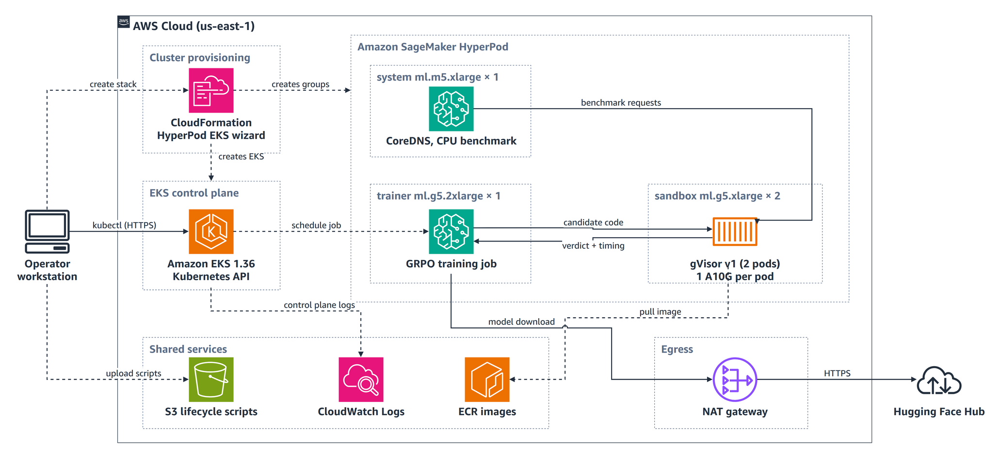

**한국어** | [English](scenario-b2.guide.en.md)

# 시나리오 B2, 시스템, 학습, 채점을 모두 HyperPod에서 실행하기

EKS는 Kubernetes API와 스케줄러를 제공합니다. `us-east-1`에서 이 클러스터에 등록된 워커 네 대는 모두 SageMaker HyperPod 인스턴스 그룹 소속입니다.

## 구성도 읽기

1. **운영자와 EKS**. 운영자는 왼쪽 워크스테이션에서 CloudFormation에 HyperPod EKS 마법사 스택 생성을 요청합니다. 이 스택이 VPC, EKS 제어 영역과 HyperPod 클러스터를 함께 만듭니다. 이후 `kubectl`은 EKS API에 직접 연결합니다.
2. **HyperPod의 세 인스턴스 그룹**. 안쪽 점선 상자는 인스턴스 그룹입니다. `system` 그룹의 CPU 워커 한 대에서 CoreDNS와 벤치마크 클라이언트가 동작합니다. `trainer` 그룹의 `ml.g5.2xlarge` 한 대는 GRPO 학습을 맡습니다. `sandbox`는 `ml.g5.xlarge` 두 대에 A10G 한 장과 v1 채점 Pod 한 개씩을 배치합니다.
3. **채점 요청과 응답**. 가운데 실선을 따라 트레이너가 생성 코드를 보내면 샌드박스가 채점 판정과 실행 시간을 돌려줍니다. 위쪽 실선은 학습을 마친 뒤 CPU 워커에서 같은 채점 pool에 벤치마크 요청을 보낸 경로입니다.
4. **공유 서비스와 모델 다운로드**. 아래쪽에는 lifecycle 스크립트를 저장한 S3, 컨테이너 이미지를 제공하는 ECR, EKS 제어 영역 로그를 받는 CloudWatch Logs가 있습니다. 학습 노드는 NAT 게이트웨이를 거쳐 Hugging Face Hub에서 모델을 받습니다.

## 노드에서 확인한 것

기본 HyperPod 이미지의 NVIDIA 드라이버 `595.112.07`은 gVisor `20261109.0`의 지원 목록에 없었습니다. 채점 노드 두 대에 `580.178.04`를 설치하고 HyperPod API로 재부팅했습니다. 재부팅 후 gVisor Pod 안에서 A10G의 CUDA 연산을 확인했습니다. 학습 워커는 기본 드라이버를 사용했습니다.

학습이 끝난 뒤 `system` 노드에서 테스트 코드 하나로 채점을 32회 요청했습니다. 이어서 `trainer` 노드에서도 같은 코드로 32회 요청했습니다. 두 번 모두 같은 pool이 채점했고 모든 요청이 정답 판정을 받았습니다. [배포 순서와 실행 화면](../docs/handson/scenarios/b/b2.md), [요청별 채점 시간과 처리량](../docs/handson/benchmarks/index.md#hyperpod-b2), [편집용 draw.io 파일](scenario-b2.drawio)

[기존 워커 중심 구성도](variants/b2-worker-overview/scenario-b2.drawio.png), [해당 그림의 편집 원본](variants/b2-worker-overview/scenario-b2.drawio)
