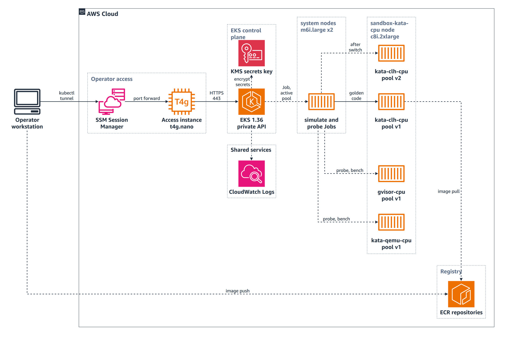

**한국어** | [English](scenario-c.guide.en.md)

# 시나리오 C: c8i 노드 한 대에서 중첩 가상화로 CPU 샌드박스 실행하기

GPU가 필요 없어 실습 비용이 가장 낮은 구성입니다. EC2 nested virtualization을 켠 c8i.2xlarge 노드 한 대에서 세 가지 CPU 샌드박스 런타임(gVisor runsc, Kata + Cloud Hypervisor, Kata + QEMU)을 실행합니다. 모델 학습 없이 system 노드에서 reward 루프 Job을 실행해요. 이 Job이 요청을 보내는 동안 routing과 v1에서 v2로의 rollout을 시험합니다.

## 다이어그램 읽는 법
- **Operator access**: 운영자는 SSM Session Manager와 접속 인스턴스를 거쳐 클러스터 API에 접속합니다. 이 구성에서 API에 접속하는 경로는 이것뿐이에요.
- **EKS control plane**: private endpoint만 있는 EKS control plane과 KMS key입니다.
- **system nodes m6i.large x2**(EKS node group system): 여기서 simulate와 probe Job을 실행합니다. 이 시나리오에서는 해당 node group에서 trainer 대신 reward 루프를 실행하므로 그림에 표시했어요.
- **sandbox-kata-cpu node c8i.2xlarge**(EKS node group sandbox-kata-cpu): 활성 pool kata-clh-cpu v1과 v2, 그리고 비교용 gvisor-cpu와 kata-qemu-cpu pool이 한 노드에 있습니다.
- **Shared services**: CloudWatch Logs입니다. **Registry**: ECR repositories예요.
- **선**: 실선은 동기 호출, 점선은 비동기 또는 보조 관계입니다. 화살표 라벨은 각 구간에서 오가는 요청이나 데이터를 나타냅니다. 아래 단계의 `라벨`과 같은 이름이 붙은 화살표를 따라가세요. 단계 번호는 브리프 관계표의 `#` 순서와 같습니다.
- Operator workstation은 AWS Cloud 상자 밖에 있습니다. 모델 다운로드가 없어서 Hugging Face Hub와 NAT gateway는 그림에 없어요.

## 단계별 흐름
1. **Operator workstation → SSM Session Manager**: 운영자가 cdk/tunnel.sh로 port forwarding 세션을 엽니다. scripts/kata/cpu_nodes.sh 이후의 kubectl과 helm이 이 터널로 실행돼요. (라벨 `kubectl tunnel`)
2. **SSM Session Manager → Access instance t4g.nano**: 세션은 inbound 규칙이 없는 private subnet의 access instance를 거칩니다. (라벨 `port forward`)
3. **Access instance t4g.nano → EKS 1.36 private API**: access instance가 private endpoint의 443 포트로 연결합니다. (라벨 `HTTPS 443`)
4. **EKS 1.36 private API → simulate and probe Jobs**: scripts/ops/simulate.sh가 k8s/probe/job-probe.yaml.tpl을 Job simulate로 렌더링해 ns rl-trainer에 넣습니다. node selector와 toleration이 없어서 taint 없는 system 노드만 이 Job을 받고, Job은 ConfigMap sandbox-routing과 audience gpu-sandbox인 projected token을 마운트해요. 워크스테이션이 아니라 클러스터 안에서 돌고, 스크립트는 로그만 따라갑니다. (라벨 `Job, active pool`)
5. **simulate and probe Jobs → kata-clh-cpu pool v1**: 20초마다(기본 30 batch) Job이 routing snapshot 하나로 채점 버전을 고정하고, completion 대신 CPU golden submission 4개를 headless Service로 활성 pool kata-clh-cpu v1에 보냅니다. trainer와 같은 KernelRewards 코드(require_triton off)로 reward를 계산해 reward_batch 이벤트로 출력해요. (라벨 `golden code`)
6. **simulate and probe Jobs → kata-clh-cpu pool v2**: 두 번째 터미널에서 scripts/ops/rollout.sh kata-clh-cpu v1 v2가 v2를 배포하고 검증하고 parity를 확인한 뒤 ConfigMap을 patch합니다. Job은 batch 경계에서 sandbox_version_switch를 출력하고, served_versions에 v1과 v2가 섞이지 않아요. (라벨 `after switch`)
7. **simulate and probe Jobs → gvisor-cpu pool v1**: ops/verify.sh의 probe(격리 증거, egress 차단, golden verdict)와 ops/bench.sh의 bench(cold start, latency)가 같은 Job 템플릿으로 gvisor-cpu pool도 검사합니다. 활성 pool이 아니라서 점선이지만, 세 runtime을 같은 노드에서 같은 조건으로 비교하는 데 꼭 필요한 선이에요. (라벨 `probe, bench`)
8. **simulate and probe Jobs → kata-qemu-cpu pool v1**: 같은 probe와 bench가 비교 기준선인 kata-qemu-cpu pool에도 돕니다. nested virtualization에서 잰 speedup은 reward 근거로 쓰지 않습니다. (라벨 `probe, bench`)
9. **kata-clh-cpu pool v1 → ECR repositories**: c8i 노드와 system 노드가 node role로 이미지를 내려받습니다. pool v1의 왼쪽은 golden code, 아래쪽은 다른 pool이 차지해서 선이 오른쪽으로 나가 Registry로 내려가요. (라벨 `image pull`)
10. **Operator workstation → ECR repositories**: 운영자가 sandbox와 control 이미지 두 개만 빌드해 push합니다(scripts/03_build_push_images.sh --no-trainer). (라벨 `image push`)
11. **EKS 1.36 private API → CloudWatch Logs**: control plane 로그가 CloudWatch Logs로 갑니다. VPC flow log(REJECT)는 두 번째 log group으로 가요. (라벨 `control plane logs`)
12. **EKS 1.36 private API → KMS secrets key**: EKS가 KMS key로 Kubernetes Secret을 암호화합니다. (라벨 `encrypt secrets`)

## 서비스
| 서비스 | 이 시스템에서의 역할 | 비고 |
|---|---|---|
| Operator workstation | 스크립트를 실행하고 터널로 kubectl과 helm을 쓰며 두 이미지를 빌드해 올립니다 | AWS Cloud 밖 |
| SSM Session Manager | 워크스테이션에서 API endpoint까지 이어 주는 port forwarding 세션 | |
| Access instance t4g.nano | 세션만 받는 경유 호스트, 들어오는 규칙이 없음 | private subnet |
| EKS 1.36 private API | private endpoint만 있는 control plane과 기본 add-on | |
| KMS secrets key | Kubernetes Secret을 암호화하는 고객 관리 키 | rotation 켜짐 |
| simulate and probe Jobs | 템플릿 하나로 만드는 일회성 Job들(simulate, probe, parity, bench) | system 노드에서 실행 |
| kata-clh-cpu pool v1 | 지금 트래픽을 받는 pool, pod마다 Cloud Hypervisor 위의 Kata microVM 하나 | 기본 차단 NetworkPolicy |
| kata-clh-cpu pool v2 | 다음 버전 pool, 평가 200회마다 pod VM을 새로 만듦, 전환 전에는 트래픽 없음 | |
| gvisor-cpu pool v1 | nvproxy 없이 systrap으로 도는 gVisor pool | 노드 user data가 설치 |
| kata-qemu-cpu pool v1 | pod마다 QEMU 위의 Kata microVM 하나 | 비교 기준선 |
| ECR repositories | sandbox와 control 이미지를 비공개로 보관 | scripts/03_build_push_images.sh가 생성 |
| CloudWatch Logs | control plane 로그와 VPC flow log | 보존 한 달 |
| VPC | AZ 두 개, NAT만 있는 public subnet과 노드가 있는 private subnet | 그림에 없음 |
| NAT gateway | 여전히 배포되어 이미지 pull과 부팅 때 다운로드의 출구가 되지만, 그려진 선 중에는 필요로 하는 것이 없음 | 그림에 없음 |
| IAM roles | cluster, node, access instance 역할과 운영자 access entry | 그림에 없음 |
| Kubernetes ConfigMap sandbox-routing | 활성 runtime kata-clh-cpu와 버전, pool 주소를 담은 설정 | 그림에 없음, 4번 선이 실어 나름 |
| kata-deploy DaemonSet | c8i 노드에만 Kata를 설치하고 RuntimeClass를 만드는 Helm release | 그림에 없음 |

## 설계 결정
- reward 루프는 system 노드의 rl-trainer 네임스페이스에서 simulate Job으로 실행합니다(scripts/ops/simulate.sh:3-5, scripts/lib_jobs.sh:12-13). 운영자는 워크스테이션에서 Job을 제출하고 로그를 확인합니다.
- CPU pool 이름은 gvisor-cpu, kata-clh-cpu, kata-qemu-cpu이고 RuntimeClass는 gvisor-cpu, kata-clh, kata-qemu입니다. 채점을 맡고 v1에서 v2로 전환하는 pool은 kata-clh-cpu입니다(docs/handson/scenarios/c/index.md, docs/handson/scenarios/c/index.md). node group sandbox-kata-cpu는 label gpusandbox/role=sandbox-kata를 답니다(stack.py:241).
- 이미지는 sandbox와 control 두 개만 빌드합니다(scripts/03_build_push_images.sh --no-trainer).
- 노드 `sim`은 모든 tool 실행(simulate, probe, parity, bench)이 쓰는 Job 템플릿 하나를 뜻합니다. 7번과 8번은 활성이 아닌 두 pool에 대한 probe와 bench 실행이고, 점선이지만 선이 없는 pool이 생기지 않도록 꼭 그렸어요.
- Kubernetes workload(Job, pool Deployment)는 Containers 카테고리의 `container_1`로 그리고 workload 이름을 붙였습니다. `eks` 아이콘은 control plane만 뜻해요.
- gVisor, Kata, Cloud Hypervisor, QEMU는 stencil이 없어서 pool 라벨(pool 이름이 곧 runtime)과 설명으로 드러냈습니다. c8i node group은 이름과 instance type을 제목에 단 role group이에요.
- C의 EC2 system 노드 그룹에서는 reward driver가 실행됩니다. B2 그림의 HyperPod `system` 인스턴스 그룹이 CPU 작업을 맡습니다.
- kata-deploy DaemonSet은 AWS 리소스가 아니라 kube-system의 Helm release이고 독자가 봐야 할 관계가 없어서 그리지 않았습니다.
- 그룹 제목은 node group 이름과 instance type만 적고 1열 카드에 두 줄로 들어가게 했습니다.
- 샌드박스 egress 선은 일부러 없습니다. default-deny NetworkPolicy, IMDS와 API server와 kubelet에 닿지 않아야 하는 readiness, c8i 노드 user data의 node guard가 외부 연결을 제한합니다.
- Architecture review는 건너뛰었습니다. AWS documentation MCP 서버가 없었고, CDK stack이 synth마다 cdk-nag AwsSolutions 검사를 돌립니다(cdk/app.py:21-22, 수용 finding은 cdk/gpusandbox_cdk/stack.py:271-281). 제목은 em dash 금지 때문에 "Architecture review (skipped)"로 적었어요.
- 브리프가 남긴 질문은 CloudWatch alarm이 없다는 점입니다. reward_batch와 sandbox_version_switch 이벤트는 Job의 stdout으로만 나가요.
- 한국어판과 영어판에 같은 그림을 실어 그림 속 라벨은 영어로 표기했습니다.
- 리뷰 단계 결정: ECR repositories를 다른 시나리오처럼 CloudWatch Logs 아래 공유 열에 둘 수 없었습니다. pool v1의 왼쪽은 golden code가, 아래쪽은 gvisor-cpu와 kata-qemu-cpu가 차지해서 `image pull`은 오른쪽으로만 나갈 수 있고, `image push`는 왼쪽부터 비어 있는 lane을 따라 들어와야 하기 때문입니다. 그래서 ECR은 오른쪽 아래의 자기 상자에 두고, 두 번째 "Shared services" 대신 **Registry**라는 이름을 붙였습니다. 이 배치에서는 왼쪽 아래가 비고 lane마다 아이콘이 하나씩 놓입니다. 선끼리 교차하는 곳은 없어요.

## 이 다이어그램에 없는 것
VPC와 subnet, NAT gateway, IAM 역할, routing ConfigMap, kata-deploy DaemonSet은 위 서비스 표에만 있습니다. 브리프가 범위 밖으로 둔 것도 그리지 않았어요. GPU passthrough를 쓰는 Kata GPU node group, Agent Sandbox extension, 클러스터로 가는 길이 없는 demo site, production reference(c8i와 m8i와 r8i를 쓰는 Karpenter NodePool 포함), 기본으로 꺼진 public endpoint 옵션이 여기에 해당합니다.
