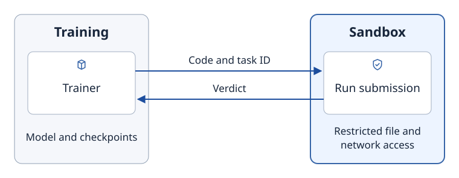
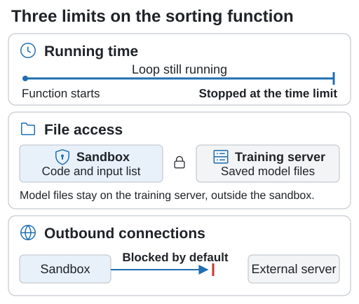

# 01 Why AI-generated code needs isolation

Suppose a model writes a function that sorts a list of numbers. To grade it, you run the function and check the result. If its loop never ends on an empty list, what happens to the training run waiting for the answer?

## Separating scoring from training

If the trainer calls the function in its own process, the next step waits for the function to return. If the submission opens a file or makes a network request, it does so with the trainer's permissions. A separate execution environment limits how far a single submission can affect the training run and its files.

A **sandbox** runs the submission with limited access to files, the network, and machine resources. The trainer sends the answer and receives the evaluation result.

| What the submission does | How the sandbox handles it |
|---|---|
| Produces an output | Compares it with the reference answer. |
| Runs indefinitely | Stops it at the time limit. |
| Tries to reach files or external services it does not need | Applies file permissions and network rules. |

The trainer on the left manages the model and its checkpoints. The sandbox on the right receives the code and task ID, prepares the inputs, and runs the function. If the loop never ends, the sandbox stops the evaluation at its time limit and reports the outcome.

## Defense in depth

Each control has a different job. Low privileges limit file access, network rules limit connections, and time and memory limits contain runaway computation. The [security design](../production/02_security.md) describes the controls used together in this repository.

## Which setting protects what?

Suppose an answer keeps computing and tries to open a training checkpoint. A timeout lets the grader stop the computation. Whether the answer could read the file before that deadline depends on what was mounted in the grading pod. Keep the checkpoint with the trainer and send the sandbox the submission and the inputs it needs.

| Boundary | How the lab applies it |
|---|---|
| Process and files | The grading pod runs as an ordinary user with a read-only root filesystem. Each submission gets a separate work directory. |
| Operating system | gVisor's Sentry or the guest kernel in a Kata VM receives system calls from the submission. |
| Network and credentials | Only allowed clients can send scoring requests. Outbound connections are denied by default and the pod does not automatically mount a service account token of its own. |
| Time and resources | Limits on running time and memory let the grader report what happened even when a submission cannot finish. |

### Reading `Ready` and `ok`

`Ready` means the grading server has checked its device and network state and can accept requests. If you send it a deliberately wrong submission, `wrong_answer` is the expected result. This is why the operator checks readiness and then sends submissions with known verdicts, called goldens. [Reading the pool verification results](../handson/common/03_pools/details.md#gpu-verdicts)

[Chapter 02](02_container_vs_sandbox.md) follows a file request through runc, gVisor, and Kata.
