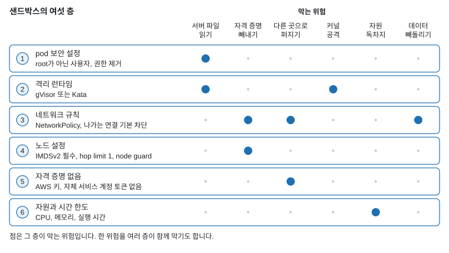

# 01 AI가 만든 코드를 격리하는 이유

모델에게 숫자 목록을 정렬하는 함수를 작성하게 했다고 해 봅시다. 답을 채점하려면 함수를 실행해 출력 순서를 확인해야 합니다. 그런데 빈 목록을 받았을 때 반복문이 끝나지 않는다면, 그 답 하나 때문에 전체 학습도 기다려야 할까요?

## 학습 서버와 실행 환경을 분리하는 이유

학습 프로그램이 자기 프로세스 안에서 함수를 호출하면, 함수가 끝날 때까지 다음 단계도 기다립니다. 답안에 파일 읽기나 네트워크 요청이 들어 있다면 학습 프로그램과 같은 권한으로 실행됩니다. 답안 하나 때문에 학습이 지연되는 시간을 제한하고 학습 파일을 보호하기 위해 실행 환경을 분리합니다.

## 샌드박스가 제한하는 권한

**샌드박스**는 답안이 접근할 수 있는 파일과 네트워크, 사용할 수 있는 자원을 제한한 실행 환경입니다. 학습 프로그램은 답안을 샌드박스에 보내고, 실행 결과를 돌려받아 학습에 사용합니다.

그림에서 왼쪽 학습 프로그램은 모델과 체크포인트를 관리합니다. 오른쪽 샌드박스는 답안과 과제 ID를 받고, 테스트 입력을 준비해 함수를 실행합니다. 위 예시처럼 반복문이 끝나지 않으면 샌드박스가 시간 한도에서 평가를 중단하고 그 결과를 돌려줍니다.

| 답안에서 일어난 일 | 채점 환경의 동작 |
|---|---|
| 계산이 끝나고 값이 나옴 | 기준 답과 출력값을 비교합니다. |
| 반복문이 끝나지 않음 | 실행 시간 한도에서 중단합니다. |
| 채점에 필요 없는 파일이나 외부 주소에 접근하려 함 | 실행 환경의 파일 및 네트워크 권한으로 접근을 제한합니다. |

## 여러 겹으로 보호하는 이유

실행 권한을 낮추면 파일에 접근할 수 있는 범위가 줄어듭니다. 네트워크 정책은 프로그램이 어디로 연결할 수 있는지 제한하고, 시간과 메모리 한도는 계산이 너무 오래 걸리거나 자원을 다 쓰는 상황을 막습니다. 각 설정이 맡는 일이 달라 함께 사용합니다. 저장소의 실제 설정은 [보안 설계](../production/02_security.md)에 있습니다.

## 어느 설정이 무엇을 지키나요?

답안이 끝없이 계산하면서 학습 체크포인트를 열려고 한다고 가정해 봅시다. 실행 시간 한도에 도달하면 채점기는 계산을 중단할 수 있습니다. 그 전에 파일을 읽을 수 있는지는 별개의 문제입니다. 체크포인트는 trainer에 두고, 채점 pod에는 제출 코드와 그 과제에 필요한 입력만 전달합니다.

| 확인할 경계 | 실습에서 하는 일 |
|---|---|
| 프로세스와 파일 | 채점 pod는 일반 사용자로 실행하고 루트 파일 시스템을 읽기 전용으로 둡니다. 제출을 실행할 때마다 별도 작업 디렉터리를 준비합니다. |
| 운영체제 | gVisor의 Sentry 또는 Kata VM 안의 커널이 제출 코드의 시스템 호출을 받습니다. |
| 네트워크와 자격 증명 | 채점 요청은 허용된 클라이언트에서 받습니다. 나가는 연결은 기본 차단하고 샌드박스에 자체 서비스 계정 토큰을 자동으로 넣지 않습니다. |
| 시간과 자원 | 실행 시간과 메모리를 제한합니다. 답안이 끝까지 실행되지 않아도 채점기는 그 상태를 보고할 수 있습니다. |

### `Ready`와 `ok`가 답하는 질문

`Ready`는 채점 서버가 장치와 네트워크 상태를 확인하고 요청을 받을 준비가 됐다는 뜻입니다. 그 서버에 일부러 틀린 답을 보내면 `wrong_answer`가 돌아오는 것이 정상입니다. 미리 기대 판정을 정해 둔 답안(golden)으로 확인하는 이유입니다. 운영자는 준비 상태와 개별 답안의 판정을 각각 확인합니다. [pool 검증 결과 읽기](../handson/04_sandbox_pools.md#gpu-verdicts)

[다음 편](02_container_vs_sandbox.md)에서는 파일 열기 요청을 예로 들어 컨테이너, gVisor, Kata의 경계를 비교합니다.
