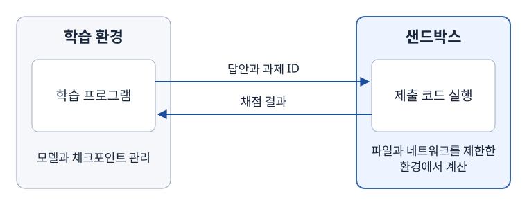

# 01 AI가 만든 코드를 격리하는 이유

모델에 코드를 만들어 달라고 하면 결과는 텍스트로 돌아옵니다. 그 코드가 실제로 동작하는지 확인하려고 실행하는 순간, 컴퓨터는 답안에 적힌 명령을 실행합니다. 실행 환경에 권한이 있다면 파일을 읽거나 네트워크에 접속할 수 있고, 실수로 끝나지 않는 작업을 시작할 수도 있습니다.

## 학습 서버와 실행 환경을 분리하는 이유

학습 프로그램이 답안을 자기 프로세스에서 실행하면, 답안도 그 프로그램과 같은 권한으로 설정 파일이나 모델 체크포인트에 접근할 수 있습니다. 잘못된 반복문 하나가 채점과 학습을 함께 멈추게 할 수도 있습니다. 학습 중에는 모델이 만든 답을 반복해서 실행하므로, 한 답안의 문제가 다음 채점이나 전체 학습으로 번지지 않도록 실행 환경을 분리합니다.

## 샌드박스가 제한하는 권한

**샌드박스**는 답안이 접근할 수 있는 파일과 네트워크, 사용할 수 있는 자원을 제한한 실행 환경입니다. 학습 프로그램은 답안을 샌드박스에 보내고, 실행 결과를 돌려받아 학습에 사용합니다.

그림에서 제출 코드가 실행되는 곳은 오른쪽 샌드박스입니다. 왼쪽의 학습 프로그램은 모델과 체크포인트를 관리하고, 샌드박스에는 답안과 과제 ID를 보냅니다. 샌드박스가 해당 과제의 테스트 입력을 준비합니다.

| 답안에서 일어난 일 | 채점 환경의 동작 |
|---|---|
| 계산이 끝나고 값이 나옴 | 기준 답과 출력값을 비교합니다. |
| 반복문이 끝나지 않음 | 실행 시간 한도에서 중단합니다. |
| 채점에 필요 없는 파일이나 외부 주소에 접근하려 함 | 실행 환경의 파일 및 네트워크 권한으로 접근을 제한합니다. |

## 여러 겹으로 보호하는 이유

실행 권한을 낮추면 파일에 접근할 수 있는 범위가 줄어듭니다. 네트워크 정책은 프로그램이 어디로 연결할 수 있는지 제한하고, 시간과 메모리 한도는 계산이 너무 오래 걸리거나 자원을 다 쓰는 상황을 막습니다. 각 설정이 맡는 일이 달라 함께 사용합니다. 저장소의 실제 설정은 [보안 설계](../production/02_security.md)에 있습니다.

[다음 편](02_container_vs_sandbox.md)에서는 파일 열기 요청을 예로 들어 컨테이너, gVisor, Kata의 경계를 비교합니다.
