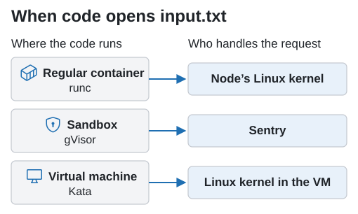
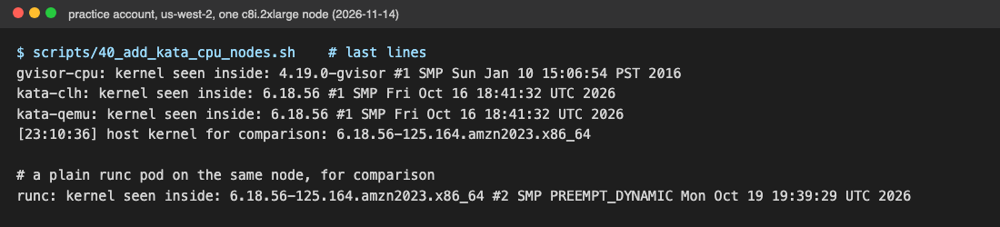

# 02 Containers and sandboxes

Suppose a generated script tries to open a file. The operating system handles that request. The location of the handler is what differs across runc, gVisor, and Kata.

## Nodes and kernels

A **node** is the machine that runs the program. Its operating system **kernel** handles access to files, memory, and devices. A program's request to the kernel is a **system call**.

Ordinary containers can give each program its own view of files and processes. Two containers on the same node still send their file requests to the same Linux kernel.

| Runtime | Where the file request goes |
|---|---|
| runc | To the node's kernel. |
| gVisor | First to Sentry, gVisor's user-space kernel. |
| Kata | To the Linux kernel inside a virtual machine (VM). |

**Sentry** is the part of gVisor that acts as a kernel for programs inside the sandbox. On the node, Sentry itself runs as a program in **user space**, the area where programs run on top of the operating system. If submitted code opens `input.txt`, Sentry handles the request and looks for that path in the files visible to the sandbox.

A **runtime** prepares the execution environment and starts the program. Kubernetes deploys containers in units called **pods**. A pod's `runtimeClassName` selects its runtime. Most sandbox deployments in this guide run one grading server per pod.

Compare where the system call arrow first lands. In the runc panel, namespaces separate views of files and processes, and cgroups can limit CPU and memory use. In the Kata panel, KVM is the Linux virtualization feature used to run the VM.

## Read `uname` on the same node

`uname -r` prints the kernel release seen by a program. Would three runtimes print the same release if they started the same Linux image? The image supplies files and programs. The runtime determines which kernel receives their system calls.

In this lab `gvisor-cpu` printed `4.19.0-gvisor`. QEMU and Cloud Hypervisor booted the same Kata guest kernel, so those two lines matched. The ordinary runc container reported the node's `amzn2023` kernel. The releases will change with the images. Look for the line matching the **node**, the release reported by **Sentry**, and the release reported by the **guest**. [Run the comparison](05_hands_on.md#aws-cpu)

## How the workload affects isolation costs

A loop that computes in memory and a program that repeatedly opens small files make different demands on the kernel. In an AWS comparison on the same `m7i.xlarge`, a CPU loop took 0.144 s under runc and 0.146 s under gVisor. For 200,000 `getppid` calls the times were 0.035 s and 0.444 s. The ratio for one workload will not predict the other. [AWS comparison and conditions](https://aws.amazon.com/ko/blogs/tech/aws-ai-agent-sandbox-eks-isolation-part-2/)

Kata boots a VM when it starts a pod. A request sent to a ready pod reuses that VM. Compare time to Ready separately from the time a running pod takes to grade one submission. [Runtime benchmark](../handson/benchmarks/index.md#runtime-results)

[Chapter 03](03_gpu_sandbox.md) follows requests to a GPU. [Runtime comparison](../concepts/02_isolation_runtimes.md) covers the trade-offs and node requirements.
