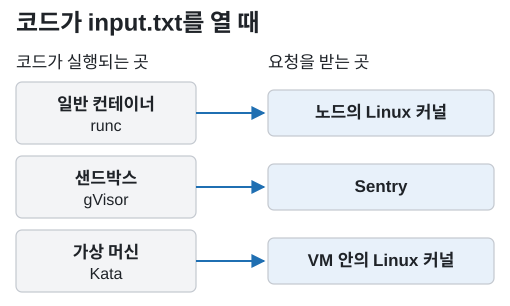
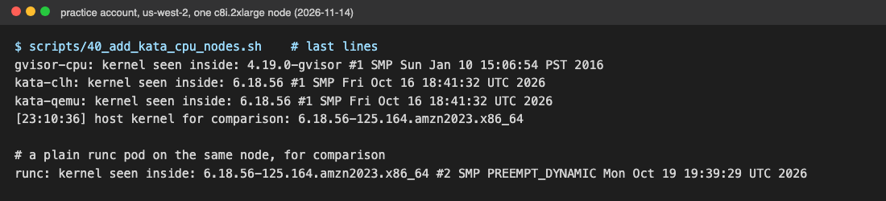

# 02 컨테이너와 샌드박스

모델이 작성한 스크립트에 파일을 여는 코드가 들어 있다고 해 봅시다. 파일을 열려면 프로그램이 운영체제에 요청해야 합니다. 그 요청을 어디에서 받아 처리하는지가 컨테이너, gVisor, Kata의 차이를 이해하는 출발점입니다.

## 노드와 커널

**노드**는 프로그램을 실행하는 물리 서버나 가상 서버입니다. 노드에서 실행되는 운영체제의 **커널**은 파일, 메모리, 장치에 접근하는 요청을 처리합니다. 프로그램이 커널에 보내는 이런 요청을 **시스템 호출(system call)**이라고 합니다.

일반 **컨테이너**는 프로그램마다 보이는 파일과 프로세스를 나눌 수 있습니다. 같은 노드에 있는 두 컨테이너에서 파일을 열면 두 요청 모두 그 노드의 Linux 커널이 받습니다.

## 파일 요청을 처리하는 위치

| 실행 방식 | 파일 열기 요청의 경로 |
|---|---|
| 일반 컨테이너(runc) | 답안의 요청을 노드 커널이 받습니다. |
| gVisor | gVisor의 사용자 공간 커널인 Sentry가 먼저 요청을 받습니다. |
| Kata | 답안은 별도의 **가상 머신(VM)** 안에서 실행됩니다. VM 내부의 Linux 커널이 요청을 받습니다. |

**Sentry**는 샌드박스 안의 프로그램에 커널 역할을 하는 gVisor의 구성 요소입니다. 노드에서 보면 Sentry 자체도 다른 프로그램처럼 운영체제 위에서 실행됩니다. 이 실행 영역을 **사용자 공간**이라고 합니다. 예를 들어 답안 코드가 `input.txt`를 열면 Sentry가 요청을 받아 샌드박스에 보이는 파일 중에서 그 경로를 찾습니다.

**런타임(runtime)**은 이런 실행 환경을 준비하고 프로그램을 시작합니다. Kubernetes에서는 컨테이너를 **pod** 단위로 배치하고, pod에 `runtimeClassName`을 지정해 어떤 런타임을 쓸지 고릅니다. 이 가이드에서는 대개 채점 서버 하나를 pod 하나에 둡니다.

그림에서 `시스템 호출` 화살표가 처음 닿는 곳을 비교해 보세요. runc의 `namespace`는 프로그램에 보이는 파일이나 프로세스를 나누고, `cgroup`은 CPU와 메모리 사용량을 제한하는 데 쓰입니다. Kata의 `KVM`은 VM을 실행하는 데 쓰는 Linux의 가상화 기능입니다.

## 같은 노드에서 `uname` 결과 읽기

`uname -r`는 프로그램이 보는 커널의 버전을 출력합니다. 세 런타임에 같은 Linux 이미지를 주면 결과도 같을까요? 이미지는 파일과 프로그램을 제공하고, 시스템 호출을 받는 커널은 런타임에 따라 달라집니다.

위 실습에서 `gvisor-cpu`는 `4.19.0-gvisor`를 출력했습니다. Kata의 QEMU와 Cloud Hypervisor는 같은 게스트 커널을 부팅해 두 줄이 같았습니다. 일반 컨테이너(runc)에는 노드의 `amzn2023` 커널 버전이 보였습니다. 버전 문자열이 바뀌면 숫자를 외울 필요 없이 **노드와 같은 줄**, **Sentry가 보고한 줄**, **게스트 커널을 보고한 줄**을 구분해 보세요. [같은 노드에서 비교하기](05_hands_on.md#aws-cpu)

## 워크로드에 따라 달라지는 격리 비용

메모리 안에서 오래 계산하는 프로그램과 작은 파일을 자주 여는 프로그램은 커널에 요청하는 횟수가 다릅니다. AWS 기술 블로그의 같은 `m7i.xlarge` 비교에서는 CPU 반복 계산이 runc 0.144초, gVisor 0.146초였고, `getppid` 20만 번은 각각 0.035초와 0.444초였습니다. 한 종류의 작업에서 나온 비율을 다른 프로그램에 그대로 적용하기는 어렵습니다. [AWS 비교 조건](https://aws.amazon.com/ko/blogs/tech/aws-ai-agent-sandbox-eks-isolation-part-2/)

Kata는 pod를 시작할 때 VM을 부팅합니다. 이미 실행 중인 pod에 제출을 보낼 때에는 그 VM을 다시 띄우지 않습니다. pool을 고를 때에는 첫 pod가 Ready가 될 때까지의 시간과, 준비된 pod가 한 답을 채점하는 시간을 따로 보세요. [런타임 벤치마크](../handson/08_benchmark.md#runtime-results)

[다음 편](03_gpu_sandbox.md)에서는 파일 대신 GPU를 사용하면 요청 경로가 어떻게 달라지는지 봅니다.
