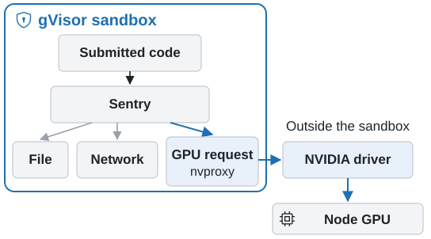
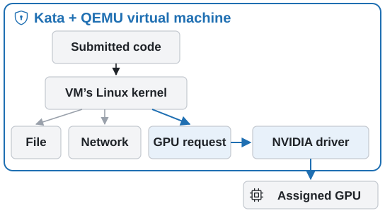

# 03 GPU access in a sandbox

Take two lists, `[-3, 2]` and `[1, 1]`. Add the numbers at matching positions, then replace any negative result with zero. The expected answer is `[0, 3]`. A CPU can calculate it. If the task is to **write code that runs this calculation faster on a GPU**, the sandbox needs access to a GPU to test that claim.

## Time both implementations on the same GPU { #gpu-kernels-and-drivers }

A **GPU kernel** is code the GPU runs to perform a calculation. The **operating system kernel** from chapter 02 handles requests for files and devices. Here we want the model to write a GPU kernel that adds the lists.

Suppose the reference code takes 4 milliseconds (ms) and the model’s code takes 2 ms on the same A10G GPU with the same input. If both give the right output, the new code is **twice as fast** under those conditions (4 ÷ 2). These are example timings. If you plan to use another GPU, time both implementations on that GPU as well.

## How does the sandbox reach the GPU? { #gpu-request-path }

In either sandbox, a physical GPU does the addition from the example above. Look for the **NVIDIA driver**, the software that controls the GPU. The blue outline in each figure marks the sandbox boundary.

**With gVisor, GPU requests go to a driver outside the sandbox.** When the code opens a file or asks to use the GPU, **Sentry**, gVisor’s sandbox kernel, receives the request. For GPU requests, Sentry’s `nvproxy` checks which ones it can forward. Only those requests reach the NVIDIA driver on the node, the server that holds the GPU.

??? question "What is nvproxy?"
    `nvproxy` is the part of gVisor that checks requests from a sandboxed program to the node’s NVIDIA driver. In the addition example, the program asks for GPU memory to hold the inputs. `nvproxy` forwards only the commands it supports for that driver version. The GPU does the addition.

    - [Read how gVisor decides which GPU requests to support](https://gvisor.dev/docs/user_guide/gpu/#ioctls)
    - [Check the node’s NVIDIA driver compatibility in the lab](../handson/common/02_runtimes/gvisor.md#nvproxy-driver-version-matching)

**With Kata + QEMU, the driver inside the sandbox controls the GPU directly.** Kata uses QEMU to start a virtual machine (VM). When the code opens a file, the VM’s Linux kernel handles the request. When the code adds the numbers on the GPU, the NVIDIA driver in that same VM controls the device. Assigning a physical GPU directly to a VM this way is called **GPU passthrough**.

??? question "Does Kata require QEMU? How does Cloud Hypervisor differ?"
    Kata can also use **Cloud Hypervisor**. Both programs run the VM and connect the devices it uses.

    - **QEMU** supports devices from several generations of computers. For example, it can present a disk to the VM through an emulated PC disk controller or as a disk designed for virtual machines. [Devices QEMU supports](https://www.qemu.org/docs/master/system/introduction.html#feature-overview)
    - **Cloud Hypervisor** focuses on running servers in the cloud. For disks and networking, it primarily uses devices designed for virtual machines (`virtio`). [Cloud Hypervisor’s design goals and features](https://github.com/cloud-hypervisor/cloud-hypervisor/blob/v55.0/README.md)

    In the CPU lab, we ran sandboxes with both on a single `c8i` node. [Compare the two on CPU](../handson/common/02_runtimes/kata.md#cpu-run)

    Cloud Hypervisor itself supports assigning a physical GPU to a VM. For NVIDIA GPUs, **Kata 4.3.1**, the version used in this lab, supports **Kata + QEMU**. That’s the combination we used to run CUDA on a T4. [Kata 4.3.1 support table](https://github.com/kata-containers/kata-containers/blob/4.3.1/docs/hypervisors.md#types) / [Cloud Hypervisor GPU experiment](../handson/common/02_runtimes/kata.md#clh-gpu)

### Which runtime should you choose? { #choosing-a-gpu-runtime }

**gVisor is the simpler starting point on a regular EC2 GPU instance.** In this lab you can use the A10G on a `g5.xlarge` without booting a VM for each sandbox. First check that `nvproxy` supports the node’s NVIDIA driver version and the GPU features your code needs. [Check the GPU under gVisor](../handson/common/02_runtimes/gvisor.md)

**Choose Kata + QEMU if each sandbox needs its own Linux kernel.** You need hardware that supports GPU passthrough. This lab assigns one T4 on a `g4dn.metal` to the VM. Allow for VM boot time and memory when you start a new sandbox. [Attach a GPU to a Kata VM](../handson/common/02_runtimes/kata.md#kata-gpu)

## Check which GPU the sandbox sees { #follow-one-submission-to-one-gpu }

The screenshot shows a Kata VM. The last command asks PyTorch for the name of the first GPU. The `Tesla T4` output tells us **the assigned GPU is visible inside the VM**. To check that code actually runs correctly on it, send a submission with a known answer. [GPU sandbox results](../handson/common/03_pools/details.md#gpu-verdicts)

??? note "What if a job requests a GPU and never starts?"
    Check for a free GPU first. The default `g5.xlarge` has one A10G. If another sandbox holds it, the next one waits. If the sandbox starts but its first GPU operation fails, check the supported node driver version for gVisor. For Kata, check the device assignment and the driver inside the VM.

??? note "Time per calculation and throughput across sandboxes"
    Execution time tells you how long one submission’s calculation takes. **Throughput** counts how many evaluations a group of sandboxes completes per second. In the lab, gVisor on two A10Gs completed 0.198 evaluations/s, and Kata + QEMU on four T4s completed 0.349/s. The GPU models and number of sandboxes working at once differed. These numbers alone cannot rank the speed of a kernel or runtime. [Benchmark conditions and results](../handson/benchmarks/index.md#runtime-results)

The next chapter shows why two correct implementations can earn different training rewards. [04 Reinforcement learning and sandboxes](04_rl_and_sandbox.md)
