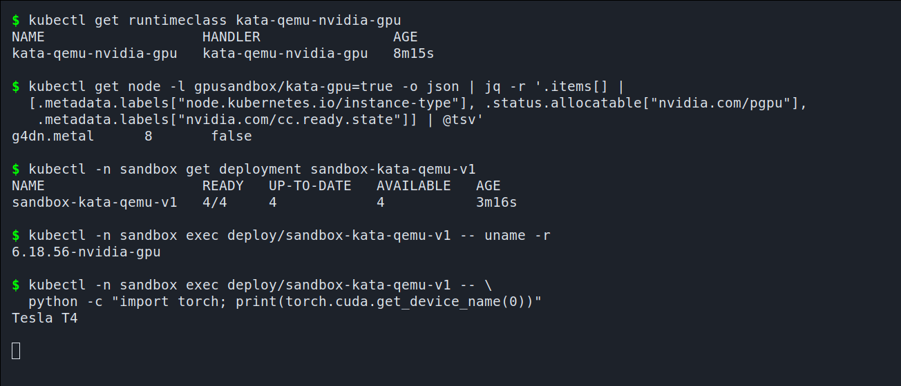

# 03 GPU access in a sandbox

Take two lists, `[-3, 2]` and `[1, 1]`. Add the numbers at matching positions, then replace any negative result with zero. The expected answer is `[0, 3]`. A CPU can calculate it. If the task is to **write code that runs this calculation faster on a GPU**, the sandbox needs access to a GPU to test that claim.

## Time both implementations on the same GPU { #gpu-kernels-and-drivers }

A **GPU kernel** is code the GPU runs to perform a calculation. The **operating system kernel** from chapter 02 handles requests for files and devices. Here we want the model to write a GPU kernel that adds the lists.

Suppose the reference code takes 4 milliseconds (ms) and the model’s code takes 2 ms on the same A10G GPU with the same input. If both give the right output, the new code is **twice as fast** under those conditions (4 ÷ 2). These are example timings. If you plan to use another GPU, time both implementations on that GPU as well.

## How does the sandbox reach the GPU? { #gpu-request-path }

A **driver** handles a program’s requests to use a device. Both paths in the figure use an NVIDIA driver. Where that driver runs depends on the sandbox runtime.

- **gVisor.** `nvproxy` checks GPU requests from inside the sandbox. It forwards supported requests to the NVIDIA driver on the node that holds the GPU. This lab uses the A10G on a `g5.xlarge`. [Check the GPU under gVisor](../handson/common/02_runtimes/gvisor.md)
- **Kata + QEMU.** The node assigns a physical GPU directly to a virtual machine (VM). This is called **GPU passthrough**. The NVIDIA driver inside the VM controls one T4 on the lab’s `g4dn.metal`. [Attach a GPU to a Kata VM](../handson/common/02_runtimes/kata.md#kata-gpu)

## Check which GPU the sandbox sees { #follow-one-submission-to-one-gpu }

The screenshot shows a Kata VM. The last command asks PyTorch for the name of the first GPU. The `Tesla T4` output tells us **the assigned GPU is visible inside the VM**. To check that code actually runs correctly on it, send a submission with a known answer. [GPU sandbox results](../handson/common/03_pools/details.md#gpu-verdicts)

??? note "What if a job requests a GPU and never starts?"
    Check for a free GPU first. The default `g5.xlarge` has one A10G. If another sandbox holds it, the next one waits. If the sandbox starts but its first GPU operation fails, check the supported node driver version for gVisor. For Kata, check the device assignment and the driver inside the VM.

??? note "How does the Kata CPU exercise differ?"
    QEMU and Cloud Hypervisor both run virtual machines. The CPU lab compares both on a `c8i` node without a GPU. The Kata exercise with an NVIDIA GPU uses QEMU. [CPU lab](../handson/scenarios/c/index.md) / [Kata GPU support and experiment notes](../handson/common/02_runtimes/kata.md#clh-gpu)

??? note "Time per calculation and throughput across sandboxes"
    Execution time tells you how long one submission’s calculation takes. **Throughput** counts how many evaluations a group of sandboxes completes per second. In the lab, gVisor on two A10Gs completed 0.198 evaluations/s, and Kata + QEMU on four T4s completed 0.349/s. The GPU models and number of sandboxes working at once differed. These numbers alone cannot rank the speed of a kernel or runtime. [Benchmark conditions and results](../handson/benchmarks/index.md#runtime-results)

The next chapter shows why two correct implementations can earn different training rewards. [04 Reinforcement learning and sandboxes](04_rl_and_sandbox.md)
