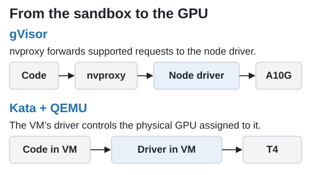

# 03 GPU access in a sandbox

A small array-addition test can check correctness on a CPU. To compare how fast two implementations run on a GPU, run both on that GPU with the same input.

## GPU kernels and drivers

A **GPU kernel** is code that performs a calculation on the GPU. The **GPU driver** provides the interface for programs to request GPU work. If the deployment GPU is an L4, measure there. Results from an A10G may rank the implementations differently.

## Two paths to the GPU

- **gVisor** forwards supported GPU requests through `nvproxy` to the node's NVIDIA driver. It can run on a regular GPU instance with a supported driver version.
- **Kata with QEMU** assigns a physical GPU to a VM. The driver inside the VM controls the device. The GPU exercise uses a `g4dn.metal` node with T4 GPUs.

??? note "GPU request path"
    

    An `ioctl` is a system call that lets a program send a device-specific request to a driver.

See [runtime comparison](../concepts/02_isolation_runtimes.md) for node requirements. [Chapter 04](04_rl_and_sandbox.md) turns those results into a learning signal.
