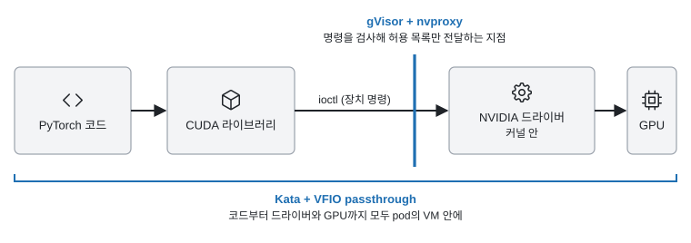

# 03 GPU까지 격리하려면

모델에게 두 배열을 더하는 코드를 작성하게 했다고 해 봅시다. 작은 입력의 정답은 CPU에서도 확인할 수 있습니다. 두 구현 중 GPU에서 어느 쪽이 더 빠른지 비교하려면 실제 GPU에서 같은 입력으로 실행 시간을 재야 합니다.

## GPU 커널과 드라이버

**GPU 커널**은 GPU에서 실행되는 계산 코드입니다. [앞 편](02_container_vs_sandbox.md)에서 파일 접근을 처리하던 운영체제 커널과는 이름만 같습니다. Python 프로그램이 GPU에서 계산을 요청하면 **GPU 드라이버**가 소프트웨어와 GPU 사이에서 그 일을 전달합니다.

GPU의 종류와 입력 크기에 따라 빠른 구현이 달라질 수 있습니다. 예를 들어 A10G에서 개선된 시간을 확인했더라도 L4에 배포할 예정이라면 L4에서도 같은 입력으로 재는 편이 정확합니다.

## GPU에 연결하는 두 방식

- **gVisor**는 `nvproxy`를 통해 지원하는 GPU 요청을 노드의 NVIDIA 드라이버에 전달합니다. 일반 GPU 인스턴스에서 시작할 수 있고, 노드의 드라이버 버전이 gVisor 지원 목록에 있어야 합니다.
- **Kata + QEMU**는 GPU를 VM에 직접 할당합니다. 그 VM 내부의 드라이버가 장치를 제어합니다. 이 저장소의 GPU 실습에서는 T4가 달린 `g4dn.metal` 노드를 씁니다.

??? note "GPU 요청을 전달하는 경로"
    

    `ioctl`은 프로그램이 드라이버에 장치 관련 요청을 보내는 시스템 호출입니다. 여기서는 gVisor가 그 요청을 확인하는 위치를 보면 됩니다.

CPU에서 답만 확인하는 실습은 GPU 없이 진행할 수 있습니다. GPU 연결 조건을 더 보고 싶다면 [격리 런타임 비교](../concepts/02_isolation_runtimes.md)를 참고하세요. [다음 편](04_rl_and_sandbox.md)에서는 실행 결과를 학습 점수로 바꿉니다.
