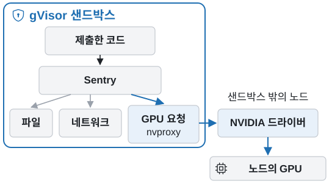
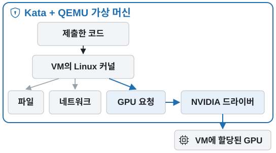
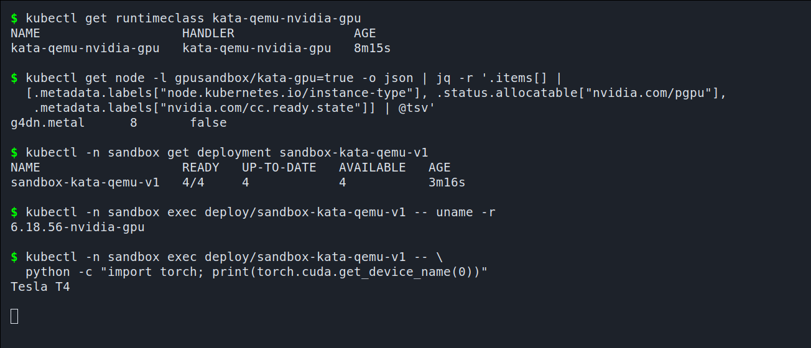

# 03 샌드박스에서 GPU를 쓰는 방법 { #03-gpu까지-격리하려면 }

두 숫자 목록 `[-3, 2]`와 `[1, 1]`에서 같은 자리에 있는 수끼리 더하고, 음수는 0으로 바꾸는 문제를 생각해 봅시다. 기대하는 답은 `[0, 3]`입니다. CPU에서도 정답을 계산할 수 있습니다. 그런데 과제가 **GPU에서 이 계산을 더 빨리 끝내는 코드를 만드는 것**이라면, 샌드박스 안에서도 GPU로 코드를 실행해야 합니다.

## 같은 GPU에서 두 코드의 실행 시간을 측정합니다 { #gpu-커널과-드라이버 }

GPU가 실행하는 계산 코드를 **GPU 커널**이라고 합니다. 2편에서 본 **운영체제 커널**은 파일과 장치에 대한 요청을 처리합니다. 여기서 모델에게 작성해 달라는 것은 두 목록을 더하는 GPU 커널입니다.

예를 들어 같은 A10G GPU에 같은 입력을 주었을 때 기존 코드가 4밀리초(ms), 모델이 만든 코드가 2밀리초 걸렸다고 해 봅시다. 두 코드의 답이 모두 맞다면 새 코드는 이 조건에서 **2배** 빠릅니다(4 ÷ 2). 이 숫자는 계산 방법을 보여 주는 예입니다. 다른 GPU에서 쓸 코드라면 그 GPU에서 두 코드의 실행 시간을 다시 측정합니다.

## 샌드박스에서 GPU까지 어떻게 연결할까요? { #gpu-요청을-전달하는-경로 }

앞에서 본 덧셈 코드를 어느 샌드박스에서 실행해도 계산은 실제 GPU가 합니다. 두 방식을 구분하려면 **GPU를 제어하는 소프트웨어인 NVIDIA 드라이버**가 어디에 있는지 보세요. 두 그림에서 파란 테두리는 샌드박스의 경계입니다.

**gVisor에서는 샌드박스 밖에 있는 드라이버에 GPU 요청을 보냅니다.** 코드가 파일을 열거나 GPU를 쓰려고 하면 gVisor에서 커널 역할을 하는 **Sentry**가 먼저 요청을 받습니다. GPU 요청은 Sentry의 `nvproxy`가 검사합니다. 허용된 요청만 GPU가 장착된 서버(노드)의 NVIDIA 드라이버로 넘어갑니다.

??? question "nvproxy가 뭔가요?"
    `nvproxy`는 샌드박스 안의 프로그램이 노드의 NVIDIA 드라이버에 보내는 요청을 검사하는 gVisor 기능입니다. 예를 들어 두 목록을 더할 때 프로그램은 입력값을 담을 GPU 메모리를 요청합니다. 이때 `nvproxy`는 해당 드라이버 버전의 허용 목록에 있는 명령만 전달합니다. 덧셈은 GPU가 합니다.

    - [gVisor 공식 문서에서 nvproxy가 지원하는 GPU 요청 살펴보기](https://gvisor.dev/docs/user_guide/gpu/#ioctls)
    - [실습에서 노드의 NVIDIA 드라이버 호환성 확인하기](../handson/common/02_runtimes/gvisor.md#nvproxy의-드라이버-버전-매칭)

**Kata + QEMU에서는 샌드박스 안의 드라이버가 GPU를 직접 제어합니다.** Kata는 QEMU로 가상 머신(VM)을 띄우고 물리 GPU 한 장을 그 VM에 직접 연결합니다. 이 방식을 **GPU 패스스루(passthrough)**라고 합니다. 코드가 파일을 열 때는 VM의 Linux 커널이 요청을 받고, GPU에 덧셈을 맡길 때는 같은 VM 안의 NVIDIA 드라이버가 GPU를 제어합니다.

??? question "Kata에서는 QEMU만 쓸 수 있나요? Cloud Hypervisor는 어떻게 다른가요?"
    Kata는 **Cloud Hypervisor**로도 VM을 띄웁니다. 둘 다 VM을 실행하고 그 안에서 쓸 장치를 연결하는 일을 맡습니다.

    - **QEMU**는 여러 종류의 컴퓨터와 주변 장치를 재현합니다. VM에 디스크를 연결할 때도 예전 PC의 디스크 장치를 흉내 내거나 가상 머신용 디스크를 선택할 수 있습니다. [QEMU가 지원하는 장치](https://www.qemu.org/docs/master/system/introduction.html#feature-overview)
    - **Cloud Hypervisor**는 클라우드에서 서버를 실행하는 데 초점을 맞췄습니다. 디스크와 네트워크에는 가상 머신용으로 설계된 장치(`virtio`)를 주로 사용합니다. [Cloud Hypervisor의 설계 목표와 주요 기능](https://github.com/cloud-hypervisor/cloud-hypervisor/blob/v55.0/README.md)

    CPU 실습에서는 `c8i` 한 대에서 두 방식 모두로 샌드박스를 실행했습니다. [CPU에서 두 방식 비교하기](../handson/common/02_runtimes/kata.md#cpu-run)

    Cloud Hypervisor 자체도 물리 GPU를 VM에 직접 연결하는 기능이 있습니다. 이 실습에서 쓰는 **Kata 4.3.1**이 NVIDIA GPU용으로 지원하는 조합은 **Kata + QEMU**입니다. 이 조합으로 T4에서 CUDA 연산을 확인했습니다. [Kata 4.3.1 공식 지원표](https://github.com/kata-containers/kata-containers/blob/4.3.1/docs/hypervisors.md#types) / [Cloud Hypervisor의 GPU 연결 실험](../handson/common/02_runtimes/kata.md#clh-gpu)

### 어떤 방식을 고르면 좋을까요? { #choosing-a-gpu-runtime }

**일반 EC2 GPU 인스턴스로 시작하려면 gVisor가 간단합니다.** 이 실습에서는 샌드박스마다 VM을 띄울 필요 없이 `g5.xlarge`의 A10G를 사용합니다. 먼저 `nvproxy`가 노드의 NVIDIA 드라이버 버전과 코드에 필요한 GPU 기능을 지원하는지 확인하세요. [gVisor에서 GPU 확인하기](../handson/common/02_runtimes/gvisor.md)

**샌드박스마다 독립된 Linux 커널이 필요하다면 Kata + QEMU가 적합합니다.** GPU 패스스루를 지원하는 장비가 필요해 이 실습에서는 `g4dn.metal`의 T4 한 장을 VM에 할당합니다. 새 샌드박스를 만들 때는 VM 부팅 시간과 VM이 쓸 메모리도 고려해야 합니다. [Kata VM에 GPU 연결하기](../handson/common/02_runtimes/kata.md#kata-gpu)

## 샌드박스에서 GPU가 보이는지 확인하기 { #gpu-한-장에-답-하나를-보내면 }

아래는 Kata VM에서 확인한 화면입니다. 마지막 명령은 PyTorch에 첫 번째 GPU의 이름을 묻습니다. `Tesla T4`가 출력됐으므로 **VM 안에서도 배정된 GPU가 보입니다.** 그 GPU에서 실제 코드가 올바르게 실행되는지는 시험용 답안을 보내 확인합니다. [GPU 샌드박스의 실행 결과](../handson/common/03_pools/details.md#gpu-verdicts)

??? note "GPU를 요청했는데 작업이 시작되지 않는다면"
    먼저 비어 있는 GPU가 있는지 확인하세요. 기본 `g5.xlarge`에는 A10G가 한 장입니다. 이미 다른 샌드박스가 쓰고 있다면 다음 샌드박스는 기다립니다. 실행은 시작됐는데 첫 연산에서 실패한다면 gVisor는 노드 드라이버의 지원 버전을, Kata는 VM에 장치가 배정됐는지와 VM 안의 드라이버를 확인합니다.

??? note "코드 한 번의 실행 시간과 여러 요청의 처리량"
    실행 시간은 한 답안의 코드가 얼마나 빨리 계산하는지 알려 줍니다. **처리량**은 샌드박스 여러 개가 함께 초당 몇 건의 채점을 끝내는지 나타냅니다. 이 실습의 gVisor 구성은 A10G 두 장으로 초당 0.198건, Kata + QEMU 구성은 T4 네 장으로 초당 0.349건을 처리했습니다. GPU 종류와 동시에 일한 샌드박스 수가 달라 이 값만으로 코드나 런타임의 속도를 비교하기는 어렵습니다. [벤치마크 조건과 결과](../handson/benchmarks/index.md#runtime-results)

다음 편에서는 두 코드가 모두 정답이더라도 학습 프로그램이 왜 서로 다른 점수를 주는지 살펴봅니다. [04 강화학습과 샌드박스](04_rl_and_sandbox.md)
