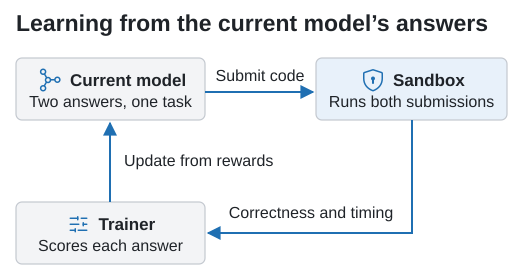

# 04 Reinforcement learning and sandboxes

Suppose a model writes three implementations of array addition. One gives a wrong answer. Two give the right answer, but one runs faster. The sandbox runs each submission so the trainer can distinguish those outcomes.

## From verdict to reward

A **verdict** is an evaluation result such as correct or incorrect. A **reward** is the number used for learning. An illustrative scheme gives `0` to the wrong answer, `1` to the slower correct answer, and `2` to the faster one. The repository's scoring also accounts for the answer format.

**GRPO** compares answers to the same problem as a **group**. In this example the fast correct answer scores above the group average, so the update encourages the model to produce answers like it more often.

## Generate, score, update

The current model generates answers. The sandbox evaluates them and the trainer computes rewards. The trainer updates the model, and that updated model generates the next answers. Using data generated by the current model is called **on-policy** training.

Comparing answers within a group requires a common scoring standard. The trainer pins a sandbox version for each batch. Failures that prevent grading are recorded separately as `sandbox_error`. See [On-policy RL with sandboxes](../concepts/03_onpolicy_rl_with_sandboxes.md) for the details.

## How scoring shapes behavior

A program that skips a calculation may look fastest if the grader checks only the time. Exploiting gaps in the scoring rules to earn a higher reward is called **reward hacking**. Here, the grader checks outputs on changing inputs and awards performance credit to correct code. See [reward integrity](../production/04_reward_integrity.md) for the measurement rules.

In [chapter 05](05_hands_on.md), you can check the scoring part locally.
