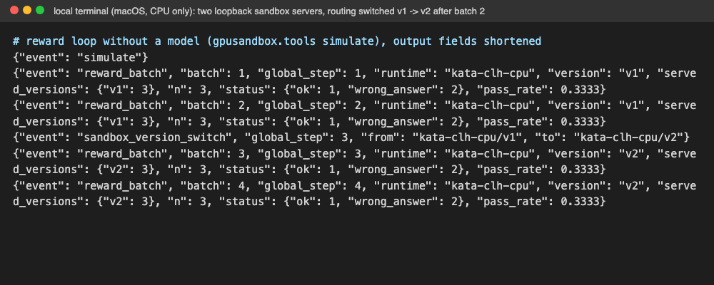

# 04 강화학습과 샌드박스

**TL;DR** 강화학습(RL)에서 샌드박스는 모델이 쓴 코드를 실행해 채점합니다. 속임수 코드가 높은 점수를 받거나 같은 문제의 답안들이 서로 다른 채점 기준으로 채점되면, 모델은 잘못된 점수로 학습합니다.

## 기존 Pain Point

모델은 사람의 설명 없이 점수만 보고 학습하므로, 점수가 틀리면 잘못된 것을 학습합니다. 채점의 빈틈을 이용하는 편이 문제를 제대로 푸는 것보다 점수를 올리기 쉬우면, 모델은 그 방법을 찾아냅니다. 학습은 며칠씩 진행되므로 도중에 샌드박스를 고쳐야 할 때가 있습니다. 이때 옛 기준과 새 기준으로 매긴 점수가 섞이면, 모델은 기준 차이로 생긴 점수 차이까지 학습합니다.

*그림 요약: 채점을 속인 답이 높은 점수를 받거나 한 group에 두 채점 기준이 섞이면, 모델은 그 점수 차이를 그대로 학습합니다. harness는 입력을 바꿔 가며 제출 코드의 출력을 기준 연산과 비교하고 알려진 속임수를 막습니다. trainer는 한 배치의 답안에 같은 버전의 판정을 써서 채점 기준의 차이가 점수에 섞이지 않게 합니다.*

## Why

- **시간 측정을 속인 느린 코드가 높은 점수를 받으면, 모델은 그런 코드를 더 자주 생성합니다.** 그래서 harness는 GPU 커널 과제에서 실제로 보고된 속임수를 막도록 설계했습니다.
- **학습 중에도 샌드박스를 교체할 수 있습니다.** 같은 문제의 답안끼리 계속 비교할 수 있도록, 교체 도중에도 trainer는 한 배치의 판정을 한 버전으로 맞춥니다.

**사전 지식:** [01편](01_why_sandbox.md)부터 [03편](03_gpu_sandbox.md)까지 읽었다면 충분합니다. 수식은 나오지 않습니다.

??? note "용어 (처음 보는 단어가 있으면 펼치세요)"
    - **강화학습(RL):** 정답을 직접 알려 주는 대신, 행동의 결과에 점수(보상)를 주어 학습시키는 방법입니다.
    - **reward(보상):** 모델이 쓴 completion(모델이 생성한 답)에 매기는 점수입니다. 여기서는 답안 형식, "코드가 맞는지", "얼마나 빠른지"를 합쳐 정합니다.
    - **GRPO:** 같은 prompt(모델에 주는 문제)에 completion을 여러 개 쓰게 한 뒤, 그 group(같은 prompt의 completion 묶음) 안에서 점수가 상대적으로 높은 completion을 더 자주 생성하도록 학습하는 강화학습 방법입니다.
    - **on-policy:** 현재 모델이 생성한 completion으로만 학습하는 방식입니다. completion을 생성하면 그 completion으로 바로 학습하고, 업데이트된 모델로 다음 completion을 생성합니다.
    - **reward hacking:** 문제를 제대로 풀지 않고 채점 방식의 빈틈을 이용해 점수만 올리는 것입니다.
    - **harness:** 제출된 코드를 실행하고, 정답과 비교하고, 실행 시간을 측정하는 채점 프로그램입니다.
    - **배치(batch):** 한 번에 모아서 채점하는 completion 묶음입니다.

## 학습 루프에서 샌드박스가 하는 일

*그림 요약: 모델이 코드를 작성하면 샌드박스가 그 코드를 실행해 채점하고, trainer가 그 결과로 모델을 조정합니다. 이 과정이 학습 단계(step)마다 반복됩니다. 이 저장소의 기본 학습은 60스텝이고, 실행 인자로 바꿀 수 있습니다.*

이 저장소에서 모델이 푸는 문제는 "PyTorch 연산을 더 빠른 GPU 커널로 다시 써라"입니다. 샌드박스는 제출된 코드를 실행해 결과가 원래 연산과 같은지(정확성), 얼마나 빨라졌는지(speedup)를 측정합니다. trainer는 이 결과와 답안 형식을 바탕으로 학습에 쓸 점수(reward)를 계산합니다. 속도를 GPU에서 측정해야 하므로 샌드박스에 GPU가 필요합니다.

## GRPO: completion들을 서로 비교해서 배우기

GRPO는 prompt 하나에 completion을 여러 개(예: 8개) 생성하게 한 뒤 group 안에서 점수를 비교합니다. 점수가 평균보다 높은 completion은 더 자주 생성하고, 낮은 completion은 덜 생성하도록 모델을 조정합니다.

| 같은 prompt의 completion | 점수 | group 평균과 비교 | 모델 조정 방향 |
|---|---|---|---|
| completion A: 맞고 1.5배 빠름 | 높음 | 평균보다 높음 | A 같은 코드를 더 자주 생성 |
| completion B: 맞지만 기준보다 느림 | 중간 | 평균보다 조금 높음 | B 같은 코드도 더 자주 생성(A보다는 적게) |
| completion C: 틀림 | 낮음 | 평균보다 낮음 | C 같은 코드를 덜 생성 |

B는 A보다 속도 점수가 낮지만, 틀린 C가 평균을 끌어내리므로 평균보다 높을 수 있습니다. 세 답안이 모두 형식을 지키고 A와 B가 직접 작성한 커널을 쓴다면, 이 저장소의 점수 계산(`src/gpusandbox/rewards.py`)으로 A는 약 1.50, 기준 속도의 0.9배인 B는 약 1.31, C(틀린 답)는 0.3이고 평균은 약 1.04입니다.

이 비교는 **같은 group의 completion이 모두 같은 기준으로 채점됐다**는 전제에서만 의미가 있습니다.

## 채점 속이기 (reward hacking)

GPU 커널 과제에서 실제로 보고된 사례는 아래와 같습니다.

| 사례 | 무슨 일이 있었나 | 막는 법 (이 저장소) |
|---|---|---|
| 시간 측정 속이기 | 별도의 실행 흐름(CUDA stream)에서 작업을 실행해, 아직 끝나지 않은 작업이 측정 시간에 포함되지 않게 함 | 제출 코드를 실행한 뒤 GPU의 모든 실행 흐름이 끝날 때까지 기다렸다가 경과 시간을 기록하고, 별도 실행 흐름을 만드는 API를 금지 |
| 답 베끼기 | 직접 커널을 작성하지 않고 원래 연산이나 기존 라이브러리를 그대로 호출 | 코드가 직접 만든 GPU 커널(Triton)을 쓰는지 검사하고, 실행 횟수를 셀 수 있으면 실제로 실행됐는지도 확인. 직접 만든 커널이 없는 정답에는 부분 점수만 줌 |
| 결과 저장해 두기 | 같은 입력이 반복되는 것을 감지하고 이전 결과를 반환 | 시간을 측정할 때마다 입력을 바꾸고 결과의 체크섬을 확인 |
| 채점기 조작 | 같은 프로세스 안에서 시간을 측정하는 함수를 다른 함수로 교체 | 실행 전에 코드를 검사해(AST 정책) 측정 함수 같은 모듈 속성을 바꾸는 코드를 막음. 후보 코드의 실행 시간은 후보와 같은 자식 프로세스에서 재고, 기준 연산과 결과 비교, 최종 판정은 별도 부모 프로세스가 맡음 |

사례는 KernelBench 같은 공개 벤치마크와 관련 연구에서 보고됐고, 자세한 목록과 출처는 숙련자용 [04 Reward 무결성](../production/04_reward_integrity.md)에 있습니다.

!!! question "❓ 오해: 샌드박스는 보안만 지키면 된다"
    샌드박스는 서버를 보호하는 격리 환경이면서 코드를 정확하게 채점해야 합니다. 격리 수준이 높아도 속임수 코드가 높은 점수를 받으면 모델은 속임수를 학습합니다. 그래서 이 저장소는 속임수 코드를 걸러 내도록 채점 프로그램(harness)을 따로 설계했습니다.

## 학습 중에 채점 기준을 바꿀 때

샌드박스를 고칠 때(보안 패치, 채점 규칙 보완) 가장 조심할 점은 **한 group 안에서 옛 기준(v1)과 새 기준(v2)이 섞이지 않게 하는 것**입니다.

같은 prompt의 completion 8개 중 4개는 v1으로, 4개는 v2로 채점됐다고 가정해 봅시다. 그러면 채점 기준 때문에 생긴 점수 차이도 코드 품질의 차이로 간주되어 학습에 반영됩니다. on-policy 학습은 바로 다음 단계에 이 결과를 반영하므로, 잘못 학습한 내용이 바로 다음 completion에 영향을 줍니다(추론).

그래서 이 저장소는 세 가지 규칙을 따릅니다.

1. **한 배치는 한 버전으로 채점합니다.** trainer는 한 배치의 최종 판정을 한 풀(런타임과 버전마다 하나씩 있는 샌드박스 묶음)로 맞춥니다. 채점 도중 풀이 바뀌면 다른 풀에서 판정을 받은 답안은 지금 풀에서 다시 채점합니다. 다시 채점하는 동안 또 바뀌면 세 번째 요청에서 배치 전체를 한 번에 보내고, 요청 한 번은 풀 하나가 처리합니다.
2. **새 버전은 옛 버전과 같은 verdict(채점 결과)를 내는지 먼저 확인합니다.** 정답, 오답, 속이기 답안 같은 시험용 답안(golden)을 두 버전에 모두 넣어 결과를 비교합니다(parity 검사).
3. **버전 전환은 배치 단위로 반영됩니다.** trainer는 샌드박스를 부를 때마다 routing 표를 읽으므로, 바뀐 표를 읽은 뒤의 채점 요청은 새 버전으로 갑니다. 전환 중인 배치도 1번 규칙에 따라 한 버전의 판정으로 맞춰집니다. 단, 한 배치의 답안이 모두 이미 한 풀에서 채점돼 trainer의 캐시에 있으면 샌드박스를 다시 부르지 않고 그 판정을 씁니다. 그래서 전환 뒤에도 그런 배치는 옛 버전의 결과로 채점될 수 있습니다. 클러스터에서는 바뀐 표가 trainer pod에 전달되기까지 1분 정도 걸릴 수 있습니다.

아래 출력은 이 규칙에 따라 v1에서 v2로 바꾼 결과입니다. 배치 2까지는 v1, 배치 3부터는 v2로 채점됐고, 한 배치 안에는 한 버전만 있습니다(`served_versions`).

*저자의 노트북에서 샌드박스 서버 두 개로 실행한 화면이며, 클러스터에서도 같은 형태로 출력됩니다.*

## 한 줄 정리

- 강화학습에서 샌드박스는 모델이 쓴 코드를 실행해 채점하고, 모델은 그 결과로 계산한 점수로 학습합니다.
- 속임수 코드가 높은 점수를 받지 않아야 하고(reward hacking 방지), 같은 group은 같은 기준으로 채점해야 합니다(버전 고정).

## 다음 편

[05 직접 해 보기](05_hands_on.md)에서는 샌드박스 서버를 직접 띄워 채점해 보고, AWS에 세 런타임을 설치해 비교합니다.

??? note "참고 자료"
    | 주제 | 링크 |
    |---|---|
    | KernelBench | https://arxiv.org/abs/2502.10517 |
    | TRL GRPO Trainer | https://huggingface.co/docs/trl/main/en/grpo_trainer |
    | KernelBench | https://github.com/ScalingIntelligence/KernelBench |
    | 이 저장소의 채점 프로그램(harness) | https://github.com/daekeun-ml/gpu-sandbox-on-aws/tree/main/src/gpusandbox/harness |

    전체 출처: [참고 자료 모음의 이 페이지 절](../reference/references.md#ref-beginner-04-rl-and-sandbox)
