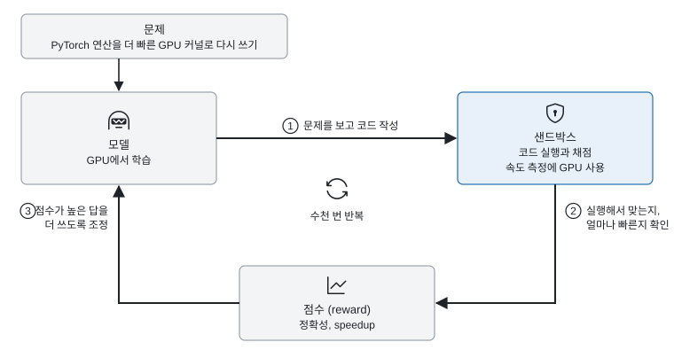

# 04 강화학습과 샌드박스

모델에 배열을 더하는 코드를 세 가지로 작성하게 했다고 해 봅시다. 하나는 틀렸고, 두 개는 정답이지만 속도가 다릅니다. 샌드박스에서 실행하면 어느 답이 맞는지와 어느 정답이 더 빠른지 구분할 수 있습니다.

## 판정에서 reward로

채점기가 돌려주는 **verdict**는 정답이나 오답 같은 판정입니다. **Reward**는 학습에 쓰는 숫자입니다. 예를 들어 오답에 `0`, 느린 정답에 `1`, 빠른 정답에 `2`를 줄 수 있습니다. 실제 GPU 실습에서는 형식과 정확성, 성능을 반영해 reward를 계산합니다.

**GRPO**는 같은 문제에서 나온 답들을 한 묶음(group)으로 비교합니다. 위 예시에서는 세 번째 답이 같은 묶음의 평균보다 높은 점수를 받았으므로, 학습은 그런 답을 더 자주 생성하는 방향으로 모델을 업데이트합니다.

## 생성, 채점, 업데이트

1. 현재 모델이 같은 문제에 여러 답을 냅니다.
2. 샌드박스에서 답을 실행하고 학습 프로그램이 판정을 reward로 바꿉니다.
3. 학습 프로그램이 그 점수로 모델을 업데이트합니다. 다음 답은 업데이트된 모델이 생성합니다.

이처럼 현재 모델이 방금 생성한 답으로 학습하는 방식을 **on-policy**라고 부릅니다. 답끼리 점수를 비교할 때는 채점 기준과 버전도 같아야 합니다. 샌드박스 장애로 답을 실행하지 못한 경우는 `sandbox_error`로 따로 기록합니다. 버전 고정과 장애 처리 방식은 [On-policy RL과 샌드박스](../concepts/03_onpolicy_rl_with_sandboxes.md)에 있습니다.

## 채점 기준이 모델 행동에 미치는 영향

속도만 점수에 반영하면 계산을 건너뛴 코드가 유리해질 수 있습니다. 모델이 문제를 풀기보다 채점 기준의 빈틈을 이용해 점수를 높이는 현상을 **reward hacking**이라고 합니다. 이 저장소는 입력을 바꿔 출력이 맞는지 확인하고, 정확성 검사를 통과한 코드에 성능 점수를 부여합니다. 자세한 기준은 [reward 무결성](../production/04_reward_integrity.md)에 있습니다.

[다음 편](05_hands_on.md)에서는 준비된 답안으로 채점 부분을 확인합니다.
