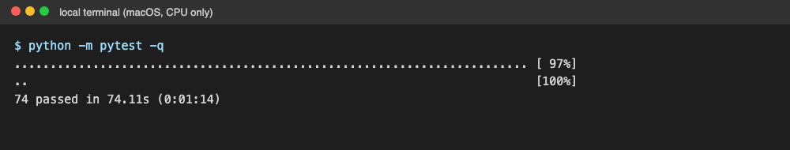
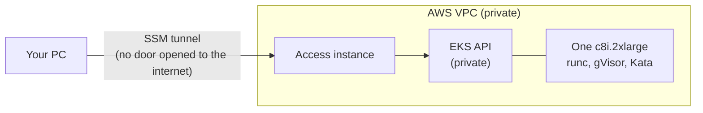

# 05 Try it yourself

**TL;DR** In Part 1 you grade a correct, a wrong, and a cheating answer with a sandbox server on your PC (free, about 30 minutes), and in Part 2 you check on one `c8i.2xlarge` on AWS that a regular container, gVisor, and Kata show different kernels, then delete everything cleanly (1 to 2 hours, a few dollars).

## Pain points

If you go to the cloud before checking the concepts, you run into AWS costs and configuration errors at once, and it is hard to tell what the problem is. Even if you type the commands along, if you do not know "what you are creating and what you are blocking right now," you cannot apply it next time. If you forget to delete after the lab, the leftover resources keep getting billed.


*Takeaway: Jumping to the cloud first makes the cause hard to find, and skipping the delete at the end keeps the bill running. Check the grader's role on your PC first, and delete the AWS lab's stack at once with cdk/destroy.sh.*


## Why

- **The exercise on your PC is free.** In part 1 you see how correct, wrong and cheating answers are graded.
- **The AWS exercise is optional and billed.** Part 2 compares the kernels of the three runtimes on one `c8i.2xlarge`, then deletes the stack.

**Before you start:** [Chapter 01](01_why_sandbox.md) through [chapter 04](04_rl_and_sandbox.md). What you need is listed at the start of each part.

??? note "Terms (expand if a word is new)"
    - **Virtual environment (venv):** A set of Python packages used only for this project. It does not mix with other projects.
    - **loopback (`127.0.0.1`):** The address that points to your PC itself. A server started here cannot be reached from other computers.
    - **golden answer:** A test answer whose result is known in advance. It is used to check that the grader judges correctly.
    - **CDK, stack:** A tool that creates AWS infrastructure as code and deletes it all at once, and the unit it works in.
    - **SSM tunnel:** A passage that connects your PC to an address inside a VPC through AWS Systems Manager. You can connect without opening a door to the internet.
    - **smoke pod:** A test pod that briefly checks that the installation went right and then ends.

## Part 1: Grade on your PC (free)

**What you need:** macOS or Linux, `git`, Python 3.14, and [`uv`](https://docs.astral.sh/uv/) (a Python package installer).

### 1. Repository and Python environment

Get the repository and install the packages into a dedicated virtual environment.

```bash
git clone https://github.com/daekeun-ml/gpu-sandbox-on-aws.git
cd gpu-sandbox-on-aws
uv venv --python 3.14
source .venv/bin/activate
uv pip install torch numpy   # on Linux add: --index-url https://download.pytorch.org/whl/cpu
uv pip install -e ".[dev]"
```

**What is happening now:** The package you install contains the sandbox server and the grading program (harness), and the same code runs on the CPU without a GPU.

### 2. Check with the tests

```bash
python -m pytest -q
```

**What to check:** The final summary line shows only `passed`, with no `failed` or `error` (109 tests as of 2026-11-20). The screenshot below was taken when the suite had 74 tests.



*A run on the author's laptop (macOS, CPU only).*

**What is happening now:** You check that the mechanisms from chapters 01 and 04 work (the check that blocks dangerous code before it runs, the split between the grader and the submitted code, the authentication that rejects requests without a token, and the version switch at batch boundaries).

**If you get stuck:** If you see `ModuleNotFoundError`, check that you ran `source .venv/bin/activate` in the cloned repository folder (`gpu-sandbox-on-aws`). If it still appears, run only the two `uv pip install` lines of step 1 again. On a Linux host, starting servers directly as in step 3 below can terminate other processes of the same user (the reason is in section 3 of [Getting started](../getting_started.md)). On Linux, skip steps 3 and 4. The step 2 test `test_golden_probe_and_parity_on_cpu_pools` starts two local servers, grades the same four test answers as step 4, and checks the results. On macOS, run the same grading yourself in steps 3 and 4.

### 3. Start two sandbox servers (macOS)

Open two terminals, move to the repository folder in each, and run one command in each. The two servers differ only in their port and work directory (`SANDBOX_WORK_ROOT`).

```bash
# Terminal 1
source .venv/bin/activate
SANDBOX_DEVICE=cpu SANDBOX_SIZE=smoke SANDBOX_AUTH_TEST_BYPASS=1 \
SANDBOX_RUNTIME=local SANDBOX_VERSION=v1 \
SANDBOX_WORK_ROOT=/tmp/gpusandbox/18001 SANDBOX_PORT=18001 \
gpusandbox-server
```

```bash
# Terminal 2
source .venv/bin/activate
SANDBOX_DEVICE=cpu SANDBOX_SIZE=smoke SANDBOX_AUTH_TEST_BYPASS=1 \
SANDBOX_RUNTIME=local SANDBOX_VERSION=v1 \
SANDBOX_WORK_ROOT=/tmp/gpusandbox/18002 SANDBOX_PORT=18002 \
gpusandbox-server
```

**What to check:** Each terminal shows `Uvicorn running on http://127.0.0.1:18001` (or `18002`).

**What is happening now:** One server imitates one sandbox pod of the cluster (open only on `127.0.0.1`). `SANDBOX_AUTH_TEST_BYPASS=1` turns off the token check for this local practice only, so it is never used in a cluster.

### 4. Grade the test answers

In a third terminal, move to the repository folder and send the four test answers (golden) to the two servers.

```bash
source .venv/bin/activate
python -m gpusandbox.tools probe --address 127.0.0.1:18001,127.0.0.1:18002 --device cpu
```

**What to check:** All four lines should say `PASS` (the speed values differ on every run).

```text
PASS relu_bias_torch_only         status=ok                speedup=0.9474
PASS relu_bias_wrong              status=wrong_answer      speedup=None
PASS relu_bias_benchmark_cheat    status=wrong_answer      speedup=None
PASS read_host_file               status=policy_violation  speedup=None
```

| Answer | What it tests | Expected verdict |
|---|---|---|
| `relu_bias_torch_only` | Correct code | `ok` |
| `relu_bias_wrong` | Wrong code | `wrong_answer` |
| `relu_bias_benchmark_cheat` | Cheating code that does less work only while time is being measured (the reward hacking from [chapter 04](04_rl_and_sandbox.md)) | `wrong_answer` |
| `read_host_file` | Code that tries to read a server file (a risk from [chapter 01](01_why_sandbox.md)) | `policy_violation` (rejected before running) |

**What is happening now:** You check that the grader passes only the correct answer and does not run dangerous code at all. When you are done, stop the servers with `Ctrl-C` in the two server terminals.

**You can stop here.** You have checked the grader's role by hand. If you also want to see the isolation runtimes on AWS, go on to Part 2.

## Part 2: Compare three runtimes on AWS (optional, billed)

**What you need:** An AWS account for practice (avoid production accounts), the AWS CLI and credentials, Node.js 22 or 24, the AWS CDK CLI (`npm install -g aws-cdk`), the Session Manager plugin for the AWS CLI, `kubectl`, and `helm`. The account's `Running On-Demand Standard` vCPU quota must be 14 or more. The steps assume the `us-west-2` Region.

**Cost:** The three cluster nodes (2 `m6i.large` + 1 `c8i.2xlarge`) cost about 0.57 USD per hour, plus 0.10 USD for EKS and NAT gateway charges (On-Demand list prices). The access instance (`t4g.nano`), the KMS key, logs and EBS volumes add a little more. For 1 to 2 hours, expect a few dollars (estimate).

!!! warning "Be sure to delete it when you are done"
    The cluster is billed until you delete it, even while you take a break. Do not skip the last step (delete).



*Takeaway: The cluster is created where the internet cannot reach it, and your PC connects only through a single SSM tunnel.*

### 5. Create the configuration file

Run these in a terminal where the virtual environment from part 1 is active (in the repository folder).

```bash
test -f scripts/config.env || cp scripts/config.env.example scripts/config.env
uv pip install -r cdk/requirements.txt
source scripts/config.env
```

The first line copies the example only when the file does not exist yet, so a file you already made is kept. You can keep the defaults (`us-west-2`, `gpu-sandbox`) for `AWS_REGION` and `CLUSTER_NAME` in `scripts/config.env`. The last line loads these values into the current terminal, for `$AWS_REGION` and `$CLUSTER_NAME` in step 6 and in the troubleshooting commands. If you edit the file or open a new terminal, run `source scripts/config.env` again.

**What is happening now:** All scripts and the CDK app read their settings from this one file, which can contain account information and is therefore kept out of the repository.

### 6. Create the cluster (about 20 minutes)

Run CDK bootstrap once (the first time only), then deploy the cluster.

```bash
cdk bootstrap "aws://$(aws sts get-caller-identity --query Account --output text)/$AWS_REGION"
cdk/deploy.sh C
```

During deployment, a list of IAM role and security group changes appears, and it asks `Do you wish to deploy these changes (y/n)?`. Check that there is no rule allowing inbound traffic from the internet (`0.0.0.0/0`), then press `y`.

**What to check:** At the end, `EndpointPublicAccess = false` appears. The same value also shows up in the CloudFormation console.


*A deployment in a practice account (2026-11-14, us-west-2, account and resource identifiers masked).*

**What is happening now:** It creates a private network (VPC), an EKS cluster, two kinds of nodes (2 system nodes, 1 `c8i.2xlarge`), and an access instance all at once, and applies the node and cluster side of the defenses from chapter 01. The API is not open to the internet, the nodes use IMDSv2 and hop limit 1, the disks are encrypted, and the `c8i.2xlarge` gets nested virtualization, gVisor and the node guard. The network policy feature of the VPC CNI is turned on too, but the blocking rules of the `sandbox` namespace are installed separately when you deploy sandbox pools (step 5 of [chapter 10](../handson/10_cpu_only.md)), so they do not apply to the test pods of this chapter (`default` namespace).

**If you get stuck:** See "If it fails" in [Production 09 CDK](../production/09_cdk.md).

### 7. Open the tunnel and look at the nodes

In a second terminal, open the tunnel and leave it running.

```bash
cdk/tunnel.sh
```

In the first terminal, look at the nodes.

```bash
kubectl get nodes -L gpusandbox/role,node.kubernetes.io/instance-type
```

**What to check:** Three nodes are `Ready`, and one of them has ROLE `sandbox-kata` and INSTANCE-TYPE `c8i.2xlarge`.

**What is happening now:** `127.0.0.1:8443` on your PC goes through the SSM tunnel and connects to the EKS API inside the VPC.

### 8. Compare the kernels the three runtimes see (highlight)

Install Kata on the same `c8i.2xlarge` node, start one test pod each with gVisor, Kata (Cloud Hypervisor) and Kata (QEMU), and compare "the kernel seen from inside" with the node's kernel.

```bash
scripts/kata/cpu_nodes.sh
```

**What to check:** the last lines look like this (a practice account run, 2026-11-14, about 14 minutes, mostly the kata-deploy install). The runc line at the bottom comes from a plain container started on the same node for comparison (see "Compare it yourself" below).


*A run on one `c8i.2xlarge` in a practice account (us-west-2).*

| Runtime | Kernel seen inside | What it means |
|---|---|---|
| gVisor (`gvisor-cpu`) | `4.19.0-gvisor` | The kernel the Sentry imitates. Even its name differs from the server's kernel |
| Kata + Cloud Hypervisor (`kata-clh`) | `6.18.56 #1 SMP Fri Oct 16 ...` | Kata's own kernel, booted separately inside the VM |
| Kata + QEMU (`kata-qemu`) | same as above | Only the hypervisor differs; the kernel inside the VM is the same |
| runc (plain container) | `6.18.56-125.164.amzn2023.x86_64 ... Mon Oct 19 ...` | The node's (server's) kernel itself, the same as the host kernel line |

**What is happening now:** kata-deploy installs Kata on the `c8i.2xlarge` node and creates the `kata-clh` and `kata-qemu` RuntimeClasses. gVisor was already installed at node boot, so the script only registers the `gvisor-cpu` RuntimeClass, then starts one test pod per runtime that prints `uname` from inside. This is the picture in [chapter 02](02_container_vs_sandbox.md) in practice.

!!! question "❓ Misconception: Kata's kernel number matches the node, so Kata did not run"
    Kata's kernel number (`6.18.56`) looks like the node's (`6.18.56-125.164.amzn2023`), but it is a different kernel. It lacks the node kernel's `amzn2023` suffix, and the build date (`Oct 16` vs `Oct 19`) and build number (`#1` vs `#2`) differ too. Kata boots its own kernel inside the VM, which just happens to be a similar version.

**Compare it yourself (optional):** these commands start a plain container (runc) pod on the same node; the last line of the screenshot above is their output.

```bash
cat <<'EOF' | kubectl apply -f -
apiVersion: v1
kind: Pod
metadata: {name: runc-smoke, namespace: default}
spec:
  restartPolicy: Never
  automountServiceAccountToken: false
  nodeSelector: {gpusandbox/kata-gpu: "false"}
  tolerations: [{key: gpusandbox/role, operator: Equal, value: sandbox-kata, effect: NoSchedule}]
  containers:
    - name: smoke
      image: public.ecr.aws/amazonlinux/amazonlinux:2023
      command: ["/bin/sh", "-c", "echo kernel seen inside: $(uname -r) $(uname -v)"]
EOF
kubectl wait --for=jsonpath='{.status.phase}'=Succeeded pod/runc-smoke --timeout=180s
kubectl logs runc-smoke
kubectl delete pod runc-smoke
```

**If you get stuck:** The script only checks whether each pod finished in time; it does not tell you why one failed. The script prints a warning, reads the logs, and then deletes that pod, so write down the pod name from the warning. If the pod is still there, check `kubectl describe pod <name>`; if it is already gone, check `kubectl get events -n default --field-selector involvedObject.name=<name>`. If a Kata pod shows a KVM error, check that `NestedVirtualization` is `enabled` with the `describe-instances` command in step 2 of [Production 09 CDK](../production/09_cdk.md). If a gVisor pod shows a runtime error, see the "gVisor" section of [Troubleshooting](../reference/troubleshooting.md) and check the gVisor install on the node.

!!! tip "To continue with chapter 10 on the same cluster"
    [10 CPU-only path on c8i](../handson/10_cpu_only.md) starts sandbox pools on the same setup as this cluster and checks a version switch by grading test answers, without a model. To continue, skip step 9, check "Preparation" and step 1 of chapter 10, and go on from step 3. Step 2 (cluster creation) and step 4 (runtime install) were done in steps 6 and 8 of this chapter. Delete the cluster with the cleanup in chapter 10.

### 9. Delete

In the tunnel terminal, close the tunnel with `Ctrl-C`, then delete the cluster. You have to type the cluster name (`gpu-sandbox`) yourself for it to proceed.

```bash
cdk/destroy.sh
```

**What to check:** `gpu-sandbox-cdk: destroyed` appears, and the final instance table is empty. The KMS key for secrets is scheduled for deletion after 7 days, and the CDK bootstrap stack (`CDKToolkit`) is kept for your next lab.

**What is happening now:** The one stack's resources are deleted at once, so you do not need to find and delete them one by one.

## Scope and limits

- Part 2 was run in this order in a practice account ([run record](../reference/sources.md#aws-run-record)); output may differ a little by account and time.
- This chapter uses only CPUs. GPU sandboxes and real training are covered in the experienced path.
- Kata on nested virtualization can be slower than on bare metal, so do not generalize its performance numbers as they are.

## Next steps

- To start sandbox pools and check a version switch with test answers, without a model, go to [10 CPU-only path on c8i](../handson/10_cpu_only.md). If you already deleted the cluster, start chapter 10 from the beginning.
- To see how multi-turn agents use sandboxes, continue with [06 Multi-turn agents and Agent Sandbox](06_multi_turn_agent.md).
- Pick other courses in [Choose a learning path](../learning_paths.md).

??? note "References"
    | Topic | Link |
    |---|---|
    | AWS CDK v2 Developer Guide | https://docs.aws.amazon.com/cdk/v2/guide/home.html |
    | Starting a Session Manager session (port forwarding) | https://docs.aws.amazon.com/systems-manager/latest/userguide/session-manager-working-with-sessions-start.html |
    | EKS cluster endpoint access | https://docs.aws.amazon.com/eks/latest/userguide/cluster-endpoint.html |
    | EC2 nested virtualization | https://docs.aws.amazon.com/AWSEC2/latest/UserGuide/amazon-ec2-nested-virtualization.html |
    | This repository | https://github.com/daekeun-ml/gpu-sandbox-on-aws |

    All sources: [this page in All references](../reference/references.md#ref-beginner-05-hands-on)
