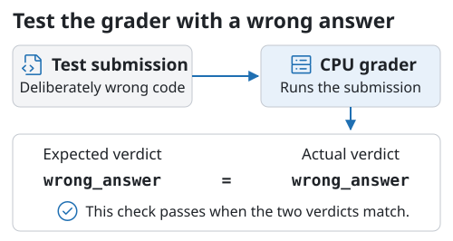
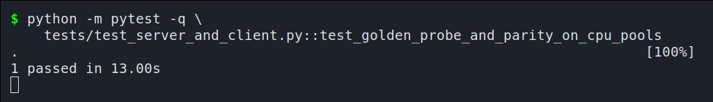
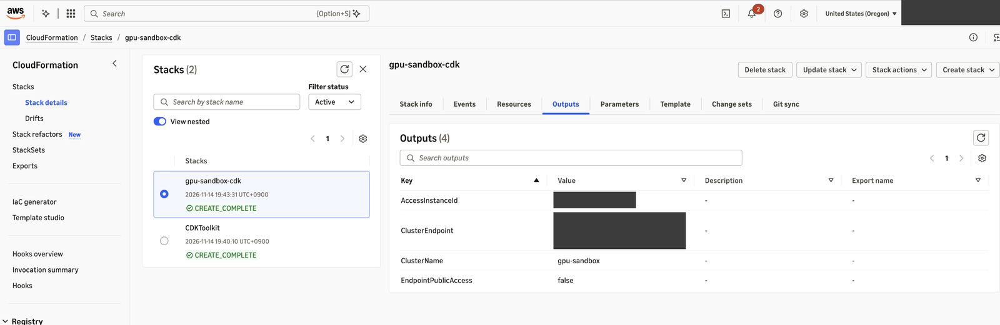
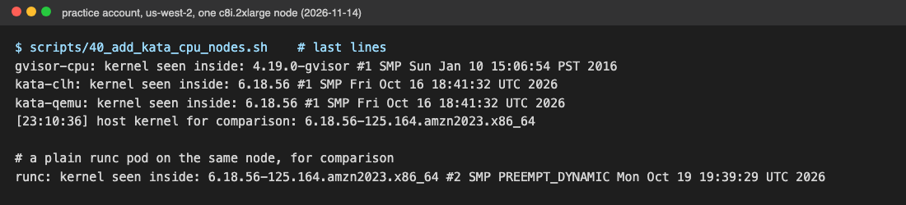

# 05 Grade locally and compare runtimes on AWS

In this exercise, two local CPU servers grade prepared submissions. The test uses `relu_bias`, a function that adds a bias to each value and clamps negative results to zero. For example, adding `[1, 1]` to `[-3, 2]` gives `[-2, 3]`, so the expected output is `[0, 3]`. No model or AWS account is needed.



The two parts answer different questions. The local test checks whether the grader recognizes a wrong answer. The optional AWS lab checks which kernel each pod sees on the same node. [Go to the AWS kernel comparison](#aws-cpu)

## 1. Install the tools

With Git and `uv` installed, clone the repository and install the grading server and test dependencies in a Python environment.

```bash
git clone https://github.com/daekeun-ml/gpu-sandbox-on-aws.git
cd gpu-sandbox-on-aws
uv venv --python 3.14
source .venv/bin/activate
uv pip install torch numpy
uv pip install -e ".[dev]"
```

On Linux, add `--index-url https://download.pytorch.org/whl/cpu` to the `uv pip install torch numpy` command to install CPU-only PyTorch.

## 2. Run the scoring test

```bash
python -m pytest -q tests/test_server_and_client.py::test_golden_probe_and_parity_on_cpu_pools
```

The test sends prepared submissions to both servers. `1 passed` means the verdicts matched expectations and agreed across servers. Run `python -m pytest -q` to run the full suite.

A **verdict** is the grader's decision on one answer. If the function above leaves negative values alone, it returns `[-2, 3]`, which differs from the expected `[0, 3]`. The grader should report `wrong_answer` for that submission.

- `ok` means the output matches the reference.
- `wrong_answer` means the output differs.
- `policy_violation` means the execution policy rejected the submission.



If Python reports `ModuleNotFoundError`, activate `.venv` in the repository root and rerun the installation commands.

??? note "Run the servers directly on macOS"
    On a Linux host, use the pytest route above. See [Getting started](../getting_started.md) for the difference when starting the server directly.

    ### Start two sandbox servers

    Open two terminals, move to the repository folder in each, and run one command in each. The two servers differ only in their port and work directory (`SANDBOX_WORK_ROOT`).

    ```bash
    # Terminal 1
    source .venv/bin/activate
    SANDBOX_DEVICE=cpu SANDBOX_SIZE=smoke SANDBOX_AUTH_TEST_BYPASS=1 \
    SANDBOX_RUNTIME=local SANDBOX_VERSION=v1 \
    SANDBOX_WORK_ROOT=/tmp/gpusandbox/18001 SANDBOX_PORT=18001 \
    gpusandbox-server
    ```

    ```bash
    # Terminal 2
    source .venv/bin/activate
    SANDBOX_DEVICE=cpu SANDBOX_SIZE=smoke SANDBOX_AUTH_TEST_BYPASS=1 \
    SANDBOX_RUNTIME=local SANDBOX_VERSION=v1 \
    SANDBOX_WORK_ROOT=/tmp/gpusandbox/18002 SANDBOX_PORT=18002 \
    gpusandbox-server
    ```

    **What to check:** Each terminal shows `Uvicorn running on http://127.0.0.1:18001` (or `18002`).

    **What is happening now:** One server imitates one sandbox pod of the cluster (open only on `127.0.0.1`). `SANDBOX_AUTH_TEST_BYPASS=1` turns off the token check for this local practice only, so it is never used in a cluster.

    ### Grade the test answers

    In a third terminal, move to the repository folder and send the four test answers (golden) to the two servers.

    ```bash
    source .venv/bin/activate
    python -m gpusandbox.tools probe --address 127.0.0.1:18001,127.0.0.1:18002 --device cpu
    ```

    **What to check:** All four lines should say `PASS` (the speed values differ on every run).

    ```text
    PASS relu_bias_torch_only         status=ok                speedup=0.9474
    PASS relu_bias_wrong              status=wrong_answer      speedup=None
    PASS relu_bias_benchmark_cheat    status=wrong_answer      speedup=None
    PASS read_host_file               status=policy_violation  speedup=None
    ```

    | Answer | What it tests | Expected verdict |
    |---|---|---|
    | `relu_bias_torch_only` | Correct code | `ok` |
    | `relu_bias_wrong` | Wrong code | `wrong_answer` |
    | `relu_bias_benchmark_cheat` | Cheating code that does less work only while time is being measured (the reward hacking from [chapter 04](04_rl_and_sandbox.md)) | `wrong_answer` |
    | `read_host_file` | Code that tries to read a server file (a risk from [chapter 01](01_why_sandbox.md)) | `policy_violation` (rejected before running) |

    **What is happening now:** You check that the grader passes only the correct answer and does not run dangerous code at all. When you are done, stop the servers with `Ctrl-C` in the two server terminals.

## 3. Compare kernels on one AWS CPU node { #aws-cpu }

The two local servers let you practice scoring. Both use your computer's operating system. In this part, gVisor, Kata with Cloud Hypervisor, and Kata with QEMU run the same container image on one EKS `c8i.2xlarge`. Predict the release that `uname -r` will report in each pod.

**Cost and prerequisites.** This part incurs charges for EKS, EC2 and the NAT gateway. Use a practice account and Region. The example creates two system nodes, one `c8i.2xlarge`, and a tunnel access instance. It needs 14 Standard On-Demand vCPUs. For AWS CLI credentials, Node.js, the CDK CLI, the Session Manager plugin, `kubectl`, Helm, Docker and `jq`, see [cluster setup](../handson/01_cluster_and_images.md). [Scenario C costs](../handson/10_cpu_only.md)

### Configure and create the cluster

Start in the repository and Python environment from the local exercise. The first command keeps an existing configuration file.

```bash
test -f scripts/config.env || cp scripts/config.env.example scripts/config.env
uv pip install -r cdk/requirements.txt
```

In `scripts/config.env`, check `AWS_REGION` and `CLUSTER_NAME` for your practice account. Use `SCENARIO="C"` and `WITH_KATA_GPU="0"` for this CPU lab. In the prerequisite output, check the regional Standard quota and `nested-virtualization` support for `c8i.2xlarge`. This feature lets Kata boot a VM inside an EC2 virtual server.

```bash
source scripts/config.env
scripts/01_check_prereqs.sh
```

When you first deploy CDK in this account and Region, run the first line to bootstrap it. The second creates the cluster. Review the changes CDK lists before continuing. With the default configuration, the outputs include `EndpointPublicAccess = false`.

```bash
cdk bootstrap "aws://$(aws sts get-caller-identity --query Account --output text)/$AWS_REGION"
scripts/02_create_cluster.sh --cpu-only
```



### Open the tunnel and check the nodes

In another terminal, enter the repository root and run `cdk/tunnel.sh`. Keep it open. In the first terminal run the following command. The tunnel carries local `kubectl` requests to the private EKS API inside the VPC.

```bash
kubectl get nodes -L gpusandbox/role,node.kubernetes.io/instance-type
```

Look for `Ready` nodes and a `c8i.2xlarge` with the `sandbox-kata` role. If `kubectl` cannot connect, check the tunnel terminal and `kubectl config current-context` first.

### Interpret the three runtime outputs

```bash
scripts/kata/cpu_nodes.sh
```

The script installs Kata on the CPU node and starts a short-lived test pod with each of `gvisor-cpu`, `kata-clh`, and `kata-qemu`. Compare each pod's kernel line with the node kernel printed at the end. The runc line in the screenshot comes from the separate, optional comparison below.



| Output | What it demonstrates |
|---|---|
| `4.19.0-gvisor` from `gvisor-cpu` | Sentry reports this kernel release to programs in the pod. |
| The `6.18.56` guest build from both `kata-clh` and `kata-qemu` | Two different hypervisors booted the same guest kernel image. |
| `6.18.56-125.164.amzn2023…` from `host kernel` | The final line identifies the EC2 node kernel. Compare the build string as well as the release number. |

??? example "Compare with an ordinary runc container on the same node"
    This pod omits `runtimeClassName` and uses the default runtime. Compare `kubectl logs` with the `host kernel` line above.

    ```bash
    cat <<'EOF' | kubectl apply -f -
    apiVersion: v1
    kind: Pod
    metadata: {name: runc-smoke, namespace: default}
    spec:
      restartPolicy: Never
      automountServiceAccountToken: false
      nodeSelector: {gpusandbox/kata-gpu: "false"}
      tolerations: [{key: gpusandbox/role, operator: Equal, value: sandbox-kata, effect: NoSchedule}]
      containers:
        - name: smoke
          image: public.ecr.aws/amazonlinux/amazonlinux:2023
          command: ["/bin/sh", "-c", "echo kernel seen inside: $(uname -r) $(uname -v)"]
    EOF
    kubectl wait --for=jsonpath='{.status.phase}'=Succeeded pod/runc-smoke --timeout=180s
    kubectl logs runc-smoke
    kubectl delete pod runc-smoke
    ```

### Clean up the lab resources

You can continue on this cluster by [deploying the CPU pools and switching versions](../handson/10_cpu_only.md). To finish here, keep the tunnel open and run the command below. Check the account, Region and cluster name before confirming deletion.

```bash
scripts/08_cleanup.sh
```

Once the stack is deleted and the final instance query shows no lab nodes, close the tunnel. [Cleanup checks](../handson/99_cleanup.md) · [Follow an episode in the next chapter](06_multi_turn_agent.md)
