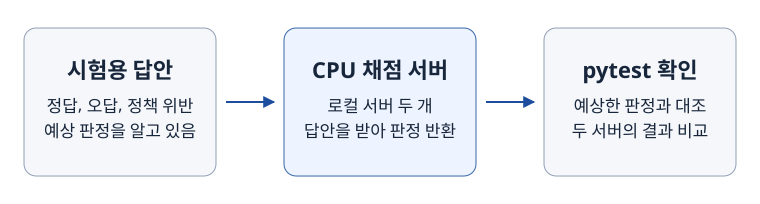

# 05 직접 해 보기

내 PC에서 작은 계산 과제의 답안을 채점합니다. 이 테스트는 `relu_bias`를 사용합니다. 입력에 보정값을 더하고 음수인 결과를 0으로 바꾸는 과제입니다. 예를 들어 입력 `[-3, 2]`에 `[1, 1]`을 더하면 `[-2, 3]`이므로 기대 출력은 `[0, 3]`입니다. 테스트는 준비된 답안을 두 로컬 서버에 보냅니다. 모델 학습과 AWS 배포 없이 정답, 오답, 정책 위반이 각각 예상한 판정을 받는지 확인할 수 있습니다.



## 1. 설치하기

Git과 `uv`가 필요합니다. 아래 명령은 저장소를 받고 전용 Python 환경에 채점 서버와 테스트를 설치합니다.

```bash
git clone https://github.com/daekeun-ml/gpu-sandbox-on-aws.git
cd gpu-sandbox-on-aws
uv venv --python 3.14
source .venv/bin/activate
uv pip install torch numpy
uv pip install -e ".[dev]"
```

Linux에서 CPU용 PyTorch만 설치하려면 `uv pip install torch numpy`에 `--index-url https://download.pytorch.org/whl/cpu`를 붙이세요.

## 2. 시험용 답을 채점하기

```bash
python -m pytest -q tests/test_server_and_client.py::test_golden_probe_and_parity_on_cpu_pools
```

테스트는 채점 서버에 시험용 답을 보내고 예상한 판정이 돌아오는지 확인합니다. 마지막에 `1 passed`가 나오면 두 로컬 서버의 채점 결과가 예상과 일치한 것입니다. 전체 테스트를 보려면 `python -m pytest -q`를 실행하세요.

여기서 **verdict**는 채점기가 답 하나에 내린 판정입니다. 예를 들어 틀린 답에 `wrong_answer`가 나오면 채점기가 예상대로 동작한 것입니다.

- `ok`는 실행 결과가 예상한 답과 일치할 때 나옵니다.
- 실행 결과가 틀리면 `wrong_answer`가 나옵니다.
- `policy_violation`은 실행 정책 검사에서 제출을 거절했다는 뜻입니다.

`ModuleNotFoundError`가 나오면 저장소 루트에서 `.venv`를 활성화했는지 확인하고 설치 명령을 다시 실행하세요.

??? note "macOS에서 서버를 직접 띄워 판정 보기"
    Linux 호스트에서는 위의 pytest 경로를 사용하세요. 서버를 직접 띄울 때의 차이는 [로컬 실행 환경](../getting_started.md)에 설명돼 있습니다.

    ### 서버 두 개 띄우기

    터미널 두 개를 열고, 각각 저장소 폴더로 이동한 뒤 실행합니다. 두 서버는 포트와 작업 디렉터리(`SANDBOX_WORK_ROOT`)만 다릅니다.

    ```bash
    # Terminal 1
    source .venv/bin/activate
    SANDBOX_DEVICE=cpu SANDBOX_SIZE=smoke SANDBOX_AUTH_TEST_BYPASS=1 \
    SANDBOX_RUNTIME=local SANDBOX_VERSION=v1 \
    SANDBOX_WORK_ROOT=/tmp/gpusandbox/18001 SANDBOX_PORT=18001 \
    gpusandbox-server
    ```

    ```bash
    # Terminal 2
    source .venv/bin/activate
    SANDBOX_DEVICE=cpu SANDBOX_SIZE=smoke SANDBOX_AUTH_TEST_BYPASS=1 \
    SANDBOX_RUNTIME=local SANDBOX_VERSION=v1 \
    SANDBOX_WORK_ROOT=/tmp/gpusandbox/18002 SANDBOX_PORT=18002 \
    gpusandbox-server
    ```

    **확인할 것:** 각 터미널에 `Uvicorn running on http://127.0.0.1:18001`(또는 `18002`)이 나옵니다.

    **지금 일어나는 일:** 서버 하나가 클러스터의 샌드박스 pod 하나 역할을 합니다(`127.0.0.1`에서만 접속 가능). `SANDBOX_AUTH_TEST_BYPASS=1`은 로컬 연습용으로 토큰 검사를 끄는 설정이므로 클러스터에서는 쓰면 안 됩니다.

    ### 시험용 답안 채점하기

    세 번째 터미널에서 저장소 폴더로 이동한 뒤, 시험용 답안(golden) 네 개를 두 서버에 보냅니다.

    ```bash
    source .venv/bin/activate
    python -m gpusandbox.tools probe --address 127.0.0.1:18001,127.0.0.1:18002 --device cpu
    ```

    **확인할 것:** 네 줄이 모두 `PASS`면 됩니다. 거절해야 할 답을 제대로 거절해도 `PASS`입니다. 속도 값은 실행마다 다릅니다.

    ```text
    PASS relu_bias_torch_only         status=ok                speedup=0.9474
    PASS relu_bias_wrong              status=wrong_answer      speedup=None
    PASS relu_bias_benchmark_cheat    status=wrong_answer      speedup=None
    PASS read_host_file               status=policy_violation  speedup=None
    ```

    | 답안 | 확인하는 내용 | 기대 verdict(채점 결과) |
    |---|---|---|
    | `relu_bias_torch_only` | 정답 코드 | `ok` |
    | `relu_bias_wrong` | 틀린 코드 | `wrong_answer` |
    | `relu_bias_benchmark_cheat` | 시간을 측정할 때만 계산을 제대로 하지 않는 속이기 코드 ([04편](04_rl_and_sandbox.md)의 reward hacking) | `wrong_answer` |
    | `read_host_file` | 서버 파일을 읽으려는 코드 ([01편](01_why_sandbox.md)의 위험) | `policy_violation` (실행 전에 거절) |

    **지금 일어나는 일:** 채점 프로그램이 정답만 통과시키고, 위험한 코드는 실행하지 않고 거절하는지 확인합니다. 끝나면 두 서버 터미널에서 `Ctrl-C`로 서버를 끄세요.

## 3. 다음에 해 볼 것

AWS에서 각 런타임의 커널과 채점 결과를 비교하려면 [CPU 전용 핸즈온](../handson/10_cpu_only.md)을 따라가세요. EKS와 노드는 삭제할 때까지 과금되므로 실습을 마치면 같은 가이드의 정리 단계까지 실행하세요.

채점 결과를 보고 답을 고치는 흐름이 궁금하다면 [06 multi-turn 에이전트](06_multi_turn_agent.md)로 이어집니다.
