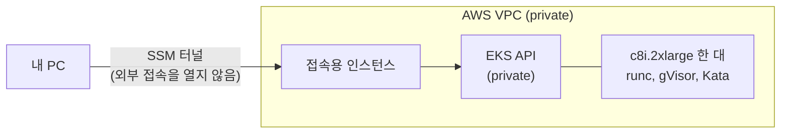
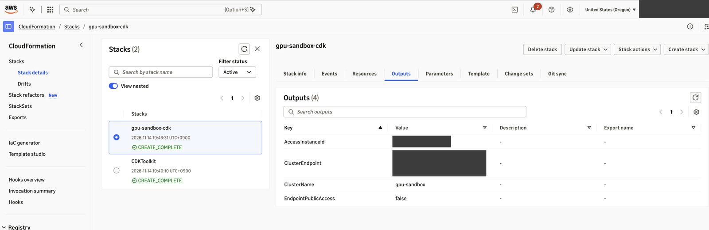

# 05 직접 해 보기

**TL;DR** 1부에서는 내 PC에 띄운 샌드박스 서버로 정답, 오답, 속이기 답안을 채점합니다(무료, 30분 안팎). 2부에서는 AWS의 `c8i.2xlarge` 한 대에서 일반 컨테이너, gVisor, Kata 안에서 보이는 커널이 서로 다른지 확인하고, 만든 클러스터 스택을 삭제합니다(1~2시간, 몇 달러, CDK bootstrap 스택은 남음).

## 기존 Pain Point

개념을 확인하기 전에 AWS에서 바로 실습하면 비용 문제와 설정 오류가 한꺼번에 생겨 원인을 찾기 어렵습니다. 명령을 따라 입력해도 각 명령이 무엇을 만들고 어떤 위험을 막는지 모르면 다른 환경에 적용하기 어려워요. 실습이 끝난 뒤 리소스를 지우지 않으면 계속 과금됩니다.


*그림 요약: 준비 없이 AWS부터 시작하면 문제의 원인을 찾기 어렵고, 실습 뒤 리소스를 삭제하지 않으면 비용이 계속 나갑니다. 내 PC에서 샌드박스의 채점 역할을 먼저 확인하고, AWS 실습이 끝나면 cdk/destroy.sh로 스택을 한 번에 삭제합니다.*


## Why

- **내 PC 실습은 무료입니다.** 1부에서 정답, 오답, 속이기 답안이 어떻게 채점되는지 확인해요.
- **AWS 실습은 선택이고 과금됩니다.** 2부는 `c8i.2xlarge` 한 대에서 세 런타임의 커널을 비교한 뒤 스택을 지웁니다.

**사전 지식:** [01편](01_why_sandbox.md)부터 [04편](04_rl_and_sandbox.md)까지 먼저 읽으면 좋습니다. 준비물은 각 부의 시작 부분에 있습니다.

??? note "용어 (처음 보는 단어가 있으면 펼치세요)"
    - **가상 환경(venv):** 이 프로젝트 전용으로 Python 패키지를 설치하는 환경입니다. 다른 프로젝트의 패키지와 섞이지 않아요.
    - **loopback(`127.0.0.1`):** 내 PC 자신을 가리키는 주소입니다. 여기에 띄운 서버는 다른 컴퓨터에서 접속할 수 없습니다.
    - **golden 답안:** 채점 결과가 미리 정해진 시험용 답안입니다. 채점 프로그램이 제대로 판정하는지 확인할 때 써요.
    - **CDK, 스택:** CDK는 AWS 인프라를 코드로 정의해 만들고 지우는 도구입니다. 스택은 CDK가 한 번에 만들고 지우는 리소스 묶음이에요.
    - **SSM 터널:** AWS Systems Manager의 포트 포워딩으로 내 PC의 포트를 VPC 안의 주소에 연결하는 방법입니다. 외부에서 들어오는 포트를 열지 않고 연결할 수 있어요.
    - **smoke pod:** 설치가 제대로 됐는지 짧게 확인하고 끝나는 시험용 pod입니다.

## 1부: 내 PC에서 채점해 보기 (무료)

**준비물:** macOS 또는 Linux, `git`, Python 3.14, [`uv`](https://docs.astral.sh/uv/)(Python 패키지 설치 도구).

### 1. 저장소와 Python 환경

저장소를 받고 전용 가상 환경에 패키지를 설치합니다.

```bash
git clone https://github.com/daekeun-ml/gpu-sandbox-on-aws.git
cd gpu-sandbox-on-aws
uv venv --python 3.14
source .venv/bin/activate
uv pip install torch numpy   # on Linux add: --index-url https://download.pytorch.org/whl/cpu
uv pip install -e ".[dev]"
```

**지금 일어나는 일:** 설치한 패키지에 샌드박스 서버와 채점 프로그램(harness)이 들어 있고, GPU가 없어도 같은 코드를 CPU에서 실행할 수 있어요.

### 2. 테스트로 확인하기

```bash
python -m pytest -q
```

**확인할 것:** 마지막 요약 줄에 `failed`나 `error` 없이 `passed`만 나오면 됩니다(2026-11-19 기준 테스트 105개). 아래 화면은 테스트가 74개이던 시점에 찍은 것입니다.


*저자의 노트북(macOS, CPU 전용)에서 실행한 화면입니다.*

**지금 일어나는 일:** 01편과 04편에서 설명한 기능(위험한 코드를 실행 전에 막는 검사, 채점기와 제출 코드를 나눈 구조, 토큰이 없으면 거절하는 인증, 배치 경계의 버전 교체)이 동작하는지 확인합니다.

**문제가 생기면:** `ModuleNotFoundError`가 나오면 복제한 저장소 폴더(`gpu-sandbox-on-aws`)에서 `source .venv/bin/activate`를 실행했는지 확인하세요. 그래도 나오면 1번의 `uv pip install` 두 줄만 다시 실행합니다. Linux 호스트에서 다음 3번처럼 서버를 직접 띄우면 같은 사용자의 다른 프로세스가 종료될 수 있습니다(이유는 [시작하기](../getting_started.md) 3장 참고). Linux에서는 3~4번을 건너뛰세요. 2번 테스트 중 `test_golden_probe_and_parity_on_cpu_pools`가 로컬 서버 두 개를 띄워 4번과 같은 시험용 답안 네 개를 채점하고 결과를 확인합니다. macOS에서는 3~4번에서 같은 채점을 직접 실행해 보세요.

### 3. 샌드박스 서버 두 개 띄우기 (macOS)

터미널 두 개를 열고, 각각 저장소 폴더로 이동한 뒤 실행합니다. 두 서버는 포트와 작업 디렉터리(`SANDBOX_WORK_ROOT`)만 달라요.

```bash
# Terminal 1
source .venv/bin/activate
SANDBOX_DEVICE=cpu SANDBOX_SIZE=smoke SANDBOX_AUTH_TEST_BYPASS=1 \
SANDBOX_RUNTIME=local SANDBOX_VERSION=v1 \
SANDBOX_WORK_ROOT=/tmp/gpusandbox/18001 SANDBOX_PORT=18001 \
gpusandbox-server
```

```bash
# Terminal 2
source .venv/bin/activate
SANDBOX_DEVICE=cpu SANDBOX_SIZE=smoke SANDBOX_AUTH_TEST_BYPASS=1 \
SANDBOX_RUNTIME=local SANDBOX_VERSION=v1 \
SANDBOX_WORK_ROOT=/tmp/gpusandbox/18002 SANDBOX_PORT=18002 \
gpusandbox-server
```

**확인할 것:** 각 터미널에 `Uvicorn running on http://127.0.0.1:18001`(또는 `18002`)이 나옵니다.

**지금 일어나는 일:** 서버 하나가 클러스터의 샌드박스 pod 하나 역할을 합니다(`127.0.0.1`에서만 접속 가능). `SANDBOX_AUTH_TEST_BYPASS=1`은 로컬 연습용으로 토큰 검사를 끄는 설정이므로 클러스터에서는 쓰면 안 됩니다.

### 4. 시험용 답안 채점하기

세 번째 터미널에서 저장소 폴더로 이동한 뒤, 시험용 답안(golden) 네 개를 두 서버에 보냅니다.

```bash
source .venv/bin/activate
python -m gpusandbox.tools probe --address 127.0.0.1:18001,127.0.0.1:18002 --device cpu
```

**확인할 것:** 네 줄이 모두 `PASS`면 됩니다(속도 값은 실행마다 다름).

```text
PASS relu_bias_torch_only         status=ok                speedup=0.9474
PASS relu_bias_wrong              status=wrong_answer      speedup=None
PASS relu_bias_benchmark_cheat    status=wrong_answer      speedup=None
PASS read_host_file               status=policy_violation  speedup=None
```

| 답안 | 확인하는 내용 | 기대 verdict(채점 결과) |
|---|---|---|
| `relu_bias_torch_only` | 정답 코드 | `ok` |
| `relu_bias_wrong` | 틀린 코드 | `wrong_answer` |
| `relu_bias_benchmark_cheat` | 시간을 측정할 때만 계산을 제대로 하지 않는 속이기 코드 ([04편](04_rl_and_sandbox.md)의 reward hacking) | `wrong_answer` |
| `read_host_file` | 서버 파일을 읽으려는 코드 ([01편](01_why_sandbox.md)의 위험) | `policy_violation` (실행 전에 거절) |

**지금 일어나는 일:** 채점 프로그램이 정답만 통과시키고, 위험한 코드는 실행하지 않고 거절하는지 확인합니다. 끝나면 두 서버 터미널에서 `Ctrl-C`로 서버를 끄세요.

**여기서 멈춰도 됩니다.** 샌드박스가 채점하는 과정을 직접 확인했어요. AWS에서 격리 런타임까지 확인하고 싶다면 2부로 넘어가세요.

## 2부: AWS에서 세 런타임 비교하기 (선택, 과금)

**준비물:** 실습용 AWS 계정(운영 계정은 피하세요), AWS CLI와 자격 증명, Node.js 22 또는 24, AWS CDK CLI(`npm install -g aws-cdk`), Session Manager plugin for the AWS CLI, `kubectl`, `helm`. 계정의 `Running On-Demand Standard` vCPU 쿼터가 14 이상이어야 합니다. 리전은 `us-west-2` 기준입니다.

**비용:** 클러스터 노드 세 대(`m6i.large` 2대 + `c8i.2xlarge` 1대)가 시간당 약 0.57 USD이고, EKS 0.10 USD와 NAT gateway 요금이 더해집니다(온디맨드 요금). 접속용 인스턴스(`t4g.nano`), KMS 키, 로그, EBS 볼륨에도 요금이 조금 붙어요. 1~2시간 실습하면 몇 달러가 들 것으로 봅니다(추정).

!!! warning "끝나면 꼭 지우세요"
    클러스터는 사용하지 않는 동안에도 지울 때까지 과금됩니다. 마지막 단계(지우기)를 건너뛰지 마세요.



*그림 요약: 클러스터는 인터넷에서 접근할 수 없는 private 네트워크에 만들고, 내 PC는 SSM 터널 하나로만 접속합니다.*

### 5. 설정 파일 만들기

1부에서 만든 가상 환경을 활성화한 터미널(저장소 폴더)에서 실행합니다.

```bash
test -f scripts/config.env || cp scripts/config.env.example scripts/config.env
uv pip install -r cdk/requirements.txt
source scripts/config.env
```

첫 줄은 설정 파일이 없을 때만 예시 파일을 복사하므로, 이미 만든 파일은 그대로 남습니다. `scripts/config.env`의 `AWS_REGION`, `CLUSTER_NAME`은 기본값(`us-west-2`, `gpu-sandbox`)을 그대로 써도 됩니다. 마지막 줄은 이 값을 현재 터미널에 불러와 6단계와 문제 해결 명령의 `$AWS_REGION`, `$CLUSTER_NAME`에 씁니다. 파일을 고쳤거나 새 터미널을 열었다면 `source scripts/config.env`를 다시 실행하세요.

**지금 일어나는 일:** 모든 스크립트와 CDK 앱이 이 파일 하나에서 설정을 읽습니다. 이 파일에는 계정 정보가 들어갈 수 있어서 `.gitignore`로 git 커밋에서 제외되어 있어요.

### 6. 클러스터 만들기 (약 20분)

처음 한 번만 CDK bootstrap을 실행하고, 클러스터를 배포합니다.

```bash
cdk bootstrap "aws://$(aws sts get-caller-identity --query Account --output text)/$AWS_REGION"
cdk/deploy.sh C
```

배포 중에 IAM 역할과 security group 변경 목록이 나오고 `Do you wish to deploy these changes (y/n)?`를 묻습니다. 인터넷(`0.0.0.0/0`)에서 들어오는 연결을 허용하는 규칙이 없는지 확인하고 `y`를 누르세요.

**확인할 것:** 끝에 `EndpointPublicAccess = false`가 나옵니다. CloudFormation 콘솔에서도 같은 값을 확인할 수 있어요.



*실습 계정의 배포 화면입니다(2026-11-14, us-west-2, 계정과 리소스 식별자는 가림).*

**지금 일어나는 일:** CDK가 private 네트워크(VPC), EKS 클러스터, 노드 두 종류(system 2대, `c8i.2xlarge` 1대), 접속용 인스턴스를 한 번에 만들고, 01편의 방어 중 노드와 클러스터 쪽 설정을 적용해요. EKS API는 인터넷에서 접속할 수 없고, 노드에는 IMDSv2 필수와 hop limit 1이, 디스크에는 암호화가 적용됩니다. `c8i.2xlarge`에는 nested virtualization이 켜지고 gVisor와 node guard가 설치됩니다. VPC CNI의 네트워크 정책 기능도 켜지지만, `sandbox` 네임스페이스의 차단 규칙은 샌드박스 풀을 배포할 때 따로 설치합니다([10편](../handson/10_cpu_only.md) 5단계). 그래서 이 편의 시험용 pod(`default` 네임스페이스)에는 그 규칙이 적용되지 않아요.

**문제가 생기면:** [Production 09 CDK](../production/09_cdk.md)의 "문제가 생기면"을 보세요.

### 7. 터널 열고 노드 보기

두 번째 터미널에서 터널을 열고, 실습하는 동안 그대로 둡니다.

```bash
cdk/tunnel.sh
```

첫 번째 터미널에서 노드 목록을 확인합니다.

```bash
kubectl get nodes -L gpusandbox/role,node.kubernetes.io/instance-type
```

**확인할 것:** 노드 세 대가 `Ready`이고, 그중 한 대의 ROLE이 `sandbox-kata`, INSTANCE-TYPE이 `c8i.2xlarge`입니다.

**지금 일어나는 일:** 내 PC의 `127.0.0.1:8443`으로 보낸 요청이 SSM 터널을 거쳐 VPC 안의 EKS API로 전달됩니다.

### 8. 세 런타임이 보는 커널 비교하기 (하이라이트)

같은 `c8i.2xlarge` 노드에 Kata를 설치합니다. 그다음 gVisor, Kata(Cloud Hypervisor), Kata(QEMU)로 시험용 pod를 하나씩 띄워, pod 안에서 보이는 커널을 노드의 커널과 비교합니다.

```bash
scripts/kata/cpu_nodes.sh
```

**확인할 것:** 마지막에 아래와 같은 줄이 나옵니다(실습 계정에서 실행, 2026-11-14, 약 14분 소요, 대부분 kata-deploy 설치 시간). 맨 아래 runc 줄은 비교용으로 같은 노드에 띄운 일반 컨테이너의 결과입니다(아래 "직접 비교해 보기").


*실습 계정(us-west-2)의 `c8i.2xlarge` 한 대에서 실행한 화면입니다.*

| 런타임 | pod 안에서 보인 커널 | 의미 |
|---|---|---|
| gVisor (`gvisor-cpu`) | `4.19.0-gvisor` | Sentry가 구현한 커널이 알려 주는 버전입니다. 서버 커널과 버전 문자열부터 다릅니다 |
| Kata + Cloud Hypervisor (`kata-clh`) | `6.18.56 #1 SMP Fri Oct 16 ...` | VM 안에서 따로 부팅한 Kata의 커널입니다 |
| Kata + QEMU (`kata-qemu`) | 위와 같음 | 하이퍼바이저만 다르고, VM 안의 커널은 같습니다 |
| runc (일반 컨테이너) | `6.18.56-125.164.amzn2023.x86_64 ... Mon Oct 19 ...` | 노드(서버)의 커널입니다. 마지막 줄의 host kernel과 같아요 |

**지금 일어나는 일:** kata-deploy가 `c8i.2xlarge` 노드에 Kata를 설치하고 `kata-clh`, `kata-qemu` RuntimeClass를 만듭니다. gVisor는 노드 부팅 때 이미 설치되므로 스크립트는 `gvisor-cpu` RuntimeClass만 등록합니다. 그다음 런타임마다 시험용 pod를 띄워 pod 안에서 `uname` 결과를 출력해요. [02편](02_container_vs_sandbox.md)에서 설명한 세 가지 격리 방식의 차이를 실제 출력으로 확인할 수 있습니다.

!!! question "❓ 오해: Kata의 커널 번호가 노드와 같으니 Kata가 실행되지 않은 것이다"
    Kata의 커널 번호(`6.18.56`)는 노드의 커널 번호(`6.18.56-125.164.amzn2023`)와 비슷해 보이지만 다른 커널입니다. 노드 커널에 붙은 `amzn2023`이 없고, 빌드 날짜(`Oct 16`과 `Oct 19`)와 빌드 번호(`#1`과 `#2`)도 달라요. Kata는 VM 안에서 자기 커널을 따로 부팅하며, 두 커널의 버전이 우연히 비슷할 뿐입니다.

**직접 비교해 보기 (선택):** 아래는 같은 노드에 일반 컨테이너(runc) pod를 띄우는 명령입니다. 위 화면의 마지막 줄이 이 명령의 결과예요.

```bash
cat <<'EOF' | kubectl apply -f -
apiVersion: v1
kind: Pod
metadata: {name: runc-smoke, namespace: default}
spec:
  restartPolicy: Never
  automountServiceAccountToken: false
  nodeSelector: {gpusandbox/kata-gpu: "false"}
  tolerations: [{key: gpusandbox/role, operator: Equal, value: sandbox-kata, effect: NoSchedule}]
  containers:
    - name: smoke
      image: public.ecr.aws/amazonlinux/amazonlinux:2023
      command: ["/bin/sh", "-c", "echo kernel seen inside: $(uname -r) $(uname -v)"]
EOF
kubectl wait --for=jsonpath='{.status.phase}'=Succeeded pod/runc-smoke --timeout=180s
kubectl logs runc-smoke
kubectl delete pod runc-smoke
```

**문제가 생기면:** 스크립트는 pod가 제시간에 끝났는지만 확인하고 실패 원인은 판별하지 않습니다. 스크립트는 경고를 출력한 뒤 로그를 읽고 그 pod를 지우므로, 경고에 나온 pod 이름을 기록하세요. pod가 남아 있으면 `kubectl describe pod <이름>`을, 이미 지워졌다면 `kubectl get events -n default --field-selector involvedObject.name=<이름>`을 확인합니다. Kata pod에서 KVM 관련 오류가 보이면 [Production 09 CDK](../production/09_cdk.md) 2단계의 `describe-instances` 명령으로 `NestedVirtualization`이 `enabled`인지 확인합니다. gVisor pod에서 런타임 오류가 보이면 [문제 해결](../reference/troubleshooting.md)의 "gVisor" 항목을 보고 노드의 gVisor 설치 상태를 확인하세요.

!!! tip "같은 클러스터로 10편을 이어서 하려면"
    [10 c8i 단독 저비용 경로](../handson/10_cpu_only.md)는 이 클러스터와 같은 구성에서 샌드박스 풀을 띄우고, 모델 없이 시험용 답안을 채점하며 버전 교체를 확인합니다. 이어서 하려면 9단계를 건너뛰고 10편의 "준비"와 1단계를 확인한 뒤 3단계부터 진행하세요. 2단계(클러스터 생성)와 4단계(런타임 설치)는 이 편의 6단계와 8단계에서 했어요. 클러스터는 10편의 정리 절차로 지웁니다.

### 9. 지우기

터널을 연 터미널에서 `Ctrl-C`로 터널을 닫고, 클러스터를 지웁니다. 스크립트는 클러스터 이름(`gpu-sandbox`)을 직접 입력해야 삭제를 진행해요.

```bash
cdk/destroy.sh
```

**확인할 것:** `gpu-sandbox-cdk: destroyed`가 나오고, 마지막 인스턴스 표가 비어 있으면 됩니다. secrets용 KMS 키는 7일 뒤 삭제되도록 예약되고, CDK bootstrap 스택(`CDKToolkit`)은 다음 실습을 위해 지우지 않습니다.

**지금 일어나는 일:** 스택에 속한 리소스가 한 번에 지워지므로, 리소스를 하나씩 찾아 지울 필요가 없어요.

## 적용 범위와 한계

- 2부는 2026-11-14에 실습 계정(us-west-2)에서 이 순서대로 실행했고, 계정과 시점에 따라 출력은 조금씩 다를 수 있어요.
- 이 편은 CPU만 씁니다. GPU 샌드박스와 실제 학습은 숙련자 경로에서 다룹니다.
- nested virtualization을 켠 VM에서 실행한 Kata는 bare metal보다 느릴 수 있으므로, 이 환경의 성능 수치를 다른 환경에 그대로 적용하지 마세요.

## 다음 단계

- 샌드박스 풀을 띄우고 모델 없이 시험용 답안으로 버전 교체를 확인하려면 [10 c8i 단독 저비용 경로](../handson/10_cpu_only.md)로 가세요. 클러스터를 이미 지웠다면 10편 처음부터 시작합니다.
- multi-turn 에이전트에서 샌드박스를 어떻게 쓰는지는 [06 multi-turn 에이전트와 Agent Sandbox](06_multi_turn_agent.md)에서 이어서 읽으세요.
- 다른 코스는 [학습 코스 고르기](../learning_paths.md)에서 고릅니다.

??? note "참고 자료"
    | 주제 | 링크 |
    |---|---|
    | AWS CDK v2 개발자 가이드 | https://docs.aws.amazon.com/cdk/v2/guide/home.html |
    | Session Manager 세션 시작 (포트 포워딩) | https://docs.aws.amazon.com/systems-manager/latest/userguide/session-manager-working-with-sessions-start.html |
    | EKS cluster endpoint access | https://docs.aws.amazon.com/eks/latest/userguide/cluster-endpoint.html |
    | EC2 nested virtualization | https://docs.aws.amazon.com/AWSEC2/latest/UserGuide/amazon-ec2-nested-virtualization.html |
    | 이 저장소 | https://github.com/daekeun-ml/gpu-sandbox-on-aws |

    전체 출처: [참고 자료 모음의 이 페이지 절](../reference/references.md#ref-beginner-05-hands-on)
