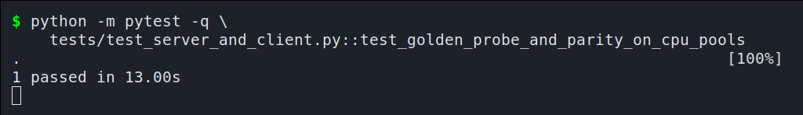
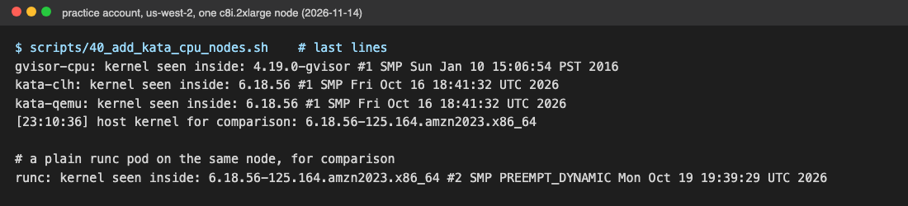

# 05 직접 해 보기

내 PC에서 `relu_bias` 과제의 답안을 채점합니다. 입력에 보정값을 더한 뒤 음수인 결과만 0으로 바꾸는 문제입니다. 예를 들어 입력 `[-3, 2]`에 `[1, 1]`을 더하면 `[-2, 3]`이므로 기대 출력은 `[0, 3]`입니다. 테스트는 준비된 답안을 두 로컬 서버에 보냅니다. 이 실습에서는 모델 학습이나 AWS 배포 없이 정답, 오답, 정책 위반 사례를 하나씩 채점합니다.


로컬 테스트에서는 **채점기가 틀린 답을 구별하는지** 확인합니다. AWS 실습에서는 **같은 노드에 있는 각 pod의 커널**도 비교합니다. [AWS 커널 비교로 이동](#aws-cpu)

## 1. 설치하기

Git과 `uv`가 필요합니다. 아래 명령으로 실습 코드를 내려받고 전용 Python 환경에 채점 서버와 테스트를 설치하세요.

```bash
git clone https://github.com/daekeun-ml/gpu-sandbox-on-aws.git
cd gpu-sandbox-on-aws
uv venv --python 3.14
source .venv/bin/activate
uv pip install torch numpy
uv pip install -e ".[dev]"
```

Linux에서 CPU용 PyTorch만 설치하려면 `uv pip install torch numpy`에 `--index-url https://download.pytorch.org/whl/cpu`를 붙이세요.

## 2. 시험용 답을 채점하기

```bash
python -m pytest -q tests/test_server_and_client.py::test_golden_probe_and_parity_on_cpu_pools
```

테스트는 준비된 답안을 두 서버에 보내고, 예상한 판정이 돌아오는지와 두 서버가 같은 판정을 내리는지 확인합니다. 두 서버의 판정이 모두 기대와 일치하면 마지막에 `1 passed`가 나옵니다. 전체 테스트를 보려면 `python -m pytest -q`를 실행하세요.

여기서 **verdict**는 채점기가 답 하나에 내린 판정입니다. 위 예시의 함수가 음수를 그대로 남겨 `[-2, 3]`을 출력하면 기준 답 `[0, 3]`과 다릅니다. 이 답안에 `wrong_answer`가 나오면 채점기가 예상대로 동작한 것입니다.

- `ok`는 실행 결과가 예상한 답과 일치할 때 나옵니다.
- 실행 결과가 틀리면 `wrong_answer`가 나옵니다.
- `policy_violation`은 실행 정책 검사에서 제출을 거절했다는 뜻입니다.



`ModuleNotFoundError`가 나오면 `gpu-sandbox-on-aws` 폴더에서 `.venv`를 활성화했는지 확인하고 설치 명령을 다시 실행하세요.

??? note "macOS에서 서버를 직접 띄워 판정 보기"
    Linux 호스트에서는 위의 pytest 명령으로 테스트를 실행하세요. 서버를 직접 띄울 때의 차이는 [로컬 실행 환경](../handson/start.md)에 설명돼 있습니다.

    ### 서버 두 개 띄우기

    터미널 두 개를 열어 각각 `gpu-sandbox-on-aws` 폴더로 이동하세요. 두 서버는 포트와 작업 디렉터리(`SANDBOX_WORK_ROOT`)만 다릅니다.

    ```bash
    # Terminal 1
    source .venv/bin/activate
    SANDBOX_DEVICE=cpu SANDBOX_SIZE=smoke SANDBOX_AUTH_TEST_BYPASS=1 \
    SANDBOX_RUNTIME=local SANDBOX_VERSION=v1 \
    SANDBOX_WORK_ROOT=/tmp/gpusandbox/18001 SANDBOX_PORT=18001 \
    gpusandbox-server
    ```

    ```bash
    # Terminal 2
    source .venv/bin/activate
    SANDBOX_DEVICE=cpu SANDBOX_SIZE=smoke SANDBOX_AUTH_TEST_BYPASS=1 \
    SANDBOX_RUNTIME=local SANDBOX_VERSION=v1 \
    SANDBOX_WORK_ROOT=/tmp/gpusandbox/18002 SANDBOX_PORT=18002 \
    gpusandbox-server
    ```

    **확인할 것:** 각 터미널에 `Uvicorn running on http://127.0.0.1:18001`(또는 `18002`)이 나옵니다.

    **지금 일어나는 일:** 서버 하나가 클러스터의 샌드박스 pod 하나 역할을 합니다(`127.0.0.1`에서만 접속 가능). `SANDBOX_AUTH_TEST_BYPASS=1`은 로컬 연습용으로 토큰 검사를 끄는 설정이므로 클러스터에서는 쓰면 안 됩니다.

    ### 시험용 답안 채점하기

    세 번째 터미널도 같은 폴더에서 열고 시험용 답안(golden) 네 개를 두 서버에 보냅니다.

    ```bash
    source .venv/bin/activate
    python -m gpusandbox.tools probe --address 127.0.0.1:18001,127.0.0.1:18002 --device cpu
    ```

    **확인할 것:** 네 줄이 모두 `PASS`면 됩니다. 거절해야 할 답을 제대로 거절해도 `PASS`입니다. 속도 값은 실행마다 다릅니다.

    ```text
    PASS relu_bias_torch_only         status=ok                speedup=0.9474
    PASS relu_bias_wrong              status=wrong_answer      speedup=None
    PASS relu_bias_benchmark_cheat    status=wrong_answer      speedup=None
    PASS read_host_file               status=policy_violation  speedup=None
    ```

    | 답안 | 확인하는 내용 | 기대 verdict(채점 결과) |
    |---|---|---|
    | `relu_bias_torch_only` | 정답 코드 | `ok` |
    | `relu_bias_wrong` | 틀린 코드 | `wrong_answer` |
    | `relu_bias_benchmark_cheat` | 시간을 측정할 때만 잘못된 결과를 내는 코드 ([04편](04_rl_and_sandbox.md)의 reward hacking) | `wrong_answer` |
    | `read_host_file` | 서버 파일을 읽으려는 코드 ([01편](01_why_sandbox.md)의 위험) | `policy_violation` (실행 전에 거절) |

    **지금 일어나는 일:** 채점 프로그램이 정답만 통과시키고, 위험한 코드는 실행하지 않고 거절하는지 확인합니다. 끝나면 두 서버 터미널에서 `Ctrl-C`로 서버를 끄세요.

## 3. AWS에서 같은 CPU 노드의 커널 비교하기 { #aws-cpu }

로컬 서버 두 개는 채점을 연습할 수 있게 해 줍니다. 두 서버 모두 내 PC의 운영체제를 사용합니다. 이번에는 EKS의 `c8i.2xlarge` 한 대에서 같은 컨테이너 이미지를 gVisor, Kata + Cloud Hypervisor, Kata + QEMU로 실행합니다. pod마다 `uname -r`가 어떤 값을 출력하는지 예상해 보세요.

**비용과 준비물**　이 단계부터 EKS, EC2, NAT gateway 등에 요금이 발생합니다. 실습용 계정과 리전에서 진행하세요. 예제 구성은 system 노드 두 대, `c8i.2xlarge` 한 대, 터널용 인스턴스 한 대를 만듭니다. Standard 온디맨드 vCPU가 14개 필요합니다. AWS CLI 자격 증명, Node.js, CDK CLI, Session Manager plugin, `kubectl`, Helm, Docker와 `jq` 설치 방법은 [클러스터 준비](../handson/common/01_provision/cdk.md)에 있습니다. [시나리오 C 비용](../handson/scenarios/c/index.md)

### 설정과 클러스터 준비

로컬 실습을 진행한 폴더에서 같은 가상 환경을 활성화하세요. 다음 명령은 설정 파일이 이미 있으면 그대로 둡니다.

```bash
test -f scripts/config.env || cp scripts/config.env.example scripts/config.env
uv pip install -r cdk/requirements.txt
```

`scripts/config.env`를 열어 실습 계정에서 쓸 `AWS_REGION`과 `CLUSTER_NAME`을 확인하세요. 이 CPU 실습은 `SCENARIO="C"`, `WITH_KATA_GPU="0"`을 사용합니다. 사전 검사 결과에서 선택한 리전의 Standard 쿼터와 `c8i.2xlarge`의 `nested-virtualization` 지원 여부를 확인합니다. EC2 가상 서버 안에서 Kata VM을 띄우는 데 필요한 기능입니다.

```bash
source scripts/config.env
scripts/01_check_prereqs.sh
```

이 계정과 리전에 CDK를 처음 배포할 때 첫 줄로 bootstrap을 준비합니다. 두 번째 줄이 클러스터를 만듭니다. CDK가 표시하는 변경 내역을 확인하고 계속하세요. 배포가 끝나면 기본 설정에서 `EndpointPublicAccess = false`가 보입니다.

```bash
cdk bootstrap "aws://$(aws sts get-caller-identity --query Account --output text)/$AWS_REGION"
scripts/02_create_cluster.sh --cpu-only
```


### 터널을 열고 노드 확인

두 번째 터미널에서 `gpu-sandbox-on-aws` 폴더로 이동해 `cdk/tunnel.sh`를 실행하고 열어 둡니다. 첫 번째 터미널에서 다음 명령을 실행하세요. 터널은 로컬의 `kubectl` 요청을 VPC 안에 있는 EKS API에 전달합니다.

```bash
kubectl get nodes -L gpusandbox/role,node.kubernetes.io/instance-type
```

노드가 `Ready`이고 `sandbox-kata` 역할의 `c8i.2xlarge`가 보이면 CPU 런타임을 설치할 준비가 됐습니다. `kubectl`이 연결되지 않으면 먼저 터널 터미널의 메시지와 `kubectl config current-context`를 확인하세요.

### 세 런타임의 출력 해석

```bash
scripts/kata/cpu_nodes.sh
```

스크립트는 CPU 노드에 Kata를 설치하고 `gvisor-cpu`, `kata-clh`, `kata-qemu`로 짧은 시험용 pod를 하나씩 띄웁니다. 각 pod가 출력한 커널과 마지막에 출력한 노드 커널을 나란히 읽으세요. 아래 화면의 runc 줄은 선택 단계로 따로 실행한 일반 컨테이너의 결과입니다.



| 출력 | 무엇을 확인했나요? |
|---|---|
| `gvisor-cpu`의 `4.19.0-gvisor` | Sentry가 프로그램에 보고한 커널 버전입니다. |
| `kata-clh`와 `kata-qemu`의 `6.18.56` 게스트 빌드 | VM을 시작하는 프로그램은 달라도 두 게스트는 같은 커널 이미지를 부팅했습니다. |
| `host kernel`의 `6.18.56-125.164.amzn2023…` | EC2 노드의 Linux 커널입니다. 게스트와 구분하려면 빌드 문자열까지 읽으세요. |

??? example "같은 노드에서 일반 컨테이너(runc)로도 확인하기"
    아래 pod에는 `runtimeClassName`이 없어 노드의 기본 런타임을 사용합니다. `kubectl logs`의 출력과 위의 `host kernel` 줄을 비교합니다.

    ```bash
    cat <<'EOF' | kubectl apply -f -
    apiVersion: v1
    kind: Pod
    metadata: {name: runc-smoke, namespace: default}
    spec:
      restartPolicy: Never
      automountServiceAccountToken: false
      nodeSelector: {gpusandbox/kata-gpu: "false"}
      tolerations: [{key: gpusandbox/role, operator: Equal, value: sandbox-kata, effect: NoSchedule}]
      containers:
        - name: smoke
          image: public.ecr.aws/amazonlinux/amazonlinux:2023
          command: ["/bin/sh", "-c", "echo kernel seen inside: $(uname -r) $(uname -v)"]
    EOF
    kubectl wait --for=jsonpath='{.status.phase}'=Succeeded pod/runc-smoke --timeout=180s
    kubectl logs runc-smoke
    kubectl delete pod runc-smoke
    ```

### 실습 리소스 정리

이 클러스터에서 [CPU pool을 배포하고 버전을 교체하는 실습](../handson/scenarios/c/index.md)으로 이어갈 수 있습니다. 여기서 끝내려면 **터널을 열어 둔 상태에서** 아래 명령을 실행합니다. 확인 메시지에 표시된 계정, 리전, 클러스터 이름이 실습 환경과 일치하는지 보세요.

```bash
scripts/08_cleanup.sh
```

스택 삭제가 끝나고 마지막 인스턴스 조회에 실습 노드가 보이지 않으면 터널을 종료합니다. [정리 확인 항목](../handson/cleanup.md), [다음 편에서 에피소드 따라가기](06_multi_turn_agent.md)
