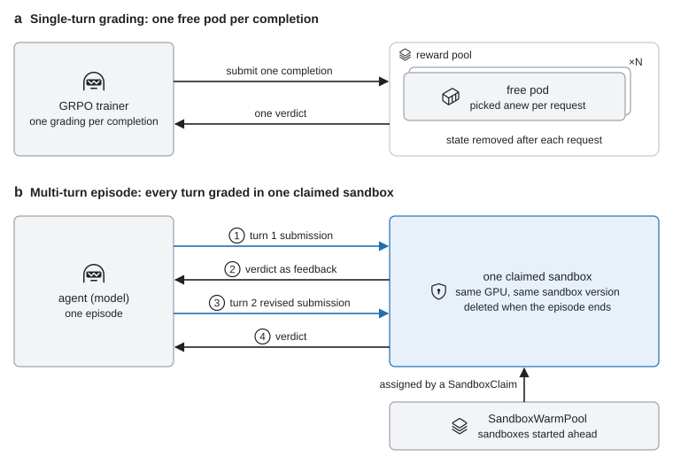
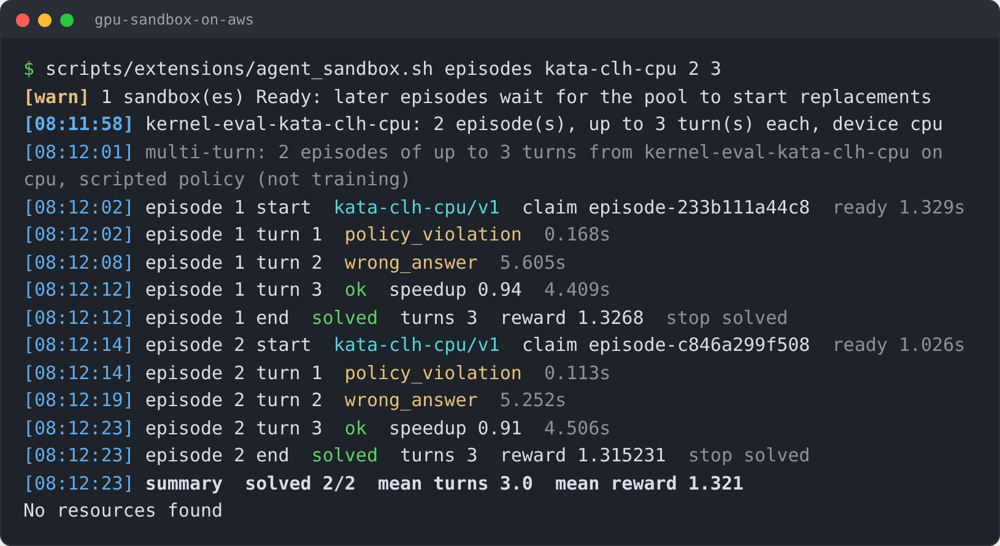

# 06 Multi-turn agents and Agent Sandbox

An agent can read a verdict, revise its answer, and submit again. For example, if a sorting function drops duplicate values, the agent can preserve duplicates in its next submission. Each submission is a **turn**, and the attempt to solve one problem is an **episode**.

## One sandbox for the episode

Assigning the episode to one sandbox keeps the runtime and grader version consistent across turns. On a GPU profile, those turns also use the same GPU. The grading server clears its working files and processes after each submission. The agent sends the full revised code on every turn and uses the prior verdict as feedback.



## Prepare, assign, and clean up

1. Agent Sandbox starts a **warm pool** of ready sandboxes.
2. At the start of an episode, the runner creates a `SandboxClaim` and sends all submissions to the assigned address.
3. At the end, the runner deletes the claim and the sandbox is removed.

A warm pool reduces startup wait and uses CPU or GPU capacity while idle. See [Agent Sandbox concepts](../concepts/06_agent_sandbox.md) for how assignment relates to the isolation runtime.

## Reading one episode in the logs

In the [multi-turn exercise](../handson/11_multi_turn.md), the CPU runner submits prepared answers in sequence. This abbreviated example shows selected fields for the final two turns and the end of an episode.

```text
turn         episode=1  turn=2  claim=episode-ab12  status=wrong_answer
turn         episode=1  turn=3  claim=episode-ab12  status=ok
episode_end  episode=1          claim=episode-ab12  released=true
```

The matching `claim` shows that both turns used the same sandbox. `released=true` on `episode_end` indicates that the runner released the claim.

## What carries over to the next turn?

The **agent** keeps the previous submission and feedback while it revises its answer. The **grader** keeps the same pod, runtime and grading version for the episode. It removes temporary files after each submission, so a file written on turn one is not available on turn three. Each turn submits the complete revised code.

| Turn | Verdict | Next action |
|---|---|---|
| 1 | `policy_violation` | Read the reason and rewrite the answer using permitted operations. |
| 2 | `wrong_answer` | The output differs from the reference. Fix the calculation before comparing speed. |
| 3 | `ok` | End an episode configured to stop on a correct answer and release its sandbox. |

The CPU exercise uses a `scripted` policy with prepared submissions so you can reproduce this sequence. In `multiturn_summary`, `episodes` counts episodes and `solved` counts those that ended with a correct answer. `one_sandbox_per_episode` checks that all turns of each episode used one sandbox.



## Choose a pool or an episode claim

For 30 independent submissions, send the next request whenever a pod becomes available. For an agent that revises one answer three times, holding a sandbox from the first turn through the last makes the placement easy to trace. An idle GPU sandbox still holds a GPU, so size the warm pool for the episodes you intend to run concurrently. [Follow a claim in the lab](../handson/11_multi_turn.md) · [Agent Sandbox resources and code](../concepts/06_agent_sandbox.md)

### Why a warm sandbox may remain after release

Suppose the warm pool targets one idle sandbox and an episode ends. You may see zero `SandboxClaim` objects and one ready sandbox again. The used sandbox was removed and the controller replenished the pool for the next episode. The **claim count** tells you how many allocations remain. The **warm replica count** tells you how much capacity is being kept for future allocations.

Scaling a GPU warm pool to zero can free the device reserved for idle work. EC2 charges continue until the node is scaled down or the lab stack is deleted. [Cleanup and cost](../handson/11_multi_turn.md)
