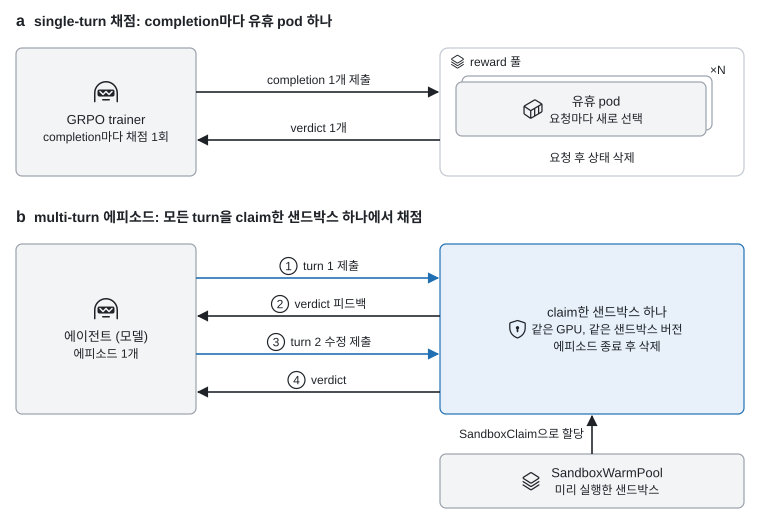
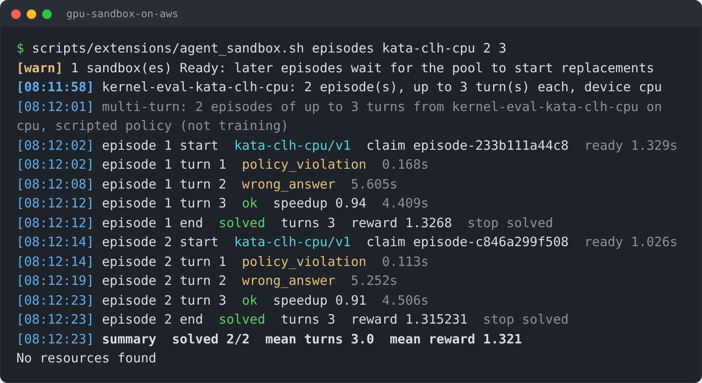

# 06 multi-turn 에이전트와 Agent Sandbox

로컬 실습에서는 준비한 답안을 각각 한 번씩 채점했습니다. 에이전트에게 같은 문제를 맡기면 첫 답을 낸 뒤 채점 결과를 읽고 답을 고쳐 다시 제출할 수도 있습니다. 한 문제를 풀기 시작해서 정답을 내거나 시도 한도에 도달할 때까지를 **에피소드**, 답을 한 번 제출하는 단계를 **턴**이라고 부릅니다.

## 같은 샌드박스에서 채점하는 이유

예를 들어 정렬 함수가 중복된 값을 빠뜨렸다는 피드백을 받으면, 다음 턴에 중복도 유지하도록 고친 함수를 제출할 수 있습니다. 두 답안을 같은 샌드박스에 제출하면 런타임과 채점 버전이 유지됩니다. GPU 과제라면 두 번 모두 같은 GPU에서 채점합니다.

채점 서버는 답안 하나를 실행하고 나면 작업 파일과 프로세스를 정리합니다. 다음 턴에는 수정한 코드 전체를 보내고, 앞선 판정은 에이전트가 피드백으로 사용합니다.

## 샌드박스 준비, 할당, 정리



1. **준비**　Agent Sandbox가 요청을 바로 받을 수 있도록 대기 샌드박스를 띄워 둡니다. 이 대기 묶음을 **warm pool**이라고 합니다.
2. **할당**　에피소드가 시작되면 `SandboxClaim`을 만듭니다. 샌드박스 하나를 달라는 요청이며, 에피소드의 모든 제출을 할당받은 주소로 보냅니다.
3. **정리**　에피소드가 끝나면 claim을 삭제합니다. 사용한 샌드박스도 삭제됩니다.

미리 켜 두면 첫 제출을 기다리는 시간이 줄어듭니다. 대기 중인 샌드박스도 CPU나 GPU 자원을 점유합니다. 런타임과 할당의 관계는 [Agent Sandbox 개념](../concepts/06_agent_sandbox.md)에 있습니다.

## 실습 로그에서 한 에피소드 따라가기

[Multi-turn 핸즈온](../handson/11_multi_turn.md)의 CPU 경로는 준비된 답안을 차례대로 보냅니다. 아래는 한 에피소드에서 마지막 두 턴과 종료에 해당하는 필드만 뽑은 예입니다.

```text
turn         episode=1  turn=2  claim=episode-ab12  status=wrong_answer
turn         episode=1  turn=3  claim=episode-ab12  status=ok
episode_end  episode=1          claim=episode-ab12  released=true
```

두 턴의 `claim`이 같으므로 두 답안은 같은 샌드박스에서 채점됐습니다. `episode_end`의 `released=true`는 에피소드가 끝나고 claim이 반납됐다는 뜻입니다.

## 이전 턴에서 무엇을 이어받나요?

에이전트가 답을 세 번 고치는 동안 **에이전트**에는 앞선 제출과 피드백이 남습니다. **채점 서버**에는 같은 pod와 런타임, 채점 버전이 유지됩니다. 서버가 제출마다 임시 파일을 정리하므로 첫 턴에 만든 파일을 세 번째 턴에서 열 수 있다고 가정하면 안 됩니다. 다음 턴의 제출은 수정한 코드 전체입니다.

| 턴 | 채점 결과 | 다음에 할 일 |
|---|---|---|
| 1 | `policy_violation` | 피드백에서 거절 이유를 읽고 허용된 연산으로 답을 다시 작성합니다. |
| 2 | `wrong_answer` | 계산 결과가 기준과 달랐습니다. 빠르기를 비교하기 전에 계산부터 고칩니다. |
| 3 | `ok` | 정답에서 멈추도록 설정한 에피소드를 종료하고 샌드박스를 반납합니다. |

CPU 실습의 `scripted` 정책은 세 답안을 미리 준비해 이 순서를 재현합니다. `multiturn_summary`의 `episodes`와 `solved`는 시작한 에피소드 수와 푼 문제 수입니다. `one_sandbox_per_episode`는 각 에피소드가 같은 주소로 제출을 보냈는지 확인하는 항목입니다.



## 요청마다 보낼지, 에피소드별로 빌릴지

서로 독립적인 답안 30개를 채점할 때는 준비된 pod가 이전 채점을 마칠 때마다 다음 요청을 보낼 수 있습니다. 한 문제에 대한 피드백을 읽으며 세 번 수정하는 과정이라면 에피소드가 시작될 때 샌드박스를 빌리고 마지막 턴이 끝난 뒤 반납하면 각 답안이 어디에서 실행됐는지 추적하기 쉽습니다. GPU를 붙인 채 대기하는 샌드박스도 한 장을 계속 점유하므로 동시에 진행할 에피소드 수에 맞춰 warm pool 크기를 정하세요. [할당을 따라가는 실습](../handson/11_multi_turn.md) · [Agent Sandbox의 구성과 코드](../concepts/06_agent_sandbox.md)

### 반납 후에도 warm pool이 남는 이유

예를 들어 대기 샌드박스 수를 1로 설정하고 에피소드 하나가 끝났다고 해 봅시다. `SandboxClaim`이 없어지고도 대기 샌드박스가 다시 하나 보일 수 있습니다. 방금 쓴 샌드박스는 정리되고 controller가 다음 에피소드를 위해 빈자리를 채웠기 때문입니다. **남은 claim 수**는 진행 중인 요청을, **warm pool의 replica 수**는 다음 요청을 위해 유지할 용량을 보여 줍니다.

GPU pool에서 대기 샌드박스 수를 0으로 줄이면 미리 할당해 둔 GPU를 반납할 수 있습니다. EC2 노드 자체의 요금은 노드를 줄이거나 실습 스택을 지울 때까지 계속됩니다. [실습 종료와 비용 확인](../handson/11_multi_turn.md)
