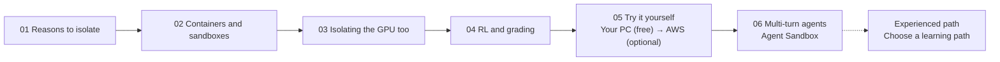

# Before you begin (beginner guide)

!!! info "TL;DR"
    Six chapters for people new to "how to safely run and grade code that AI wrote": chapters 1 to 4 build the concepts (about an hour in total), in chapter 5 you launch it yourself (free on your own PC, or a few dollars on AWS if you want), and chapter 6 explains sandboxes for multi-turn agents.

## Pain points

When one sentence has three or four words you have never seen (sandbox, gVisor, Kata, nvproxy, RuntimeClass, GRPO, reward hacking), it is easy to miss what matters. If you type the commands without knowing what the setup is meant to prevent, you cannot adapt when the situation changes even a little. Turning on a GPU in the cloud costs money and a setting left open by mistake becomes a security problem, so the newer you are, the more you hesitate to start.

*Takeaway: Skipping the words and the reasons and copying commands first gets you through the screens but leaves nothing behind. Read the concepts in chapters 1 to 4 first. In chapter 5 you check the grading results of test answers, and if you choose the AWS exercise, you also compare which kernel each runtime shows.*

## Why

- **Chapters 1 to 4 are concepts, chapter 5 is hands-on.** In chapter 5 you check the grading program with test answers and compare, with `uname` output, the kernel seen inside a regular container and inside a sandbox.
- **The exercise on your PC in chapter 5 is free.** The AWS exercise is optional and costs a few dollars.

**Before you start:** None. If you can paste commands into a terminal, that is enough; the guide explains as much Kubernetes and reinforcement learning as you need.

## Questions this guide answers

| Chapter | Question | One-line answer |
|---|---|---|
| [01](01_why_sandbox.md) | Why should code that AI wrote be locked up and run separately? | A model can write dangerous code regardless of intent, and if that code reaches your server's files, credentials, or network, it becomes an incident |
| [02](02_container_vs_sandbox.md) | Is a container not enough? | A regular container shares the host's kernel, so a single kernel vulnerability can bring the wall down. A sandbox puts up one more wall in between |
| [03](03_gpu_sandbox.md) | What is harder about code that uses a GPU? | The GPU driver lives inside the kernel, so the way you hand over the GPU decides the isolation level and which instances you can use |
| [04](04_rl_and_sandbox.md) | What does a sandbox do in reinforcement learning? | It runs and grades the code a model wrote. If cheating code gets a high score, or answers to the same problem are graded by different standards, the model can learn the wrong thing |
| [05](05_hands_on.md) | Where do I start if I want to try it myself? | Launch a sandbox server on your PC and grade with it, and if you want, create a cluster on AWS with isolation runtimes installed, then delete it |
| [06](06_multi_turn_agent.md) | How should a multi-turn agent use sandboxes? | Every turn of one episode has to be graded in the same sandbox, so Agent Sandbox assigns one sandbox to each episode and deletes it when the episode ends |

*Takeaway: Read the concepts in chapters 1 to 4, check them yourself in chapter 5, read about sandboxes for multi-turn agents in chapter 6, and then move on to the experienced path.*

## How to read

- **Terms box:** Expand the "Terms" box near the top of each chapter for that chapter's words, one line each. More words are in the [Glossary](../reference/glossary.md).
- **❓ Misconception box:** Corrects points that new learners often mix up.
- **In one line:** At the end of the concept chapters (1 to 4 and 6), one or two sentences to remember.
- **Analogies are a starting point.** We note separately where the analogy and reality differ.

## After you finish

After chapter 6, pick a course that runs real training on GPUs or one that reads through operations design in [Choose a learning path](../learning_paths.md).
