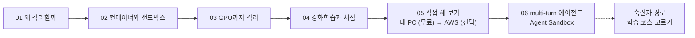

# 시작하기 전에 (초심자 가이드)

**TL;DR** AI가 만든 코드를 안전하게 실행하고 채점하는 방법을 처음 배우는 분을 위한 여섯 편의 가이드입니다. 1~4편에서 개념을 설명하고(합쳐서 1시간 정도), 5편에서 샌드박스를 직접 띄워 보고(내 PC에서 무료, 원하면 AWS에서 몇 달러), 6편에서 multi-turn 에이전트용 샌드박스를 설명합니다.

## 기존 Pain Point

샌드박스, gVisor, Kata, nvproxy, RuntimeClass, GRPO, reward hacking처럼 처음 보는 단어가 한 문장에 서너 개씩 나오면 내용을 이해하기 어려워요. 각 구성이 어떤 위험을 막는지 모른 채 명령만 따라 입력하면, 환경이 조금만 달라져도 대응하기 어렵습니다. 클라우드에서 GPU 인스턴스를 켜면 비용이 나가고 잘못 열어 둔 설정은 보안 문제가 되므로, 처음에는 실습을 시작하기가 부담스럽습니다.

*그림 요약: 명령만 따라 하면 각 단계가 왜 필요한지 알기 어렵습니다. 1~4편에서 개념을 먼저 읽으면 5편의 각 명령이 어떤 위험을 막는지 이해할 수 있습니다.*

## Why

- **그림과 예시로 먼저 설명합니다.** 각 편은 질문 하나에 답하고, 용어는 처음 나올 때 한 줄로 설명합니다.
- **"왜"를 먼저, "어떻게"를 나중에 다룹니다.** 1~4편을 읽고 나면 5편의 각 명령이 어떤 위험을 막는지 이해할 수 있어요.
- **비용이 들지 않는 실습부터 합니다.** 5편은 내 PC에서 먼저 실행하고, AWS 단계는 원할 때만 합니다. AWS 단계에는 실제 배포 화면을 넣었어요.

**사전 지식:** 없습니다. 터미널에 명령을 붙여 넣을 수 있으면 충분하고, Kubernetes와 강화학습은 필요한 만큼 이 가이드에서 설명해요.

## 이 가이드가 답하는 질문

| 편 | 질문 | 한 줄 답 |
|---|---|---|
| [01](01_why_sandbox.md) | AI가 만든 코드를 왜 따로 격리해서 실행해야 할까요? | 모델은 의도와 상관없이 위험한 코드를 쓸 수 있고, 그 코드가 내 서버의 파일, 자격 증명, 네트워크에 접근하면 보안 사고로 이어집니다 |
| [02](02_container_vs_sandbox.md) | 컨테이너로는 부족할까요? | 일반 컨테이너는 호스트의 커널을 함께 써서, 커널 취약점 하나로 격리가 깨질 수 있어요. 샌드박스 런타임은 컨테이너와 호스트 커널 사이에 격리 계층을 하나 더 둡니다 |
| [03](03_gpu_sandbox.md) | GPU를 쓰는 코드는 무엇이 더 어려울까요? | GPU 드라이버가 커널 안에 있어서, GPU를 연결하는 방식에 따라 격리 수준과 쓸 수 있는 인스턴스가 달라집니다 |
| [04](04_rl_and_sandbox.md) | 강화학습에서 샌드박스는 무슨 일을 할까요? | 모델이 쓴 코드를 실행해 점수를 매깁니다. 속임수 코드가 높은 점수를 받거나 채점 기준이 바뀌면 모델이 잘못 학습합니다 |
| [05](05_hands_on.md) | 직접 해 보려면 무엇부터 하면 될까요? | 내 PC에서 샌드박스 서버를 띄워 채점해 보고, 원하면 AWS에 격리 런타임을 설치한 클러스터를 만들어 확인한 뒤 지웁니다 |
| [06](06_multi_turn_agent.md) | multi-turn 에이전트는 샌드박스를 어떻게 써야 할까요? | 한 에피소드의 모든 turn을 같은 샌드박스에서 채점해야 하므로, Agent Sandbox로 에피소드마다 샌드박스 하나를 할당하고 에피소드가 끝나면 삭제합니다 |

*그림 요약: 1~4편에서 개념을 읽고 5편에서 직접 확인한 뒤, 6편에서 multi-turn 에이전트용 샌드박스를 읽고 숙련자 경로로 넘어갑니다.*

## 읽는 법

- **용어 상자:** 각 편 위쪽의 "용어" 상자를 펼치면 그 편에 나오는 용어의 설명이 한 줄씩 있습니다. 더 많은 용어는 [용어 사전](../reference/glossary.md)에 있어요.
- **❓ 오해 상자:** 처음 배우는 사람이 자주 헷갈리는 부분을 바로잡습니다.
- **한 줄 정리:** 각 편 끝에 꼭 기억할 문장을 한두 개 적었습니다.

## 다 읽은 다음에

6편까지 읽었다면 [학습 코스 고르기](../learning_paths.md)에서 GPU로 실제 학습을 실행하는 코스나 운영 설계를 읽는 코스를 고르세요.
