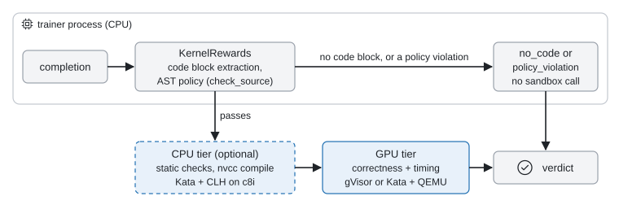

# When the sandbox needs a GPU

!!! info "TL;DR"
    Use a GPU sandbox when the submitted code must run on a GPU or when GPU performance affects its score. Syntax checks and CPU unit tests can run in a CPU sandbox.

## Work that needs a GPU

Suppose you ask a model to write a faster Triton matrix multiplication kernel. Reading the code reveals its structure. To know whether it runs, produces the right output, and beats the reference, execute it on the target GPU. A GPU sandbox runs the submission and returns the result while limiting the execution environment it shares with training and other workloads.

## CPU checks before GPU evaluation

| Check | Where to run it |
|---|---|
| Code format and CPU unit tests | CPU |
| CUDA execution and output correctness | GPU |
| Performance against the reference | Target GPU |

**Speedup** is reference execution time divided by submission execution time. A 4 ms reference and a 2 ms submission give a speedup of 2×. Compare correct outputs with the same input on the same GPU.

A submission that fails a format or compilation check can stop before using a GPU. A trainer can also run on a GPU even when all grading uses CPU unit tests. When execution time contributes to the reward, the measurement environment becomes part of the scoring standard.

See [runtime isolation](02_isolation_runtimes.md) for the GPU paths and [on-policy RL](03_onpolicy_rl_with_sandboxes.md) for how the trainer uses scores. The [CPU exercise](../handson/10_cpu_only.md) demonstrates the scoring flow without GPU instances.

## Further detail

??? note "Four cases where the sandbox needs a GPU"
    | Case | Examples | Why the GPU is needed |
    |---|---|---|
    | GPU kernel RL | KernelBench, CUDA-L1, Kevin-32B, TritonRL and similar | the reward is correctness and speedup measured on a GPU, so scoring is impossible without one |
    | Local models inside the sandbox | tasks where an agent starts a small model for inference or evaluation | running the model is part of the task |
    | GPU simulators | environments that use physics simulation or rendering output as the reward | the simulator runs on the GPU |
    | ML engineer agents | tasks scored by actually running a training or tuning script | the training run uses the GPU |

    !!! note "When no GPU is needed"
        If running the candidate code and every measurement the score needs can happen on CPU, as in code RL scored by unit tests, SQL, or checking math answers, a CPU sandbox is enough; the options are in [05 Decision guide](05_decision_guide.md).

??? note "The scenario of this asset"
    A code model (default `Qwen/Qwen2.5-Coder-1.5B-Instruct`, Apache-2.0) rewrites a PyTorch module as `ModelNew` using Triton kernels, the sandbox measures correctness and speed and returns the result, and the trainer computes the format, correctness and speedup scores. The task contract is similar to KernelBench. Each task module has these.

    - a trusted reference `Model`
    - `get_init_inputs()`
    - `get_inputs(seed, device, size)` that builds inputs per seed
    - tolerances `ATOL` and `RTOL`

    ### Ten tasks (`src/gpusandbox/tasks/`)

    | Level | task_id | What it computes |
    |---|---|---|
    | 0 | `vector_add` | elementwise sum of two 1-D float32 tensors |
    | 0 | `relu_bias` | add a per-column bias to a 2-D activation, then ReLU |
    | 0 | `scaled_residual` | `x + alpha * y` (alpha is a constructor argument) |
    | 1 | `silu_mul` | `silu(a) * b` (the SwiGLU gate) |
    | 1 | `gelu_tanh` | GELU with `approximate='tanh'` |
    | 1 | `row_sum_sq` | sum of squares per row (output shape `[rows]`) |
    | 2 | `row_softmax` | softmax over the last dimension (numerically stable) |
    | 2 | `rms_norm` | RMSNorm over the last dimension |
    | 2 | `layer_norm` | LayerNorm over the last dimension with weight and bias |
    | 3 | `matmul_bias_relu` | float16 `relu(x @ w + b)`, accumulating in float32 inside the kernel |

    By default `train_grpo.py` uses `--max-level 2` (nine tasks) and builds 64 rows per task (`--repeats`). The prompt contains a system prompt, the rules, a Triton example for an op outside the task set (`y = 2 * x`) and the reference source. The task set is part of the sandbox version, so changing a task means shipping a new sandbox version.

    ### Three-part reward

    | Component | Value | Weight (`--reward-weights`) |
    |---|---|---|
    | format | 1.0 when the answer parses as a module that defines `ModelNew`, else 0.0 | 0.1 |
    | correctness | `policy_violation`, `compile_error`, `timeout` 0.0 / `runtime_error` 0.05 / `wrong_answer` 0.2 / correct without a Triton kernel 0.3 / correct with a custom kernel 1.0 | 1.0 |
    | speedup | log2 scale: 0.5x 0.0, 1x 0.5, 2x 1.0, capped at 1.5 from 4x. Only for correct custom kernels | 0.5 |

    The weighted sum peaks at 0.1 + 1.0 + 0.5 x 1.5 = 1.85. Infrastructure errors (`sandbox_error`) are not the policy's fault, so with TRL all three components return `None` and the sample is excluded (reasoning in [03 On-policy RL with sandboxes](03_onpolicy_rl_with_sandboxes.md)).

    ### The RL loop

    ![A clockwise loop. vLLM generates 8 completions per task prompt from the dataset, the trainer extracts code and checks the AST policy on CPU, then sends it to a sandbox pod with one GPU. Inside the pod an untrusted child runs the candidate and a trusted parent judges its outputs with the reference and timing and returns the verdict. Then come the three-part reward (format, correctness, speedup), the group-relative GRPO advantage and the LoRA update (one optimizer step), and a dashed weight sync arrow returns to generation.](../images/figures/concepts-01_why_gpu_sandbox--rl-loop.en.svg)

    *Takeaway: The sandbox sits between generation and update, so slow or wrong scoring slows down or skews the whole training run.*

??? note "Scope and limits"
    - The repository has no pipeline that hands work from the CPU tier to the GPU tier automatically. The two-tier pattern is implemented as the pre-check inside the trainer plus a separate CPU pool.
    - The harness defenses target the published cases in the table above; residual risks and operating countermeasures are in [Production 04 Reward integrity](../production/04_reward_integrity.md).

    ??? note "References"
        | Topic | Link |
        |---|---|
        | AWS Nitro Sandboxes | https://docs.aws.amazon.com/AWSEC2/latest/UserGuide/amazon-ec2-nitro-sandboxes.html |
        | EKS sandboxing limitations | https://docs.aws.amazon.com/eks/latest/userguide/sandboxing-limitations.html |
        | KernelBench GitHub, v0.1 blog | https://github.com/ScalingIntelligence/KernelBench , https://scalingintelligence.stanford.edu/blogs/kernelbenchv01/ |
        | Tasks, prompts, reward code | https://github.com/daekeun-ml/gpu-sandbox-on-aws/blob/main/src/gpusandbox/tasks/__init__.py , https://github.com/daekeun-ml/gpu-sandbox-on-aws/blob/main/src/gpusandbox/prompts.py , https://github.com/daekeun-ml/gpu-sandbox-on-aws/blob/main/src/gpusandbox/rewards.py |
        | Harness timing, policy | https://github.com/daekeun-ml/gpu-sandbox-on-aws/blob/main/src/gpusandbox/harness/timing.py , https://github.com/daekeun-ml/gpu-sandbox-on-aws/blob/main/src/gpusandbox/harness/policy.py |

        All sources: [this page in All references](../reference/references.md#ref-concepts-01-why-gpu-sandbox)
