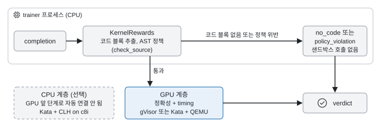

# GPU 샌드박스가 필요한 경우

!!! info "TL;DR"
    샌드박스에 GPU가 필요한지는 어떤 코드를 실행하고 무엇을 채점하느냐에 달려 있습니다. 커널 최적화 과제에서는 모델이 작성한 GPU 커널의 정확도와 실행 시간을 확인해 학습 점수(reward)를 계산합니다. CPU 단위 테스트로 채점할 수 있는 과제라면 CPU 샌드박스로 충분합니다.

## GPU가 필요한 작업

모델에게 “행렬 곱을 더 빠르게 계산하는 Triton 커널을 작성해 줘”라고 요청했다고 해 봅시다. 채점기는 제출 코드와 기준 구현을 목표 GPU에서 같은 입력으로 실행합니다. 두 결과가 일치해야 속도 향상을 점수에 반영할 수 있습니다. GPU 샌드박스는 이 코드를 학습 서버와 분리된 환경에서 실행하고, 학습 서버에는 채점 결과를 돌려줍니다.

KernelBench는 PyTorch 기준 구현을 주고, 모델이 작성한 GPU 커널의 정확도와 성능을 평가하는 벤치마크입니다. ByteDance Seed와 칭화대 연구진의 CUDA Agent는 CUDA 커널을 GPU에서 검증하고 `torch.compile` 대비 성능을 reward에 반영해 모델을 학습시켰습니다. [KernelBench 논문](https://arxiv.org/abs/2502.10517) [CUDA Agent](https://cuda-agent.github.io/)

| 다른 작업 | 샌드박스에서 GPU를 쓰는 경우 |
|---|---|
| 모델 추론 | 입력을 외부 서비스에 보내기 어려울 때 샌드박스 안에서 GPU로 모델을 실행해 답을 생성하거나 평가할 수 있습니다. 외부 모델 API를 호출하는 작업은 CPU에서도 할 수 있습니다. |
| 시뮬레이션 | 로봇이 물체를 집는 동작을 GPU 기반 물리 엔진에서 반복해 성공률을 평가합니다. [NVIDIA Isaac Lab](https://developer.nvidia.com/isaac/lab) |
| 모델 학습과 튜닝 | 에이전트가 학습 코드나 설정을 바꾼 뒤 GPU에서 모델을 학습시켜 정확도를 비교합니다. |

## CPU 검사와 GPU 채점의 역할

학습 서버가 GPU를 써도 보상이 단위 테스트 통과 여부라면 CPU에서 채점할 수 있습니다. 커널 과제를 채점할 때도 trainer는 먼저 CPU에서 답안의 코드를 추출하고 정책을 검사합니다. 이 검사를 통과한 코드를 GPU 샌드박스에서 실행해 정확도와 속도를 비교합니다. GPU 없이 채점을 연습할 때는 [별도의 CPU pool](../handson/10_cpu_only.md)을 사용합니다.

**Speedup**은 기준 구현의 실행 시간을 제출 코드의 실행 시간으로 나눈 값입니다. 같은 GPU에서 기준 구현이 4 ms, 제출한 정답 코드가 2 ms 걸렸다면 speedup은 2배입니다.

## GPU를 격리할 때의 운영 조건

- **장치 연결**　Firecracker v1.18.0은 물리 GPU를 VM에 직접 연결하는 GPU passthrough를 지원하지 않습니다. E2B의 샌드박스도 CPU 전용입니다. GPU 채점 실습에서는 gVisor와 Kata + QEMU로 물리 GPU를 연결합니다. [Firecracker FAQ](https://github.com/firecracker-microvm/firecracker/blob/v1.18.0/FAQ.md) [E2B GPU 지원](https://docs.e2b.dev/faq/gpu-support) [격리 런타임 비교](02_isolation_runtimes.md)
- **측정 일관성**　같은 GPU에서 다른 작업이 겹치면 같은 코드도 실행 시간이 달라져 속도 점수가 흔들릴 수 있습니다. 이 실습에서는 GPU 한 장을 pod 하나에 할당하고, pod마다 한 번에 제출 하나만 채점합니다. [샌드박스 pool 배포와 검증](../handson/04_sandbox_pools.md)
- **동시 실행 비용**　이 구성에서 pod 10개를 동시에 띄우려면 GPU 10장이 필요합니다. 요청을 기다리는 pod도 GPU 한 장을 계속 점유합니다. 그래서 한꺼번에 띄울 pod 수만큼 GPU를 확보해야 합니다. [용량과 노드 관리](../production/01_capacity_and_nodes.md)

??? note "CUDA 오류와 다음 채점"
    잘못된 메모리 접근 같은 일부 CUDA 오류가 나면 같은 프로세스에서 다음에 실행하는 정상 코드도 실패할 수 있습니다. NVIDIA time-slicing으로 GPU를 공유하는 pod는 같은 GPU 메모리 용량을 나눠 쓰며, 장치 오류가 여러 pod에 영향을 줄 수 있습니다. [CUDA 오류 코드](https://docs.nvidia.com/cuda/cuda-runtime-api/group__CUDART__TYPES.html) [NVIDIA GPU time-slicing](https://docs.nvidia.com/datacenter/cloud-native/gpu-operator/latest/gpu-sharing.html)

    채점 서버는 답안을 받을 때마다 새 프로세스에서 후보 코드를 실행합니다. 기준 구현에서도 CUDA 오류가 감지되면 해당 샌드박스는 `sandbox_error`를 반환하고 새 요청을 받지 않습니다. TRL 학습에서는 이렇게 실패한 평가를 제외합니다. [On-policy RL과 오류 처리](03_onpolicy_rl_with_sandboxes.md)

채점 점수가 모델 업데이트에 어떻게 반영되는지는 [On-policy RL과 샌드박스](03_onpolicy_rl_with_sandboxes.md)에서 살펴봅니다. GPU 없이 채점 흐름을 실습하려면 [CPU 핸즈온](../handson/10_cpu_only.md)부터 시작하세요.

## 커널 실행 시간과 채점 시간을 구별하기

GPU pool에 `relu_bias_triton`을 보냈을 때 `ref_ms_median`은 **기준 커널 한 번**의 실행 시간을 나타냅니다. `eval_p50_s`는 **요청 하나**에 대해 샌드박스가 코드를 준비하고 정확성을 검사하고 성능을 측정해 판정을 내리기까지 걸린 시간의 중앙값입니다. 단위도 각각 밀리초와 초입니다.

예를 들어 A10G 두 장을 둔 gVisor pool에서 기준 커널은 0.5833 ms, 커널 speedup 중앙값은 1.743배였고, 요청당 채점 시간 중앙값은 9.984초였습니다. 커널이 빨라져도 코드 준비와 정확성 검사 시간은 여전히 듭니다. 모델이 낸 커널의 성능을 보려면 speedup을, 학습이 다음 배치를 얼마나 기다리는지 보려면 채점 시간과 pool 처리량을 읽으세요. [벤치마크 표와 원본 JSONL](../handson/08_benchmark.md#runtime-results)

## 과제와 채점 기준

코드 모델(기본 `Qwen/Qwen2.5-Coder-1.5B-Instruct`, Apache-2.0)은 PyTorch 모듈을 Triton 커널을 사용하는 `ModelNew`로 다시 작성합니다. 샌드박스가 정확성과 속도를 측정해 결과를 보내면, trainer가 format, correctness, speedup 점수를 계산합니다. 과제 형식은 KernelBench와 비슷합니다. 각 과제 모듈은 다음을 정의합니다.

- 신뢰할 수 있는 reference `Model`
- `get_init_inputs()`
- seed별 입력을 만드는 `get_inputs(seed, device, size)`
- 허용 오차 `ATOL`과 `RTOL`

### 과제 10개 (`src/gpusandbox/tasks/`)

| level | task_id | 내용 |
|---|---|---|
| 0 | `vector_add` | 1-D float32 텐서 두 개의 elementwise 덧셈 |
| 0 | `relu_bias` | 2-D activation에 열 단위 bias를 더한 뒤 ReLU |
| 0 | `scaled_residual` | `x + alpha * y` (alpha는 생성자 인자) |
| 1 | `silu_mul` | `silu(a) * b` (SwiGLU의 gate) |
| 1 | `gelu_tanh` | `approximate='tanh'` GELU |
| 1 | `row_sum_sq` | 행마다 제곱합 (출력 shape `[rows]`) |
| 2 | `row_softmax` | 마지막 차원 softmax (수치 안정) |
| 2 | `rms_norm` | 마지막 차원 RMSNorm |
| 2 | `layer_norm` | weight, bias를 쓰는 마지막 차원 LayerNorm |
| 3 | `matmul_bias_relu` | float16 `relu(x @ w + b)`, 커널 안에서 float32 누산 |

`train_grpo.py`는 기본값으로 `--max-level 2`(9개 과제)를 쓰고 과제마다 64행(`--repeats`)을 만듭니다. prompt에는 system prompt, 규칙, 과제에 없는 연산(`y = 2 * x`)의 Triton 예시, reference 소스가 들어갑니다. 과제 집합은 샌드박스 버전의 일부라서 과제를 바꾸면 새 샌드박스 버전으로 배포합니다.

### Reward 3요소

| 구성 | 값 | 가중치 (`--reward-weights`) |
|---|---|---|
| format | `ModelNew`를 정의하는 모듈로 파싱되면 1.0, 아니면 0.0 | 0.1 |
| correctness | `policy_violation`, `compile_error`, `timeout` 0.0 / `runtime_error` 0.05 / `wrong_answer` 0.2 / 정답이지만 Triton 커널 없음 0.3 / 정답 + 커스텀 커널 1.0 | 1.0 |
| speedup | log2 스케일: 0.5x 0.0, 1x 0.5, 2x 1.0, 4x 이상 1.5에서 상한. 정답이고 커스텀 커널일 때만 | 0.5 |

가중 합의 최댓값은 0.1 + 1.0 + 0.5 x 1.5 = 1.85입니다. 인프라 오류(`sandbox_error`)는 policy가 만든 오류가 아니므로 TRL에서는 세 요소 모두 `None`을 반환해 그 샘플을 학습에서 제외합니다(이유는 [03 On-policy RL과 샌드박스](03_onpolicy_rl_with_sandboxes.md)).

### RL 루프

*그림 요약: 샌드박스는 생성 단계와 업데이트 단계 사이에 있습니다. 그래서 채점이 느리면 학습 전체가 느려지고, 채점이 틀리면 학습이 잘못된 방향으로 진행됩니다.* [채점기가 확인하는 항목과 방어 범위](../production/04_reward_integrity.md)

??? note "참고 자료"
    | 주제 | 링크 |
    |---|---|
    | AWS Nitro Sandboxes | https://docs.aws.amazon.com/AWSEC2/latest/UserGuide/amazon-ec2-nitro-sandboxes.html |
    | EKS sandboxing 제한 사항 | https://docs.aws.amazon.com/eks/latest/userguide/sandboxing-limitations.html |
    | KernelBench GitHub, v0.1 블로그 | https://github.com/ScalingIntelligence/KernelBench , https://scalingintelligence.stanford.edu/blogs/kernelbenchv01/ |
    | 과제, prompt, reward 코드 | https://github.com/daekeun-ml/gpu-sandbox-on-aws/blob/main/src/gpusandbox/tasks/__init__.py , https://github.com/daekeun-ml/gpu-sandbox-on-aws/blob/main/src/gpusandbox/prompts.py , https://github.com/daekeun-ml/gpu-sandbox-on-aws/blob/main/src/gpusandbox/rewards.py |
    | harness timing, 정책 | https://github.com/daekeun-ml/gpu-sandbox-on-aws/blob/main/src/gpusandbox/harness/timing.py , https://github.com/daekeun-ml/gpu-sandbox-on-aws/blob/main/src/gpusandbox/harness/policy.py |

    [관련 대표 자료](../reference/references.md#ref-concepts-01-why-gpu-sandbox)
