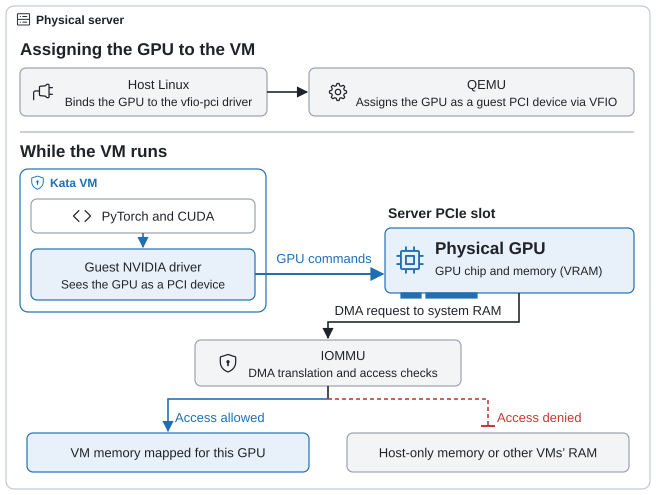

# Isolation runtimes

!!! info "TL;DR"
    Containers running on the same server usually share one Linux kernel, the part of the operating system that handles requests to open files or allocate memory. **gVisor and Kata Containers** are two container runtimes that isolate untrusted programs, such as model-generated code, from other workloads on that server.

    - **gVisor** places a software kernel called the **Sentry** between the program and the server’s kernel. When the program opens a file, the Sentry handles the request and calls on the server’s kernel only for the operations it needs. This design does not require a VM per sandbox.
    - **Kata Containers** starts a **small virtual machine (VM) for each pod** and runs the pod’s containers inside it. The same request to open a file goes to **the Linux kernel inside that VM**. Other Kata pods on the server each have their own VM and kernel.

## How the same image runs under different kernels { #system-calls-and-isolation-boundaries }

Suppose the grader reads an input tensor from a file, then moves it to the GPU with `tensor.to("cuda")`. Opening the file requires a **system call** to the operating system kernel. Allocating GPU memory and copying the data also require the CUDA libraries to communicate with the **NVIDIA driver**.

The container image supplies the grading code and PyTorch. The runtime determines **which kernel handles the program’s system calls**. In Kubernetes you select that runtime through the pod’s `runtimeClassName` field.

| Runtime | What handles a request to open a file? | What do pods on the same node share? |
|---|---|---|
| **runc** (regular containers) | The node’s Linux kernel | Containers can see different files and processes while sharing the kernel. |
| **gVisor** (`runsc`) | [The Sentry](#sentry), gVisor’s user-space kernel | The Sentry invokes the node’s kernel for the operations it needs. GPU workloads also rely on the node’s NVIDIA driver. |
| **Kata Containers** | The Linux kernel inside the pod’s VM, called the *guest kernel* | Containers in one pod share a guest kernel. Other Kata pods run in separate VMs. |

## Which driver handles a GPU request? { #two-gpu-paths }

### gVisor uses the node’s GPU driver { #gvisor-and-nvproxy }

???+ question "What does the Sentry do?"
    When the grader calls `open("input.pt", "rb")`, the Sentry resolves the path in the sandbox’s filesystem and checks whether the process has permission to read the file. From the program’s perspective, the Sentry acts as its kernel. On the node, the Sentry itself runs as a process, which is why it’s called a **user-space kernel**. [The Sentry in gVisor’s architecture guide](https://gvisor.dev/docs/architecture_guide/intro/)

???+ question "What does nvproxy do inside the Sentry?"
    nvproxy handles **device control requests (`ioctl`) for the NVIDIA driver**. For example, when the CUDA libraries request GPU memory for a tensor, nvproxy forwards only the commands it supports for the node’s driver version. The physical GPU on the node then performs the tensor computation. [GPU requests supported by gVisor](https://gvisor.dev/docs/user_guide/gpu/#ioctls)

The node’s driver controls the GPU. Even with the same container image, the GPU features available to a sandbox depend on which driver version the node runs. [gVisor driver compatibility](https://gvisor.dev/docs/user_guide/gpu/)

### How does GPU passthrough work in Kata? { #kata-and-vfio-passthrough }

**GPU passthrough** gives one VM exclusive use of a physical GPU. The card stays in the server’s PCIe slot. What changes is **which driver controls it**. The guest OS sees the GPU as one of its PCI devices, and the NVIDIA driver inside the VM controls it.

**For device assignment**, the host binds the GPU to the Linux `vfio-pci` driver. QEMU uses the Linux **VFIO** interface to present the GPU as a PCI device to the VM. The VM has exclusive use of the device until it releases it. [Linux kernel VFIO documentation](https://docs.kernel.org/driver-api/vfio.html)

**Suppose code inside the VM moves two tensors to the GPU and adds them.** First, the GPU reads the inputs from system RAM and copies them into its own memory (VRAM). Once the inputs are ready, the guest’s NVIDIA driver submits the work, and the physical GPU in the server performs the addition.

???+ question "What is an IOMMU, and why does GPU passthrough need one?"
    An **input/output memory management unit (IOMMU)** is hardware that translates addresses and checks permissions when a device reads or writes system RAM using **direct memory access (DMA)**. A VM can have a GPU all to itself while the server’s RAM still holds data belonging to other VMs.

    In the diagram, the GPU issues a read for the input tensor. The IOMMU looks up the device’s address in the mapping set up by the host. If the mapping allows reads, the IOMMU translates the address to the physical location of the tensor in RAM. It blocks requests to unmapped memory, such as another VM’s pages, and writes to read-only mappings. [CPU and DMA addresses in the Linux kernel documentation](https://docs.kernel.org/core-api/dma-api-howto.html#cpu-and-dma-addresses)

??? question "Does choosing a runtime also set file and network permissions?"
    The runtime establishes the boundary between submitted code and the node. The pod configuration determines which files are mounted, and network policies control which connections are allowed. For example, code inside a Kata VM can still read a file mounted into the sandbox if file permissions allow it. [Sandbox access controls](../production/02_security.md)

??? question "Can Firecracker run these GPU sandboxes?"
    Firecracker runs small VMs with KVM. The version covered here (v1.18.0) supports CPU sandboxes and has no physical GPU passthrough. [Firecracker FAQ](https://github.com/firecracker-microvm/firecracker/blob/v1.18.0/FAQ.md)

## How QEMU and Cloud Hypervisor differ by design { #qemu-and-cloud-hypervisor-in-kata }

Kata uses either **QEMU** or **Cloud Hypervisor** to run a pod’s VM. Both act as a **virtual machine monitor (VMM)**, presenting disks and network devices to the operating system inside the VM (the guest OS). Their designs reflect different goals for **which machines and guest operating systems they need to support**.

- **QEMU is a general-purpose system emulator.** The choice of device model is independent of how guest instructions run. On an x86 server, Linux’s KVM virtualization facility can run x86 guest instructions directly on the processor while QEMU presents the disk through a legacy PC’s IDE controller. To run an Arm OS on that same x86 server, QEMU can translate Arm instructions in software. [QEMU system emulation](https://www.qemu.org/docs/master/system/introduction.html)
- **Cloud Hypervisor is a VMM designed for modern operating systems in cloud VMs.** It runs guest instructions using the host processor’s hardware virtualization support and uses `virtio` for most disk and network I/O. Virtio gives a virtual device and its guest driver a standard interface for exchanging requests. A guest with that driver can use the device without the VMM having to reproduce the behavior of a legacy controller. [Cloud Hypervisor design goals](https://github.com/cloud-hypervisor/cloud-hypervisor/blob/v55.0/README.md#objectives)

Even when a VM uses the same disk image (the file holding the disk’s contents), **the drivers available inside the guest OS matter**. An old OS with only an IDE driver can read the disk when QEMU emulates the controller it expects. A Linux guest with the `virtio-blk` driver can use the same virtual disk interface under either QEMU or Cloud Hypervisor. The guest driver places a request for a block in a shared-memory queue, and the virtual device handles the read. [QEMU’s PC device models](https://www.qemu.org/docs/master/system/i386/pc.html) / [Virtio specification](https://docs.oasis-open.org/virtio/virtio/v1.3/virtio-v1.3.html)

## VM startup and steady-state costs { #compare-runtimes-on-one-node }

When Kata starts a new pod, it sets up memory for the VM and boots the guest kernel. A pod that serves multiple requests incurs that startup cost once. The cost of disk and network I/O while it runs depends on the device model, the guest driver and the workload’s I/O pattern.

[Platforms and instances](04_platforms_and_instances.md) / [Isolation runtime references](../reference/references.md#runtimes) / [Runtime benchmarks](../handson/benchmarks/index.md#runtime-results)
