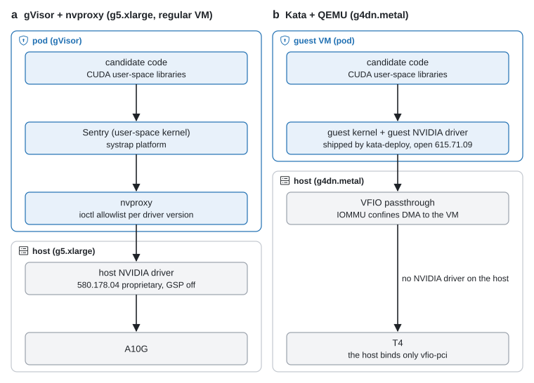

# Isolation runtimes

!!! info "TL;DR"
    gVisor handles application system calls in a user-space kernel. Kata starts a VM with its own kernel for each pod. Their GPU paths require different AWS nodes.

## System calls and isolation boundaries

Opening a file or accessing a device requires a request to the operating system. The runtime determines which kernel receives that request.

| Runtime | First handler | Use in this repository |
|---|---|---|
| runc | Node's Linux kernel | Trainer and system pods |
| gVisor | Sentry, a user-space kernel | CPU and GPU sandboxes |
| Kata | Linux kernel inside a VM per pod | CPU sandboxes and QEMU-based GPU sandboxes |

## Two GPU paths

### gVisor and nvproxy

`nvproxy` forwards supported GPU requests to the node's NVIDIA driver. This works on a regular GPU VM when the driver version matches the `nvproxy` support list.

### Kata and VFIO passthrough

The VM gets a physical GPU and its own NVIDIA driver controls it. VFIO makes the device available to the VM. The IOMMU limits which memory the device can access. CPU-only Kata can use nested virtualization on supported EC2 nodes.

## Running and maintaining each runtime

With gVisor, a driver change can affect GPU compatibility even if the sandbox image stays the same. Kata requires memory for the VM and a GPU that can be assigned directly. QEMU and Cloud Hypervisor are hypervisors that Kata uses to start VMs. This repository verified the QEMU GPU path and uses Cloud Hypervisor for CPU exercises.

## Where each runtime can run on AWS

| Exercise | Node | Requirement |
|---|---|---|
| gVisor GPU | EC2 `g5.xlarge` | Driver supported by nvproxy |
| Kata GPU | EC2 `g4dn.metal` | Passthrough AMI and IOMMU setup |
| Kata CPU | EC2 `c8i.2xlarge` | Nested virtualization enabled |

The runtime controls the execution boundary. Pool access and network controls also matter. Compare the [gVisor exercise](../handson/02_gvisor.md) and [Kata exercise](../handson/03_kata.md).

## Further detail

??? note "Structure of the four runtimes"
    runc shares the host kernel, gVisor has a user-space kernel (the Sentry) receive syscalls first, and Kata gives each pod its own VM (with its own guest kernel).

    | Item | runc | gVisor (runsc) | Kata (QEMU, Cloud Hypervisor) | Firecracker |
    |---|---|---|---|---|
    | Who receives syscalls | host kernel | the Sentry (a user-space kernel). systrap platform on VMs; the KVM platform only on bare metal | guest kernel inside the VM | guest kernel inside the microVM |
    | Isolation boundary | namespaces, cgroups, seccomp | user-space kernel | hardware virtualization (KVM) | hardware virtualization (KVM), minimal device model |
    | NVIDIA driver location | host | host | guest (the host does not load the NVIDIA driver) | n/a |
    | GPU path | direct access to device nodes | nvproxy forwards only allowed ioctls to the host driver | VFIO passthrough (cold-plug) | none |
    | `/dev/kvm` | not needed | not needed (systrap) | needed | needed |
    | In this asset | trainer and system pods | `gvisor` RuntimeClass (handler `runsc`) | `kata-qemu-nvidia-gpu`, `kata-qemu`, `kata-clh` | not used (it is also one of Kata's hypervisors) |

    The sandbox image is the same for all three runtimes and contains no NVIDIA kernel driver, only the CUDA user-space libraries bundled with the PyTorch wheel.

??? note "Kata's hypervisors: QEMU and Cloud Hypervisor"
    | Item | QEMU | Cloud Hypervisor (CLH) |
    |---|---|---|
    | CPU sandbox | supported (`kata-qemu`) | supported (`kata-clh`) |
    | GPU passthrough | supported upstream (`kata-qemu-nvidia-gpu`) | not supported upstream. This asset ships only an experimental `kata-clh-nvidia-gpu` |
    | RuntimeClass `overhead.podFixed` (Kata 4.3.1) | 320Mi, 250m. The GPU class is 10240Mi, 1 CPU | 130Mi, 250m. The experimental `kata-clh-nvidia-gpu` is 10240Mi, 1 CPU |
    | Boot to workload (Kata metrics CI, 3.28.0) | 0.71 s | 0.39 s |

    `overhead.podFixed` is a RuntimeClass setting, not a measurement, that tells the scheduler to add the memory and CPU of the VM itself to the pod's requests.

    GPU support for Cloud Hypervisor stands as follows.

    - **Upstream documentation**: `docs/hypervisors.md` marks GPU support for Cloud Hypervisor as not supported.
    - **Maintainer answer**: in 2025-08 a maintainer answered "You should use the QEMU GPU runtime class. I haven't done any work on CLH to enable proper GPU support."
    - **Go `kata-clh` shim**: it has VFIO cold-plug code since 3.29.0, but it is untested upstream and disabled in the shipped configuration.
    - **runtime-rs**: its CLH configuration has no VFIO keys.

    So QEMU is the only GPU path in Kata that upstream supports, and this asset keeps CLH + GPU in `infra/kata/experimental-clh-gpu/` for evaluation only (no CI). CLH is supported as a CPU sandbox, and the CPU tier (`kata-clh-cpu` profile) is this combination.

    !!! warning "How to read the overhead numbers"
        - **The boot times above**: they come from the Kata metrics CI (3.28.0), measured on different machines with a wide tolerance; they are not AWS measurements.
        - **The AWS China blog's "CLH about 130 MB, QEMU about 160 MB"**: it equals the Kata 3.31.0 `podFixed` defaults, so it is probably not a measurement (inference). What the post did measure is a cold start of about 3 s and about 230 ms to take a sandbox from a pre-started pool.
        - **Values measured in the AWS practice account**: they are in [08 Runtime benchmark](../handson/08_benchmark.md). Its cold start runs from pod creation to Ready, a different interval from boot to workload in the table above. Four pods started with the GPU profile `kata-qemu` (RuntimeClass `kata-qemu-nvidia-gpu`) on `g4dn.metal` had a median of 30.5 s.

    The VM size of `kata-qemu-nvidia-gpu` is `default_memory` 8192 MiB plus the container limits. VFIO type1 pins all guest RAM, so memory cannot be overcommitted. This asset's profile gives each T4 pod 8 CPUs and 16 GiB, and 8 x (16 + 10) GiB = 208 GiB fits in the 384 GiB of `g4dn.metal`.

??? note "Isolation strength and residual risk"
    | Runtime | Between untrusted code and the host | Residual risk | What this asset adds |
    |---|---|---|---|
    | runc | shares the host kernel and driver | kernel or driver vulnerabilities are exposed directly | not used for sandboxes |
    | gVisor + nvproxy | syscalls go to the Sentry, the GPU goes through an ioctl allowlist | weaker than a VM boundary (list below the table) | one GPU per pod (no time-sharing), one sandbox per node, Ready only after egress denial is verified, node guard iptables |
    | Kata + VFIO | VM boundary + IOMMU | the hypervisor and the GPU device itself (list below the table) | v2 marks a pod as draining after 200 evaluations, and the production gateway's recycler deletes it so that a new pod (a new VM with Kata) replaces it |
    | Kata (CPU only) | VM boundary | the hypervisor | the same network controls |

    - **Residual risk of gVisor + nvproxy**: per the gVisor documentation nvproxy is "much less effective at mitigating vulnerabilities within the NVIDIA GPU drivers themselves" and has "no validation of things like DMA buffers".
    - **Residual risk of Kata + VFIO**:
        - The IOMMU confines DMA to the VM (the unsafe noiommu mode stays off).
        - vfio-pci resets the function (or the bus) on release, and T4 reports `reset_method=bus` (third-party report, not an NVIDIA guarantee).
        - T4 has no confidential computing.

    The GKE Sandbox documentation also advises "Don't use GPU time-sharing in sandboxed Pods". The full security boundary and threat model are in [Production 02 Security](../production/02_security.md).

??? note "Scope and limits"
    - **T4 on gVisor:** unverified, because of the AMI condition above.
    - **Kata + GPU on `g4dn.metal`:** not verified upstream. The NVIDIA CI covers A100 and H100, not T4, and the EKS configuration NVIDIA validated is Ubuntu (AL2023 is not listed).
    - **Kata CPU on HyperPod nodes:** judged not possible, but not checked directly.

    ??? note "References"
        | Topic | Link |
        |---|---|
        | EC2 nested virtualization (User Guide, What's New) | https://docs.aws.amazon.com/AWSEC2/latest/UserGuide/amazon-ec2-nested-virtualization.html , https://aws.amazon.com/about-aws/whats-new/2026/02/amazon-ec2-nested-virtualization-on-virtual/ |
        | EC2 accelerated computing instance specifications | https://docs.aws.amazon.com/ec2/latest/instancetypes/ac.html |
        | gVisor installation, GPU support, GitHub | https://gvisor.dev/docs/user_guide/install/ , https://gvisor.dev/docs/user_guide/gpu/ , https://github.com/google/gvisor |
        | Kata NVIDIA GPU passthrough (4.3.1), CLH GPU issue | https://github.com/kata-containers/kata-containers/blob/4.3.1/docs/use-cases/NVIDIA-GPU-passthrough-and-Kata-QEMU.md , https://github.com/kata-containers/kata-containers/issues/11687 |
        | This asset's runtime settings | https://github.com/daekeun-ml/gpu-sandbox-on-aws/blob/main/infra/gvisor/install-gvisor.sh , https://github.com/daekeun-ml/gpu-sandbox-on-aws/blob/main/infra/kata/kata-deploy-values.yaml , https://github.com/daekeun-ml/gpu-sandbox-on-aws/blob/main/infra/kata/gpu-operator-values.yaml |

        [Selected references on this topic](../reference/references.md#ref-concepts-02-isolation-runtimes)
