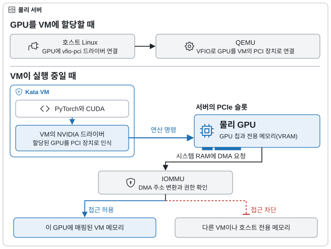

# 격리 런타임 비교

!!! info "TL;DR"
    보통 같은 서버에서 실행되는 컨테이너들은 하나의 Linux 커널을 공유합니다. 커널은 프로그램이 파일을 열거나 메모리를 할당받을 때 그 요청을 처리하는 운영체제의 핵심입니다. **gVisor와 Kata Containers**는 모델이 만든 코드처럼 신뢰하기 어려운 프로그램을 서버의 다른 작업과 격리해 실행하는 컨테이너 런타임입니다.

    - **gVisor**는 프로그램과 서버의 커널 사이에 **Sentry**라는 소프트웨어를 둡니다. 프로그램이 파일을 열면 Sentry가 커널 역할을 맡아 요청을 처리하고, 필요한 작업만 서버 커널에 요청합니다. 이 방식은 샌드박스마다 가상 머신을 띄울 필요가 없습니다.
    - **Kata Containers**는 **pod마다 작은 가상 머신(VM)**을 띄우고 그 안에서 컨테이너를 실행합니다. 프로그램이 파일을 열면 **그 VM의 Linux 커널**이 요청을 처리합니다. 같은 서버에 있는 다른 Kata pod는 별도의 VM과 커널을 사용합니다.

## 같은 이미지를 실행해도 격리가 달라지는 이유 { #시스템-호출은-어디에서-처리될까 }

채점 코드가 파일에서 입력 텐서를 읽은 뒤 `tensor.to("cuda")`로 GPU에 옮긴다고 해 봅시다. 파일을 열려면 프로그램이 운영체제의 커널에 **시스템 호출**을 보냅니다. GPU에 메모리를 할당하고 데이터를 복사하려면 CUDA 라이브러리를 통해 **NVIDIA 드라이버**에도 요청을 보냅니다.

컨테이너 이미지에는 채점 코드와 PyTorch가 들어 있습니다. 같은 이미지라도 **어느 커널이 시스템 호출을 처리하는지**는 런타임에 따라 달라집니다. Kubernetes에서는 pod의 `runtimeClassName`으로 런타임을 고릅니다.

| 런타임 | 파일 열기 요청을 처리하는 곳 | 같은 노드의 다른 pod와 무엇을 공유하나요? |
|---|---|---|
| **runc** (일반 컨테이너) | 노드의 Linux 커널 | 컨테이너마다 보이는 파일과 프로세스는 달라도 Linux 커널은 공유합니다. |
| **gVisor** (`runsc`) | gVisor의 사용자 공간 커널인 [Sentry](#sentry) | Sentry가 필요한 작업만 노드 커널에 요청합니다. GPU를 쓸 때는 노드의 NVIDIA 드라이버를 이용합니다. |
| **Kata Containers** | pod 전용 VM의 Linux 커널. 이 커널을 *게스트 커널*이라고 합니다. | 같은 pod의 컨테이너끼리는 게스트 커널을 공유합니다. 다른 Kata pod는 별도 VM에서 실행됩니다. |

## GPU 요청은 어느 드라이버로 갈까요? { #샌드박스에서-gpu에-접근하는-두-가지-방식 }

### gVisor는 노드의 GPU 드라이버를 사용합니다 { #gvisor--nvproxy }

???+ question "Sentry는 어떤 일을 하나요?"
    채점 코드가 `open("input.pt", "rb")`를 호출하면 Sentry가 샌드박스의 파일 시스템에서 경로를 찾고 읽기 권한을 확인합니다. 프로그램에는 Sentry가 커널 역할을 하고, 노드에서는 Sentry 자체가 하나의 프로세스로 실행됩니다. 그래서 **사용자 공간 커널**이라고 부릅니다. [gVisor 공식 문서의 Sentry 설명](https://gvisor.dev/docs/architecture_guide/intro/)

???+ question "nvproxy는 Sentry 안에서 무엇을 맡나요?"
    nvproxy는 Sentry 안에서 **NVIDIA 드라이버에 보내는 장치 제어 요청(`ioctl`)**을 처리합니다. 예를 들어 CUDA 라이브러리가 텐서를 담을 GPU 메모리를 요청하면, nvproxy는 노드의 드라이버 버전에서 지원하는 명령만 골라 전달합니다. 이후 텐서 연산은 노드에 장착된 GPU에서 실행됩니다. [gVisor가 지원하는 GPU 요청](https://gvisor.dev/docs/user_guide/gpu/#ioctls)

GPU를 제어하는 드라이버가 노드에 있으므로, 같은 컨테이너 이미지라도 노드의 드라이버 버전에 따라 샌드박스에서 사용할 수 있는 GPU 기능이 달라집니다. [gVisor의 드라이버 호환성](https://gvisor.dev/docs/user_guide/gpu/)

### Kata의 GPU 패스스루는 어떻게 동작하나요? { #kata--vfio-passthrough }

**GPU 패스스루(passthrough)**는 서버에 꽂힌 물리 GPU 한 장을 특정 VM의 전용 장치로 연결하는 방식입니다. GPU는 서버의 PCIe 슬롯에 그대로 있습니다. 달라지는 것은 **어느 드라이버가 그 GPU를 제어하느냐**입니다. VM 안의 운영체제는 GPU를 자기 PCI 장치로 인식하고, VM 안의 NVIDIA 드라이버가 제어합니다.

**장치를 할당할 때** 호스트에서 GPU에 연결하는 드라이버는 `vfio-pci`입니다. QEMU는 **VFIO**라는 Linux 인터페이스를 이용해 그 GPU를 VM의 PCI 장치로 연결합니다. VM이 장치를 반납할 때까지 이 GPU는 해당 VM 전용입니다. [Linux 커널의 VFIO 설명](https://docs.kernel.org/driver-api/vfio.html)

**VM 안에서 두 텐서를 GPU로 옮겨 더한다면** 먼저 GPU가 시스템 RAM에서 입력 데이터를 읽어 자신의 전용 메모리(VRAM)로 복사합니다. 입력이 준비되면 게스트의 NVIDIA 드라이버가 연산 명령을 보내고, 덧셈은 서버에 꽂힌 GPU에서 실행됩니다.

???+ question "IOMMU는 무엇이고, GPU 패스스루에 왜 필요한가요?"
    **IOMMU(Input/Output Memory Management Unit)**는 GPU 같은 장치가 시스템 RAM을 직접 읽거나 쓸 때(**DMA**) 주소를 변환하고 접근 권한을 확인하는 하드웨어입니다. GPU 한 장을 VM 전용으로 할당해도 서버의 RAM에는 다른 VM의 데이터가 함께 있으므로 이 구분이 필요합니다.

    위 그림에서 GPU가 입력 텐서를 읽으려고 주소를 보내면, IOMMU는 호스트가 이 GPU에 설정한 주소표를 확인합니다. 읽기가 허용된 주소라면 텐서가 저장된 RAM의 실제 주소로 바꿔 줍니다. 다른 VM의 메모리처럼 주소표에 없는 영역에 접근하거나 읽기 전용 영역에 쓰려고 하면 그 요청을 차단합니다. [Linux 커널 문서의 DMA 주소 설명](https://docs.kernel.org/core-api/dma-api-howto.html#cpu-and-dma-addresses)

??? question "런타임을 정하면 파일과 네트워크 접근 권한도 정해지나요?"
    런타임은 제출 코드와 노드 사이에 격리 경계를 만듭니다. 샌드박스에 어떤 파일을 마운트하고 어디로 접속을 허용할지는 pod 설정과 네트워크 정책으로 정합니다. 예를 들어 Kata VM 안에서도 샌드박스에 마운트한 파일은 그 파일의 권한에 따라 읽을 수 있습니다. [샌드박스의 접근 권한 설정](../production/02_security.md)

??? question "Firecracker도 GPU 샌드박스를 실행하나요?"
    Firecracker는 KVM으로 작은 VM을 실행합니다. 이 가이드에서 비교한 버전(v1.18.0)은 물리 GPU 패스스루를 지원하지 않아 CPU 샌드박스에 적합합니다. [Firecracker FAQ](https://github.com/firecracker-microvm/firecracker/blob/v1.18.0/FAQ.md)

## QEMU와 Cloud Hypervisor의 설계 차이 { #kata에서-qemu와-cloud-hypervisor의-역할 }

Kata는 **QEMU**나 **Cloud Hypervisor**에 pod 전용 VM의 실행을 맡깁니다. 둘 다 **가상 머신 모니터(VMM)**로서 VM 안의 운영체제(게스트 OS)에 디스크와 네트워크 장치를 제공합니다. 차이는 어떤 컴퓨터를 게스트 OS에 보여주도록 설계했느냐에 있습니다.

- **QEMU는 여러 종류의 컴퓨터를 소프트웨어로 재현하는 범용 에뮬레이터입니다.** 게스트의 명령어를 어떻게 실행할지와 어떤 장치를 보여 줄지는 별개입니다. 예를 들어 x86 서버에서 x86 게스트의 명령은 Linux의 가상화 기능인 KVM을 통해 프로세서가 직접 실행하고, 디스크는 QEMU가 오래된 PC의 IDE 컨트롤러처럼 보이게 합니다. x86 서버에서 Arm용 운영체제를 실행할 때는 QEMU가 Arm 명령을 소프트웨어로 번역합니다. [QEMU의 시스템 에뮬레이션](https://www.qemu.org/docs/master/system/introduction.html)
- **Cloud Hypervisor는 최신 운영체제를 클라우드 VM에서 실행하도록 설계한 VMM입니다.** 게스트 명령은 호스트 프로세서의 하드웨어 가상화 기능을 이용해 실행합니다. 디스크와 네트워크에는 주로 `virtio`를 사용합니다. 이는 가상 장치와 게스트 드라이버가 요청을 주고받는 표준입니다. 게스트에 이 드라이버가 있으면 VMM이 옛 장치의 동작을 일일이 재현할 필요가 줄어듭니다. [Cloud Hypervisor의 설계 목표](https://github.com/cloud-hypervisor/cloud-hypervisor/blob/v55.0/README.md#objectives)

디스크 내용을 담은 파일(디스크 이미지)이 같아도 **게스트 OS에 어떤 드라이버가 있느냐**가 중요합니다. IDE 드라이버만 있는 옛 OS라면 QEMU가 IDE 컨트롤러를 재현해 주므로 기존 드라이버로 디스크를 읽을 수 있습니다. 가상 디스크용 `virtio-blk` 드라이버가 있는 Linux는 QEMU에서도 Cloud Hypervisor에서도 같은 드라이버로 디스크를 읽습니다. 게스트 드라이버가 공유 메모리의 큐에 읽을 블록을 적어 두면 가상 장치가 그 요청을 처리합니다. [QEMU의 PC 장치 모델](https://www.qemu.org/docs/master/system/i386/pc.html) / [Virtio 장치 표준](https://docs.oasis-open.org/virtio/virtio/v1.3/virtio-v1.3.html)

## VM의 시작 비용과 실행 중 비용 { #같은-노드에서-런타임-비교하기 }

Kata가 새 pod를 시작하면 VM의 메모리를 준비하고 게스트 커널을 부팅합니다. 한 번 시작한 pod가 여러 요청을 처리하면 이 부팅 비용은 처음에 한 번만 듭니다. 실행 중 디스크를 읽거나 네트워크로 데이터를 보낼 때 드는 비용은 선택한 장치와 드라이버, 작업의 입출력 패턴에 따라 달라집니다.

[플랫폼과 인스턴스 선택](04_platforms_and_instances.md) / [격리 런타임 참고 자료](../reference/references.md#runtimes) / [런타임 벤치마크](../handson/benchmarks/index.md#runtime-results)
