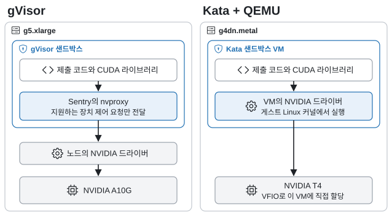

# 격리 런타임 비교

!!! info "TL;DR"
    gVisor는 시스템 호출을 사용자 공간 커널에서 처리하고, Kata는 pod마다 별도의 커널이 있는 VM을 띄웁니다. Kata GPU 실습에서는 QEMU로 VM을 띄웁니다. CPU 격리 실습에서는 Cloud Hypervisor와 QEMU를 비교합니다.

## 시스템 호출은 어디에서 처리될까?

파일을 열거나 GPU를 사용하려면 프로그램이 운영체제에 요청을 보냅니다. 모델이 만든 코드도 마찬가지입니다. 격리 런타임을 고를 때는 그 요청을 어디서 받아 처리할지 정합니다.

| 런타임 | 요청을 처음 받는 곳 | 실습에서 맡는 역할 |
|---|---|---|
| runc | 노드의 Linux 커널 | trainer와 시스템 pod |
| gVisor | 사용자 공간 커널(Sentry) | CPU 및 GPU 샌드박스 |
| Kata | pod마다 띄운 VM의 Linux 커널 | CPU 샌드박스, QEMU 기반 GPU 샌드박스 |

## 샌드박스에서 GPU에 접근하는 두 가지 방식

### gVisor + nvproxy

`nvproxy`는 GPU 요청 중 지원 목록에 있는 요청만 노드의 NVIDIA 드라이버로 전달합니다. 일반 GPU VM에서도 쓸 수 있지만 드라이버 버전이 `nvproxy` 지원 목록과 맞아야 합니다.

### Kata + VFIO passthrough

GPU를 작은 VM에 직접 연결하고 VM 안의 NVIDIA 드라이버가 장치를 제어합니다. x86 GPU 실습은 T4를 장착한 `g4dn.metal`에서 진행합니다. GPU 없이 Kata를 실습할 때는 `c8i`의 중첩 가상화를 이용할 수 있습니다.

GPU **passthrough**는 물리 GPU를 VM에 직접 할당하는 방식입니다. Linux의 **VFIO**는 VM이 그 장치를 사용할 수 있게 하고, **IOMMU**는 GPU가 직접 접근할 수 있는 메모리 범위를 제한합니다. CPU 전용 Kata는 GPU를 직접 할당하지 않으므로, 지원되는 EC2 VM에서 **nested virtualization**을 켜 VM 안에 Kata VM을 띄울 수 있습니다.

## 격리 경계와 운영 조건

파일 접근 요청은 어느 커널이 처리하고, GPU 드라이버는 어디에서 실행될까요? gVisor에서 요청은 Sentry를 거치며 일부 GPU 요청은 노드 드라이버까지 전달됩니다. 그래서 이미지가 같아도 노드의 드라이버를 바꾸면 GPU 실행 여부가 달라질 수 있습니다. Kata에서는 드라이버를 VM 안에 둡니다. 대신 VM이 쓸 메모리를 확보하고 장치를 직접 할당해야 합니다.

## Kata에서 QEMU와 Cloud Hypervisor의 역할

QEMU와 Cloud Hypervisor는 Kata가 pod의 VM을 띄울 때 쓰는 **hypervisor**입니다. Cloud Hypervisor로 VM을 직접 만들 때도 VFIO로 물리 GPU를 연결할 수 있습니다. [Cloud Hypervisor의 VFIO 문서](https://github.com/cloud-hypervisor/cloud-hypervisor/blob/v55.0/docs/vfio.md)

Kata GPU 실습에서는 pod가 `nvidia.com/pgpu`로 물리 GPU를 요청합니다. Kata가 할당된 GPU를 hypervisor에 전달하고, VM 안의 드라이버가 GPU를 제어합니다. 이 과정까지 검증한 구성은 **Kata + QEMU**입니다. **Kata + Cloud Hypervisor**는 CPU 샌드박스에서 검증했고, GPU 실험에서는 VM 부팅이 타임아웃으로 끝났습니다. [Kata 핸즈온](../handson/03_kata.md)

## AWS에서 각 런타임을 실행할 수 있는 위치

| 실습 | 노드 | 확인할 조건 |
|---|---|---|
| gVisor GPU | EC2 `g5.xlarge` | 노드 드라이버가 nvproxy 지원 목록에 있어야 함. T4에서 gVisor를 실행하는 구성은 이 실습에서 검증하지 않음 |
| Kata + QEMU GPU | EC2 `g4dn.metal` | GPU passthrough용 AMI와 IOMMU 필요. 실습 환경은 AL2023과 T4이며, NVIDIA의 EKS 검증 환경(Ubuntu)과 Kata CI 대상 GPU(A100, H100)와 다름 |
| Kata CPU (QEMU, Cloud Hypervisor) | EC2 `c8i.2xlarge` | 중첩 가상화 필요. 실습의 HyperPod GPU 노드에서는 Kata CPU도 실행하기 어려울 것으로 보이며 직접 검증하지 않음 |

런타임을 선택한 뒤에는 누가 pool에 요청을 보낼 수 있는지, 샌드박스에서 나가는 연결은 어디까지 허용되는지도 확인해야 합니다. 직접 비교하려면 [gVisor 핸즈온](../handson/02_gvisor.md)과 [Kata 핸즈온](../handson/03_kata.md)을 보세요.

## 같은 노드에서 런타임 비교하기

두 pool의 GPU 모델이 다르면 채점 시간에 영향을 준 요인이 GPU인지 런타임인지 구분하기 어렵습니다. 아래 CPU 실험에서는 `c8i.2xlarge` 한 대에 런타임별로 pool을 띄웠고, 세 pool 모두 Ready 상태인 pod가 한 개씩이었습니다. 같은 `relu_bias_torch_only` 답안을 pool마다 32번 채점한 결과입니다.

| pool | 파일·메모리 요청을 받는 곳 | 성공 | 채점 p50 |
|---|---|---:|---:|
| `gvisor-cpu` | Sentry | 32/32 | 3.576초 |
| `kata-clh-cpu` | Cloud Hypervisor VM의 게스트 커널 | 32/32 | 4.043초 |
| `kata-qemu-cpu` | QEMU VM의 게스트 커널 | 32/32 | 3.819초 |

세 pool 모두 요청을 처리할 준비가 된 상태에서 잰 값입니다. VM 부팅 시간을 알고 싶다면 pod 생성부터 Ready까지를 재야 합니다. 이 비교를 새 노드에서 되풀이할 때는 이미지 캐시 상태, pod 수, RuntimeClass의 CPU·메모리 예약량도 기록하세요. [벤치마크 조건](../handson/08_benchmark.md#runtime-results) · [직접 커널을 확인하는 실습](../beginner/05_hands_on.md#aws-cpu)

## 네 런타임의 구조

runc에서는 컨테이너가 host 커널을 공유합니다. gVisor에서는 사용자 공간 커널(Sentry)이 syscall을 먼저 처리합니다. Kata는 pod마다 별도의 VM(guest 커널)을 실행합니다.

| 항목 | runc | gVisor (runsc) | Kata (QEMU, Cloud Hypervisor) | Firecracker |
|---|---|---|---|---|
| syscall을 처리하는 곳 | host kernel | Sentry(사용자 공간 커널). VM에서는 systrap 플랫폼, KVM 플랫폼은 bare metal에서만 | VM 안의 guest kernel | microVM 안의 guest kernel |
| 격리 경계 | namespace, cgroup, seccomp | 사용자 공간 커널 | 하드웨어 가상화 (KVM) | 하드웨어 가상화 (KVM), 최소 장치 모델 |
| NVIDIA 드라이버 위치 | host | host | guest (host에는 NVIDIA 드라이버를 설치하지 않음) | 해당 없음 |
| GPU 경로 | device node 직접 접근 | nvproxy가 허용된 ioctl만 host 드라이버로 전달 | QEMU로 VFIO passthrough (cold-plug) | 없음 |
| `/dev/kvm` | 불필요 | 불필요 (systrap) | 필요 | 필요 |
| 실습 구성 | trainer와 시스템 pod | `gvisor` RuntimeClass (handler `runsc`) | `kata-qemu-nvidia-gpu`, `kata-qemu`, `kata-clh` | 사용하지 않음 (Kata의 hypervisor로도 쓰임) |

세 런타임의 샌드박스 이미지는 동일합니다. 이미지에는 NVIDIA 커널 드라이버가 없고, PyTorch wheel에 포함된 CUDA 사용자 공간 라이브러리만 들어 있습니다.

## QEMU와 Cloud Hypervisor의 자원 예약량

| 항목 | QEMU | Cloud Hypervisor (CLH) |
|---|---|---|
| Kata CPU pod | 지원 (`kata-qemu`) | 지원 (`kata-clh`) |
| Kata NVIDIA GPU pod | 지원 (`kata-qemu-nvidia-gpu`) | Kata 지원표에서 미지원. 실험용 `kata-clh-nvidia-gpu`는 EKS에서 VM 부팅 실패 |
| RuntimeClass `overhead.podFixed` (Kata 4.3.1) | 320Mi, 250m. GPU class는 10240Mi, 1 CPU | 130Mi, 250m. 실험용 `kata-clh-nvidia-gpu`는 10240Mi, 1 CPU |
| boot to workload (Kata metrics CI, 3.28.0) | 0.71 s | 0.39 s |

`overhead.podFixed`는 RuntimeClass에 지정된 설정값이며 측정값이 아닙니다. 스케줄러는 이 값을 VM 자체가 사용하는 메모리와 CPU로 보고 pod 요청량에 합산합니다.

Kata의 Go 런타임에는 Cloud Hypervisor VM을 띄우기 전에 VFIO 장치를 연결하는 코드가 있습니다. EKS에서 이 조합을 시험할 때도 Go 런타임의 해당 코드를 사용했습니다. Kata의 Rust 런타임(`runtime-rs`)도 일반 VFIO 장치를 처리하며, 새 VFIO 인터페이스의 장치를 Cloud Hypervisor에 전달하는 데 남은 작업은 별도 이슈에 정리돼 있습니다. [Go 런타임 코드](https://github.com/kata-containers/kata-containers/blob/4.3.1/src/runtime/virtcontainers/clh.go#L1173-L1209) [Kata 4.3.1 지원표](https://github.com/kata-containers/kata-containers/blob/4.3.1/docs/hypervisors.md#types) [Kata 이슈 #13992](https://github.com/kata-containers/kata-containers/issues/13992)

!!! warning "오버헤드 수치를 읽는 법"
    - **위 boot 시간**: Kata metrics CI(3.28.0)가 서로 다른 머신에서 넓은 허용 오차로 측정한 값이며 AWS 측정값이 아닙니다.
    - **AWS China 블로그의 "CLH 약 130 MB, QEMU 약 160 MB"**: Kata 3.31.0의 `podFixed` 기본값과 같아서 측정값이 아닐 가능성이 높습니다(추론). 같은 글에 실린 측정값은 cold start 약 3 s, 미리 시작해 둔 pool에서 가져올 때 약 230 ms입니다.
    - **AWS 실습 계정에서 측정한 값**: [08 런타임 벤치마크](../handson/08_benchmark.md)에 있습니다. 그 표의 cold start는 pod 생성부터 Ready까지의 시간이라 위 표의 boot to workload와 측정 구간이 다릅니다. `g4dn.metal`에서 GPU 프로필 `kata-qemu`(RuntimeClass `kata-qemu-nvidia-gpu`)로 띄운 pod 4개는 중앙값 30.5초였습니다.

`kata-qemu-nvidia-gpu`의 VM 크기는 `default_memory` 8192 MiB에 컨테이너 limit을 더한 값입니다. VFIO type1은 guest RAM 전체를 pin하므로 메모리를 overcommit할 수 없습니다. 실습용 GPU 프로필은 T4 pod마다 CPU 8개와 메모리 16 GiB를 할당합니다. 8 x (16 + 10) GiB = 208 GiB이므로 `g4dn.metal`의 384 GiB 안에 들어갑니다.

## 런타임별 격리 범위와 한계

| 런타임 | 제출 코드와 호스트를 분리하는 방식 | 격리 후에도 주의할 점 | 실습의 보완 조치 |
|---|---|---|---|
| runc | host kernel과 드라이버를 공유 | kernel이나 드라이버 취약점이 그대로 노출 | 샌드박스에 쓰지 않음 |
| gVisor + nvproxy | syscall은 Sentry, GPU는 ioctl allowlist | VM 경계보다 약함(표 아래 목록) | pod마다 GPU 1개(time-sharing 없음), 노드당 샌드박스 1개, egress 차단을 확인한 뒤 Ready, node guard iptables |
| Kata + VFIO | VM 경계 + IOMMU | hypervisor와 GPU 장치 자체(표 아래 목록) | v2는 200회 평가 후 pod를 draining으로 바꾸고, Production gateway의 recycler가 그 pod를 삭제하고 새 pod(Kata에서는 새 VM)로 교체 |
| Kata (CPU 전용) | VM 경계 | hypervisor | 같은 네트워크 통제 |

- **gVisor + nvproxy에서 호스트 드라이버를 공유할 때 주의할 점** gVisor 문서는 NVIDIA 드라이버 자체의 취약점을 완화하는 데에는 nvproxy의 효과가 제한적이라고 설명합니다("much less effective at mitigating vulnerabilities within the NVIDIA GPU drivers themselves"). DMA 버퍼 등도 검증하지 않습니다("no validation of things like DMA buffers").
- **Kata + VFIO로 GPU를 할당할 때 주의할 점**
    - IOMMU는 DMA로 접근할 수 있는 메모리를 해당 VM 안으로 제한합니다(unsafe noiommu 모드는 켜지 않음).
    - vfio-pci는 장치를 해제할 때 function 또는 bus를 초기화합니다. T4에서 `reset_method=bus`가 나타났다는 제3자 보고가 있지만 NVIDIA가 보증한 동작은 아닙니다.
    - T4는 confidential computing을 지원하지 않습니다.

GKE Sandbox 문서도 "Don't use GPU time-sharing in sandboxed Pods"라고 권고합니다. 보안 경계 전체와 위협 모델은 [Production 02 보안](../production/02_security.md)에서 다룹니다.

??? note "참고 자료"
    | 주제 | 링크 |
    |---|---|
    | EC2 nested virtualization (User Guide, What's New) | https://docs.aws.amazon.com/AWSEC2/latest/UserGuide/amazon-ec2-nested-virtualization.html , https://aws.amazon.com/about-aws/whats-new/2026/02/amazon-ec2-nested-virtualization-on-virtual/ |
    | EC2 가속 컴퓨팅 인스턴스 사양 | https://docs.aws.amazon.com/ec2/latest/instancetypes/ac.html |
    | gVisor 설치, GPU 지원, GitHub | https://gvisor.dev/docs/user_guide/install/ , https://gvisor.dev/docs/user_guide/gpu/ , https://github.com/google/gvisor |
    | Kata NVIDIA GPU passthrough (4.3.1) | https://github.com/kata-containers/kata-containers/blob/4.3.1/docs/use-cases/NVIDIA-GPU-passthrough-and-Kata-QEMU.md |
    | gVisor와 Kata 런타임 설정 파일 | https://github.com/daekeun-ml/gpu-sandbox-on-aws/blob/main/infra/gvisor/install-gvisor.sh , https://github.com/daekeun-ml/gpu-sandbox-on-aws/blob/main/infra/kata/kata-deploy-values.yaml , https://github.com/daekeun-ml/gpu-sandbox-on-aws/blob/main/infra/kata/gpu-operator-values.yaml |

    [관련 대표 자료](../reference/references.md#ref-concepts-02-isolation-runtimes)
