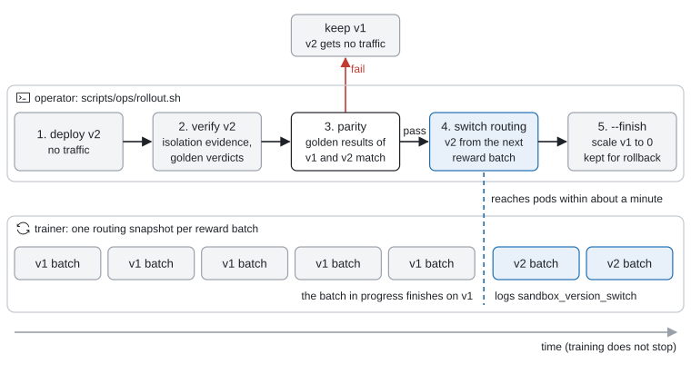

# On-policy RL with sandboxes

!!! info "TL;DR"
    Generate answers with the current model, score them under one standard, and update the model from the differences in reward. Keep the same sandbox version within a group and report infrastructure failures separately.

## Generate, score, and update

A model might produce a well-formed answer that fails, a runnable answer with incorrect output, and a correct answer. The sandbox runs each submission and returns the information needed to score it. On-policy training uses data generated by the current model. In this exercise, each generated batch feeds one optimizer step.

A **group** contains answers to the same prompt. A **batch** can contain multiple groups. **Advantage** expresses how an answer's reward compares with others in its group. For `0.1`, `0.3`, and `0.5`, the first answer is below the mean and the last is above it. If every answer earns `0.3`, this comparison provides no preference among them.

## Why one group must be scored by one version

If v2 has a stricter correctness check, evaluating equivalent answers on v1 and v2 can create a reward gap unrelated to code quality. The trainer pins a version for each batch. Deploy and compare the new pool against the old one using reference submissions before switching routing.

??? note "Sandbox version switch"
    

    When the switch becomes visible depends on routing propagation and when the trainer starts the next batch.

## Infrastructure failures and missing scores

The TRL exercise records a grading failure as `sandbox_error` and excludes that answer from the group baseline. Incorrect code still receives its normal score. See [GRPO training](../handson/05_grpo_training.md) for the logs and [updating the sandbox](../handson/06_sandbox_update.md) for switching pools.

## Further detail

??? note "How this asset pins versions"
    | Trainer | Pinning unit | Implementation |
    |---|---|---|
    | TRL (hands-on, direct) | reward batch | `SandboxClient.evaluate_batch` reads `RoutingTable.snapshot()` once per call and sends every request of that call to that snapshot's pool |
    | TRL (production, gateway) | reward batch | the gateway's `POST /v1/evaluate_batch` uses one snapshot per request |
    | veRL (gateway) | `group_key` = `{task_id}:{index}` | the gateway's `POST /v1/evaluate` pins the version that scored the group's first sample for `GATEWAY_GROUP_PIN_TTL_S` (default 900 s, 15 minutes) |

    - **TRL (hands-on, direct)**: `KernelRewards` re-scores results cached from another pool so the batch matches one pool. `routing_revision` is recorded with the results.
    - **veRL (gateway)**: the pin lives only in the gateway process memory and the TTL counts from the first request. The gateway does not read the epoch: after the TTL, or after a gateway restart, the next request picks the current version again, even for the same group.

    The routing table is JSON from a ConfigMap, mounted as a directory because a subPath mount does not receive updates. The trainer re-reads it when it takes a snapshot, but reuses the previous contents if the last check was less than 2 seconds ago, and bumps `revision` on change. TRL scores the whole generation batch of a process at once (as of TRL 1.18.0), so with the hands-on's single process, one reward batch contains whole groups.

    On the TRL path `KernelRewards` caches results under a key built from the task, prompt and completion, and stores with each result the pool (runtime, version) that produced it.

    - **After a switch, when a batch holds both new completions and completions cached from the old pool**: the cached ones are scored again on the pool that scored the new ones.
    - **When every result of the batch is already cached and all of them came from one pool**: the sandbox is not called and those results are used. In that case the batch is scored with the old pool's results even after the switch, and no `reward_batch` line is printed.
    - **If the pool switches again during re-scoring**: the third attempt sends the whole batch in a single request.

    One request is answered by one pool, so a batch is always scored by one version.

    !!! note "Setups that split a group across processes"
        Each process takes its own snapshot, so right after a switch one group can span two versions. `routing_revision` is a per-process counter, so it cannot be compared across ranks. Compare `version` and `served_versions` from all ranks at the same `global_step`, or pin per `group_key` as the veRL path does.

??? note "Updating the sandbox during training"
    1. **Blue/green Deployments:** each (runtime, version) has its own Deployment and headless Service (`sandbox-<runtime>-<version>`). v2 starts next to v1 and receives no requests until the routing table points at it.
    2. **Verification:** `scripts/ops/verify.sh` checks the isolation evidence per pod, that IMDS, the API server, the node's kubelet and the internet are blocked, the golden verdicts, and that access from another namespace is refused.
        - **If you installed the Production gateway**: first add the NetworkPolicy for verification Jobs from [Production 03](../production/03_gateway_and_pools.md), so the verification and parity Jobs can connect from `rl-trainer` straight to the sandbox.
    3. **Parity:** for every golden submission the two versions must return the same verdict, and when both are `ok` the speedup ratio must be within tolerance (`--speedup-tolerance`, default 0.35); on failure the script stops.
    4. **Switch:** the script updates the routing ConfigMap in the `rl-trainer` and `sandbox-gateway` namespaces one after the other, so if this step fails, check the active version in each namespace.
        - **When it takes effect**: after the routing ConfigMap changes, the kubelet sync reaches the mounted pods within about a minute. The trainer reads the new table when it scores the next reward batch, and with TRL's defaults one reward batch is one optimizer step, so the switch lands on a step boundary.
        - **Requests in flight during the switch**: requests already sent with the v1 snapshot finish on v1, and a batch that is being re-scored when the switch lands is scored again on the later version so it ends on one version.
    5. **Cleanup and rollback:**
        - **`--finish`**: it scales v1 to zero but keeps its Deployment. On the gateway path (veRL), run it only after `GATEWAY_GROUP_PIN_TTL_S` (default 900 s) has passed since the switch, so requests pinned to v1 have finished.
        - **Rollback**: swap the arguments to go back to the v1 settings. The script redeploys v1 with the current `SANDBOX_IMAGE_URI`, so if the update also changes the image, pin each version's image URI in its version file ([Production 05](../production/05_sandbox_updates.md)).

    In the default gVisor pool the two v1 pods already hold the GPUs of both `g5.xlarge` nodes. Run as is, the v2 pods stay Pending, step 1's `rollout status` fails after 30 minutes without progress (the Deployment `progressDeadlineSeconds` of 1800 seconds), and the switch never happens. Scale the `sandbox-gvisor` node group to 4 first; scenario A then needs 24 vCPU of G/VT quota (steps in [06 Updating the sandbox during training](../handson/06_sandbox_update.md)).

    The first command covers steps 1 to 4, the second step 5, the third the rollback.

    ```bash
    # Blue/green update of the gVisor pool while training runs
    scripts/ops/rollout.sh gvisor v1 v2
    # TRL: after sandbox_version_switch and reward_batch lines that serve only v2
    #      with at least one status other than sandbox_error.
    # veRL: after new groups report sandbox_version v2 and GATEWAY_GROUP_PIN_TTL_S has passed.
    # Then retire v1 (kept for rollback)
    scripts/ops/rollout.sh gvisor v1 v2 --finish
    # Roll back at any point
    scripts/ops/rollout.sh gvisor v2 v1
    ```

    **What to look for:**

    - **With TRL**: after the switch the trainer log shows the event below once, and afterwards `version` and `served_versions` in `reward_batch` change to `v2`.

        ```text
        {"event": "sandbox_version_switch", "from": "gvisor/v1", "to": "gvisor/v2", "routing_revision": ..., "global_step": ..., "ts": ...}
        ```

        The direct client records the requested version even on results whose connection failed, so also check that `status` holds a verdict other than `sandbox_error` before you run `--finish`.

    - **With veRL**: there is no such event, so check `sandbox_version` of new groups and the per-version evaluation count on the gateway (`gateway_evaluations_total`).

    The v2 example switches to draining after 200 evaluations.

    - **With the production gateway**: replacing a draining pod is the job of the production gateway's recycler.
    - **In the hands-on's direct mode**: a draining pod stays NotReady.

    The hands-on procedure is in [06 Updating the sandbox during training](../handson/06_sandbox_update.md) and the operating design in [Production 05 Sandbox versioning](../production/05_sandbox_updates.md).

    **If it fails:** if parity fails or a switch does not take effect, see the "version switch (routing)" section of [Troubleshooting](../reference/troubleshooting.md).

    !!! question "❓ Misconception: changing the scoring rules during on-policy training means starting over"
        On-policy means the current policy generates the data; it does not stop the reward function from changing between steps. What you must keep is no version mixing inside a group and a logged switch point. The INTELLECT-3 report also runs environments "versioned independently of the trainer".

    !!! question "❓ Misconception: passing parity means v1 and v2 give the same reward"
        Parity checks only that the golden submissions get the same verdicts and speedups within tolerance. v2 changes the seed count and the speedup cap on purpose, so some completions get a different reward. That is why the switch is aligned to a batch boundary and logged as `sandbox_version_switch`, to tell whether a change in the reward curve comes from the version switch.

??? note "Scope and limits"
    - **Checked by local tests:** pytest checks the routing table reload and `revision` bump, the reward that turns `sandbox_error` into `None`, the golden probe and parity between two CPU pools, and the gateway's group pinning across a routing switch; the TRL path was checked for wiring only, with a one-process dry run.
    - **Run on AWS:** in the practice account, a gVisor v1 pool was deployed and passed `scripts/ops/verify.sh gvisor v1`, and a `g5.2xlarge` trainer finished 5 GRPO steps ([run record](../reference/sources.md#aws-run-record)).
    - **Not run on AWS:** a `scripts/ops/rollout.sh` version switch during training. Verify it with the checks in [06 Updating the sandbox during training](../handson/06_sandbox_update.md).

    ??? note "References"
        | Topic | Link |
        |---|---|
        | TRL GRPO trainer docs, GitHub | https://huggingface.co/docs/trl/main/en/grpo_trainer , https://github.com/huggingface/trl |
        | Ray on SageMaker HyperPod | https://docs.aws.amazon.com/sagemaker/latest/dg/sagemaker-hyperpod-ray.html |
        | Client, routing, pool | https://github.com/daekeun-ml/gpu-sandbox-on-aws/blob/main/src/gpusandbox/client/__init__.py , https://github.com/daekeun-ml/gpu-sandbox-on-aws/blob/main/src/gpusandbox/client/routing.py , https://github.com/daekeun-ml/gpu-sandbox-on-aws/blob/main/src/gpusandbox/client/pool.py |
        | Rewards, gateway, veRL reward | https://github.com/daekeun-ml/gpu-sandbox-on-aws/blob/main/src/gpusandbox/rewards.py , https://github.com/daekeun-ml/gpu-sandbox-on-aws/blob/main/src/gpusandbox/gateway/app.py , https://github.com/daekeun-ml/gpu-sandbox-on-aws/blob/main/rl/verl/reward_fn.py |
        | Blue/green script, version file | https://github.com/daekeun-ml/gpu-sandbox-on-aws/blob/main/scripts/ops/rollout.sh , https://github.com/daekeun-ml/gpu-sandbox-on-aws/blob/main/k8s/sandbox/versions/v2.env |

        All sources: [this page in All references](../reference/references.md#ref-concepts-03-onpolicy-rl-with-sandboxes)

??? note "Do not turn infrastructure errors into wrong answers"
    | Verdict status | Responsible | TRL (`src/gpusandbox/rewards.py`) | veRL (`rl/verl/reward_fn.py`) |
    |---|---|---|---|
    | `ok`, `wrong_answer`, `compile_error`, `runtime_error`, `timeout`, `policy_violation`, `no_code` | policy | normal score | normal score (weighted sum) |
    | `sandbox_error` | infrastructure | `None` from all three functions | there is no "skip" signal, so only the format score (0.1) is given and `sandbox_error: 1` is recorded |

    - **How TRL handles `None`**: TRL excludes that reward function for the sample; when all return `None` the sample is unscorable, is left out of the group baseline and gets advantage 0.

    A result becomes `sandbox_error` in these cases:

    - no free pod within 600 seconds, or all 4 attempts failed
    - a 4xx response, or a gateway error
    - the harness's outer timeout, or a harness that ended without a result file
    - a failure on the trusted reference path (with the `gpu_fault` flag for CUDA errors)

    A candidate that dies with a segfault or a CUDA abort is the policy's responsibility: `runtime_error` (0.05). When `gpu_fault` occurs on the reference path, that pod stops taking work and the liveness probe (the check kubelet runs periodically to see whether the container is alive) restarts the container.

    !!! warning "The veRL path is not fully neutral"
        With veRL a sample hit by an infrastructure error gets only the format score 0.1. That is below a correct sample but above `no_code` (0), so the group mean and the ranking of samples can differ from their real quality. If the `sandbox_error` ratio in `reward_extra_info` rises noticeably, fix the infrastructure cause before continuing training (on the TRL path, check `status` in `reward_batch`).

    !!! question "❓ Misconception: giving infrastructure errors zero is the safe, conservative choice"
        Zero means "this answer is bad", so a correct sample zeroed by a pod failure gets suppressed, and when errors cluster (a failing node, for example) the noise becomes systematic. Leaving an unscored sample unscored distorts the signal less.
