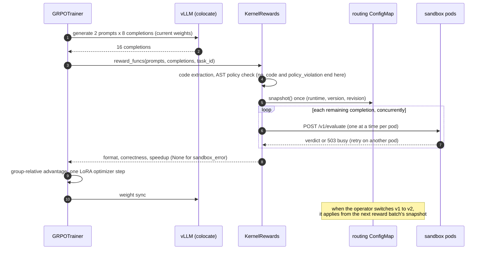

# On-policy RL with sandboxes

**TL;DR** GRPO compares completions of the same prompt to build advantages, so one group is scored by one sandbox version, infrastructure errors do not become wrong-answer scores, and versions switch at batch boundaries without stopping training.

## Pain point

Fix the harness mid-training and v1 and v2 scores mix inside one group, so the advantage learns the difference between versions instead of between behaviors. Giving zero to a sample that could not be scored because a pod was busy or dead punishes the policy for infrastructure noise. Yet stopping a multi-day on-policy run to change the sandbox wastes the GPU time and progress so far.


*Takeaway: When the same code scores differently by version and infrastructure failures enter as zeros, the advantage reflects versions and infrastructure, so one group is scored by one version and infrastructure errors are left out as None (TRL).*


## Why

- **Match the pinning unit to the trainer.** TRL pins one routing snapshot per reward batch; with veRL, the gateway pins a version per `group_key`.
- **Separate infrastructure errors from policy scores.** TRL excludes the sample with `None`; veRL gives only the format score and records a flag.
- **Switch without downtime using blue/green.** Start the new version next to the old one, check parity, then change only the routing table so the next batch uses it.

**Before you start:** read "Three-part reward" and "The RL loop" in [01 When the sandbox needs a GPU](01_why_gpu_sandbox.md) first. Unfamiliar terms are in the "Terms" box below and in the [Glossary](../reference/glossary.md).

??? note "Terms (expand if a word is new to you)"
    - **On-policy**: updating only with data the current policy just generated. A completion is discarded after one use.
    - **Group, completion**: a completion is one answer the model generated for a prompt; a group is the set of completions from the same prompt (eight here).
    - **Advantage**: how much a completion's reward exceeds the group average, divided by the standard deviation. A positive value reinforces that behavior.
    - **Optimizer step**: one update of the model weights with the computed gradients.
    - **Reward batch**: the set of completions TRL passes in one call to the reward functions.
    - **vLLM colocate**: the mode that runs the vLLM generation engine on the same GPU as the trainer.
    - **Routing table, snapshot**: the JSON (a ConfigMap) that says which sandbox pool (runtime, version) to use, and a copy of it fixed at one moment.
    - **Blue/green**: a deployment method that starts the new version (green) next to the current one (blue), verifies it, then moves traffic in one switch.
    - **Parity**: a check that the new version gives the same verdicts as the current one on the golden submissions.
    - **Draining**: a pod state in which it takes no new requests and waits to be replaced.
    - **veRL, `group_key`**: veRL is a Ray-based RL training framework; `group_key` is the key the gateway uses to recognize samples of the same group.

## One on-policy GRPO step

This asset keeps TRL's defaults and trains strictly on-policy. In `GRPOConfig`, `steps_per_generation` defaults to `gradient_accumulation_steps` and the generation batch size is `per_device_train_batch_size x num_processes x steps_per_generation`, so in the words of the TRL documentation "there is one generation batch processed per optimization step". `num_iterations` also defaults to 1, so each completion serves exactly one optimizer step and is then discarded.

| Setting (`train_grpo.py` default) | Value | Meaning |
|---|---|---|
| `--per-device-batch` | 4 | completions per micro-batch |
| `--grad-accum` | 4 | becomes the default of `steps_per_generation` |
| `--num-generations` | 8 | completions per prompt (group size) |
| Generation batch | 4 x 1 x 4 = 16 | with one process: 2 prompts x 8 completions |
| vLLM | `colocate`, `vllm_gpu_memory_utilization` 0.35, sleep mode | generation inside the trainer GPU |
| `beta`, `loss_type`, `scale_rewards` | TRL defaults (0.0, `dapo`, `group`) | no reference model, normalization per group |

After the optimizer step, TRL syncs the updated weights into vLLM for the next generation (as of TRL 1.18.0).

## Where the sandbox sits

The sandbox lives inside the reward function. `KernelRewards` hands three functions to TRL (`format_reward`, `correctness_reward`, `speedup_reward`), but caches results by a hash of (task, prompt, completion), so each completion is evaluated once and the three functions share the verdict.



*Takeaway: the routing snapshot is taken once per reward batch, so a batch in progress is scored by one version to the end even if versions switch.*

The client allows one in-flight request per endpoint; on a 503 (busy or draining) or a connection error it puts that pod on a 5-second cooldown and tries another pod, up to 4 attempts. 4xx responses (authentication or request problems) are not retried, since another pod would return the same. For every batch it prints one `reward_batch` JSON line (version, `served_versions`, `routing_revision`, counts per status, `pass_rate`, `mean_speedup`, p50/p95 evaluation time) and also appends it to `sandbox_metrics.jsonl`.

??? info "Why HTTP to the pods instead of kubectl exec"
    The INTELLECT-3 report (arXiv 2512.16144) says kubectl exec through the API server grew to about 2.5 s per command, so they moved to a gateway, a headless Service and a sidecar. With a headless Service too (one that returns a DNS A record per Ready pod, without a virtual IP), the trainer here sends HTTP requests straight to pod IPs.

## Why one group must be scored by one version

The GRPO advantage normalizes the rewards of the G completions of one prompt by the group mean and standard deviation (`scale_rewards="group"`).

```text
A_i = (r_i - mean(r_1, ..., r_G)) / std(r_1, ..., r_G)
```

If the scoring rules differ inside a group, that difference becomes the advantage. This asset's v2 raises the seeds from 3 to 5 and caps the speedup at 10x (`k8s/sandbox/versions/v2.env`).

| The same completion (12x speedup from a measurement cheat) | v1 score | v2 score |
|---|---|---|
| format (weight 0.1) | 1.0 | 1.0 |
| correctness (weight 1.0) | 1.0 | 1.0 |
| speedup (weight 0.5) | 1.5 (log2 cap) | 0.5 (`implausible_speedup` sets the speedup to 1.0) |
| Weighted sum | 1.85 | 1.35 |

The same code can get a positive advantage under v1 and a negative one under v2, a signal that means nothing to the policy. The seed count does the same: a borderline kernel can pass v1's three seeds and fail one of v2's five, becoming `wrong_answer` (0.2).

## How this asset pins versions

| Trainer | Pinning unit | Implementation |
|---|---|---|
| TRL (hands-on, direct) | reward batch | `SandboxClient.evaluate_batch` takes `RoutingTable.snapshot()` once per batch and sends every request of the batch to that snapshot's pool. `routing_revision` is recorded with the results |
| TRL (production, gateway) | reward batch | the gateway's `POST /v1/evaluate_batch` uses one snapshot per batch |
| veRL (gateway) | `group_key` = `{task_id}:{index}` | the gateway's `POST /v1/evaluate` pins the version that scored the group's first sample for `GATEWAY_GROUP_PIN_TTL_S` (default 900 s, 15 minutes). The TTL separates the same row coming back in the next epoch |

The routing table is JSON from a ConfigMap, mounted as a directory because a subPath mount does not receive updates. The trainer re-reads it at most every 2 seconds and bumps `revision` on change. TRL scores the whole generation batch of a process at once (as of TRL 1.18.0), so with the hands-on's single process, one reward batch contains whole groups.

!!! note "Setups that split a group across processes"
    Each process takes its own snapshot, so right after a switch one group can span two versions. Check that `routing_revision` in the `reward_batch` log is the same across ranks, or pin per `group_key` as the veRL path does.

## Do not turn infrastructure errors into wrong answers

| Verdict status | Responsible | TRL (`src/gpusandbox/rewards.py`) | veRL (`rl/verl/reward_fn.py`) |
|---|---|---|---|
| `ok`, `wrong_answer`, `compile_error`, `runtime_error`, `timeout`, `policy_violation`, `no_code` | policy | normal score | normal score (weighted sum) |
| `sandbox_error` | infrastructure | `None` from all three functions. TRL excludes that reward function for the sample; when all return `None` the sample is unscorable, is left out of the group baseline and gets advantage 0 | there is no "skip" signal, so only the format score (0.1) is given and `sandbox_error: 1` is recorded |

A result becomes `sandbox_error` in these cases:

- no free pod within 600 seconds, or all 4 attempts failed
- a 4xx response, or a gateway error
- the harness's outer timeout, or a harness that ended without a result file
- a failure on the trusted reference path (with the `gpu_fault` flag for CUDA errors)

A candidate that dies with a segfault or a CUDA abort is the policy's responsibility: `runtime_error` (0.05). When `gpu_fault` occurs on the reference path, that pod stops taking work and the liveness probe (the check kubelet runs periodically to see whether the container is alive) restarts the container.

!!! warning "The veRL path is not fully neutral"
    With veRL a sample hit by an infrastructure error gets only the format score 0.1, so it ranks below the normally scored samples of its group. If the `sandbox_error` ratio in `reward_extra_info` rises noticeably, fix the infrastructure cause before continuing training (on the TRL path, check `status` in `reward_batch`).

!!! question "❓ Misconception: giving infrastructure errors zero is the safe, conservative choice"
    Zero means "this answer is bad", so a correct sample zeroed by a pod failure gets suppressed, and when errors cluster (a failing node, for example) the noise becomes systematic. Leaving an unscored sample unscored distorts the signal less.

## Updating the sandbox during training

![A two-lane timeline. The top lane holds the steps of the operator's version switch script scripts/ops/rollout.sh: 1 deploy v2 (no traffic), 2 verify v2 (isolation evidence, golden verdicts), 3 parity (golden results of v1 and v2 match; on failure keep v1 and v2 gets no traffic), on pass 4 switch routing (v2 from the next reward batch), and 5 --finish (scale v1 to 0, kept for rollback). The bottom lane shows reward batches, each with one routing snapshot; a dashed line under step 4 (reaches pods within about a minute) marks the boundary between v1 batches on the left and v2 batches on the right, the batch in progress finishes on v1, and sandbox_version_switch is logged. An arrow at the bottom is time, with training not stopping.](../images/figures/concepts-03_onpolicy_rl_with_sandboxes--version-swap.svg)

*Takeaway: v2 receives traffic only after verification and parity, the switch lands on a reward batch boundary, and v1 keeps scoring until then or if any step fails.*


1. **Blue/green Deployments:** each (runtime, version) has its own Deployment and headless Service (`sandbox-<runtime>-<version>`). v2 starts next to v1 and receives no requests until the routing table points at it.
2. **Verification:** `scripts/ops/verify.sh` checks the isolation evidence per pod, that IMDS, the API server, the node's kubelet and the internet are blocked, the golden verdicts, and that access from another namespace is refused.
3. **Parity:** for every golden submission the two versions must return the same verdict, and when both are `ok` the speedup ratio must be within tolerance (`--speedup-tolerance`, default 0.35); on failure the script stops.
4. **Switch:** after the routing ConfigMap changes, the kubelet sync reaches the mounted pods within about a minute. The trainer takes a new snapshot at the next reward batch, and with TRL's defaults one reward batch is one optimizer step, so the switch lands on a step boundary (the batch in progress finishes on v1).
5. **Cleanup and rollback:** `--finish` scales v1 to zero but keeps its Deployment; swap the arguments to go back.

The first command covers steps 1 to 4, the second step 5, the third the rollback.

```bash
# Blue/green update of the gVisor pool while training runs
scripts/ops/rollout.sh gvisor v1 v2
# After the trainer logs a sandbox_version_switch event, retire v1 (kept for rollback)
scripts/ops/rollout.sh gvisor v1 v2 --finish
# Roll back at any point
scripts/ops/rollout.sh gvisor v2 v1
```

**What to look for:** after the switch the trainer log shows the event below once, and afterwards `version` and `served_versions` in `reward_batch` change to `v2`.

```text
{"event": "sandbox_version_switch", "from": "gvisor/v1", "to": "gvisor/v2", "routing_revision": ..., "global_step": ..., "ts": ...}
```

The v2 example switches to draining after 200 evaluations. Replacing a draining pod is the job of the production gateway's recycler; in the hands-on's direct mode it stays NotReady. The hands-on procedure is in [06 Updating the sandbox during training](../handson/06_sandbox_update.md) and the operating design in [Production 05 Sandbox versioning](../production/05_sandbox_updates.md).

**If it fails:** if parity fails or a switch does not take effect, see the "version switch (routing)" section of [Troubleshooting](../reference/troubleshooting.md).

!!! question "❓ Misconception: changing the scoring rules during on-policy training means starting over"
    On-policy means the current policy generates the data; it does not stop the reward function from changing between steps. What you must keep is no version mixing inside a group and a logged switch point. The INTELLECT-3 report also runs environments "versioned independently of the trainer".

!!! question "❓ Misconception: passing parity means v1 and v2 give the same reward"
    Parity checks only that the golden submissions get the same verdicts and speedups within tolerance. v2 changes the seed count and the speedup cap on purpose, so some completions get a different reward. That is why the switch is aligned to a batch boundary and logged as `sandbox_version_switch`, to tell whether a change in the reward curve comes from the version switch.

## Scope and limits

- **Checked by local tests:** pytest checks the routing table reload and `revision` bump, the reward that turns `sandbox_error` into `None`, the golden probe and parity between two CPU pools, and the gateway's group pinning across a routing switch; the TRL path was checked for wiring only, with a one-process dry run.
- **Not run on AWS:** the cluster steps, including `scripts/ops/rollout.sh`. Verify them with the checks in [06 Updating the sandbox during training](../handson/06_sandbox_update.md).

??? note "References"
    | Topic | Link |
    |---|---|
    | TRL GRPO trainer docs, GitHub | https://huggingface.co/docs/trl/main/en/grpo_trainer , https://github.com/huggingface/trl |
    | Ray on SageMaker HyperPod | https://docs.aws.amazon.com/sagemaker/latest/dg/sagemaker-hyperpod-ray.html |
    | Client, routing, pool | https://github.com/daekeun-ml/gpu-sandbox-on-aws/blob/main/src/gpusandbox/client/__init__.py , https://github.com/daekeun-ml/gpu-sandbox-on-aws/blob/main/src/gpusandbox/client/routing.py , https://github.com/daekeun-ml/gpu-sandbox-on-aws/blob/main/src/gpusandbox/client/pool.py |
    | Rewards, gateway, veRL reward | https://github.com/daekeun-ml/gpu-sandbox-on-aws/blob/main/src/gpusandbox/rewards.py , https://github.com/daekeun-ml/gpu-sandbox-on-aws/blob/main/src/gpusandbox/gateway/app.py , https://github.com/daekeun-ml/gpu-sandbox-on-aws/blob/main/rl/verl/reward_fn.py |
    | Blue/green script, version file | https://github.com/daekeun-ml/gpu-sandbox-on-aws/blob/main/scripts/ops/rollout.sh , https://github.com/daekeun-ml/gpu-sandbox-on-aws/blob/main/k8s/sandbox/versions/v2.env |

    All sources: [this page in All references](../reference/references.md#ref-concepts-03-onpolicy-rl-with-sandboxes)
