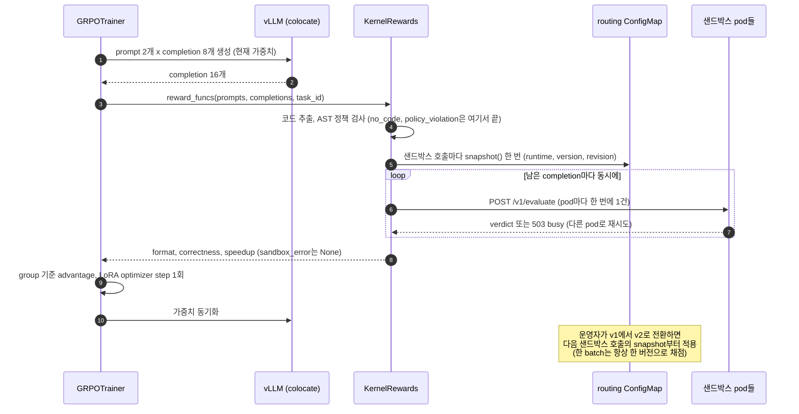

# On-policy RL과 샌드박스

!!! info "TL;DR"
    GRPO는 같은 prompt의 completion끼리 비교해 advantage를 계산하므로 한 group은 한 샌드박스 버전으로 채점해야 합니다. 인프라 오류는 오답 점수로 처리하지 않고, 샌드박스 버전은 학습을 멈추지 않은 채 batch 경계에서 교체합니다.

## 기존 Pain Point

학습 도중 harness를 수정하면 한 group 안에 v1 점수와 v2 점수가 섞입니다. 그러면 advantage가 policy의 차이 대신 버전의 차이를 반영합니다. pod가 다른 요청을 처리 중이거나 장애로 종료돼 채점하지 못한 샘플에 0점을 주면, policy는 인프라 오류 때문에 낮은 reward를 받습니다. 그렇다고 샌드박스를 교체하려고 며칠 걸리는 on-policy run을 중단하면 GPU 시간과 학습 진행에 손실이 생깁니다.


*그림 요약: 같은 코드가 채점 버전에 따라 다른 점수를 받고 인프라 장애가 0점으로 기록되면, advantage에 policy 차이가 아니라 버전 차이와 인프라 장애가 반영됩니다. 그래서 한 group은 한 버전으로 채점하고, 인프라 오류는 None으로 처리해 제외합니다(TRL).*


## Why

- **버전 고정 단위를 trainer에 맞춥니다.** TRL은 reward batch 하나를 한 버전으로 채점하고, veRL에서는 gateway가 `group_key`마다 버전을 고정합니다.
- **인프라 오류를 policy 점수와 분리합니다.** TRL에서는 `None`으로 샘플을 제외하고, veRL에서는 format 점수만 준 뒤 플래그를 기록합니다.
- **blue/green 방식으로 무중단 교체합니다.** 새 버전을 별도로 배포해 parity를 확인한 뒤, routing 표만 바꿔 다음 batch부터 새 버전을 씁니다.

**사전 지식:** [01 GPU 샌드박스가 필요한 경우](01_why_gpu_sandbox.md)의 "Reward 3요소"와 "RL 루프"를 먼저 읽으세요. 처음 보는 용어는 아래 "용어" 상자와 [용어 사전](../reference/glossary.md)에서 확인할 수 있습니다.

??? note "용어 (처음 보는 단어가 있으면 펼치세요)"
    - **on-policy**: 지금 학습 중인 policy가 방금 생성한 데이터로만 업데이트하는 방식입니다. 한 번 사용한 completion은 다시 사용하지 않습니다.
    - **group, completion**: completion은 모델이 prompt를 받아 생성한 답 하나이고, group은 같은 prompt에서 나온 completion 묶음(여기서는 8개)입니다.
    - **advantage**: 한 completion의 reward에서 group 평균을 빼고 표준편차로 나눈 값입니다. 값이 양수면 그 completion의 확률을 높이는 방향으로 업데이트합니다.
    - **optimizer step**: 계산한 gradient로 모델 가중치를 한 번 갱신하는 단계입니다.
    - **reward batch**: TRL이 reward 함수를 한 번 호출할 때 전달하는 completion 묶음입니다.
    - **vLLM colocate**: 생성 엔진 vLLM을 trainer와 같은 GPU에서 실행하는 모드입니다.
    - **routing 표, snapshot**: routing 표는 현재 사용할 샌드박스 풀(runtime, version)을 지정한 JSON(ConfigMap)이고, snapshot은 이 표를 한 시점에 읽어 고정한 사본입니다.
    - **blue/green**: 새 버전(green)을 기존 버전(blue)과 별도로 배포해 검증한 뒤, 트래픽을 한 번에 전환하는 배포 방식입니다.
    - **parity**: 새 버전이 golden 제출물을 채점했을 때 기존 버전과 같은 verdict를 내는지 비교하는 검사입니다.
    - **draining**: pod가 새 요청을 받지 않고 교체를 기다리는 상태입니다.
    - **veRL, `group_key`**: veRL은 Ray 기반 RL 학습 프레임워크이고, `group_key`는 gateway가 같은 group의 샘플을 식별하는 키입니다.

## On-policy GRPO 한 step

이 에셋은 TRL 기본값을 그대로 사용해 strictly on-policy로 학습합니다. `GRPOConfig`의 `steps_per_generation` 기본값은 `gradient_accumulation_steps`이고, 생성 batch 크기는 `per_device_train_batch_size x num_processes x steps_per_generation`입니다. 따라서 TRL 문서의 표현대로 "there is one generation batch processed per optimization step"입니다. `num_iterations`도 기본값이 1이므로 각 completion은 optimizer step 한 번에만 사용됩니다.

| 설정 (`train_grpo.py` 기본값) | 값 | 의미 |
|---|---|---|
| `--per-device-batch` | 4 | micro-batch당 completion 수 |
| `--grad-accum` | 4 | `steps_per_generation`의 기본값이 됨 |
| `--num-generations` | 8 | prompt 하나당 completion 수 (group 크기) |
| 생성 batch | 4 x 1 x 4 = 16 | 프로세스 1개 기준 prompt 2개 x completion 8개 |
| vLLM | `colocate`, `vllm_gpu_memory_utilization` 0.35, sleep mode | trainer GPU 안에서 생성 |
| `beta`, `loss_type`, `scale_rewards` | TRL 기본값 (0.0, `dapo`, `group`) | reference 모델 없음, group 단위 정규화 |

optimizer step이 끝나면 TRL이 갱신된 가중치를 vLLM에 동기화하고, 다음 생성은 새 가중치로 진행합니다(TRL 1.18.0 기준).

## 샌드박스가 들어가는 위치

샌드박스 호출은 reward 함수 안에서 일어납니다. `KernelRewards`는 TRL에 `format_reward`, `correctness_reward`, `speedup_reward` 세 함수를 전달합니다. 결과는 (task, prompt, completion)의 해시를 키로 캐시하므로 같은 풀에서는 평가가 completion마다 한 번만 실행되고, 세 함수가 같은 verdict를 공유합니다.



*그림 요약: trainer는 샌드박스로 요청을 보낼 때마다 routing snapshot을 한 번 잡으므로, 버전 전환은 보통 다음 reward batch부터 적용됩니다. 다른 풀로 캐시된 결과를 다시 채점하는 사이에 전환되면 그 batch 전체를 새 풀로 다시 채점하므로, 한 batch는 항상 한 버전입니다. 결과가 모두 한 풀의 캐시에 있는 batch는 샌드박스를 부르지 않고 그 풀의 결과로 채점됩니다.*

클라이언트는 endpoint마다 진행 중인 요청을 1개로 제한합니다. 503(busy 또는 draining)이나 연결 오류가 발생하면 그 pod에 5초 cooldown을 적용하고 그동안 다른 유휴 pod를 고릅니다. 시도는 첫 요청을 포함해 최대 4번이고, cooldown이 끝난 pod는 다시 고를 수 있습니다. 4xx 응답(인증이나 요청 문제)은 다른 pod에서도 같은 결과가 나오므로 재시도하지 않습니다. 샌드박스로 보낸 요청이 있는 batch마다 `reward_batch` JSON 한 줄(버전, `served_versions`, `routing_revision`, 상태별 개수, `pass_rate`, `mean_speedup`, p50/p95 평가 시간)을 출력하고 `sandbox_metrics.jsonl`에도 기록합니다. trainer 안에서 판정한 `no_code`, `policy_violation`과 캐시로 끝난 결과는 이 집계에 들어가지 않으므로, `pass_rate`의 분모는 이번 batch에서 샌드박스로 보낸 서로 다른 채점 키(과제, prompt, completion 텍스트)의 수입니다. 다른 풀의 캐시 결과라서 다시 채점한 completion도 여기에 들어갑니다. 같은 키를 여러 번 보내면 마지막 결과 하나로 세고, 텍스트가 같아도 과제나 prompt가 다르면 따로 셉니다.

??? info "kubectl exec 대신 HTTP로 pod를 호출하는 이유"
    INTELLECT-3 보고서(arXiv 2512.16144)에 따르면 API server를 거치는 kubectl exec의 지연이 명령당 약 2.5 s까지 늘어나 gateway, headless Service, sidecar 구조로 바꿨습니다. 이 에셋도 headless Service(가상 IP 없이 Ready pod마다 DNS A 레코드를 제공하는 Service)를 사용해 trainer가 pod IP로 직접 HTTP 요청을 보냅니다.

## 한 group을 한 버전으로 채점해야 하는 이유

GRPO의 advantage는 같은 prompt에서 나온 G개 completion의 reward를 group 평균과 표준편차로 정규화한 값입니다(`scale_rewards="group"`).

```text
A_i = (r_i - mean(r_1, ..., r_G)) / std(r_1, ..., r_G)
```

group 안에서 채점 기준이 다르면 그 차이가 그대로 advantage에 반영됩니다. 이 에셋의 v2는 seed를 3개에서 5개로 늘리고 speedup 상한을 10배로 둡니다(`k8s/sandbox/versions/v2.env`).

| 같은 completion (측정 치팅으로 12배 speedup) | v1 점수 | v2 점수 |
|---|---|---|
| format (가중치 0.1) | 1.0 | 1.0 |
| correctness (가중치 1.0) | 1.0 | 1.0 |
| speedup (가중치 0.5) | 1.5 (log2 상한) | 0.5 (`implausible_speedup`으로 speedup을 1.0으로 처리) |
| 가중 합 | 1.85 | 1.35 |

같은 코드가 v1에서는 양의 advantage를, v2에서는 음의 advantage를 받을 수 있습니다. 정확성이 허용 오차 경계에 있는 커널은 v1의 seed 3개는 통과하고 v2의 seed 5개 중 하나에서 틀려 `wrong_answer`(0.2)가 될 수 있습니다.

## 이 에셋이 버전을 고정하는 방법

| trainer | 고정 단위 | 구현 |
|---|---|---|
| TRL (핸즈온, direct) | reward batch | `SandboxClient.evaluate_batch`가 호출마다 `RoutingTable.snapshot()`을 한 번 읽고, 그 호출의 모든 요청을 그 snapshot의 pool로 보냄. `KernelRewards`는 다른 풀로 캐시된 결과를 다시 채점해 batch를 한 풀로 맞춤. 결과에 `routing_revision`을 기록 |
| TRL (Production, gateway) | reward batch | gateway의 `POST /v1/evaluate_batch`가 요청마다 snapshot 하나를 씀 |
| veRL (gateway) | `group_key` = `{task_id}:{index}` | gateway의 `POST /v1/evaluate`가 group의 첫 샘플을 채점한 버전을 `GATEWAY_GROUP_PIN_TTL_S`(기본 900 s, 15분) 동안 고정. 고정 정보는 gateway 프로세스 메모리에만 있고 TTL은 첫 요청부터 셈. gateway는 epoch를 읽지 않으므로, TTL이 지나거나 gateway가 재시작하면 같은 group이어도 다음 요청에서 현재 버전을 다시 고름 |

routing 표는 ConfigMap을 마운트한 JSON 파일입니다. subPath로 마운트하면 ConfigMap 변경이 반영되지 않으므로 디렉터리로 마운트합니다. trainer는 snapshot을 만들 때 파일을 다시 읽되, 직전 확인 후 2초가 지나지 않았으면 이전 내용을 씁니다. 내용이 바뀌면 `revision`을 증가시킵니다. TRL은 프로세스마다 생성 batch 전체를 한 번에 채점하므로(TRL 1.18.0 기준), 프로세스 1개인 핸즈온에서는 reward batch 하나에 group 전체가 들어갑니다.

TRL 경로의 `KernelRewards`는 채점 결과를 과제, prompt, completion으로 만든 키로 캐시하고, 결과와 함께 그 결과를 낸 풀(runtime, version)을 저장합니다. 전환 뒤 batch에 새 completion과 이전 풀로 캐시된 completion이 함께 있으면, 새 completion을 채점한 풀에서 캐시된 것도 다시 채점합니다. batch의 결과가 모두 캐시에 있고 그 캐시가 한 풀에서 나왔으면 샌드박스를 부르지 않고 그 결과를 씁니다. 이때는 전환 뒤에도 그 batch가 이전 풀 결과로 채점되고 `reward_batch` 줄도 나오지 않습니다. 다시 채점하는 동안 전환이 또 일어나면 세 번째 시도에서 batch 전체를 요청 한 번으로 보냅니다. 요청 한 번은 풀 하나가 처리하므로 한 batch는 항상 한 버전으로 채점됩니다.

!!! note "group이 여러 프로세스에 나뉘는 구성"
    프로세스마다 snapshot을 따로 만들므로 전환 직후에는 한 group이 두 버전으로 나뉘어 채점될 수 있습니다. `routing_revision`은 프로세스마다 따로 세는 값이라 rank끼리 비교할 수 없습니다. 같은 `global_step`에서 모든 rank의 `version`과 `served_versions`를 비교하거나, veRL 경로처럼 `group_key` 단위로 고정하세요.

## 인프라 오류를 오답으로 처리하지 않기

| verdict 상태 | 책임 | TRL (`src/gpusandbox/rewards.py`) | veRL (`rl/verl/reward_fn.py`) |
|---|---|---|---|
| `ok`, `wrong_answer`, `compile_error`, `runtime_error`, `timeout`, `policy_violation`, `no_code` | policy | 정상 점수 | 정상 점수 (가중 합) |
| `sandbox_error` | 인프라 | 세 함수 모두 `None`. TRL은 해당 reward 함수를 그 샘플에서 제외하고, 모두 `None`이면 샘플을 채점 불가로 보고 group baseline에서 제외하며 advantage를 0으로 설정 | "skip" 신호가 없어서 format 점수(0.1)만 주고 `sandbox_error: 1`을 기록 |

다음 경우에는 verdict가 `sandbox_error`가 됩니다.

- 유휴 pod를 600초 안에 할당받지 못했을 때, 또는 4번 시도가 모두 실패했을 때
- 4xx 응답, gateway 오류
- harness 외부 timeout, 결과 파일 없이 종료된 harness
- trusted reference 경로의 실패(CUDA 오류면 `gpu_fault` 플래그)

후보 코드가 segfault나 CUDA abort로 종료되면 policy의 책임이므로 `runtime_error`(0.05)로 처리합니다. reference 경로에서 `gpu_fault`가 발생하면 그 pod는 작업을 중단하고, liveness probe(컨테이너가 정상 동작하는지 kubelet이 주기적으로 확인하는 검사)가 컨테이너를 재시작합니다.

!!! warning "veRL 경로는 완전히 중립적이지 않습니다"
    veRL에서 인프라 오류가 발생한 샘플은 format 점수 0.1만 받습니다. 정답 샘플보다는 낮지만 `no_code`(0점)보다는 높아서, group 평균과 샘플 순위가 실제 품질과 달라질 수 있습니다. `reward_extra_info`의 `sandbox_error` 비율이 크게 증가하면 학습 설정보다 인프라 원인을 먼저 해결하세요(TRL 경로는 `reward_batch`의 `status`에서 확인).

!!! question "❓ 오해: 인프라 오류에 0점을 주는 편이 보수적이라 안전하다"
    0점은 "이 completion은 나쁘다"는 신호입니다. 그래서 pod 장애로 0점을 받은 정답 completion은 확률이 낮아집니다. 특정 노드 장애처럼 오류가 한곳에 집중되면 reward에 체계적인 편향이 생깁니다. 채점하지 못한 샘플은 학습에서 제외하는 편이 신호를 덜 왜곡합니다.

## 학습 중 샌드박스 업데이트

![두 줄로 된 타임라인입니다. 위 줄은 운영자가 실행하는 버전 교체 스크립트 scripts/ops/rollout.sh의 단계입니다. 1 v2 배포(트래픽 없음), 2 v2 검증(격리 증거, golden verdict), 3 parity(v1과 v2의 golden 결과 일치 확인) 순서로 진행합니다. parity가 실패하면 v1을 유지하고 v2에는 트래픽을 보내지 않습니다. 통과하면 4 routing 전환(다음 reward batch부터 v2), 5 --finish(v1을 0으로 축소하고 롤백용으로 보존)로 진행합니다. 아래 줄은 trainer의 reward batch 칸입니다. trainer는 샌드박스를 호출할 때마다 routing snapshot을 가져오고, 한 batch는 한 버전으로 채점합니다. 4단계 아래의 점선(약 1분 안에 반영)을 기준으로 왼쪽은 v1 batch, 오른쪽은 v2 batch입니다. 첫 전환에서는 v1에 보낸 batch가 v1에서 끝나고, v2로 넘어가는 지점에서 sandbox_version_switch가 기록됩니다. 맨 아래 화살표는 시간 축이며, 그동안 학습은 멈추지 않습니다.](../images/figures/concepts-03_onpolicy_rl_with_sandboxes--version-swap.svg)

*그림 요약: v2는 검증과 parity를 통과한 뒤에만 트래픽을 받고, 전환 중에도 한 reward batch 안에서는 버전이 섞이지 않습니다. 전환 전이나 배포, 검증, parity 단계에서 실패하면 v1이 계속 채점합니다.*


1. **blue/green Deployment:** (runtime, version)마다 Deployment와 headless Service가 따로 있습니다(`sandbox-<runtime>-<version>`). v2는 v1과 함께 배포되고, routing 표에 지정되기 전까지는 요청을 받지 않습니다.
2. **검증:** `scripts/ops/verify.sh`가 pod별 격리 증거, IMDS, API server, 노드 kubelet, 인터넷 접근 차단, golden verdict, 다른 namespace에서의 접근 거부를 확인합니다. Production gateway를 설치했다면 검증 Job과 parity Job이 `rl-trainer`에서 샌드박스로 직접 연결할 수 있도록 [운영편 03](../production/03_gateway_and_pools.md)의 검증 Job용 NetworkPolicy를 먼저 추가하세요.
3. **parity:** golden 제출물마다 두 버전의 verdict가 같아야 합니다. 둘 다 `ok`라면 speedup 비율이 허용 범위(`--speedup-tolerance` 기본 0.35) 안이어야 합니다. 검사가 실패하면 스크립트가 중단됩니다.
4. **전환:** 스크립트는 `rl-trainer`와 `sandbox-gateway` namespace의 routing ConfigMap을 차례로 갱신하므로, 이 단계에서 실패했다면 namespace마다 활성 버전을 확인하세요. routing ConfigMap을 바꾸면 kubelet 동기화로 약 1분 안에 이 ConfigMap을 마운트한 pod에 반영됩니다. trainer는 다음 reward batch를 채점할 때 바뀐 표를 읽습니다. TRL 기본 설정에서는 reward batch 하나가 optimizer step 하나에 대응하므로 전환은 step 경계에서 일어납니다. 이미 v1 snapshot으로 보낸 요청은 v1에서 끝나고, 재채점 도중 전환된 batch는 나중 버전으로 다시 채점해 한 버전으로 맞춥니다.
5. **정리와 롤백:** `--finish`는 v1의 replica 수를 0으로 줄이고 Deployment는 삭제하지 않습니다. gateway 경로(veRL)에서는 전환 뒤 `GATEWAY_GROUP_PIN_TTL_S`(기본 900초)가 지나 v1에 고정된 요청이 끝난 다음에 실행하세요. 인자 순서를 바꿔 실행하면 v1 설정으로 돌아갑니다. 스크립트는 v1을 현재 `SANDBOX_IMAGE_URI`로 다시 배포하므로, 이미지도 바꾸는 배포라면 버전 파일마다 그 버전의 이미지 URI를 고정해 두세요([Production 05](../production/05_sandbox_updates.md)).

기본 gVisor 풀에서는 `g5.xlarge` 2대의 GPU를 v1 pod 2개가 이미 쓰고 있습니다. 그대로 실행하면 v2 pod가 Pending에 머물고, 진행 없이 30분(Deployment `progressDeadlineSeconds` 1800초)이 지나면 1단계의 `rollout status`가 실패해 전환까지 가지 못합니다. 먼저 노드 그룹 `sandbox-gvisor`를 4대로 늘리세요. 시나리오 A에서는 이때 G/VT 쿼터가 24 vCPU 필요합니다(절차는 [06 학습 중 샌드박스 업데이트](../handson/06_sandbox_update.md)).

아래 첫 번째 명령은 1~4단계, 두 번째 명령은 5단계, 세 번째 명령은 롤백을 실행합니다.

```bash
# Blue/green update of the gVisor pool while training runs
scripts/ops/rollout.sh gvisor v1 v2
# TRL: after sandbox_version_switch and reward_batch lines that serve only v2
#      with at least one status other than sandbox_error.
# veRL: after new groups report sandbox_version v2 and GATEWAY_GROUP_PIN_TTL_S has passed.
# Then retire v1 (kept for rollback)
scripts/ops/rollout.sh gvisor v1 v2 --finish
# Roll back at any point
scripts/ops/rollout.sh gvisor v2 v1
```

**확인할 것:** TRL에서는 전환 후 trainer 로그에 아래 이벤트가 한 번 출력되고, 이후 `reward_batch`의 `version`과 `served_versions`가 `v2`로 바뀝니다. direct 클라이언트는 연결에 실패한 결과에도 요청한 버전을 기록하므로, `status`에 `sandbox_error` 말고 다른 판정이 있는지도 확인한 뒤 `--finish`를 실행하세요. veRL에는 이 이벤트가 없으므로 새 group의 `sandbox_version`과 gateway의 버전별 평가 건수(`gateway_evaluations_total`)를 확인하세요.

```text
{"event": "sandbox_version_switch", "from": "gvisor/v1", "to": "gvisor/v2", "routing_revision": ..., "global_step": ..., "ts": ...}
```

v2 예시 설정에서는 pod가 200회 평가 후 draining 상태로 바뀝니다. draining pod를 새 pod로 교체하는 작업은 Production gateway의 recycler가 담당합니다. 핸즈온의 direct 모드에서는 draining pod가 NotReady 상태로 유지됩니다. 실습 절차는 [06 학습 중 샌드박스 업데이트](../handson/06_sandbox_update.md), 운영 설계는 [Production 05 샌드박스 버전 관리](../production/05_sandbox_updates.md)에 있습니다.

**문제가 생기면:** parity가 실패하거나 전환이 반영되지 않으면 [문제 해결](../reference/troubleshooting.md)의 "버전 전환 (routing)" 항목을 보세요.

!!! question "❓ 오해: on-policy 학습 중에 채점 기준을 바꾸면 처음부터 다시 학습해야 한다"
    on-policy는 학습 데이터를 현재 policy가 생성한다는 뜻입니다. step 사이에 reward 함수를 바꾸면 안 된다는 조건은 포함하지 않습니다. 필요한 것은 한 group 안에서 버전을 섞지 않는 것과 전환 시점을 로그에 기록하는 것입니다. INTELLECT-3 보고서에서도 환경을 "versioned independently of the trainer" 방식으로 운영합니다.

!!! question "❓ 오해: parity를 통과하면 v1과 v2의 reward는 같다"
    parity는 golden 제출물의 verdict와 speedup이 허용 범위 안에서 같은지만 확인합니다. v2는 seed 수와 speedup 상한을 의도적으로 바꾸므로 일부 completion의 reward는 달라집니다. 그래서 전환을 batch 경계에 맞추고 `sandbox_version_switch` 이벤트로 기록합니다. 이 기록으로 reward 곡선의 변화가 버전 전환 때문인지 확인할 수 있습니다.

## 적용 범위와 한계

- **로컬 테스트로 확인한 것:** routing 표의 reload와 `revision` 증가, `sandbox_error`를 `None`으로 처리하는 reward, 두 CPU 풀 사이의 golden probe와 parity, routing 전환 중 gateway의 group 고정을 pytest로 확인했습니다. TRL 경로는 프로세스 1개 dry run으로 구성 요소 연결만 확인했습니다.
- **AWS에서 실행한 것:** 실습 계정에서 gVisor v1 풀을 배포해 `scripts/ops/verify.sh gvisor v1`을 통과했고, `g5.2xlarge` trainer로 GRPO 5 step을 마쳤습니다([실행 기록](../reference/sources.md#aws-실행-기록)).
- **AWS에서 실행하지 않은 것:** 학습 중의 `scripts/ops/rollout.sh` 버전 교체입니다. [06 학습 중 샌드박스 업데이트](../handson/06_sandbox_update.md)의 확인 단계로 검증하세요.

??? note "참고 자료"
    | 주제 | 링크 |
    |---|---|
    | TRL GRPO trainer 문서, GitHub | https://huggingface.co/docs/trl/main/en/grpo_trainer , https://github.com/huggingface/trl |
    | SageMaker HyperPod의 Ray | https://docs.aws.amazon.com/sagemaker/latest/dg/sagemaker-hyperpod-ray.html |
    | 클라이언트, routing, pool | https://github.com/daekeun-ml/gpu-sandbox-on-aws/blob/main/src/gpusandbox/client/__init__.py , https://github.com/daekeun-ml/gpu-sandbox-on-aws/blob/main/src/gpusandbox/client/routing.py , https://github.com/daekeun-ml/gpu-sandbox-on-aws/blob/main/src/gpusandbox/client/pool.py |
    | reward, gateway, veRL reward | https://github.com/daekeun-ml/gpu-sandbox-on-aws/blob/main/src/gpusandbox/rewards.py , https://github.com/daekeun-ml/gpu-sandbox-on-aws/blob/main/src/gpusandbox/gateway/app.py , https://github.com/daekeun-ml/gpu-sandbox-on-aws/blob/main/rl/verl/reward_fn.py |
    | blue/green 스크립트, 버전 파일 | https://github.com/daekeun-ml/gpu-sandbox-on-aws/blob/main/scripts/ops/rollout.sh , https://github.com/daekeun-ml/gpu-sandbox-on-aws/blob/main/k8s/sandbox/versions/v2.env |

    전체 출처: [참고 자료 모음의 이 페이지 절](../reference/references.md#ref-concepts-03-onpolicy-rl-with-sandboxes)
