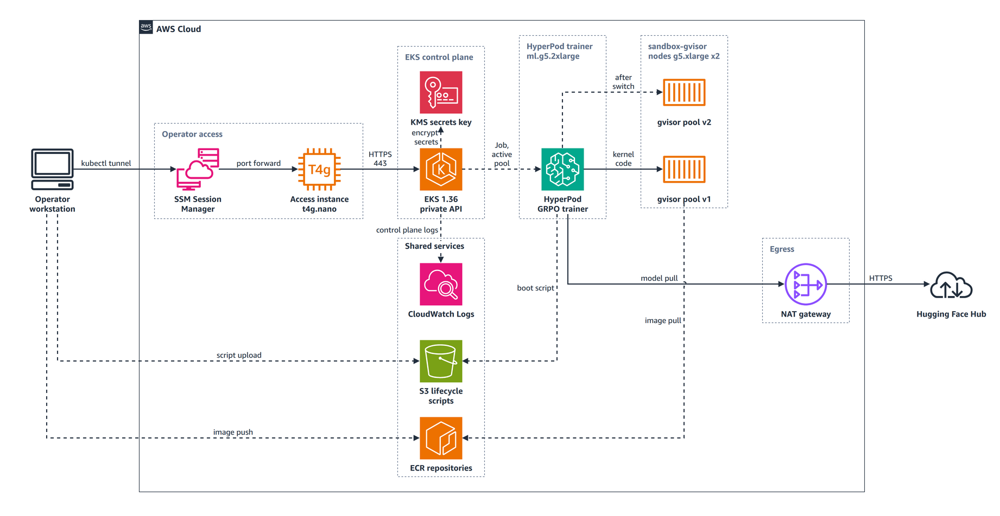
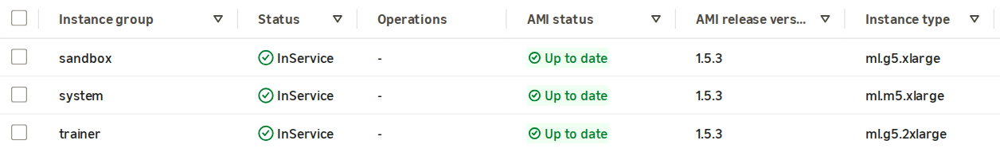

# 플랫폼과 인스턴스 선택

!!! info "TL;DR"
    trainer는 모델을 학습시키고 샌드박스는 모델의 답을 실행해 채점합니다. 두 역할의 노드는 따로 고를 수 있습니다. HyperPod가 필요한지 판단할 때는 먼저 trainer의 복구 요구를 보세요.

## 한 클러스터에서 역할을 나누는 이유

학습과 채점에서 GPU가 하는 일이 다릅니다. trainer는 모델을 메모리에 올려 생성과 업데이트를 반복합니다. 샌드박스는 제출물을 실행합니다. 여기서는 작업의 격리 방식과 측정할 GPU가 중요합니다. 노드를 분리하면 학습 쪽을 바꿀 때 샌드박스 런타임도 함께 바꿀 필요가 줄어듭니다.

**Amazon EKS**는 Kubernetes 클러스터를 운영하는 서비스입니다. **EC2** 인스턴스는 그 클러스터에 연결하는 실행 노드로 쓸 수 있습니다. 이 가이드에서 **HyperPod**는 학습용 노드를 관리하며, B1에서는 그 노드가 기존 EKS 클러스터에 합류합니다. trainer와 샌드박스는 같은 클러스터에서 통신하면서 서로 다른 종류의 노드에서 실행됩니다.

## 시나리오 A, B1, B2, C 비교

| 시나리오 | 학습 | 샌드박스 | 사용 목적 |
|---|---|---|---|
| A | EC2 GPU trainer | EC2 GPU | EKS에서 학습과 GPU 채점 연결 |
| B1 | HyperPod trainer | EC2 GPU | trainer 노드 복구와 Job 재시작 |
| B2 | HyperPod `trainer` | HyperPod `sandbox` | 시스템 Pod, 학습, 채점을 각각의 HyperPod 그룹에 배치 |
| C | 모델 없이 시뮬레이터 실행 | EC2 `c8i.2xlarge`의 CPU 풀 | GPU 없이 런타임 비교, 채점, 버전 교체 |

A, B1, C는 `us-west-2`에서, [관리형 B2](../handson/07_hyperpod_b2.md)는 `us-east-1`에서 실행했습니다.

B1이 학습과 채점의 노드를 나누는 이유는 복구 기능과 런타임 조건을 따로 맞추기 위해서입니다. HyperPod trainer가 Job 재시작 기능을 쓰는 동안, EC2 샌드박스는 gVisor가 지원하는 드라이버나 Kata에 필요한 가상화 환경을 그대로 사용할 수 있습니다. 관리형 B2는 등록된 채점 노드에 gVisor가 지원하는 드라이버를 설치하고 HyperPod API로 재부팅합니다.

## 시나리오별 아키텍처

아래 탭에서 시나리오를 선택하세요.

=== "A: EC2 GPU"

    

    **그림 설명**　운영 PC에서 `kubectl tunnel`을 따라가면 SSM을 거쳐 private EKS API에 연결됩니다. 학습 중에는 `GRPO trainer Job`이 `kernel code` 화살표를 따라 gVisor 풀로 제출 코드를 보냅니다. 풀은 GPU에서 정확도와 속도를 확인하고 판정을 돌려줍니다. trainer는 그 결과를 reward로 사용합니다.

    **차이점**　학습과 채점 모두 EC2에서 직접 운영하는 기본 GPU 구성입니다. [시나리오 A 실습](../handson/01_cluster_and_images.md)

=== "B1: HyperPod 학습"

    

    **그림 설명**　EKS에 제출한 `HyperPodPyTorchJob`을 training operator가 HyperPod trainer 노드에 배치합니다. 그 뒤 `kernel code` 화살표는 A와 마찬가지로 같은 클러스터의 EC2 풀을 향합니다. 샌드박스는 같은 방식으로 코드를 실행해 판정을 돌려줍니다.

    **차이점**　A에서 trainer만 HyperPod로 옮겨 노드 복구와 Job 재시작 기능을 사용합니다. [시나리오 B1 실습](../handson/07_hyperpod.md)

=== "B2 · CPU와 GPU 모두 HyperPod"

    [](../images/console/hyperpod-b2-instance-groups.png)

    `system`은 CoreDNS를, `trainer`는 GRPO Job을, `sandbox`는 gVisor 채점을 맡습니다. Kubernetes API는 EKS에서 제공합니다. [B2 배포 실습](../handson/07_hyperpod_b2.md)

=== "C: CPU 전용"

    

    **그림 설명**　시스템 노드의 `simulate and probe Jobs`에서 `golden code` 화살표를 따라가면 c8i 노드의 Kata CPU v1 풀에 닿습니다. 시뮬레이터는 모델이 만든 답 대신 예상 판정을 아는 답을 보내고, 라우팅을 바꾼 뒤에는 v2 결과를 로그에 남깁니다. 같은 노드의 gVisor와 Kata + QEMU CPU 풀은 검증과 벤치마크에 쓰입니다.

    **차이점**　모델 학습과 GPU 없이 gVisor와 Kata의 채점 및 버전 교체를 실습합니다. [시나리오 C 실습](../handson/10_cpu_only.md)

## 복구 기능과 체크포인트는 각각 필요합니다

HyperPod는 문제가 생긴 노드를 복구하고 training operator가 Job을 다시 시작할 수 있게 합니다. 이전 학습 상태에서 이어가려면 새 pod에서도 체크포인트를 읽을 수 있어야 합니다. 핸즈온의 `emptyDir`는 pod를 교체하면 함께 사라집니다.

[HyperPod 핸즈온](../handson/07_hyperpod.md)에 배치 절차가 있습니다. 샌드박스에 어떤 노드가 필요한지는 [런타임 비교](02_isolation_runtimes.md)에서 확인하세요.

## B1에서 학습 GPU와 채점 GPU 구분하기

B1 실습에서 `ml.g5.2xlarge`의 A10G 한 장은 모델의 답을 생성하고 가중치를 업데이트하는 데 쓰였습니다. 생성된 코드 12개를 실행한 곳은 EC2 `g5.xlarge` 두 대의 gVisor 풀이었습니다. trainer의 Job이 `Completed`인지와 샌드박스가 어떤 판정을 냈는지는 별개로 읽습니다. 이 한 스텝에서 정답은 한 개였습니다. [학습 노드 배치와 완료 로그](../handson/07_hyperpod.md#확인-방법)

샌드박스를 그대로 두고 요청을 보내는 노드만 바꾸면 무엇을 비교할 수 있을까요? 학습을 멈춘 상태에서 EKS 시스템 노드와 HyperPod trainer가 차례로 고정 커널을 32번씩 보냈습니다. 중앙 채점 시간은 각각 9.918초와 9.937초, 풀 처리량은 모두 초당 0.199건이었습니다. 두 클라이언트가 같은 풀에 도달해 요청을 처리했다는 기록입니다. 노드 교체 후 학습 재개를 검증하려면 체크포인트를 저장하고 복구하는 별도의 시험이 필요합니다. [B1 클라이언트 비교](../handson/08_benchmark.md#hyperpod-b1)

<a id="더-살펴보기"></a>

## HyperPod가 trainer에 제공하는 기능

- **노드 복구:** 클러스터를 `NodeRecovery: Automatic`으로 생성합니다(`infra/hyperpod/cluster.json.tpl`). 노드 상태는 `sagemaker.amazonaws.com/node-health-status` 라벨(`Schedulable`, `Unschedulable` 등)로 표시되며, trainer job은 `Schedulable` 노드에만 배치됩니다.
- **deep health check:** 인스턴스 그룹의 `OnStartDeepHealthChecks`로 `InstanceStress`(GPU/NVLink 개수, DCGM 진단, EFA 등)와 `InstanceConnectivity`(NCCL 등)를 켤 수 있습니다. 이 저장소의 템플릿은 이 필드를 설정하지 않습니다. 이 필드를 추가할 때는 아래 taint 제약을 확인하세요.
- **job 재시작과 hang 감지:** training operator add-on(`amazon-sagemaker-hyperpod-training-operator`)의 `HyperPodPyTorchJob`을 쓰고, `jobMaxRetryCount: 3`과 `restartPolicy`(`numRestartBeforeFullJobRestart: 1`, `evalPeriodSeconds: 3600`, `maxFullJobRestarts: 2`)를 설정합니다. 로그 패턴 감지 규칙은 두 가지입니다.
    - **`JobStart`**: 1200초 안에 `"event": "routing"` 줄이 출력돼야 합니다.
    - **`RewardStalled`**: 1800초마다 `"event": "reward_batch"` 줄이 출력돼야 합니다.

    HyperPod용 trainer 이미지는 `hyperpod-elastic-agent`를 버전 고정 없이 설치하고, Job은 `hyperpodrun`으로 trainer를 시작합니다. 설치되는 버전은 빌드 시점에 따라 달라질 수 있습니다.

- **checkpoint 재개:** `train_grpo.py`는 재시작되면 출력 디렉터리의 최신 checkpoint에서 이어서 학습합니다. 핸즈온의 `/outputs`는 emptyDir(pod가 삭제되면 함께 삭제되는 임시 볼륨)이므로, 노드 교체 후에도 학습을 이어 가려면 공유 스토리지(FSx for Lustre PVC 등)를 마운트해야 합니다.
- **그 밖의 기능:** CLI `hyp`(`pip install sagemaker-hyperpod`), task governance와 observability add-on, Karpenter 기반 autoscaling(`AutoScalerType: Karpenter`, `NodeProvisioningMode: Continuous`)이 있습니다.

!!! warning "training operator와 Kubernetes 버전"
    이 저장소는 Kubernetes 1.36을 씁니다. HyperPod의 EKS 지원 범위에 포함되는 버전입니다. 클러스터를 만들기 전에 아래 읽기 전용 명령으로 add-on 호환 버전을 확인하세요.

    ```bash
    aws eks describe-addon-versions \
      --addon-name amazon-sagemaker-hyperpod-training-operator \
      --kubernetes-version 1.36
    ```

    **확인할 것:**

    - **JSON의 `addons[0].addonVersions` 목록에 버전이 하나 이상 있으면**: 1.36과 호환되는 add-on이 있다는 뜻입니다.
    - **목록이 비어 있으면**: `K8S_VERSION`을 낮추는 것을 검토하세요.

??? info "HyperPod (EKS) 사전 요구 사항 요약"
    - EKS 인증 모드 `API` 또는 `API_AND_CONFIG_MAP`, VPC CNI 1.18.3 이상, private subnet이 필요합니다.
    - **API로 클러스터를 만들 때**: health monitoring agent, deep health check RBAC, job auto-restart, MPI operator, nvidia-device-plugin, Neuron과 EFA plugin, Kueue를 설치하는 HyperPod 의존성 Helm 차트(`sagemaker-hyperpod-cli`의 `helm_chart/HyperPodHelmChart`)를 먼저 설치해야 합니다.
    - **IAM role**: HyperPod 노드와 EKS 노드는 서로 다른 IAM role을 씁니다. execution role에는 `AmazonSageMakerClusterInstanceRolePolicy`와 EC2 ENI, ECR inline policy가 연결됩니다.

## HyperPod가 샌드박스 계층에 제공하지 않는 기능

| 항목 | 사실 | 이 저장소의 대응 |
|---|---|---|
| 샌드박스 런타임 | HyperPod EKS AMI의 NVIDIA 드라이버 595.91.07은 gVisor release-20261109.0에서 unknown이라 nvproxy가 동작하지 않습니다. Kata는 `ml.*.metal`이 없고 CreateCluster에 nested virtualization CPU 옵션이 없어서 실행할 수 없습니다 | 샌드박스는 EC2 노드에서 실행 (B1). B2는 드라이버를 바꾼 custom AMI로 별도 인스턴스 그룹을 만듦 |
| 전용 노드 taint | "You cannot add custom taints to nodes in instance groups with DeepHealthChecks turned on." | 샌드박스 노드는 EC2 노드 그룹에서 `gpusandbox/role` taint로 분리 |
| 격리 검증 | deep health check는 GPU, NVLink, EFA, NCCL 같은 하드웨어 점검이며 샌드박스 격리(egress 차단 등)를 확인하지 않습니다 | egress 차단을 확인한 뒤에만 Ready, `scripts/ops/verify.sh` |
| pod 밀도 | B1의 `ml.g5.2xlarge` 노드가 보고한 pod 한도는 14개였습니다. ENI를 추가할 수 있는지는 AMI와 VPC CNI 버전에 따라 달라집니다. | B1은 HyperPod 노드에 trainer만 배치. B2의 `sandbox` 그룹은 노드당 샌드박스 pod 1개 |
| CPU 노드 교체 | "Node auto-replacement is not supported for CPU instances." | CPU 계층은 EC2 (`c8i`) |
| 버전 고정, parity, gateway | HyperPod 기능이 아닙니다 | 이 저장소의 코드 |

HyperPod 노드에서는 기본적으로 hostNetwork pod만 IMDS에 접근할 수 있습니다. 샌드박스 격리에는 유리한 기본값이지만, 위 표의 제약을 해결하지는 않습니다.

## B1의 EC2 샌드박스와 기존 B2 custom AMI

gVisor는 드라이버 버전이 지원 목록과 정확히 일치해야 하고, unknown 버전은 우회 플래그를 써도 동작하지 않습니다. 그래서 B2는 드라이버를 580.178.04로 바꾼 custom AMI를 직접 빌드합니다([07 HyperPod 시나리오의 B2](../handson/07_hyperpod.md#b2)).

아래 스크립트는 노드의 드라이버 버전을 확인합니다(HyperPod 클러스터 필요). 노드마다 debug pod를 실행하고, 끝날 때 `default` 네임스페이스에서 이름이 `node-debugger-`로 시작하는 pod를 모두 삭제합니다. 다른 작업자의 디버깅 세션도 함께 삭제될 수 있습니다.

```bash
scripts/hyperpod/check_gvisor.sh
```

**확인할 것:**

- **기본 AMI를 쓰는 trainer 노드**: 아래 줄이 출력됩니다.

    ```text
      driver 595.91.07: NOT supported by gVisor 20261109.0
    ```

- **B2 custom AMI를 쓰는 sandbox 노드**: `driver 580.178.04: SUPPORTED ...`가 출력됩니다.

B2에서도 위의 pod 수 제한은 그대로 적용됩니다. taint는 deep health check를 켜지 않은 인스턴스 그룹에만 추가할 수 있으므로 B2의 sandbox 그룹은 deep health check 없이 만듭니다. B1을 기본으로 둔 이유는 custom AMI를 직접 관리하지 않아도 되기 때문입니다. B2의 실제 노드 검증은 남아 있습니다.

B2에서는 `scripts/04_install_gpu_stack.sh`가 smoke pod를 만들지 않습니다. 다음 순서로 확인하고 배포하세요.

1. sandbox 노드의 `/proc/driver/nvidia/version`으로 어떤 모듈 종류가 로드됐는지 봅니다.
2. 위의 `scripts/hyperpod/check_gvisor.sh`로 그 드라이버가 지원 목록에 있는지 확인합니다.
3. `scripts/06_deploy_sandboxes.sh gvisor-hyperpod v1`로 풀을 배포합니다.
4. `scripts/ops/verify.sh gvisor-hyperpod v1`로 검증합니다.

**문제가 생기면:** `no HyperPod nodes found`는 HyperPod 노드가 아직 클러스터에 연결되지 않았다는 뜻입니다. [07 HyperPod 시나리오](../handson/07_hyperpod.md)와 [문제 해결](../reference/troubleshooting.md)의 "HyperPod" 항목을 보세요.

## 인스턴스 선택

| 역할 | 선택 | 이유 | 온디맨드 요금 (USD/시간) |
|---|---|---|---|
| trainer (A) | `g5.2xlarge` (1 x A10G 24 GB, 8 vCPU, 32 GiB) | 1.5B 모델 + LoRA + vLLM colocate를 A10G 하나에서 실행하도록 설정 (`vllm_gpu_memory_utilization` 0.35). 실습 계정에서 GRPO 5 step 완료 | 1.212 |
| trainer (B) | `ml.g5.2xlarge` | 같은 하드웨어를 HyperPod에서 사용. 온디맨드 요금 기준 약 25% 높음 (1.515 / 1.212 = 1.25) | 1.515 |
| gVisor 샌드박스 | `g5.xlarge` (1 x A10G), 노드당 샌드박스 1개 | AMI가 로드하는 드라이버 580.178.04가 nvproxy 지원 목록에 있음. 검증 조건은 아래 "`g5`의 드라이버와 검증 범위" | 1.006 |
| Kata GPU 샌드박스 | `g4dn.metal` (8 x T4, 96 vCPU, 384 GiB), VM마다 T4 1개 | NVIDIA GPU를 탑재한 유일한 x86 `.metal` 타입 | 7.824 (서울 9.624) |
| Kata CPU 샌드박스 | `c8i.2xlarge` (nested virtualization) | `.metal` 없이 `/dev/kvm` 사용 가능. Kata 연습과 CPU 계층용 | 0.37484 |
| system | `m6i.large` x 2 | CoreDNS와 컨트롤러 | 0.096 (대당) |

가격은 us-east-1과 us-west-2의 온디맨드 요금입니다.

!!! note "`g5`의 드라이버와 검증 범위"
    2026-11-18에 배포한 `g5.xlarge` 노드에서는 EKS AL2023 NVIDIA AMI가 GSP를 끈 proprietary 커널 모듈 580.178.04를 로드했습니다(`/proc/driver/nvidia/version`, `/proc/driver/nvidia/params`의 `EnableGpuFirmware: 0`). gVisor 문서는 NVIDIA open 드라이버를 기준으로 nvproxy를 설명하고 proprietary 드라이버는 언급하지 않습니다.

    - **이 저장소의 검증**: 580.178.04는 runsc `release-20261109.0`의 지원 목록(`runsc nvproxy list-supported-drivers`)에 있습니다. 실습 계정에서 `g5.xlarge`로 gVisor smoke test(`cuda ok: NVIDIA A10G 2048.0`)와 `scripts/ops/verify.sh gvisor v1`이 통과했고, `g5.2xlarge` trainer로 GRPO 5 step을 마쳤습니다. 즉 이 조합은 gVisor가 문서화한 것이 아니라 이 저장소가 검증한 것입니다.
    - **드라이버, AMI, gVisor 버전을 바꾸면**: 다시 확인하세요.
    - **`04_install_gpu_stack.sh`의 smoke test**: GPU 하나를 쓰는 pod를 따로 만들므로 gVisor 노드에 빈 GPU가 있을 때 실행하세요.
    - **이미 배포한 풀**: `scripts/ops/verify.sh gvisor v1`로 확인합니다.

    `g6`(L4)는 지원하는 대안입니다. AMI가 open 모듈 580.178.04를 로드하므로 gVisor 문서와 일치하고, 요금도 낮습니다(`g6.xlarge` 0.8048, `g6.2xlarge` 0.9776). 쓰려면 `scripts/config.env`에서 `GVISOR_INSTANCE_TYPE`과 `TRAINER_INSTANCE_TYPE`(HyperPod는 `HYPERPOD_*`)을 바꿔 쓰세요.

??? info "다른 후보의 가격과 GPU"
    | EC2 | GPU | USD/시간 |
    |---|---|---|
    | `g4dn.xlarge` | 1 x T4 | 0.526 |
    | `g4dn.2xlarge` | 1 x T4 | 0.752 |
    | `g6.xlarge` | 1 x L4 | 0.8048 |
    | `g6.2xlarge` | 1 x L4 | 0.9776 |
    | `g6e.xlarge` | 1 x L40S | 1.861 |
    | `g6e.12xlarge` | 4 x L40S | 10.49264 |
    | `g6e.48xlarge` | 8 x L40S | 30.13118 |
    | `p4d.24xlarge` | 8 x A100 | 21.95764 |
    | `p5.48xlarge` | 8 x H100 | 55.04 |
    | `g5g.metal` | 2 x T4g (arm64) | 2.744 |
    | `c5.metal` | 없음 | 4.08 |
    | `t3.large` | 없음 | 0.0832 |

    | HyperPod | USD/시간 |
    |---|---|
    | `ml.g4dn.xlarge` | 0.7364 |
    | `ml.g6.xlarge` | 1.127 |
    | `ml.g6.2xlarge` | 1.222 |
    | `ml.g6.4xlarge` | 1.654 |
    | `ml.g5.xlarge` | 1.408 |
    | `ml.g5.8xlarge` | 3.06 |
    | `ml.g6e.xlarge` | 2.61 |

    Production의 trainer NodePool 후보(`infra/karpenter/nodepools.yaml`)는 `g6e.12xlarge`, `g6e.48xlarge`, `p5.48xlarge`입니다.

## 리전별 vCPU 쿼터

| quota (vCPU 기준) | 핸즈온 필요량 | 비고 |
|---|---|---|
| Running On-Demand G and VT instances | A: 16 (`g5.2xlarge` 8 + `g5.xlarge` 4 x 2), B1: 8 (`g5.xlarge` 4 x 2), B2: 0. Kata GPU를 실습하면 `g4dn.metal` 96 추가 | 문서상 기본값 0일 수 있음 |
| Running On-Demand Standard (A, C, D, H, I, M, R, T, Z) instances | 6 (`m6i.large` 2 x 2 + SSM 접속용 `t4g.nano` 2). 추가 필요량은 표 아래 목록 | 문서상 기본값 5 |
| `ml.g5.2xlarge for cluster usage` | 1 (B) | HyperPod는 `ml.<type> for cluster usage` quota를 씀 |
| `ml.g5.xlarge for cluster usage` | 2 (B2) | B2의 `sandbox` 인스턴스 그룹(`HYPERPOD_SANDBOX_COUNT`) |

Standard quota가 더 필요한 경우는 다음과 같습니다.

- **Kata CPU를 실습하면**: 추가 필요량은 `c8i.2xlarge` 8(합계 14)입니다.
- **B2나 Kata GPU용 AMI를 만드는 동안에는**: builder `m6i.large` 2가 더 필요합니다(8, Kata CPU 노드가 있으면 16).

`scripts/01_check_prereqs.sh`가 G and VT quota, `c8i.2xlarge`의 nested virtualization 지원, GPU 타입의 AZ별 제공 여부를 읽기 전용으로 조회해 출력합니다. 실행 방법과 확인할 내용은 [시작하기](../getting_started.md)의 5장에 있습니다.

## 핸즈온 구성의 시간당 비용 (추정)

| 구성 | 포함 노드 | 노드 소계 (USD/시간) |
|---|---|---|
| A 기본 (gVisor + trainer) | `m6i.large` x 2 + `g5.xlarge` x 2 + `g5.2xlarge` | 0.192 + 2.012 + 1.212 = 약 3.42 |
| A + Kata CPU | A 기본 + `c8i.2xlarge` x 1 | 약 3.79 |
| A + Kata GPU | A 기본 + `g4dn.metal` x 1 | 3.416 + 7.824 = 약 11.24 |
| B1 (HyperPod trainer) | `m6i.large` x 2 + `g5.xlarge` x 2 + `ml.g5.2xlarge` | 0.192 + 2.012 + 1.515 = 약 3.72 |

온디맨드 요금으로 계산한 추정치이며, EKS 컨트롤 플레인, NAT gateway, SSM 접속용 `t4g.nano`, EBS, 데이터 전송, ECR, CloudWatch 비용은 포함하지 않았습니다.

!!! warning "`g4dn.metal` 노드 그룹은 쓰지 않을 때 0으로 줄이세요"
    A + Kata GPU 구성에서는 `g4dn.metal` 한 대가 노드 비용의 약 70%를 차지합니다(7.824 / 11.24). 쓰지 않을 때는 아래 명령으로 노드 그룹 크기를 0으로 줄이고, 실습이 끝나면 [99 정리](../handson/99_cleanup.md)를 실행하세요.

    ```bash
    aws eks update-nodegroup-config --cluster-name "$CLUSTER_NAME" --nodegroup-name sandbox-kata-gpu \
      --scaling-config minSize=0,maxSize=1,desiredSize=0
    ```

    **확인할 것:**

    - 몇 분 후 `cdk/tunnel.sh`를 실행한 상태에서 `kubectl get nodes -l gpusandbox/kata-gpu=true`를 실행했을 때 노드가 하나도 출력되지 않으면 축소가 끝난 것입니다.
    - **셸에 `CLUSTER_NAME` 변수가 없다면**: 먼저 `source scripts/config.env`를 실행하세요.

!!! question "❓ 오해: HyperPod를 쓰면 샌드박스도 HyperPod가 관리한다"
    HyperPod의 노드 복구, deep health check, job 재시작은 노드와 job의 복원력 기능입니다. 노드 복구는 클러스터 설정이라 B2의 `sandbox` 그룹에도 적용되지만, 샌드박스 런타임 설치, 격리 검증, 버전 고정은 HyperPod가 제공하지 않습니다.

!!! question "❓ 오해: T4가 더 저렴하니 gVisor 노드도 `g4dn`을 쓰면 된다"
    `g4dn.xlarge`(0.526)는 `g5.xlarge`(1.006)보다 요금이 낮습니다. `g4dn`의 드라이버 조건은 `g5`와 같습니다(AMI가 GSP를 끈 proprietary 커널 모듈을 로드). 그래서 드라이버 종류 때문에 제외할 이유는 없지만, 이 저장소는 T4에서 실행하는 gVisor를 테스트하지 않아 미검증입니다. T4는 Kata + QEMU(`g4dn.metal`)의 GPU로 쓰고, gVisor에 쓰려면 직접 검증하세요.

## 적용 범위와 한계

- 시나리오 A의 `g5` 구성은 실습 계정에서 실행했습니다([실행 기록](../reference/sources.md#aws-실행-기록)). gVisor 샌드박스(1 replica)와 `scripts/ops/verify.sh gvisor v1`이 통과했고, trainer 설정(1.5B + LoRA + vLLM colocate on A10G 하나)으로 GRPO 5 step을 마쳤습니다.
- 다른 클러스터 구성에서는 `g4dn.metal`의 Kata + QEMU(`kata-qemu` replica 4, `scripts/ops/verify.sh kata-qemu v1`)를 실행했고, `scripts/ops/bench.sh 32`로 GPU 풀 2개와 CPU 풀 3개를 측정했습니다.
- 시나리오 A에서 학습 중 gVisor 버전을 전환했습니다. 관리형 B2에서는 HyperPod에서 한 스텝 학습을 완료했습니다. [전환 기록](../handson/06_sandbox_update.md#switch-batches)
- `c8i.2xlarge`는 us-east-1과 us-west-2에서 시간당 0.37484 USD, 서울 리전에서 0.42336 USD입니다. GPU 없이 이 노드만 쓰는 시나리오 C는 [10 c8i 단독 저비용 경로](../handson/10_cpu_only.md)에 있습니다.

??? note "참고 자료"
    | 주제 | 링크 |
    |---|---|
    | HyperPod 복원력, deep health check | https://docs.aws.amazon.com/sagemaker/latest/dg/sagemaker-hyperpod-eks-resiliency.html , https://docs.aws.amazon.com/sagemaker/latest/dg/sagemaker-hyperpod-eks-resiliency-deep-health-checks.html |
    | HyperPod training operator | https://docs.aws.amazon.com/sagemaker/latest/dg/sagemaker-eks-operator.html |
    | EC2 가속 컴퓨팅 인스턴스 사양, quota | https://docs.aws.amazon.com/ec2/latest/instancetypes/ac.html , https://docs.aws.amazon.com/ec2/latest/instancetypes/ec2-instance-quotas.html |
    | 가격 (EC2, SageMaker AI) | https://aws.amazon.com/ec2/pricing/on-demand/ , https://aws.amazon.com/sagemaker/ai/pricing/ |
    | 이 저장소의 HyperPod 템플릿과 점검 스크립트 | https://github.com/daekeun-ml/gpu-sandbox-on-aws/blob/main/infra/hyperpod/cluster.json.tpl , https://github.com/daekeun-ml/gpu-sandbox-on-aws/blob/main/k8s/trainer/hyperpod-job-grpo.yaml.tpl , https://github.com/daekeun-ml/gpu-sandbox-on-aws/blob/main/scripts/hyperpod/check_gvisor.sh |

    [관련 대표 자료](../reference/references.md#ref-concepts-04-platforms-and-instances)
