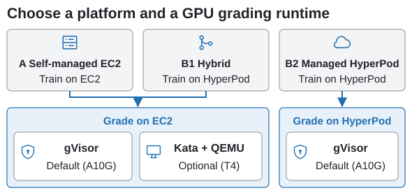

# Decision guide

!!! info "TL;DR"
    Decide whether grading needs a GPU. If it does, choose the measurement GPU and decide whether a separate VM boundary is required.

## Choosing an exercise

1. **Compute required for grading.** If CPU unit tests are enough, start with the [CPU path](../handson/scenarios/c/index.md). A GPU trainer can use CPU graders.
2. **Target GPU.** Measure performance on the GPU that will execute the deployed code. The default gVisor exercise uses A10G.
3. **Isolation requirement.** Kata uses a separate VM per pod. The GPU exercise uses T4 on `g4dn.metal`.

## Competing requirements

If you need L4 measurements and a separate VM per sandbox, neither default GPU path meets both requirements. gVisor can use L4 and the Kata exercise provides a VM boundary on T4. Decide which measurement environment and isolation boundary are required before deploying.

## First checks by path

| Path | First check |
|---|---|
| [CPU exercise](../handson/scenarios/c/index.md) | Reference submissions return the expected verdicts. |
| [gVisor GPU](../handson/common/02_runtimes/gvisor.md) | The smoke pod prints the GPU name and `cuda ok:`. |
| [Kata GPU](../handson/common/02_runtimes/kata.md) | GPU computation completes inside the VM. |
| [Per-episode assignment](../handson/extensions/multi_turn.md) | Turns use the same claim, which is deleted at episode end. |

See [runtime comparison](02_isolation_runtimes.md) and [platform selection](04_platforms_and_instances.md) for the underlying requirements.

## A small comparison before changing a deployment

Suppose a team proposes replacing its sandbox GPU because training feels slow. Start with `batch_wall_s` in `reward_batch`, the time the batch spent waiting for grading. Then inspect `eval_p50_s` for individual requests and `throughput_eval_per_s` for the entire pool.

- If a kernel is slow on a single GPU, compare the reference and candidate with the same inputs on that device. If production uses an L4, an A10G result alone cannot settle the choice.
- If requests wait for a free pod, count the slots available for concurrent grading. Each GPU replica needs an available GPU.
- If every submission needs a VM boundary, check that the target GPU works inside it. The Kata GPU lab here grades on a T4 with QEMU.

This lets you test the choice of trainer platform independently of the size of the grading pool. [Request latency and throughput for the five pools](../handson/benchmarks/index.md#runtime-results)

## Worked examples by workload

| Customer situation | Combination | Reason |
|---|---|---|
| An in-house research team trains Triton kernels for L4 serving with its own model | gVisor on `g6.xlarge` (a supported alternative in this asset; the default is `g5.xlarge`) | a pool used by one team does not require a VM boundary, and the measurement GPU can match the deployment GPU (L4) |
| Training jobs of several customers use the same GPU nodes, and rankings on T4 are good enough | Kata + QEMU on `g4dn.metal`, one pool per customer | customers are separated by a VM boundary only when each has its own pool and its requests go to that pool (list below the table). T4 measurement is accepted |
| Kernels for H100 serving are trained in a pool shared by several customers | gVisor on `p5` + compensating controls, consider separate nodes per customer, a written risk acceptance | EC2 has no VM boundary + H100 combination |
| Code RL scored by unit tests | Kata + CLH on `c8i` or a managed CPU sandbox | the GPU is not on the reward path |
| You want to separate the nvcc compile stage from the measurement stage | CPU tier (Kata + CLH on `c8i`) + GPU tier (gVisor or Kata + QEMU) | compilation and static checks do not spend GPU time |

- **Why the second example needs one pool per customer**: Kata creates a VM per pod, but the pool picks an idle pod for each request, so in one shared pool requests from several customers use the same VM in turn.

The second and third examples are the same multi-tenant situation with different measurement GPU requirements, and that difference decides whether a VM boundary is available.

## Compare operating requirements

| Item | gVisor + nvproxy | Kata + QEMU (GPU) | Kata + CLH (CPU) | Nitro Sandboxes, EKS isolated pods |
|---|---|---|---|---|
| Isolation boundary | user-space kernel. The GPU goes through an ioctl allowlist, weaker than a VM | VM + IOMMU | VM | managed by AWS (see the documentation for details) |
| GPUs available on AWS | G/P family VMs. This asset uses A10G (`g5`, default) and L4 (`g6`, alternative) | T4 (`g4dn.metal`) only | none | none (at launch) |
| Installation effort | medium: runsc via user data, containerd handler, RuntimeClass, device plugin `cdi-cri` | high: IOMMU AMI bake, GPU Operator, kata-deploy, `.metal` node | medium: nested-virtualization launch template, kata-deploy | low: Kubernetes 1.36 or later |
| Density (this asset's setup) | one per `g5.xlarge` node | up to 8 VMs per `g4dn.metal`, all guest RAM pinned | 1.25 CPU per pod (request 1 + overhead 250m) and 2 GiB + 130Mi of memory; whichever of the node's allocatable CPU and memory runs out first sets the limit | see the documentation |
| Upstream support | supported (nvproxy documentation) | supported (NVIDIA CI covers A100, H100) | supported | supported by AWS (launched 2026-11-09) |
| Driver coupling | the host driver version must match the nvproxy support list exactly | guest driver (kata-deploy, open 615.71.09). The host loads no driver | none | none |
| On-Demand per GPU per hour | 1.006 (A10G, `g5.xlarge`) | about 0.978 (7.824 / 8, with all eight in use) | n/a | n/a |

Prices are computed from us-east-1 and us-west-2 list prices. With fewer T4s in use, the cost per GPU on `g4dn.metal` goes up.

## Signals to revisit the decision

Revisit the runtime choice if one of these facts changes.

| Changing fact | Impact | How to check |
|---|---|---|
| A new gVisor release supports the default HyperPod driver | Reassess the driver change on B2 grading workers | Test CUDA inside a gVisor pod and rerun the golden cases with that driver and `GVISOR_RELEASE`. [B2 verification steps](../handson/scenarios/b/b2.md) |
| The EKS NVIDIA AMI, the NVIDIA driver or the gVisor version changes | gVisor on the default `g5` (proprietary module with GSP off) rests on this repository's verification, not on the gVisor documentation, so it must be checked again | the steps in the list below the table |
| you can get `g6` On-Demand capacity in the Availability Zones you use | you can choose `g6`, which uses the open driver, matches the gVisor documentation and is cheaper | launch an instance and terminate it at once to check, then change `GVISOR_INSTANCE_TYPE` and `TRAINER_INSTANCE_TYPE` in `scripts/config.env` |
| A G or P family joins the nested virtualization list | Kata + GPU without `.metal` becomes worth evaluating (check VFIO support separately) | the nested virtualization User Guide, the `describe-instance-types` filter |
| A new `.metal` type with an x86 NVIDIA GPU | a VM boundary + current GPU combination becomes possible | EC2 accelerated computing instance specifications |
| Nitro Sandboxes supports GPU passthrough | a managed GPU tier becomes worth evaluating | the Nitro Sandboxes documentation, EKS sandboxing limitations |
| NVIDIA CI covers T4, or Kata supports CLH GPUs | the verification status of `g4dn.metal` or the CLH GPU path changes | Kata release notes, upstream `docs/hypervisors.md` |

- **When the EKS NVIDIA AMI, the NVIDIA driver or the gVisor version changes**: first check `/proc/driver/nvidia/version` and `runsc nvproxy list-supported-drivers` on the node. Then check the following.
    - **While a GPU is free**: run the `04_install_gpu_stack.sh` smoke test (it creates its own pod that uses one GPU).
    - **For a deployed pool**: check it with `scripts/ops/verify.sh gvisor v1`.

!!! question "❓ Misconception: with gVisor, GPU code is isolated as well as in a VM"
    gVisor handles syscalls in a user-space kernel (the Sentry), but the GPU path is an ioctl allowlist to the host driver, and the gVisor documentation says nvproxy is "much less effective at mitigating vulnerabilities within the NVIDIA GPU drivers themselves" and has "no validation of things like DMA buffers". For adversarial code from different customers, evaluate a VM boundary (Kata + VFIO) first; if you use gVisor because you need a current GPU, document the compensating controls and the residual risk.

!!! question "❓ Misconception: Nitro Sandboxes are out, so GPU sandboxes are solved as a managed service"
    AWS Nitro Sandboxes and EKS isolated pods (launched 2026-11-09) state in their documentation "GPU and other device passthrough are not supported at launch". For now they are a managed alternative for the CPU tier; run the GPU tier with this asset's gVisor or Kata + QEMU.

!!! tip "What to read next"
    - Runtime structure and AWS placement conditions: [02 Isolation runtimes](02_isolation_runtimes.md)
    - Instances, quotas and hourly cost: [04 Platforms and instances](04_platforms_and_instances.md)
    - Taking a sandbox from a warm pool per episode: [06 Extending with Agent Sandbox](06_agent_sandbox.md)
    - Building it yourself: [Overview](../handson/index.md)
    - Operating design and threat model: [Production 00 Architecture](../production/00_architecture.md), [Production 02 Security](../production/02_security.md)

??? note "References"
    | Topic | Link |
    |---|---|
    | AWS Nitro Sandboxes, EKS sandboxing limitations | https://docs.aws.amazon.com/AWSEC2/latest/UserGuide/amazon-ec2-nitro-sandboxes.html , https://docs.aws.amazon.com/eks/latest/userguide/sandboxing-limitations.html |
    | Amazon Bedrock AgentCore Code Interpreter | https://docs.aws.amazon.com/bedrock-agentcore/latest/devguide/code-interpreter-tool.html |
    | EC2 nested virtualization | https://docs.aws.amazon.com/AWSEC2/latest/UserGuide/amazon-ec2-nested-virtualization.html |
    | gVisor GPU support, GitHub | https://gvisor.dev/docs/user_guide/gpu/ , https://github.com/google/gvisor |
    | Kata NVIDIA GPU passthrough (4.3.1), GitHub | https://github.com/kata-containers/kata-containers/blob/4.3.1/docs/use-cases/NVIDIA-GPU-passthrough-and-Kata-QEMU.md , https://github.com/kata-containers/kata-containers |

    [Selected references on this topic](../reference/references.md#ref-concepts-05-decision-guide)
