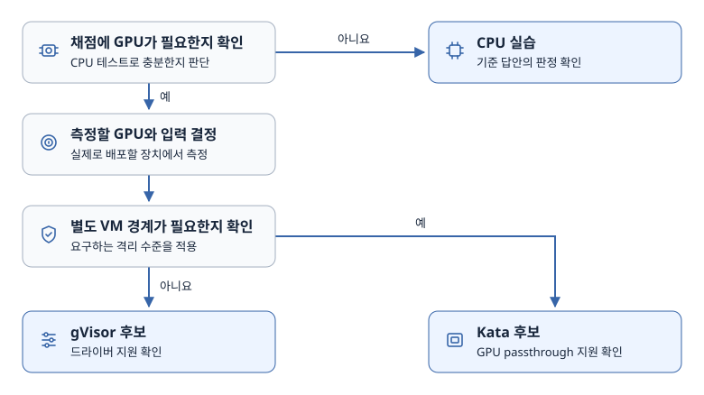

# 상황별 선택 가이드

!!! info "TL;DR"
    먼저 채점에 GPU가 필요한지 확인하세요. 필요하다면 어떤 GPU에서 측정할지, 별도 VM 경계가 필요한지 순서대로 정합니다.

## 세 질문으로 실습 경로 고르기

1. **샌드박스 안에서 GPU 연산이 필요한가요?** CPU 테스트면 [CPU 경로](../handson/10_cpu_only.md)로 시작할 수 있습니다. trainer에 GPU가 있어도 채점이 CPU로 끝나면 샌드박스에 GPU를 붙일 필요는 없습니다.
2. **생성한 코드를 어떤 GPU에서 돌릴 건가요?** 실행 속도를 점수에 반영한다면 목표 GPU에서 시간을 재세요. 기본 gVisor GPU 실습은 A10G에서 진행합니다.
3. **pod마다 별도 VM이 필요한가요?** 이 저장소의 Kata GPU 경로는 `g4dn.metal`의 T4를 사용합니다. VM 경계와 목표 GPU를 둘 다 만족하는 구성을 먼저 확인하세요.

예를 들어 L4에서 서비스할 코드를 속도로 채점한다면, T4에서 얻은 순위가 L4에서도 같다고 가정할 수 없습니다. 측정할 GPU가 정해졌다면 후보 런타임이 그 GPU를 지원하는지 확인한 뒤, 필요한 격리 경계와 운영 비용을 비교하세요.

## 두 조건을 동시에 만족하기 어려운 경우

L4에서 시간을 재야 하고 샌드박스마다 별도 VM도 필요하다면, 이 저장소의 기본 GPU 구성으로는 두 조건을 함께 충족할 수 없습니다. gVisor 경로에서는 L4로 측정할 수 있고 Kata 경로에서는 T4를 전용 VM에 연결합니다. 실제 운영에 적용하려면 어느 GPU에서 측정해야 결과가 유효한지와 어떤 격리 경계가 필수인지 먼저 정해야 합니다.

## 실습 경로별 확인 항목

| 경로 | 첫 확인 |
|---|---|
| [CPU 실습](../handson/10_cpu_only.md) | 기준 입력의 verdict가 예상과 맞습니다. |
| [gVisor GPU](../handson/02_gvisor.md) | smoke pod가 GPU 이름과 `cuda ok:`를 출력합니다. |
| [Kata GPU](../handson/03_kata.md) | pod가 VM 안에서 GPU 연산을 완료합니다. |
| [에피소드마다 샌드박스 할당](../handson/11_multi_turn.md) | 같은 에피소드의 턴이 같은 샌드박스를 쓰고 끝나면 claim이 삭제됩니다. |

런타임의 차이는 [격리 런타임 비교](02_isolation_runtimes.md), trainer를 어디에 둘지는 [플랫폼과 인스턴스 선택](04_platforms_and_instances.md)에서 볼 수 있습니다.

## 선택을 시험하는 작은 비교

팀에서 “학습이 느리니 샌드박스 GPU부터 바꾸자”고 제안했다고 해 봅시다. 먼저 `reward_batch`의 `batch_wall_s`를 봅니다. 이는 배치가 채점 결과를 기다린 시간입니다. 다음으로 벤치마크에서 요청 한 건을 처리하는 `eval_p50_s`와 pool 전체의 `throughput_eval_per_s`를 봅니다.

- GPU 한 장에서 커널이 느리다면 같은 장치, 같은 입력으로 기준 코드와 제출 코드를 비교하세요. 운영 장치가 L4라면 A10G 결과만으로 구현을 고르기 어렵습니다.
- 여러 요청이 빈 pod를 기다린다면 동시에 채점할 자리 수를 먼저 확인하세요. pod 하나가 GPU 한 장을 쓰므로 replica를 늘리려면 여유 GPU가 필요합니다.
- 별도 VM 경계가 필수라면 그 경계에서 목표 GPU를 쓸 수 있는지 먼저 확인하세요. 이 저장소에서 GPU를 연결해 채점한 Kata 경로는 QEMU와 T4 조합입니다.

이 순서로 보면 trainer를 HyperPod에 두는 결정과 채점 pool의 크기를 정하는 결정을 나누어 시험할 수 있습니다. [다섯 pool의 요청당 시간과 처리량](../handson/08_benchmark.md#runtime-results)

## 워크로드별 선택 예시

| 고객 상황 | 조합 | 이유 |
|---|---|---|
| 사내 연구팀이 자체 모델로 L4 서빙용 Triton 커널을 학습 | `g6.xlarge`의 gVisor (이 저장소가 지원하는 대안. 기본값은 `g5.xlarge`) | 한 팀만 쓰는 pool이라 VM 경계까지는 요구하지 않고, 측정 GPU를 배포 GPU(L4)에 맞출 수 있음 |
| 여러 고객의 학습 작업이 같은 GPU 노드를 쓰고, T4 기준 순위로 충분 | `g4dn.metal`의 Kata + QEMU, 고객별 pool | 고객별로 pool을 나누고 요청도 그 pool로 보내야 고객 간 작업이 VM 경계로 나뉨(표 아래 목록). T4에서 측정하는 조건을 수용 |
| 여러 고객이 공유하는 pool에서 H100 서빙용 커널을 학습 | `p5`의 gVisor + 보완 통제, 고객별 노드 분리 검토, 위험 수용 기록 | EC2에 VM 경계 + H100 조합이 없음 |
| 단위 테스트로 채점하는 code RL | `c8i`의 Kata + CLH 또는 관리형 CPU 샌드박스 | reward 계산에 GPU가 필요 없음 |
| nvcc 컴파일 단계와 측정 단계를 나누고 싶음 | CPU 계층(`c8i`의 Kata + CLH) + GPU 계층(gVisor 또는 Kata + QEMU) | 컴파일과 정적 검사에 GPU 시간을 쓰지 않음 |

- **두 번째 예시에서 고객별 pool이 필요한 이유**: Kata는 pod마다 VM을 만들지만 pool은 요청마다 빈 pod를 고르므로, 한 pool을 공유하면 서로 다른 고객이 보낸 코드가 같은 VM에서 차례로 실행될 수 있습니다.

두 번째와 세 번째 예시는 둘 다 멀티테넌트 상황이고 측정 GPU 요구만 다릅니다. T4에서 측정해도 되면 Kata로 VM 경계를 쓸 수 있고, H100에서 측정해야 하면 VM 경계를 쓸 수 없습니다.

## 운영 조건 비교

| 항목 | gVisor + nvproxy | Kata + QEMU (GPU) | Kata + CLH (CPU) | Nitro Sandboxes, EKS isolated pods |
|---|---|---|---|---|
| 격리 경계 | 사용자 공간 커널. GPU는 ioctl allowlist라 VM보다 약함 | VM + IOMMU | VM | AWS 관리형 (세부는 문서 확인) |
| AWS에서 쓸 수 있는 GPU | G/P 계열 VM. 이 저장소는 A10G (`g5`, 기본)와 L4 (`g6`, 대안) | T4 (`g4dn.metal`)만 | 없음 | 없음 (출시 시점) |
| 설치 난이도 | 중간: user data로 runsc 설치, containerd handler, RuntimeClass, device plugin `cdi-cri` | 높음: IOMMU AMI 빌드, GPU Operator, kata-deploy, `.metal` 노드 | 중간: nested virtualization launch template, kata-deploy | 낮음: Kubernetes 1.36 이상 |
| 밀도 (이 저장소 구성) | `g5.xlarge` 노드당 1개 | `g4dn.metal`당 VM 최대 8개, guest RAM 전체 pin | pod당 CPU 1.25개(요청 1 + overhead 250m)와 메모리 2 GiB + 130Mi. 노드의 할당 가능 CPU와 메모리 중 먼저 소진되는 쪽이 상한 | 문서 확인 |
| upstream 지원 | 지원 (nvproxy 문서) | 지원 (NVIDIA CI는 A100, H100) | 지원 | AWS 지원 (2026-11-09 출시) |
| 드라이버 의존성 | host 드라이버 버전이 nvproxy 지원 목록과 정확히 일치해야 함 | guest 드라이버 (kata-deploy, open 615.71.09). host에는 드라이버를 설치하지 않음 | 없음 | 없음 |
| GPU 1개의 온디맨드 요금 (시간당) | 1.006 (A10G, `g5.xlarge`) | 약 0.978 (7.824 / 8, 8개를 모두 쓸 때) | 해당 없음 | 해당 없음 |

가격은 us-east-1과 us-west-2의 온디맨드 요금으로 계산한 값입니다. `g4dn.metal`의 T4를 일부만 쓰면 GPU 1개당 비용이 올라갑니다.

## 결정을 다시 검토할 조건

다음 조건이 달라지면 런타임을 다시 선택해야 할지 검토하세요.

| 달라질 수 있는 조건 | 런타임 선택에 미치는 영향 | 확인 방법 |
|---|---|---|
| 새 gVisor 릴리스가 HyperPod 기본 드라이버를 지원 | B2 채점 워커에서 드라이버 교체가 필요한지 다시 판단 | 기본 드라이버와 새 `GVISOR_RELEASE` 조합으로 gVisor Pod의 CUDA 연산과 기준 사례를 다시 확인합니다. [B2 검증 순서](../handson/07_hyperpod_b2.md) |
| EKS NVIDIA AMI, NVIDIA 드라이버, gVisor 버전이 바뀜 | 기본값 `g5`(GSP를 끈 proprietary 모듈)의 gVisor는 gVisor 문서가 아니라 이 저장소의 검증에 근거하므로 다시 확인해야 함 | 표 아래 목록의 순서 |
| 사용할 가용 영역에서 `g6` On-Demand 용량을 확보할 수 있음 | open 드라이버를 써서 gVisor 문서와 맞고 요금도 낮은 `g6`를 선택할 수 있음 | 인스턴스를 시작했다가 바로 종료해 확인한 뒤 `scripts/config.env`의 `GVISOR_INSTANCE_TYPE`, `TRAINER_INSTANCE_TYPE` 변경 |
| nested virtualization 지원 목록에 G나 P 계열이 추가 | `.metal` 없는 Kata + GPU 배치를 검토할 수 있음 (VFIO 지원은 따로 확인) | nested virtualization User Guide, `describe-instance-types` 필터 |
| NVIDIA GPU를 탑재한 새 x86 `.metal` 타입 출시 | VM 경계 + 최신 GPU 조합 가능 | EC2 가속 컴퓨팅 인스턴스 사양 |
| Nitro Sandboxes가 GPU passthrough를 지원 | 관리형 GPU 계층 검토 가능 | Nitro Sandboxes 문서, EKS sandboxing 제한 사항 |
| NVIDIA CI가 T4를 테스트하거나 Kata가 CLH GPU를 지원 | `g4dn.metal`의 검증 상태나 CLH GPU 지원 여부가 바뀜 | Kata 릴리스 노트, upstream `docs/hypervisors.md` |

- **EKS NVIDIA AMI, NVIDIA 드라이버, gVisor 버전이 바뀌었을 때**: 먼저 노드의 `/proc/driver/nvidia/version`과 `runsc nvproxy list-supported-drivers`를 확인합니다. 이어서 다음을 확인합니다.
    - **빈 GPU가 있을 때**: `04_install_gpu_stack.sh` smoke test를 실행합니다(GPU 1개를 쓰는 pod를 따로 만듦).
    - **배포한 pool은**: `scripts/ops/verify.sh gvisor v1`로 확인합니다.

!!! question "❓ 오해: gVisor를 쓰면 GPU 코드도 VM만큼 격리된다"
    gVisor는 syscall을 사용자 공간 커널(Sentry)에서 처리하지만, GPU 요청은 ioctl allowlist를 거쳐 host 드라이버로 전달됩니다. gVisor 문서도 nvproxy가 "much less effective at mitigating vulnerabilities within the NVIDIA GPU drivers themselves"이며 "no validation of things like DMA buffers"라고 설명합니다. 서로 다른 고객의 적대적 코드를 실행한다면 VM 경계(Kata + VFIO)를 먼저 검토하세요. 최신 GPU 때문에 gVisor를 쓴다면 보완 통제와 잔여 위험을 문서로 기록하세요.

!!! question "❓ 오해: Nitro Sandboxes가 나왔으니 GPU 샌드박스도 관리형으로 해결된다"
    AWS Nitro Sandboxes와 EKS isolated pods(2026-11-09 출시) 문서에는 "GPU and other device passthrough are not supported at launch"라고 명시돼 있습니다. 현재는 CPU 계층에 쓸 수 있는 관리형 대안입니다. GPU 계층은 이 저장소의 gVisor나 Kata + QEMU로 운영하세요.

!!! tip "다음에 읽을 페이지"
    - 런타임 구조와 AWS 배치 조건: [02 격리 런타임 비교](02_isolation_runtimes.md)
    - 인스턴스, quota, 시간당 비용: [04 플랫폼과 인스턴스 선택](04_platforms_and_instances.md)
    - 에피소드마다 warm pool에서 샌드박스 할당받기: [06 Agent Sandbox로 확장](06_agent_sandbox.md)
    - 직접 구축: [핸즈온 00 전체 흐름](../handson/00_overview.md)
    - 운영 설계와 위협 모델: [Production 00 아키텍처](../production/00_architecture.md), [Production 02 보안](../production/02_security.md)

??? note "참고 자료"
    | 주제 | 링크 |
    |---|---|
    | AWS Nitro Sandboxes, EKS sandboxing 제한 사항 | https://docs.aws.amazon.com/AWSEC2/latest/UserGuide/amazon-ec2-nitro-sandboxes.html , https://docs.aws.amazon.com/eks/latest/userguide/sandboxing-limitations.html |
    | Amazon Bedrock AgentCore Code Interpreter | https://docs.aws.amazon.com/bedrock-agentcore/latest/devguide/code-interpreter-tool.html |
    | EC2 nested virtualization | https://docs.aws.amazon.com/AWSEC2/latest/UserGuide/amazon-ec2-nested-virtualization.html |
    | gVisor GPU 지원, GitHub | https://gvisor.dev/docs/user_guide/gpu/ , https://github.com/google/gvisor |
    | Kata NVIDIA GPU passthrough (4.3.1), GitHub | https://github.com/kata-containers/kata-containers/blob/4.3.1/docs/use-cases/NVIDIA-GPU-passthrough-and-Kata-QEMU.md , https://github.com/kata-containers/kata-containers |

    [관련 대표 자료](../reference/references.md#ref-concepts-05-decision-guide)
