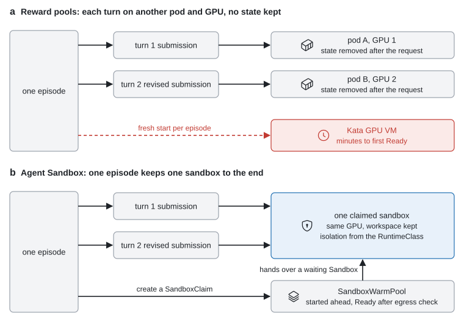
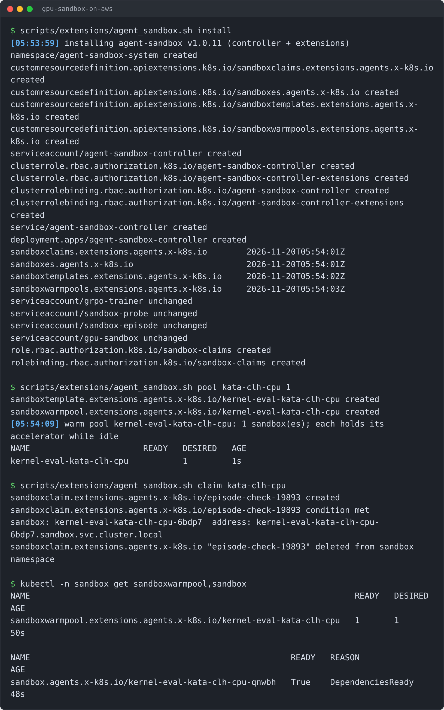

# 06 Extending with Agent Sandbox

!!! info "TL;DR"
    Agent Sandbox assigns and removes a sandbox for each episode. The runtime, such as gVisor or Kata, provides execution isolation.

## One sandbox per episode

An agent may need to revise an answer several times. Assigning one sandbox keeps those evaluations on the same pod and grader version, and on the same GPU for a GPU profile. In this repository the grader clears working files and processes after each submission. The agent sends the full revised code on each turn.



| | Reward pool | Agent Sandbox extension |
|---|---|---|
| Assignment | Select a ready pod per submission | Assign one sandbox at episode start |
| Next submission | May go to a different pod | Uses the same pod within the episode |
| After use | Pod can handle another submission | Claimed pod is removed at episode end |

## Resources that handle assignment

- `SandboxTemplate` defines the image, runtime, and resource requirements.
- `SandboxWarmPool` keeps sandboxes from the template ready in advance.
- `SandboxClaim` requests one of those sandboxes and is deleted at episode end.

The template's `RuntimeClass` selects the isolation runtime. Agent Sandbox manages the lifecycle. Ready sandboxes reduce the first-turn delay and hold CPU or GPU capacity while idle.

The [multi-turn exercise](../handson/11_multi_turn.md) starts with a CPU pool. Check that `claim` stays the same through the episode and that `released: true` appears at the end. The Kata GPU template and veRL integration have not been verified in AWS exercises.

## Trace one template from allocation to release

Start with the prerequisites for the [CPU episode lab](../handson/11_multi_turn.md), including the `sandbox` and `rl-trainer` namespaces, authentication, CPU node and images. These commands let you observe the three roles in the deployment.

```bash
scripts/extensions/agent_sandbox.sh install
scripts/extensions/agent_sandbox.sh pool kata-clh-cpu 1
scripts/extensions/agent_sandbox.sh episodes kata-clh-cpu 2 3
```

| Point in the run | What happens | What to inspect |
|---|---|---|
| After `install` | The controller watches sandbox resources. The episode Job's identity gets permission to create claims. | Installed CRDs and controller readiness |
| After `pool` | The `SandboxTemplate` specifies the image and RuntimeClass. The `SandboxWarmPool` keeps one sandbox ready. | `kernel-eval-kata-clh-cpu` in `kubectl -n sandbox get sandboxwarmpools` |
| During an episode | A `SandboxClaim` gets a sandbox. Each turn sends its complete submission to that address. | `claim`, `pod`, and `version` within one `episode` |
| On exit | The runner releases the claim, the used sandbox is removed, and the warm pool replenishes capacity. | `released` in `episode_end` and the remaining claim count |



The Kata CPU exercise processed two episodes in sequence. Each solved the task on turn three. Here `2` is the episode count and `3` is the maximum number of turns per episode. An episode that gets the first answer right stops there. `replicas: 1` is an idle capacity target. Each sandbox is assigned to one episode, and the controller can prepare another when the node has capacity. [Turn-by-turn results and cleanup](../handson/11_multi_turn.md)

### Find the wait when a claim is slow

Imagine two simultaneous requests and a target of one idle sandbox. The first claim can receive the ready sandbox. The next may wait for a replacement. Scheduling, image pulls, boot and the grading server's readiness checks can all contribute. Measure this separately from execution time after a ready sandbox starts grading.

```bash
kubectl -n sandbox get sandboxclaims
kubectl -n sandbox get sandboxwarmpools
kubectl -n sandbox get pods -o wide
```

If the runner is waiting for an address before `episode_start`, inspect claim assignment and pod readiness in these three lists. If several `turn` events already completed on the same pod, allocation succeeded. Inspect the verdict and feedback for each turn.

### Which version will the next episode receive?

This repository uses a stable template name per runtime. Applying the same pool with `VERSION_FILE=v2` changes the template for subsequently created sandboxes. Under the warm pool's `OnReplenish` policy, an older ready sandbox can remain until assigned or removed. If all episodes in a GRPO group must share the same grader version, inspect `turn.version`. One design is to keep distinct templates and pools per version and direct claims for a group to the same pool.

### The lifetime of a claim in Python

This illustrates the calls inside an in-cluster episode Job. `first_code` and `revised_code` are complete submissions for the same task. `token_file` points to the token for the scoring API. Entering `with` creates a claim and leaving it releases the claim. Both calls use the same `episode` object.

```python
from gpusandbox.agent_sandbox import EpisodeSandbox

with EpisodeSandbox("kernel-eval-kata-clh-cpu", token_file=token_file) as episode:
    first = episode.evaluate(task_id="relu_bias", code=first_code)
    if first["status"] == "wrong_answer":
        second = episode.evaluate(task_id="relu_bias", code=revised_code)
```

<a id="further-detail"></a>

## Agent Sandbox follows the RuntimeClass

<span id="scope-and-limits"></span>

??? note "Version changes, GPU errors and tested paths"
    With `VERSION_FILE=v2`, `pool` updates the existing `kernel-eval-<runtime>` template. Upstream’s `OnReplenish` behavior leaves waiting sandboxes in place until claimed or deleted, so claims during a transition may get either version. The CLI records the version in each `turn`; the veRL tool omits it from both the episode summary and `compute_score`. If a GRPO group needs one version, record it yourself or route that group to a separately named template and pool per version.

    The template has no liveness probe. After a GPU fault, a draining sandbox returns `sandbox_error` for the rest of the episode. Discard the episode and take a new claim. When constructing many `EpisodeSandbox` instances, pass a shared `BackgroundLoop` as `loop`; otherwise each creates a thread that outlives it. The CLI and veRL tool already share one.

    Scenario C verified the `kata-clh-cpu` claim and release, warm-pool replenishment and two episodes. Local tests exercise the seven rendered profiles, claim and episode cleanup, a fake Kubernetes API and two loopback CPU servers. The GPU Kata template and the veRL integration with a live job remain untested. API fields follow `sandboxclaim_types.go` in v1.0.11. [CPU warm pool](../handson/10_cpu_only.md) · [Episode run](../handson/11_multi_turn.md)

Agent Sandbox decides the lifetime and assignment of pods; the `runtimeClassName` in the podTemplate decides the isolation. Rendering the same template with a different runtime profile therefore gives you gVisor or Kata (Cloud Hypervisor or QEMU), as long as the nodes can run that RuntimeClass. The profile sets the node selector and the GPU resource name (`nvidia.com/gpu` or `nvidia.com/pgpu`) along with the RuntimeClass.

| Combination | Evidence | Status |
|---|---|---|
| Kata on AKS | Upstream examples `kata-aks`, `kata-aks-sandbox` | Upstream example |
| Kata on GKE (`kata-qemu`, optionally `kata-clh`) | Upstream example `kata-gke-sandbox`. It uses nested virtualization on N2 nodes | Upstream example |
| gVisor + L4 GPU on GKE | Upstream example `gpu-l4-snapshot-sandbox`. It uses GKE Sandbox (gVisor) and Pod snapshots to save and restore GPU memory as well | Upstream example. Snapshots are a GKE feature, and this page did not check for an equivalent on EKS |
| gVisor on EKS (CPU) | AWS blog parts 1 and 2: Agent Sandbox v1.0.5, gVisor release-20260928.0, EKS 1.36, `m7i.xlarge` | Built and measured by the blog authors |
| Kata on EKS | AWS blog part 3: Ably runs runc today and plans to evaluate Kata (microVM), keeping the Agent Sandbox API and swapping only the runtime | Planned |
| This repository (profiles `gvisor`, `gvisor-cpu`, `gvisor-hyperpod`, `kata-qemu`, `kata-clh`, `kata-clh-cpu`, `kata-qemu-cpu`) | `template.yaml.tpl` renders with all seven profiles | All seven profiles render locally. On EKS, `kata-clh-cpu` completed claim allocation, grading and release. Kata GPU inside a SandboxTemplate (`kata-qemu-nvidia-gpu` + `nvidia.com/pgpu`) is unverified |

Where each RuntimeClass can run on AWS follows the location table of [02 Isolation runtimes](02_isolation_runtimes.md), independently of Agent Sandbox.

- **Kata + GPU**: it runs only on `g4dn.metal` in this repository's x86 setup.
- **Kata CPU**: it also runs on nested-virtualization instances.
- **gVisor + GPU**: it runs on regular GPU VMs.

!!! question "❓ Misconception: Agent Sandbox is a gVisor tool"
    Agent Sandbox does not implement isolation itself; it leaves isolation to the runtime selected through RuntimeClass, and the upstream examples cover both Kata (AKS, GKE) and gVisor (GKE). Part 1 of the AWS blog also describes strong isolation as gVisor or Kata selected through RuntimeClass ("RuntimeClass로 지정하는 gVisor나 Kata"), and the series used gVisor on EKS by its own choice, not because Agent Sandbox requires it.

## Connecting to veRL multi-turn rollouts

[`rl/verl/sandbox_tool.py`](https://github.com/daekeun-ml/gpu-sandbox-on-aws/blob/main/rl/verl/sandbox_tool.py) is a multi-turn tool for veRL v0.9.1, and [`rl/verl/sandbox_tool_config.yaml`](https://github.com/daekeun-ml/gpu-sandbox-on-aws/blob/main/rl/verl/sandbox_tool_config.yaml) is an example config for it. It was written against the veRL v0.9.1 source and has never been run with veRL. The local tests (`tests/test_multiturn.py`) check only the tool's behaviour, without veRL and with a fake Kubernetes API. The source locations below are for v0.9.1, so check them against the version you install.

| Component | What it does |
|---|---|
| `KernelSandboxTool` (tool name `submit_kernel`) | When the model calls `submit_kernel(code=...)`, the trajectory's first call claims one sandbox from the warm pool (`EpisodeSandbox`), and later calls are evaluated in the same sandbox. The verdict summary (`format_feedback`) comes back as the tool response, which the model reads before its next turn |
| `compute_score` | A veRL custom reward function. It returns the final submission's score from the episode summary in `extra_info` |
| `SandboxToolAgentLoop` (registered as `sandbox_tool_agent`) | Wraps `run()` of `ToolAgentLoop`. It creates an episode key per trajectory, puts it in `tools_kwargs`, and deletes the claim when the trajectory ends |
| `sandbox_tool_config.yaml` | `tools[].class_name: sandbox_tool.KernelSandboxTool`, `config.type: native`, and a `tool_schema` in OpenAI function format. `config` holds `warm_pool`, `max_turns` (3), `require_triton`, `max_feedback_chars` (240), `idle_release_s` (600), `claim_lifetime_s` (3600) and `ready_timeout_s` (600) |

- **When `KernelSandboxTool` deletes the claim**: the claim is deleted when the kernel is solved, after `max_turns` submissions, or on a `sandbox_error`.
- **Why `compute_score` does not evaluate on the GPU again**: the sandbox already graded every submission during the rollout, so there is no second GPU evaluation per trajectory.

### How veRL v0.9.1 behaves and what this code does about it

veRL v0.9.1 drives tools as shown below. Claiming in `create` and releasing in `release`, or scoring the episode in `calc_reward`, therefore does not work in v0.9.1.

| veRL v0.9.1 behaviour (source) | What this code does |
|---|---|
| `ToolAgentLoop` runs `create`, `execute` and `release` for every tool call (`tool_agent_loop.py` lines 485 to 496). A tool instance lasts one call, not one trajectory, and the metrics value that `execute` returns is not used | Episodes live in a registry inside the tool object, looked up by a key stored in the trajectory's `agent_data.extra_fields` (one `AgentData` per trajectory). `release` runs after every call, so it does not delete the claim |
| With `rollout.full_determinism` on, `agent_data.request_id` becomes `det-<priority>`, and priorities restart at 0 every batch | `request_id` is not used as the episode key |
| `calc_reward` is defined only in `base_tool.py`, and nothing in v0.9.1 calls it | The episode summary goes into `agent_data.extra_fields["gpusandbox_episode"]`. The reward loop merges `extra_fields` into the reward function's `extra_info` (`reward_loop/reward_manager/naive.py`), and `compute_score` reads it there. `calc_reward` is implemented to return the same score, but it is never called |
| `ToolAgentLoop` has no hook that calls tools at the end of a trajectory | `SandboxToolAgentLoop` deletes the claim when `run()` ends. For the plain `tool_agent` loop, see the list below the table |
| Tool responses longer than `multi_turn.max_tool_response_length` (default 256) are cut | Feedback is capped at `max_feedback_chars` (default 240). Keep it at or below the veRL setting |

- **With the plain `tool_agent` loop**: the plain `tool_agent` loop has no timer. The next tool call's `create()` releases the sandboxes of episodes idle for longer than `idle_release_s` (default 600 s), and without further calls the claim's `shutdownTime` is the last safety net. `idle_release_s` must exceed the longest generation between two turns.

### Reward and resources

- **The trajectory reward is `score_verdict` of the final submission.** It is the same rule as `python -m gpusandbox.tools multiturn`. `execute` returns a reward of 0.0 for every turn, because paying failing turns would reward many cheap attempts (code comment).
- **Do not turn infrastructure errors into wrong answers.** A `sandbox_error`, including a failed claim, gets only the format score and the flag `sandbox_error: 1`, as in `reward_fn.py` and the rule in [Production 06 Scaling with veRL](../production/06_scaling_with_verl.md). Without any submission the score is 0.0 and the status is `no_submission`.
- **`compute_score` returns the same keys for every outcome** (`score`, `status`, `turns`, `first_turn_reward`, `sandbox_error`), because veRL stacks `reward_extra_info` key by key across the batch.
- **Blocking calls run in threads.** `EpisodeSandbox` blocks the calling thread while it waits for Ready and while it evaluates, so the tool runs the claim and each evaluation with `asyncio.to_thread` and keeps the rollout event loop free. All episodes of one worker share one `BackgroundLoop`.
- **The warm pool size sets how many episodes can start without waiting.** A claimed sandbox leaves the pool, and the pool refills its idle count. A running GPU episode holds one GPU from its first submission until release, so the number of GPUs bounds concurrent episodes. To let concurrent episodes start without waiting, size the replicas to that number.

### Configuration (veRL v0.9.1 keys)

```text
actor_rollout_ref.rollout.multi_turn.enable=True
actor_rollout_ref.rollout.multi_turn.tool_config_path=/opt/gpusandbox/rl/verl/sandbox_tool_config.yaml
actor_rollout_ref.rollout.multi_turn.max_assistant_turns=4     # >= max_turns submissions
actor_rollout_ref.rollout.agent.default_agent_loop=sandbox_tool_agent
reward.custom_reward_function.path=pkg://sandbox_tool
reward.custom_reward_function.name=compute_score
```

- veRL imports the tool class by module name (`tool_registry.get_tool_class`), so the directory of `sandbox_tool.py` (`/opt/gpusandbox/rl/verl` in the veRL image) must be on `PYTHONPATH` in every Ray worker. Importing the module by name also registers `SandboxToolAgentLoop`, and `pkg://` loads the reward function from the same module.
- `SandboxToolAgentLoop` reads the task id from `extra_info.task_id` (written by `rl/verl/prepare_data.py`). Under the plain `tool_agent` loop, each data row needs `extra_info.tools_kwargs.submit_kernel.create_kwargs.task_id` instead.

### Not confirmed

None of this has run with veRL, so the following items are unconfirmed (`# TODO verify` in the code).

- **The tool as a whole and the registration of `SandboxToolAgentLoop`.** Registration relies on `AgentLoopWorker` loading the tools (and so this module) before it looks up `default_agent_loop`, as read from `agent_loop.py` in v0.9.1.
- **How to put `rl/verl` on the Ray workers' `PYTHONPATH`.** Whether an env var on the RayCluster pods or `env_vars` in `ray job submit --runtime-env-json` works has to be checked on a cluster.
- **The path from `extra_fields` to `extra_info`.** It was confirmed in the source only for the reward-loop managers (naive, remote, limited).
- **What the rollout workers need.** The workers in `k8s/production/raycluster-verl.yaml.tpl` already have the `gpusandbox/client=true` label and the `grpo-trainer` ServiceAccount, which is a default allowed subject of the warm pool and is in the `sandbox-claims` RoleBinding that `install` applies. What is missing is this.
    - a Kubernetes API token (`automountServiceAccountToken: false`)
    - the `kubernetes` Python package in the veRL image (it installs only the `client` extra)
    - a sandbox-audience token in `SANDBOX_TOKEN_FILE` (the mounted token has the gateway audience)

    Decide first whether rollout workers create claims themselves or hand that to a broker (requirements table above).

??? note "Lessons from the AWS blog series applied to GPU sandboxes"
    The source is parts 1, 2 and 3 of the AWS Tech Blog series "AWS에서 AI 에이전트 실행 환경 격리하기" (isolating AI agent execution environments on AWS). All numbers in the table were measured by the blog authors on CPU sandboxes on EKS and are not measurements of this repository.

    | Lesson (source) | What it means for GPU sandboxes | What this repository does |
    |---|---|---|
    | Turn on VPC CNI NetworkPolicy first. Before that, the sandbox reached IMDS and the Kubernetes API (parts 1 and 2) | Without an enforcer, NetworkPolicy objects block nothing | The CDK stack (`cdk/gpusandbox_cdk/stack.py`) sets `enableNetworkPolicy` on the vpc-cni add-on, and readiness turns Ready only after the IMDS, API server and kubelet denials are verified |
    | The SandboxTemplate default policy takes ingress only from sandbox-router and allows egress to `0.0.0.0/0` minus RFC1918 and `169.254.0.0/16` (part 2) | On GPU sandboxes, mining turns directly into GPU cost | The template sets `networkPolicy` itself: ingress from the trainer only, egress `[]` |
    | The default DNS injection (`dnsPolicy: None`, `8.8.8.8`, `1.1.1.1`) bypasses the Route 53 Resolver (part 2) | An external resolver can become a path for sending data out through DNS (inference) | `dnsPolicy: None` with `127.0.0.1` is explicit, and with egress `[]` DNS cannot leave either |
    | sandbox-router's default authorization allows everything, and SDK v1.0.5 sent no authentication header (part 2) | GPU evaluations can exceed 30 seconds because of compilation and timing (inference). With port-forward permission, someone can step over the network boundary | No router, no SDK. The server checks audience, issuer and the subject allowlist itself, and the client request timeout is 300 seconds (the `SandboxPool` default) |
    | RuntimeClass scheduling does not stop other pods that tolerate the same taint from landing on the node (part 1) | If other pods land on a GPU sandbox node, the one-sandbox-per-node assumption breaks (inference) | A dedicated taint `gpusandbox/role` and the node guard. Check the pods on a node yourself with `kubectl get pods -A -o wide --field-selector spec.nodeName=<node>` |
    | Require IMDSv2 and set hop limit 1 on the dedicated node group (part 1). The EKS Best Practices guide recommends the same | Keeps the node's IAM credentials away from the sandbox | Every node group launch template in the CDK stack requires IMDSv2 with hop limit 1, and Karpenter uses hop limit 1 by default. Readiness also verifies that IMDS is blocked |
    | runsc cannot be registered on EKS Auto Mode (part 1) | The same holds for GPU sandboxes that need a custom runtime | EKS managed node groups from the CDK stack and Karpenter NodePools |
    | A warm pool cut SandboxClaim-to-Ready from about 2 s (cold start) to about 55 ms (part 2: EKS 1.36, `m7i.xlarge`, CPU, before turning on NetworkPolicy, 10 runs per pool) | Cold starts of GPU sandboxes can be longer. A Kata GPU VM can take several minutes to its first Ready (template comment), so a warm pool saves more and also costs more | These are the blog's numbers, not this repository's. In this extension, the time from creating a claim to getting a usable address is recorded as `claim_ready_s` in the `episode_start` event |
    | Six simultaneous claims on a pool of three: three took 100 to 179 ms, and two of the other three took about 15 s. The cause was the VPC CNI IP cooldown; the blog recommends Prefix Delegation, `WARM_IP_TARGET` and sizing pools for the peak (part 2) | The gVisor GPU profile runs one sandbox per node, so GPUs and node count can become the limit before IPs do (inference) | Size pool replicas to the number of concurrent episodes |
    | gVisor's cost scales with syscalls: about 0.18 us to 2.2 us per syscall, file operations and process creation 4.7 to 6.5 times slower, exec from 0.6 ms to 3.8 ms, no difference for pure computation (part 2) | This harness creates a fresh process tree per request, so the fixed cost per evaluation can grow (inference) | Measure it with [08 Runtime benchmark](../handson/08_benchmark.md) |
    | Pause deletes the Pod and keeps the Sandbox object and the PVC; memory state is not kept (part 2) | Pausing frees the GPU, but resume is a cold start, which can take minutes under Kata GPU (inference) | This extension does not pause; it deletes the claim when the episode ends |
    | Setting `SandboxClaim.spec.env` skips the warm pool and starts fresh from the template (part 3, upstream v1.0.8). The v1.0.11 source comments say the same, and `volumeClaimTemplates` on a claim also force a cold start | On GPU sandboxes this can be a cold start of several minutes | `envVarsInjectionPolicy: Disallowed` blocks env on claims, and `EpisodeSandbox` adds neither env nor volumes |
    | Ably uses a dedicated on-demand Karpenter NodePool with `karpenter.sh/do-not-disrupt` and scheduled disruption budgets (part 3) | If a node goes away mid-episode, that episode has to be discarded | The GPU sandbox NodePools use `consolidationPolicy: WhenEmpty`, so nodes with running sandboxes are not consolidated. `sandbox-kata-cpu` uses `WhenEmptyOrUnderutilized`; if you run episode sandboxes on the CPU tier, consider `do-not-disrupt` |

    - **SandboxTemplate default policy (part 2)**: the internet stays open, so data exfiltration, C2 and mining are not prevented. The blog recommends a custom policy, an egress proxy or AWS Network Firewall.
    - **sandbox-router and port-forward (part 2)**: TokenReview proves that a token is valid, not that it is authorized. port-forward (Tunnel mode) bypasses NetworkPolicy, and commands longer than 30 seconds got 502. In this repository, keep `pods/portforward` and `pods/exec` permissions in the `sandbox` namespace to a minimum.
    - **Warm pool measurement and comparison (part 2)**: this repository's CLI polls the claim once a second, so `claim_ready_s` is hard to compare directly with the blog's 55 ms.

    The gVisor profile runs one sandbox per `g5.xlarge`, so one waiting sandbox occupies a whole node at 1.006 USD per hour. A Kata GPU sandbox uses one T4 of a `g4dn.metal` (7.824 USD per hour for 8 T4), which by simple division is about 0.978 USD per hour per T4 (us-east-1 and us-west-2 On-Demand prices).

??? note "Comparison with the AI on EKS Agent Sandbox solution"
    The [Agent Sandbox on EKS](https://awslabs.github.io/ai-on-eks/docs/infra/agents/agent-sandbox) solution in the awslabs AI on EKS project also uses kubernetes-sigs/agent-sandbox. It targets agents that run model-generated code, and its page does not mention GPUs (checked 2026-11). This repository targets GPU kernel grading.

    | Item | AI on EKS Agent Sandbox solution | This repository |
    |---|---|---|
    | Building blocks | gVisor kernel isolation, the agent-sandbox CRDs (`Sandbox`, `SandboxTemplate`, `SandboxWarmPool`, `SandboxClaim`, `v1beta1`), FQDN-based egress control | GPU sandboxes with gVisor + nvproxy or Kata + VFIO and Deployment-based reward pools. Per-episode SandboxClaims are an optional extension |
    | Runtime tiers | `standard` (runc), `gvisor` (Standard EKS only; Auto Mode does not support gVisor), `isolated-sandbox` (Nitro Sandboxes, on EKS Auto Mode with Kubernetes 1.36 or later or on Standard EKS with a custom AMI). Kata + Firecracker is listed as a future tier and not included | `gvisor`, `kata-qemu`, `kata-clh`, `kata-clh-cpu`, `kata-qemu-cpu` profiles |
    | Egress | Allowed only to allowed domains. Standard EKS uses the FQDN filter of Cilium (aws-cni chaining mode), Auto Mode uses `ApplicationNetworkPolicy` | All blocked by the template's `networkPolicy.egress: []`, DNS traffic included |
    | Composition | KRO puts several resources behind one `AgentSandbox` resource | `template.yaml.tpl` rendered per profile |
    | Nodes | Karpenter and a gVisor NodePool (the `runsc` shim installed through AL2023 user data) | EKS managed node groups and Karpenter NodePools from the CDK stack |

    - **For agent sandboxes that need no GPU and allow outbound connections only to allowed domains**: the AI on EKS solution applies.
    - **If you measure the reward on a GPU inside the sandbox**: use this repository's GPU profiles.
    - **Nitro Sandboxes (`isolated-sandbox`)**: they do not support GPU passthrough at launch ([Verified facts and sources](../reference/sources.md)), so they cannot be used for GPU kernel grading.

??? note "References"
    | Topic | Link |
    |---|---|
    | Agent Sandbox repository, releases (v1.0.11) | https://github.com/kubernetes-sigs/agent-sandbox , https://github.com/kubernetes-sigs/agent-sandbox/releases |
    | SandboxClaim, SandboxTemplate, SandboxWarmPool and Sandbox types (v1.0.11) | https://github.com/kubernetes-sigs/agent-sandbox/blob/v1.0.11/extensions/api/v1beta1/sandboxclaim_types.go , https://github.com/kubernetes-sigs/agent-sandbox/blob/v1.0.11/extensions/api/v1beta1/sandboxtemplate_types.go , https://github.com/kubernetes-sigs/agent-sandbox/blob/v1.0.11/extensions/api/v1beta1/sandboxwarmpool_types.go , https://github.com/kubernetes-sigs/agent-sandbox/blob/v1.0.11/api/v1beta1/sandbox_types.go |
    | AWS Tech Blog part 2: the default policy, DNS and router checks and the warm pool measurements cited on this page | https://aws.amazon.com/ko/blogs/tech/aws-ai-agent-sandbox-eks-isolation-part-2/ |
    | Amazon EKS NetworkPolicy (VPC CNI), policy agent | https://docs.aws.amazon.com/eks/latest/userguide/cni-network-policy-configure.html , https://github.com/aws/aws-network-policy-agent |
    | veRL `ToolAgentLoop` (v0.9.1, create, execute and release for every tool call) | https://github.com/verl-project/verl/blob/v0.9.1/verl/experimental/agent_loop/tool_agent_loop.py |

    [Selected references on this topic](../reference/references.md#ref-concepts-06-agent-sandbox)
