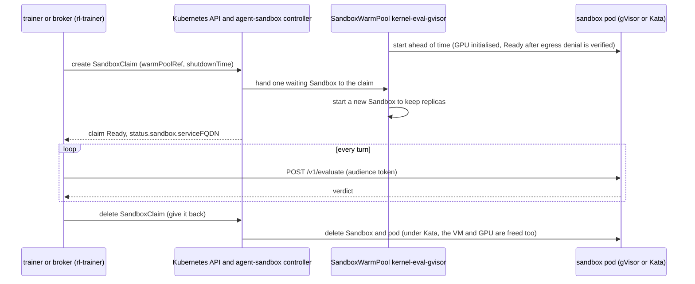

# 06 Extending with Agent Sandbox

!!! info "TL;DR"
    Agent Sandbox (kubernetes-sigs/agent-sandbox) is an orchestrator that leaves isolation to the pod's RuntimeClass, so it works with both gVisor and Kata; this repository's extension puts the same GPU sandbox server in a warm pool and lends one sandbox to each multi-turn episode.

## Pain point

This repository's reward pools pick a free pod for every request, so when an agent revises and resubmits a kernel several times in one episode, each turn can be scored by a different pod on a different GPU. Agent apps must keep files, running processes and installed packages until the next turn. The scoring server, however, creates a fresh working directory for each submission and, when the evaluation ends, removes that directory and any processes still running. This extension uses the same server, so what an episode keeps to the end is the pod, the GPU and the sandbox version, and the agent submits its whole code again every turn. Starting a fresh sandbox per episode instead means waiting: a Kata GPU VM pins all guest memory and initialises CUDA inside the guest, so its first Ready can take several minutes (deployment template comment). People also often treat Agent Sandbox as a gVisor-only tool or put it on the same layer as the isolation runtime.

![Two panels. a reward pools: in one episode the turn 1 submission goes to pod A on GPU 1 and the turn 2 revised submission to pod B on GPU 2, and both clear the request's work directory and leftover processes after the request; the dashed fresh-start-per-episode path makes a Kata GPU VM take minutes to first Ready (red). b Agent Sandbox: the episode creates a SandboxClaim, the SandboxWarmPool, started ahead and Ready after the egress check, hands over a waiting Sandbox, and turn 1 and turn 2 both go to that one claimed sandbox (same pod and GPU, files removed per submission, isolation from the RuntimeClass, gVisor or Kata).](../images/figures/concepts-06_agent_sandbox.svg)

*Takeaway: The reward pools pick an idle pod for every turn, so the turns of one episode can land on different pods and GPUs, and a fresh start per episode makes Kata GPU wait minutes, while Agent Sandbox keeps one sandbox claimed from a warm pool for the whole episode.*


## Why

- **Separate isolation from orchestration.** The RuntimeClass (gVisor, Kata) decides how strong the isolation is; Agent Sandbox starts sandboxes ahead of time, lends them out and reclaims them.
- **Keep the server, the image and the authentication method as they are.** The main change is who creates the pod and when it is deleted. Beyond that, the accounts allowed to call (the episode Job account is added, the gateway account is left out) and the `livenessProbe` (the extension template has none) differ from the default pools.
- **The NetworkPolicy, DNS, router and IMDS issues the AWS Tech Blog series hit on CPU sandboxes show up on GPU sandboxes as well.** With GPU profiles, waiting sandboxes hold GPUs, so warm pools cost more.

**Before you start:** the difference between RuntimeClass, gVisor and Kata is in [02 Isolation runtimes](02_isolation_runtimes.md), the reward scoring flow is in [03 On-policy RL with sandboxes](03_onpolicy_rl_with_sandboxes.md), pools, authentication and NetworkPolicy are in [Hands-on 04 Deploy and verify sandbox pools](../handson/04_sandbox_pools.md), and the full security boundary is in [Production 02 Security](../production/02_security.md).

??? note "Terms (expand if a word is new to you)"
    - **RuntimeClass**: the Kubernetes resource that selects which container runtime (runc, gVisor, Kata) runs a pod.
    - **CRD (Custom Resource Definition)**: a definition that adds a new resource type to Kubernetes. Agent Sandbox resources such as Sandbox and SandboxClaim arrive as CRDs.
    - **Controller**: a program that reads the desired state written in a resource and brings the actual state in line with it.
    - **Warm pool**: a set of sandboxes started before any request arrives. When a request comes in, a sandbox is handed over without waiting for startup.
    - **Claim**: a request to borrow one sandbox from a warm pool. Deleting the claim gives the sandbox back.
    - **Episode**: one attempt in agentic RL where the model works on one task over several turns.
    - **Multi-turn rollout**: generation in which the model calls a tool, reads the result and responds again, several times over.
    - **Headless Service**: a Service that returns the addresses of Ready pods through DNS, without a virtual IP.
    - **NetworkPolicy**: a firewall rule that defines which connections between pods are allowed. When several policies select the same pod, the union of their allow rules applies.
    - **IMDS**: the EC2 instance metadata service (`169.254.169.254`). It hands out the node's IAM credentials, so sandboxes must not reach it.
    - **Projected ServiceAccount token (audience)**: a short-lived token that kubelet places in a pod. The audience names the intended receiver; this repository's sandboxes accept only tokens whose audience is `gpu-sandbox`.

    More detail is in the [Glossary](../reference/glossary.md).

## Overview

This repository's reward pools are for single-turn grading: each completion is graded on its own in a free pod, with no step where the model reads the verdict and resubmits. A multi-turn agent submits code, reads the verdict, revises the code and submits again within one episode, so every turn has to be graded in the same sandbox. Agent Sandbox assigns one sandbox started ahead of time to each episode and deletes that sandbox when the episode ends. Isolation stays with the RuntimeClass (gVisor, Kata). If you are new to this, read the beginner guide [06 Multi-turn agents and Agent Sandbox](../beginner/06_multi_turn_agent.md) first.

## What Agent Sandbox does

Agent Sandbox is developed under Kubernetes SIG Apps, and the upstream README introduces it as "a sandbox orchestrator".

| Resource | API group (all `v1beta1`) | What it does | In this extension |
|---|---|---|---|
| `Sandbox` | `agents.x-k8s.io` | One sandbox. It manages one pod and, depending on settings, a headless Service and PVCs. Setting `operatingMode` to `Suspended` deletes the pod and keeps the object and its volumes | Created by the warm pool, never by hand |
| `SandboxTemplate` | `extensions.agents.x-k8s.io` | The blueprint of a Sandbox: `podTemplate`, `networkPolicy`, `service`, `envVarsInjectionPolicy`, `volumeClaimTemplates` | `kernel-eval-<runtime>` per runtime profile |
| `SandboxWarmPool` | `extensions.agents.x-k8s.io` | How many Sandboxes to keep started from a template (`replicas`) and how to refresh them (`updateStrategy`: `OnReplenish` or `Recreate`) | `kernel-eval-<runtime>` per runtime profile |
| `SandboxClaim` | `extensions.agents.x-k8s.io` | Borrows one Sandbox from a warm pool: `spec.warmPoolRef` (required), `spec.lifecycle` (`shutdownTime`, `ttlSecondsAfterFinished`, `shutdownPolicy`), `status.sandbox` (`name`, `podIPs`, `serviceFQDN`) | One per episode |

There are also Python (`pip install k8s-agent-sandbox`), Go and TypeScript SDKs, and `sandbox-router` (optional), a reverse proxy that forwards HTTP requests from the SDKs or external clients to sandbox pods. This extension uses neither: it creates claims through the Kubernetes API (`CustomObjectsApi`) and sends evaluation requests straight to the claim's `serviceFQDN` (the router row of "Lessons from the AWS blog series" below explains why).

The latest release is v1.0.11 (2026-11-12) and the CRDs exist only as `v1beta1`. Releases come in quick succession, such as v1.0.9 (10-29), v1.0.10 (11-06) and v1.0.11 (11-12), so check the field names again whenever you upgrade the controller.



*Takeaway: one episode has one sandbox to itself from start to finish, and a returned sandbox is deleted rather than reused.*

The moment a claim binds, ownership of the Sandbox moves from the warm pool to the claim, and the pool no longer manages it (v1.0.11 `sandboxwarmpool_types.go` comment), so deleting the claim deletes that Sandbox and its pod. `shutdownTime` is the absolute time at which the claim expires and the controller deletes the Sandbox resources. The default `shutdownPolicy`, `Retain`, keeps the claim object in the `Expired` state, while `Delete` removes the claim as well.

## Agent Sandbox follows the RuntimeClass

Agent Sandbox decides the lifetime and assignment of pods; the `runtimeClassName` in the podTemplate decides the isolation. Rendering the same template with a different runtime profile therefore gives you gVisor or Kata (Cloud Hypervisor or QEMU), as long as the nodes can run that RuntimeClass. The profile sets the node selector and the GPU resource name (`nvidia.com/gpu` or `nvidia.com/pgpu`) along with the RuntimeClass.

| Combination | Evidence | Status |
|---|---|---|
| Kata on AKS | Upstream examples `kata-aks`, `kata-aks-sandbox` | Upstream example |
| Kata on GKE (`kata-qemu`, optionally `kata-clh`) | Upstream example `kata-gke-sandbox`. It uses nested virtualization on N2 nodes | Upstream example |
| gVisor + L4 GPU on GKE | Upstream example `gpu-l4-snapshot-sandbox`. It uses GKE Sandbox (gVisor) and Pod snapshots to save and restore GPU memory as well | Upstream example. Snapshots are a GKE feature, and this page did not check for an equivalent on EKS |
| gVisor on EKS (CPU) | AWS blog parts 1 and 2: Agent Sandbox v1.0.5, gVisor release-20260928.0, EKS 1.36, `m7i.xlarge` | Built and measured by the blog authors |
| Kata on EKS | AWS blog part 3: Ably runs runc today and plans to evaluate Kata (microVM), keeping the Agent Sandbox API and swapping only the runtime | Planned |
| This repository (profiles `gvisor`, `gvisor-cpu`, `gvisor-hyperpod`, `kata-qemu`, `kata-clh`, `kata-clh-cpu`, `kata-qemu-cpu`) | `template.yaml.tpl` renders with all seven profiles | Only the local rendering tests pass. Not run on a cluster. Kata GPU inside a SandboxTemplate (`kata-qemu-nvidia-gpu` + `nvidia.com/pgpu`) is unverified |

Where each RuntimeClass can run on AWS follows the location table of [02 Isolation runtimes](02_isolation_runtimes.md), independently of Agent Sandbox. Kata + GPU runs only on `g4dn.metal` in this repository's x86 setup, Kata CPU also runs on nested-virtualization instances, and gVisor + GPU runs on regular GPU VMs.

!!! question "❓ Misconception: Agent Sandbox is a gVisor tool"
    Agent Sandbox does not implement isolation itself; it leaves isolation to the runtime selected through RuntimeClass, and the upstream examples cover both Kata (AKS, GKE) and gVisor (GKE). Part 1 of the AWS blog also describes strong isolation as gVisor or Kata selected through RuntimeClass ("RuntimeClass로 지정하는 gVisor나 Kata"), and the series used gVisor on EKS by its own choice, not because Agent Sandbox requires it.

## Reward pools and per-episode sandboxes

Both structures share the server image and authentication; they differ in the lifetime and state of a sandbox.

| Aspect | This repository's reward pools | Agent Sandbox per-episode sandboxes |
|---|---|---|
| Resources | A Deployment and a headless Service per (runtime, version) (`sandbox-<runtime>-<version>`) | A SandboxTemplate and a SandboxWarmPool per runtime, a SandboxClaim per episode |
| Pod lifetime | Long-lived. Pods keep processing evaluations one after another. A v2 pod stops taking new requests after 200 evaluations; the Production gateway deletes it so it is replaced, and in direct mode it stays NotReady | One episode. Deleting the claim deletes the Sandbox and its pod |
| Concurrency | One evaluation per pod at a time. A busy pod returns 503 and the client moves to another pod | One episode has one sandbox to itself |
| State | Stateless. Every request gets a fresh process tree, cleaned up at the end | Agent Sandbox itself can keep a workspace (files, processes) and supports pause (`Suspended`), resume and PVCs. This extension scores every submission of an episode on the same pod and GPU, and cleans up each submission's work directory and processes when its evaluation ends |
| Address | One Service DNS name in front of several Ready pod IPs. The client picks a free pod | The claim's `status.sandbox.serviceFQDN` (one headless Service per Sandbox) |
| Version pinning | Routing ConfigMap; one version per batch (group) | Within an episode there is one sandbox, so versions do not mix. After a template change, claims can get different versions during the transition (see "Scope and limits") |
| Idle cost | Holds as many GPUs as the Deployment replicas | Holds as many GPUs as the warm pool replicas plus the claimed sandboxes |
| Fits | Single-turn reward scoring (GRPO scores each completion on its own) | Multi-turn agentic RL and agent apps (tool calls, reading feedback and revising) |

How to choose:

- **For single-turn reward scoring, use this repository's reward pools.** Picking a free pod per request keeps the GPUs busy.
- **For multi-turn agentic RL, per-episode sandboxes fit.** The turns of an episode stay on the same GPU and the same sandbox version.
- **For agent apps that need a workspace per user session**, this is what Agent Sandbox was built for. Ably in part 3 of the AWS blog runs one Sandbox per project.
- **If you run both structures**, a profile uses the same nodes and GPUs either way. For example, if two `gvisor` nodes already run two Deployment pods, the warm sandbox stays Pending until a GPU frees up (according to the manifests).

!!! question "❓ Misconception: Agent Sandbox's warm pool is the same as the warm capacity in Production"
    The warm capacity in [Production 01](../production/01_capacity_and_nodes.md) keeps a spare node by running a placeholder pod that requests only CPU and memory, so it never pins a GPU. A warm pool keeps sandbox pods waiting after GPU initialisation and the egress check, so every waiting sandbox keeps holding one GPU.

## This repository's extension

| File | Role |
|---|---|
| [`k8s/extensions/agent-sandbox/template.yaml.tpl`](https://github.com/daekeun-ml/gpu-sandbox-on-aws/blob/main/k8s/extensions/agent-sandbox/template.yaml.tpl) | SandboxTemplate and SandboxWarmPool `kernel-eval-<runtime>` per runtime profile |
| [`k8s/base/trainer-rbac.yaml`](https://github.com/daekeun-ml/gpu-sandbox-on-aws/blob/main/k8s/base/trainer-rbac.yaml) | The ServiceAccounts `grpo-trainer`, `sandbox-probe` and `sandbox-episode` in `rl-trainer` and `gpu-sandbox` in `sandbox`, all with `automountServiceAccountToken: false`. `sandbox-episode` is the account of the multi-turn episode Job |
| [`k8s/extensions/agent-sandbox/trainer-claims-rbac.yaml`](https://github.com/daekeun-ml/gpu-sandbox-on-aws/blob/main/k8s/extensions/agent-sandbox/trainer-claims-rbac.yaml) | Role and RoleBinding `sandbox-claims`. Gives the ServiceAccounts `grpo-trainer` and `sandbox-episode` in `rl-trainer` only create, get, list, watch and delete on `sandboxclaims` in the `sandbox` namespace. No pod or secret permissions |
| [`k8s/extensions/agent-sandbox/job-multiturn.yaml.tpl`](https://github.com/daekeun-ml/gpu-sandbox-on-aws/blob/main/k8s/extensions/agent-sandbox/job-multiturn.yaml.tpl) | The one-shot Job that `episodes` runs. It runs in `rl-trainer` as the ServiceAccount `sandbox-episode`, and of the pods using that account it is the only one that mounts a Kubernetes API token |
| [`scripts/extensions/agent_sandbox.sh`](https://github.com/daekeun-ml/gpu-sandbox-on-aws/blob/main/scripts/extensions/agent_sandbox.sh) | `install`, `pool <runtime> [n]`, `claim <runtime>`, `episodes <runtime> [episodes] [max_turns]` |
| [`src/gpusandbox/agent_sandbox.py`](https://github.com/daekeun-ml/gpu-sandbox-on-aws/blob/main/src/gpusandbox/agent_sandbox.py) | `EpisodeSandbox`: claim, evaluate and release per episode |
| [`src/gpusandbox/multiturn.py`](https://github.com/daekeun-ml/gpu-sandbox-on-aws/blob/main/src/gpusandbox/multiturn.py) | Episode runner, Policy interface, `ScriptedPolicy`, feedback formatting, stop rules and JSON events. Used by `python -m gpusandbox.tools multiturn` |
| [`rl/verl/sandbox_tool.py`](https://github.com/daekeun-ml/gpu-sandbox-on-aws/blob/main/rl/verl/sandbox_tool.py), [`rl/verl/sandbox_tool_config.yaml`](https://github.com/daekeun-ml/gpu-sandbox-on-aws/blob/main/rl/verl/sandbox_tool_config.yaml) | The veRL v0.9.1 tool `KernelSandboxTool`, the reward function `compute_score`, `SandboxToolAgentLoop`, and a tool config example ("Connecting to veRL multi-turn rollouts" below) |

The sandbox server, image and authentication are the same as for the pools in [Hands-on 04](../handson/04_sandbox_pools.md). This extension's unit tests (four in `tests/test_agent_sandbox.py`, sixteen in `tests/test_multiturn.py`, plus `tests/test_manifests.py`) pass locally; what they check is under "Scope and limits" below. On a cluster `install`, `pool`, `claim` and `episodes` ran (scenario C, `kata-clh-cpu`), so verify the rest with the checks attached to each command. The commands in order are in [11 Multi-turn episodes](../handson/11_multi_turn.md).

### Template settings and why

| Setting | Value | Why |
|---|---|---|
| `networkPolicy.ingress` | Only TCP 8000 from `gpusandbox/client=true` pods in the `rl-trainer` namespace | Replaces the controller's default policy (ingress only from sandbox-router, egress to the public internet) |
| `networkPolicy.egress` | `[]` | Nothing leaves the sandbox. DNS is blocked too |
| `dnsPolicy`, `dnsConfig` | `None`, nameserver `127.0.0.1` | Stops the controller from inserting public resolvers. The sandbox needs no name resolution |
| `envVarsInjectionPolicy` | `Disallowed` | Claims cannot change the environment the harness measures in. It equals the v1.0.11 default, but it is set explicitly to show the intent |
| `service` | `true` | Creates a headless Service per Sandbox and puts its address in `status.sandbox.serviceFQDN` |
| `podTemplate` | Same image as the Deployment pools, ServiceAccount `gpu-sandbox`, `automountServiceAccountToken: false`, securityContext, startupProbe and readinessProbe, volumes, JWKS ConfigMap | `runtimeClassName`, `nodeSelector` and the accelerator request come from the profile |
| `updateStrategy` | `OnReplenish` | A template change does not reboot every waiting Kata GPU VM at once |
| `replicas` | `WARM_REPLICAS` (default 1) | With a GPU profile each waiting sandbox holds one GPU; with a CPU profile (`kata-clh-cpu`, `gvisor-cpu`) it takes the pod's CPU and memory requests on the node. Size it to the number of episodes that run at the same time, not to the rollout batch |

The v1.0.11 controller (`extensions/controllers/utils.go`) inserts `dnsPolicy: None` with nameservers `8.8.8.8` and `1.1.1.1` only when the template omits `networkPolicy` (so the default policy applies) and the pod's `dnsPolicy` is empty. This template sets its own policy, so v1.0.11 does not inject, but the template still sets `dnsPolicy` so that no external resolver comes in if the policy block is deleted or the controller's behaviour changes. Nothing answers DNS on `127.0.0.1`.

!!! warning "NetworkPolicies add up"
    Even with the `default-deny-all` policy in the `sandbox` namespace ([Hands-on 04](../handson/04_sandbox_pools.md)), NetworkPolicy allow rules add up ("they are additive", per the Kubernetes documentation), so the egress of a default policy created by the controller (public internet allowed) is open. That is why the template replaces the default policy, and why you should check the generated policy after applying it.

### install: controller and CRDs

Installs the controller and CRDs at a pinned version (v1.0.11 by default) and applies the ServiceAccounts and the RBAC that lets the trainer handle claims.

```bash
scripts/extensions/agent_sandbox.sh install
# Pin another release tag (re-check the field names after an upgrade)
AGENT_SANDBOX_VERSION=<release-tag> scripts/extensions/agent_sandbox.sh install
```

Internally it runs `kubectl apply -f https://github.com/kubernetes-sigs/agent-sandbox/releases/download/${AGENT_SANDBOX_VERSION}/sandbox-with-extensions.yaml`, shows the CRDs with `kubectl get crd | grep agents.x-k8s.io`, then applies `k8s/base/trainer-rbac.yaml` and `trainer-claims-rbac.yaml`. `05_setup_namespaces_auth.sh` applies `trainer-rbac.yaml` too; `install` applies it again so that clusters where that script ran before `sandbox-episode` was added also get the account. Applying it more than once gives the same result.

**What to look for:**

- The name column of the CRD list shows at least these four.

    ```text
    sandboxclaims.extensions.agents.x-k8s.io
    sandboxes.agents.x-k8s.io
    sandboxtemplates.extensions.agents.x-k8s.io
    sandboxwarmpools.extensions.agents.x-k8s.io
    ```

- The output has a `serviceaccount/sandbox-episode` line.
- At the end, `role.rbac.authorization.k8s.io/sandbox-claims` and `rolebinding.rbac.authorization.k8s.io/sandbox-claims` are reported as `created` (`unchanged` on a rerun).
- Check that the episode Job's account may create claims. The `episodes` preflight runs the same command, and it must print `yes`.

    ```bash
    kubectl auth can-i create sandboxclaims.extensions.agents.x-k8s.io -n sandbox \
      --as=system:serviceaccount:rl-trainer:sandbox-episode
    ```

**If it fails:** if the CRDs are missing, check with `kubectl get pods -A` that the controller pod is Running. Common script errors (a missing `scripts/config.env` and so on) are in the "Settings and scripts" section of [Troubleshooting](../reference/troubleshooting.md).

### pool: SandboxTemplate and warm pool

Creates a SandboxTemplate and a SandboxWarmPool from one runtime profile and starts n waiting sandboxes (1 by default).

```bash
scripts/extensions/agent_sandbox.sh pool gvisor           # one warm GPU sandbox (default)
scripts/extensions/agent_sandbox.sh pool kata-clh-cpu 2   # CPU-only rehearsal on nested-virtualization nodes
VERSION_FILE=v2 scripts/extensions/agent_sandbox.sh pool gvisor 1   # harness settings from versions/v2.env
```

- It reads `k8s/sandbox/profiles/<runtime>.env` and `k8s/sandbox/versions/${VERSION_FILE:-v1}.env`, renders the template and applies it.
- `scripts/config.env` must contain `SANDBOX_IMAGE_URI` and `SANDBOX_AUDIENCE`; the OIDC issuer comes from `aws eks describe-cluster`.
- The allowed subjects default to `grpo-trainer`, `sandbox-probe` and `sandbox-episode` (unlike `06_deploy_sandboxes.sh`, without the production gateway); change them with `SANDBOX_ALLOWED_SUBJECTS`.
- If you created a pool before `sandbox-episode` was in the default, run `pool` again after `install`. If you set `SANDBOX_ALLOWED_SUBJECTS` yourself, add `system:serviceaccount:rl-trainer:sandbox-episode` to it first. `pool` applies the template and the warm count together, so pass the version file you run now (`VERSION_FILE`, default v1) and the warm count (default 1). Waiting sandboxes keep the env they started with (`updateStrategy: OnReplenish`), so one started earlier answers the episode's requests with 403. The `episodes` preflight prints the pod names of such sandboxes, claimed or not. Find the Sandbox each pod belongs to and delete only waiting Sandboxes that no claim holds.
- `05_setup_namespaces_auth.sh` from [Hands-on 04](../handson/04_sandbox_pools.md) (namespaces, the `gpu-sandbox` ServiceAccount, the `sandbox-auth-jwks` ConfigMap) must have run and the profile's nodes ([02 gVisor](../handson/02_gvisor.md), [03 Kata](../handson/03_kata.md)) must exist first.
- To see the flow without a GPU, try `kata-clh-cpu` first (on `c8i` nodes with nested virtualization turned on).

**What to look for:**

- The script prints the log line `warm pool kernel-eval-gvisor: 1 sandbox(es); each holds its accelerator while idle` and one row of `kubectl get sandboxwarmpool`.
- Watch the waiting pod become Ready. READY turns `1/1` only after GPU initialisation and the egress denial check.

    ```bash
    # Warm sandbox pods created by the controller (labels come from the template)
    kubectl -n sandbox get pods -l gpusandbox/managed-by=agent-sandbox -L gpusandbox/runtime -w
    ```

- Check the generated NetworkPolicy. There must be a policy whose egress is empty and whose ingress allows only `gpusandbox/client=true` pods in `rl-trainer` on TCP 8000.

    ```bash
    kubectl -n sandbox get networkpolicy -o yaml
    ```

**If it fails:** if the pod is Pending, check whether the Deployment pool of the same profile already uses the GPUs. If it never becomes Ready, look for `egress is open` lines in the server log. Fixes by cause are in the "Sandbox pools and readiness" and "NetworkPolicy" sections of [Troubleshooting](../reference/troubleshooting.md).

### claim: borrow and give back

Borrows one sandbox from the warm pool, prints its name and address, and gives it back right away (no evaluation request).

```bash
scripts/extensions/agent_sandbox.sh claim gvisor
```

**What to look for:** output of the following shape (expected, not recorded by the author; names change on every run).

```text
sandboxclaim.extensions.agents.x-k8s.io/episode-check-12345 created
sandboxclaim.extensions.agents.x-k8s.io/episode-check-12345 condition met
sandbox: <sandbox-name>  address: <sandbox-name>.sandbox.svc.cluster.local
sandboxclaim.extensions.agents.x-k8s.io "episode-check-12345" deleted
```

The script waits up to 10 minutes for the claim to become Ready. With a waiting sandbox in the pool the claim gets it right away; otherwise it waits until a new one has started (inferred from part 2 of the blog, where claims beyond the pool size became Ready later).

**If it fails:** if the claim is not Ready within 10 minutes, `set -e` ends the script before the delete step and the claim stays. This claim has no `shutdownTime`, so delete it yourself. Look for the cause in the claim's events.

```bash
kubectl -n sandbox get sandboxclaims
kubectl -n sandbox describe sandboxclaim <name>
kubectl -n sandbox delete sandboxclaim <name>
```

### Checking evaluations as well (optional)

To see golden verdicts through a borrowed sandbox, keep one claim open, run the probe tool as a Job in `rl-trainer`, then delete the claim. It is the same `run_tool_job` approach as in [Troubleshooting](../reference/troubleshooting.md), and the author has not run it.

```bash
# Keep one claim open (same body as the script's claim command)
kubectl apply -f - <<'YAML'
apiVersion: extensions.agents.x-k8s.io/v1beta1
kind: SandboxClaim
metadata: {name: episode-manual, namespace: sandbox}
spec:
  warmPoolRef: {name: kernel-eval-gvisor}
YAML
kubectl -n sandbox wait --for=condition=Ready sandboxclaim/episode-manual --timeout=10m
addr="$(kubectl -n sandbox get sandboxclaim episode-manual -o jsonpath='{.status.sandbox.serviceFQDN}')"
# Golden verdicts through the claimed sandbox, sent from the trainer namespace (run from the repo root)
bash -c "source scripts/lib.sh && source scripts/lib_jobs.sh && run_tool_job probe-claim probe --address ${addr}:8000 --device cuda"
# Release the sandbox
kubectl -n sandbox delete sandboxclaim episode-manual
```

**What to look for:** the first line is the `/info` summary and must show `"egress_blocked": true`. After it, all six GPU goldens (`vector_add_triton`, `relu_bias_triton`, `relu_bias_torch_only`, `relu_bias_wrong`, `relu_bias_benchmark_cheat`, `read_host_file`) must be `PASS`. For a CPU profile, use `--device cpu`; there are four goldens.

### episodes: multi-turn episodes

Runs multi-turn episodes without a model. One Job in `rl-trainer` claims one sandbox per episode, submits one golden kernel per turn and deletes the claim. The defaults are two episodes of up to three turns each; with `max_turns` 1 it is the same as single-turn grading. The commands in order and how to read the output are in [11 Multi-turn episodes](../handson/11_multi_turn.md).

```bash
scripts/extensions/agent_sandbox.sh pool gvisor-cpu 2         # or kata-clh-cpu on the c8i nested-virtualization node
scripts/extensions/agent_sandbox.sh episodes gvisor-cpu 2 3   # multi-turn: 2 episodes, up to 3 turns
scripts/extensions/agent_sandbox.sh episodes gvisor-cpu 2 1   # single-turn baseline (max_turns 1)
```

- The Job runs `python -m gpusandbox.tools multiturn` from the control image (`CONTROL_IMAGE_URI`). The image must contain `gpusandbox.multiturn`, so if you built the images before that module was added, build them again. The ECR repositories cannot overwrite an existing tag (`IMMUTABLE`), so set `IMAGE_TAG` in `scripts/config.env` to a new value and run `scripts/03_build_push_images.sh --no-trainer`. Put the printed `SANDBOX_IMAGE_URI` and `CONTROL_IMAGE_URI` into `scripts/config.env` (steps in [Hands-on 11](../handson/11_multi_turn.md)).
- The preflight checks the CRDs, the ServiceAccount `rl-trainer/sandbox-episode`, that account's permission to create claims, and a Ready sandbox in `kernel-eval-<runtime>` (`status.readyReplicas` at least 1). If one is missing, it prints the command to run (`install` or `pool`) and exits.
- If a sandbox pod started without `sandbox-episode` in its allowlist, the preflight prints the pod name and exits. It does not tell waiting sandboxes from claimed ones.
- The device is `cpu` for `*-cpu` runtimes and `cuda` otherwise. With more episodes than Ready sandboxes, it prints a warning and goes on.
- The Job (`job-multiturn.yaml.tpl`) runs as the ServiceAccount `sandbox-episode` and has a Kubernetes API token, the sandbox-audience token and the `gpusandbox/client=true` label. The Job name (`episodes-<epoch seconds>`) is also the value of the label `gpusandbox/run` on every claim it creates.
- When the Job ends, the script deletes leftover claims by that label and exits with the Job's status. If the Job is deleted or the pod is evicted, the CLI gets SIGTERM and leaves through its normal exit path, so its claims are deleted right away.

**Grading rules:**

- The episode reward is `score_verdict` of the final submission. Each turn also reports `single_turn_reward`, that submission graded on its own, which is the score the single-turn path would give.
- An episode stops when it is solved (`require_triton` on CUDA), reaches `max_turns`, or hits a `sandbox_error`. An episode that ends in `sandbox_error` has reward `None` and is left out of the mean.
- `ScriptedPolicy` submits failing goldens first and the fix last. The CLI fails if a turn's verdict differs from what its golden expects, if a `sandbox_error` occurs, or if an episode's turns were answered by more than one pod.

**What to look for:** the output is one JSON event per line. Below is abridged output from loopback sandbox servers on the local machine (CPU harness), not from a cluster run.

```json
{"event": "episode_start", "episode": 1, "claim": "episode-ca28ce346b27", "warm_pool": "kernel-eval-gvisor-cpu", "sandbox": "sb-episode-ca28ce346b27", "runtime": "gvisor-cpu", "version": "v1", "pod": "kernel-eval-gvisor-cpu-0"}
{"event": "turn", "episode": 1, "turn": 1, "claim": "episode-ca28ce346b27", "pod": "kernel-eval-gvisor-cpu-0", "status": "policy_violation", "feedback": "status: policy_violation; violation: line 4: builtin 'open' is not allowed", "single_turn_reward": 0.1}
{"event": "turn", "episode": 1, "turn": 2, "status": "wrong_answer", "feedback": "status: wrong_answer; error: values differ beyond tolerance", "single_turn_reward": 0.3}
{"event": "turn", "episode": 1, "turn": 3, "status": "ok", "speedup": 0.9104, "feedback": "status: ok; speedup: 0.91x", "single_turn_reward": 1.316143}
{"event": "episode_end", "episode": 1, "turns_used": 3, "stop_reason": "solved", "final_status": "ok", "reward": 1.316143, "first_turn_reward": 0.1, "released": true}
{"event": "multiturn_summary", "episodes": 2, "solved": 2, "mean_reward": 1.3752, "mean_first_turn_reward": 0.1, "claims": 2, "distinct_sandboxes": 2, "one_sandbox_per_episode": true, "unexpected": []}
```

- In the last line, `one_sandbox_per_episode` must be `true` and `unexpected` must be `[]`. Every episode gets a new sandbox, so `distinct_sandboxes` equals the number of episodes.
- With `max_turns` 1, both episodes end with `stop_reason` `max_turns` and reward 0.1. On CPU the speedup varies from run to run.

**Cost and lifecycle:**

- Deleting a claim deletes its sandbox, because the claim owns the sandbox it adopted (agent-sandbox v1.0.11 `sandboxclaim_controller.go`). So every episode gets a new sandbox, and the pool starts a replacement. Episodes beyond the Ready count wait for that start, which on Kata GPU means a new VM.
- A waiting sandbox holds its accelerator while idle (one GPU on GPU pools). Scale the pool to zero when you are not using it.
- If a run crashes, its remaining claims expire at `shutdownTime` (CLI default 3600 seconds). The script's label cleanup normally deletes them sooner.

**If it fails:** if the preflight ends with `sandboxes started without ... in their allowlist` and you set `SANDBOX_ALLOWED_SUBJECTS` yourself, add the full `sandbox-episode` subject to it. Then run `pool <runtime>` again with the version file and warm count you run now, and find the Sandbox each pod in the message belongs to. A Sandbox listed under `status.sandbox.name` in `kubectl -n sandbox get sandboxclaims -o yaml` is in use by an episode, so clean it up after that episode ends. Delete only waiting Sandboxes with the old settings so that the pool replaces them.

```bash
# Same VERSION_FILE and warm count as the running pool (here v1 and 2)
VERSION_FILE=v1 scripts/extensions/agent_sandbox.sh pool gvisor-cpu 2
kubectl -n sandbox delete sandboxes.agents.x-k8s.io <name>
```

### Cleanup and scale to zero

A waiting GPU sandbox holds its GPU even when idle, so scale the pool to zero while training is paused.

```bash
# Hold no idle GPU: scale the warm pool to zero (claimed sandboxes are not touched).
# Patch only replicas; "pool gvisor 0" would also re-apply the template with VERSION_FILE (default v1).
kubectl -n sandbox patch sandboxwarmpool kernel-eval-gvisor --type merge -p '{"spec":{"replicas":0}}'
# Remove one runtime's pool and template
kubectl -n sandbox delete sandboxwarmpool kernel-eval-gvisor
kubectl -n sandbox delete sandboxtemplate kernel-eval-gvisor
# Claims left behind, for example by a trainer that crashed before shutdownTime
kubectl -n sandbox get sandboxclaims
```

**What to look for:** `kubectl -n sandbox get sandboxwarmpool` no longer lists `kernel-eval-gvisor`, and `kubectl -n sandbox get pods -l gpusandbox/managed-by=agent-sandbox,gpusandbox/runtime=gvisor` shows only pods of claims still in use. Check idle pods of other runtimes in their own pools. The minimum of `SandboxWarmPool.spec.replicas` is 0 (v1.0.11 source comments). Node and full cluster cleanup are in [99 Cleanup](../handson/99_cleanup.md).

### EpisodeSandbox: using it from code

`EpisodeSandbox` is a context manager that ties one claim to one episode.

| Step | What it does |
|---|---|
| `__enter__` | Creates a SandboxClaim named `episode-<12 hex characters>` with the label `gpusandbox/episode: "true"` plus your labels, `spec.warmPoolRef.name`, `spec.lifecycle.shutdownTime` (now plus `max_lifetime_s`, 3600 seconds by default) and `shutdownPolicy: Delete` |
| Waiting for Ready | Reads the claim every second; once the `Ready` condition is `True`, it uses `serviceFQDN:8000` as the address (`address`, or `podIPs[0]:8000` if there is no FQDN) and records the claim's `status.sandbox.name` in `sandbox_name`. If that does not happen within `ready_timeout_s` (600 seconds by default), it deletes the claim and raises `TimeoutError` |
| When `__enter__` fails | Not only on the timeout but also on an API error or an interrupt while waiting for Ready, it deletes the claim and re-raises. `__exit__` does not run when `__enter__` fails, so without this the claim would hold a GPU sandbox until `shutdownTime` |
| `info()` | Sends `GET /info` to the claimed sandbox and returns the runtime, version, kernel and GPU that the sandbox reports |
| `evaluate(task_id=..., code=...)` | Sends `POST /v1/evaluate` to that single address and returns the verdict with `episode_claim` (the claim name) added |
| `release()`, `__exit__` | Closes the HTTP client and deletes the claim. An already missing claim (404) is ignored |

The constructor's `loop` argument takes a `BackgroundLoop`. `BackgroundLoop` threads never stop, so without it every instance adds one thread. When one process runs several episodes, pass one loop to every `EpisodeSandbox`. The `multiturn` CLI and the veRL tool share one loop this way.

`shutdownTime` is the safety net for a trainer that dies before deleting its claim: once the time passes, the controller deletes the claim and the sandbox, and the GPU comes back.

```python
import os

from gpusandbox.agent_sandbox import EpisodeSandbox

code = "..."  # model-written ModelNew source for one turn

# One episode holds one claimed sandbox; the claim is deleted on exit, also on errors
with EpisodeSandbox(
    "kernel-eval-gvisor",
    token_file=os.environ["SANDBOX_TOKEN_FILE"],  # sandbox-audience projected token
    max_lifetime_s=3600,                           # shutdownTime safety net
    labels={"run": "r1"},
) as episode:
    verdict = episode.evaluate(task_id="relu_bias", code=code)
    print(verdict["status"], verdict.get("speedup"), verdict["episode_claim"])
```

Without `token_file` there is no `Authorization` header, the sandbox answers 401 and the verdict becomes `sandbox_error`. To use it inside the cluster, all of the following must hold.

| Requirement | Why | Current state in this repository |
|---|---|---|
| Kubernetes API token | `config.load_incluster_config()` creates and deletes claims | The hands-on trainer Job sets `automountServiceAccountToken: false`, so it has no token. Only the episode Job (`job-multiturn.yaml.tpl`) turns the token mount on in its pod spec |
| RBAC | create, get, list, watch, delete on `sandboxclaims` | `trainer-claims-rbac.yaml`, applied by `install`, grants it to `grpo-trainer` and `sandbox-episode` |
| `kubernetes` Python package | `CustomObjectsApi` | Only in the `gateway` extra. The trainer image installs only the `client` extra. The episode Job uses the control image, which installs the `gateway` extra |
| Sandbox-audience token | Authentication of the evaluation API | Pass it as `token_file`. The trainer and the episode Job have it at `SANDBOX_TOKEN_FILE` |
| Network | The template's ingress rule | The calling pod must be in the `rl-trainer` namespace with the `gpusandbox/client=true` label |
| Allowed subject | The sandbox checks the token's subject | The `pool` default is `grpo-trainer`, `sandbox-probe`, `sandbox-episode` |

The comment in the RBAC file recommends a small broker Deployment that handles only claims, rather than giving the GPU trainer API access. This repository has no broker implementation.

## Connecting to veRL multi-turn rollouts

[`rl/verl/sandbox_tool.py`](https://github.com/daekeun-ml/gpu-sandbox-on-aws/blob/main/rl/verl/sandbox_tool.py) is a multi-turn tool for veRL v0.9.1, and [`rl/verl/sandbox_tool_config.yaml`](https://github.com/daekeun-ml/gpu-sandbox-on-aws/blob/main/rl/verl/sandbox_tool_config.yaml) is an example config for it. It was written against the veRL v0.9.1 source and has never been run with veRL. The local tests (`tests/test_multiturn.py`) check only the tool's behaviour, without veRL and with a fake Kubernetes API. The source locations below are for v0.9.1, so check them against the version you install.

| Component | What it does |
|---|---|
| `KernelSandboxTool` (tool name `submit_kernel`) | When the model calls `submit_kernel(code=...)`, the trajectory's first call claims one sandbox from the warm pool (`EpisodeSandbox`), and later calls are evaluated in the same sandbox. The verdict summary (`format_feedback`) comes back as the tool response, which the model reads before its next turn. The claim is deleted when the kernel is solved, after `max_turns` submissions, or on a `sandbox_error` |
| `compute_score` | A veRL custom reward function. It returns the final submission's score from the episode summary in `extra_info`. The sandbox already graded every submission during the rollout, so there is no second GPU evaluation per trajectory |
| `SandboxToolAgentLoop` (registered as `sandbox_tool_agent`) | Wraps `run()` of `ToolAgentLoop`. It creates an episode key per trajectory, puts it in `tools_kwargs`, and deletes the claim when the trajectory ends |
| `sandbox_tool_config.yaml` | `tools[].class_name: sandbox_tool.KernelSandboxTool`, `config.type: native`, and a `tool_schema` in OpenAI function format. `config` holds `warm_pool`, `max_turns` (3), `require_triton`, `max_feedback_chars` (240), `idle_release_s` (600), `claim_lifetime_s` (3600) and `ready_timeout_s` (600) |

### How veRL v0.9.1 behaves and what this code does about it

veRL v0.9.1 drives tools as shown below. Claiming in `create` and releasing in `release`, or scoring the episode in `calc_reward`, therefore does not work in v0.9.1.

| veRL v0.9.1 behaviour (source) | What this code does |
|---|---|
| `ToolAgentLoop` runs `create`, `execute` and `release` for every tool call (`tool_agent_loop.py` lines 485 to 496). A tool instance lasts one call, not one trajectory, and the metrics value that `execute` returns is not used | Episodes live in a registry inside the tool object, looked up by a key stored in the trajectory's `agent_data.extra_fields` (one `AgentData` per trajectory). `release` runs after every call, so it does not delete the claim |
| With `rollout.full_determinism` on, `agent_data.request_id` becomes `det-<priority>`, and priorities restart at 0 every batch | `request_id` is not used as the episode key |
| `calc_reward` is defined only in `base_tool.py`, and nothing in v0.9.1 calls it | The episode summary goes into `agent_data.extra_fields["gpusandbox_episode"]`. The reward loop merges `extra_fields` into the reward function's `extra_info` (`reward_loop/reward_manager/naive.py`), and `compute_score` reads it there. `calc_reward` is implemented to return the same score, but it is never called |
| `ToolAgentLoop` has no hook that calls tools at the end of a trajectory | `SandboxToolAgentLoop` deletes the claim when `run()` ends. The plain `tool_agent` loop has no timer: the next tool call's `create()` releases the sandboxes of episodes idle for longer than `idle_release_s` (default 600 s), and without further calls the claim's `shutdownTime` is the last safety net. `idle_release_s` must exceed the longest generation between two turns |
| Tool responses longer than `multi_turn.max_tool_response_length` (default 256) are cut | Feedback is capped at `max_feedback_chars` (default 240). Keep it at or below the veRL setting |

### Reward and resources

- **The trajectory reward is `score_verdict` of the final submission.** It is the same rule as `python -m gpusandbox.tools multiturn`. `execute` returns a reward of 0.0 for every turn, because paying failing turns would reward many cheap attempts (code comment).
- **Do not turn infrastructure errors into wrong answers.** A `sandbox_error`, including a failed claim, gets only the format score and the flag `sandbox_error: 1`, as in `reward_fn.py` and the rule in [Production 06 Scaling with veRL](../production/06_scaling_with_verl.md). Without any submission the score is 0.0 and the status is `no_submission`.
- **`compute_score` returns the same keys for every outcome** (`score`, `status`, `turns`, `first_turn_reward`, `sandbox_error`), because veRL stacks `reward_extra_info` key by key across the batch.
- **Blocking calls run in threads.** `EpisodeSandbox` blocks the calling thread while it waits for Ready and while it evaluates, so the tool runs the claim and each evaluation with `asyncio.to_thread` and keeps the rollout event loop free. All episodes of one worker share one `BackgroundLoop`.
- **The warm pool size sets how many episodes can start without waiting.** A claimed sandbox leaves the pool, and the pool refills its idle count. A running GPU episode holds one GPU from its first submission until release, so the number of GPUs bounds concurrent episodes. To let concurrent episodes start without waiting, size the replicas to that number.

### Configuration (veRL v0.9.1 keys)

```text
actor_rollout_ref.rollout.multi_turn.enable=True
actor_rollout_ref.rollout.multi_turn.tool_config_path=/opt/gpusandbox/rl/verl/sandbox_tool_config.yaml
actor_rollout_ref.rollout.multi_turn.max_assistant_turns=4     # >= max_turns submissions
actor_rollout_ref.rollout.agent.default_agent_loop=sandbox_tool_agent
reward.custom_reward_function.path=pkg://sandbox_tool
reward.custom_reward_function.name=compute_score
```

- veRL imports the tool class by module name (`tool_registry.get_tool_class`), so the directory of `sandbox_tool.py` (`/opt/gpusandbox/rl/verl` in the veRL image) must be on `PYTHONPATH` in every Ray worker. Importing the module by name also registers `SandboxToolAgentLoop`, and `pkg://` loads the reward function from the same module.
- `SandboxToolAgentLoop` reads the task id from `extra_info.task_id` (written by `rl/verl/prepare_data.py`). Under the plain `tool_agent` loop, each data row needs `extra_info.tools_kwargs.submit_kernel.create_kwargs.task_id` instead.

### Not confirmed

None of this has run with veRL, so the following items are unconfirmed (`# TODO verify` in the code).

- **The tool as a whole and the registration of `SandboxToolAgentLoop`.** Registration relies on `AgentLoopWorker` loading the tools (and so this module) before it looks up `default_agent_loop`, as read from `agent_loop.py` in v0.9.1.
- **How to put `rl/verl` on the Ray workers' `PYTHONPATH`.** Whether an env var on the RayCluster pods or `env_vars` in `ray job submit --runtime-env-json` works has to be checked on a cluster.
- **The path from `extra_fields` to `extra_info`.** It was confirmed in the source only for the reward-loop managers (naive, remote, limited).
- **What the rollout workers need.** The workers in `k8s/production/raycluster-verl.yaml.tpl` already have the `gpusandbox/client=true` label and the `grpo-trainer` ServiceAccount, which is a default allowed subject of the warm pool and is in the `sandbox-claims` RoleBinding that `install` applies. What is missing is a Kubernetes API token (`automountServiceAccountToken: false`), the `kubernetes` Python package in the veRL image (it installs only the `client` extra), and a sandbox-audience token in `SANDBOX_TOKEN_FILE` (the mounted token has the gateway audience). Decide first whether rollout workers create claims themselves or hand that to a broker (requirements table above).

## Lessons from the AWS blog series applied to GPU sandboxes

The source is parts 1, 2 and 3 of the AWS Tech Blog series "AWS에서 AI 에이전트 실행 환경 격리하기" (isolating AI agent execution environments on AWS). All numbers in the table were measured by the blog authors on CPU sandboxes on EKS and are not measurements of this repository.

| Lesson (source) | What it means for GPU sandboxes | What this repository does |
|---|---|---|
| Turn on VPC CNI NetworkPolicy first. Before that, the sandbox reached IMDS and the Kubernetes API (parts 1 and 2) | Without an enforcer, NetworkPolicy objects block nothing | The CDK stack (`cdk/gpusandbox_cdk/stack.py`) sets `enableNetworkPolicy` on the vpc-cni add-on, and readiness turns Ready only after the IMDS, API server and kubelet denials are verified |
| The SandboxTemplate default policy takes ingress only from sandbox-router and allows egress to `0.0.0.0/0` minus RFC1918 and `169.254.0.0/16`. The internet stays open, so data exfiltration, C2 and mining are not prevented. The blog recommends a custom policy, an egress proxy or AWS Network Firewall (part 2) | On GPU sandboxes, mining turns directly into GPU cost | The template sets `networkPolicy` itself: ingress from the trainer only, egress `[]` |
| The default DNS injection (`dnsPolicy: None`, `8.8.8.8`, `1.1.1.1`) bypasses the Route 53 Resolver (part 2) | An external resolver can become a path for sending data out through DNS (inference) | `dnsPolicy: None` with `127.0.0.1` is explicit, and with egress `[]` DNS cannot leave either |
| sandbox-router's default authorization allows everything, and SDK v1.0.5 sent no authentication header. TokenReview proves that a token is valid, not that it is authorized. port-forward (Tunnel mode) bypasses NetworkPolicy, and commands longer than 30 seconds got 502 (part 2) | GPU evaluations can exceed 30 seconds because of compilation and timing (inference). With port-forward permission, someone can step over the network boundary | No router, no SDK. The server checks audience, issuer and the subject allowlist itself, and the client request timeout is 300 seconds (the `SandboxPool` default). Keep `pods/portforward` and `pods/exec` permissions in the `sandbox` namespace to a minimum |
| RuntimeClass scheduling does not stop other pods that tolerate the same taint from landing on the node (part 1) | If other pods land on a GPU sandbox node, the one-sandbox-per-node assumption breaks (inference) | A dedicated taint `gpusandbox/role` and the node guard. Check the pods on a node yourself with `kubectl get pods -A -o wide --field-selector spec.nodeName=<node>` |
| Require IMDSv2 and set hop limit 1 on the dedicated node group (part 1). The EKS Best Practices guide recommends the same | Keeps the node's IAM credentials away from the sandbox | Every node group launch template in the CDK stack requires IMDSv2 with hop limit 1, and Karpenter uses hop limit 1 by default. Readiness also verifies that IMDS is blocked |
| runsc cannot be registered on EKS Auto Mode (part 1) | The same holds for GPU sandboxes that need a custom runtime | EKS managed node groups from the CDK stack and Karpenter NodePools |
| A warm pool cut SandboxClaim-to-Ready from about 2 s (cold start) to about 55 ms (part 2: EKS 1.36, `m7i.xlarge`, CPU, before turning on NetworkPolicy, 10 runs per pool) | Cold starts of GPU sandboxes can be longer. A Kata GPU VM can take several minutes to its first Ready (template comment), so a warm pool saves more and also costs more | These are the blog's numbers, not this repository's. In this extension, the time from creating a claim to getting a usable address is recorded as `claim_ready_s` in the `episode_start` event. The CLI polls the claim once a second, so it is hard to compare directly with the blog's 55 ms |
| Six simultaneous claims on a pool of three: three took 100 to 179 ms, and two of the other three took about 15 s. The cause was the VPC CNI IP cooldown; the blog recommends Prefix Delegation, `WARM_IP_TARGET` and sizing pools for the peak (part 2) | The gVisor GPU profile runs one sandbox per node, so GPUs and node count can become the limit before IPs do (inference) | Size pool replicas to the number of concurrent episodes |
| gVisor's cost scales with syscalls: about 0.18 us to 2.2 us per syscall, file operations and process creation 4.7 to 6.5 times slower, exec from 0.6 ms to 3.8 ms, no difference for pure computation (part 2) | This harness creates a fresh process tree per request, so the fixed cost per evaluation can grow (inference) | Measure it with [08 Runtime benchmark](../handson/08_benchmark.md) |
| Pause deletes the Pod and keeps the Sandbox object and the PVC; memory state is not kept (part 2) | Pausing frees the GPU, but resume is a cold start, which can take minutes under Kata GPU (inference) | This extension does not pause; it deletes the claim when the episode ends |
| Setting `SandboxClaim.spec.env` skips the warm pool and starts fresh from the template (part 3, upstream v1.0.8). The v1.0.11 source comments say the same, and `volumeClaimTemplates` on a claim also force a cold start | On GPU sandboxes this can be a cold start of several minutes | `envVarsInjectionPolicy: Disallowed` blocks env on claims, and `EpisodeSandbox` adds neither env nor volumes |
| Ably uses a dedicated on-demand Karpenter NodePool with `karpenter.sh/do-not-disrupt` and scheduled disruption budgets (part 3) | If a node goes away mid-episode, that episode has to be discarded | The GPU sandbox NodePools use `consolidationPolicy: WhenEmpty`, so nodes with running sandboxes are not consolidated. `sandbox-kata-cpu` uses `WhenEmptyOrUnderutilized`; if you run episode sandboxes on the CPU tier, consider `do-not-disrupt` |

The gVisor profile runs one sandbox per `g5.xlarge`, so one waiting sandbox occupies a whole node at 1.006 USD per hour. A Kata GPU sandbox uses one T4 of a `g4dn.metal` (7.824 USD per hour for 8 T4), which by simple division is about 0.978 USD per hour per T4 (us-east-1 and us-west-2 On-Demand prices).

## Comparison with the AI on EKS Agent Sandbox solution

The [Agent Sandbox on EKS](https://awslabs.github.io/ai-on-eks/docs/infra/agents/agent-sandbox) solution in the awslabs AI on EKS project also uses kubernetes-sigs/agent-sandbox. It targets agents that run model-generated code, and its page does not mention GPUs (checked 2026-11). This repository targets GPU kernel grading.

| Item | AI on EKS Agent Sandbox solution | This repository |
|---|---|---|
| Building blocks | gVisor kernel isolation, the agent-sandbox CRDs (`Sandbox`, `SandboxTemplate`, `SandboxWarmPool`, `SandboxClaim`, `v1beta1`), FQDN-based egress control | GPU sandboxes with gVisor + nvproxy or Kata + VFIO and Deployment-based reward pools. Per-episode SandboxClaims are an optional extension |
| Runtime tiers | `standard` (runc), `gvisor` (Standard EKS only; Auto Mode does not support gVisor), `isolated-sandbox` (Nitro Sandboxes, on EKS Auto Mode with Kubernetes 1.36 or later or on Standard EKS with a custom AMI). Kata + Firecracker is listed as a future tier and not included | `gvisor`, `kata-qemu`, `kata-clh`, `kata-clh-cpu`, `kata-qemu-cpu` profiles |
| Egress | Allowed only to allowed domains. Standard EKS uses the FQDN filter of Cilium (aws-cni chaining mode), Auto Mode uses `ApplicationNetworkPolicy` | All blocked by the template's `networkPolicy.egress: []`, DNS traffic included |
| Composition | KRO puts several resources behind one `AgentSandbox` resource | `template.yaml.tpl` rendered per profile |
| Nodes | Karpenter and a gVisor NodePool (the `runsc` shim installed through AL2023 user data) | EKS managed node groups and Karpenter NodePools from the CDK stack |

For agent sandboxes that need no GPU and allow outbound connections only to allowed domains, the AI on EKS solution applies. If you measure the reward on a GPU inside the sandbox, use this repository's GPU profiles. Nitro Sandboxes (`isolated-sandbox`) do not support GPU passthrough at launch ([Verified facts and sources](../reference/sources.md)), so they cannot be used for GPU kernel grading.

## Scope and limits

- **Verified by local tests:** the claim body, address resolution, claim then release, release when Ready never comes (fake Kubernetes API), and template rendering with hardened values (empty egress, `runtimeClassName`, `automountServiceAccountToken: false`, `dnsPolicy: None`) for all seven profiles.
- **Local tests of the multi-turn path:** one claim per episode, the stop rules, `sandbox_error` handling, claim release when the policy fails, feedback length and the `multiturn` CLI, with a fake Kubernetes API. For the veRL tool, without veRL: one sandbox per trajectory, release of abandoned trajectories, release at the end of a trajectory, a failed claim, and the config file matching the tool. The episode Job manifest (API token and hardening, claim permissions, allowed subject) is checked too, and two episodes ran end to end against two loopback sandbox servers (CPU harness).
- **Run on a cluster:** `install`, `pool kata-clh-cpu 1` and `claim kata-clh-cpu` on scenario C. The claim got a sandbox address and released it, and the warm pool refilled with a new sandbox (step 9 of [10 c8i-only low-cost path](../handson/10_cpu_only.md)). Then `episodes kata-clh-cpu 2 3` ran two episodes through `EpisodeSandbox` inside a pod, with one claim and one sandbox per episode, and the claims were released ([11 Multi-turn episodes](../handson/11_multi_turn.md)).
- **Not run on a cluster:** the evaluation check above. Kata GPU inside a SandboxTemplate (`kata-qemu-nvidia-gpu` + `nvidia.com/pgpu`) is not verified either. The veRL tool has not been run with veRL ("Not confirmed" above).
- **Using it from the trainer needs more preparation.** Decide the API token, the `kubernetes` package and whether to use a broker (requirements table above).
- **The template name has no version.** Re-applying `pool` with `VERSION_FILE=v2` changes the same `kernel-eval-<runtime>` template. `OnReplenish` leaves waiting stale sandboxes in place until they are claimed or deleted, so during a transition claims can get v1 or v2 (inferred from the upstream comments). The `multiturn` CLI shows it as `version` in each `turn` event. The veRL tool does not put the version in the episode summary or in the `compute_score` result, so if versions must not mix within a GRPO group in veRL training, record that value yourself, or keep a separately named template and pool per version and send the group's claims to one pool (neither is in this repository).
- **The template has no livenessProbe.** Unlike the Deployment pools, kubelet does not restart a sandbox that went draining after a GPU error. The remaining evaluations of that episode become `sandbox_error` (from the code), so discard the episode and take a new claim.
- **Without `loop`, `EpisodeSandbox` starts one event-loop thread per instance and never stops it.** If one process runs a very large number of episodes the threads pile up, so pass one `BackgroundLoop` as `loop` (found in code review). The `multiturn` CLI and the veRL tool share one loop.
- **Upstream moves fast.** Field names follow `sandboxclaim_types.go` in v1.0.11.

??? note "References"
    | Topic | Link |
    |---|---|
    | Agent Sandbox repository, releases (v1.0.11) | https://github.com/kubernetes-sigs/agent-sandbox , https://github.com/kubernetes-sigs/agent-sandbox/releases |
    | SandboxClaim, SandboxTemplate, SandboxWarmPool and Sandbox types (v1.0.11) | https://github.com/kubernetes-sigs/agent-sandbox/blob/v1.0.11/extensions/api/v1beta1/sandboxclaim_types.go , https://github.com/kubernetes-sigs/agent-sandbox/blob/v1.0.11/extensions/api/v1beta1/sandboxtemplate_types.go , https://github.com/kubernetes-sigs/agent-sandbox/blob/v1.0.11/extensions/api/v1beta1/sandboxwarmpool_types.go , https://github.com/kubernetes-sigs/agent-sandbox/blob/v1.0.11/api/v1beta1/sandbox_types.go |
    | AWS Tech Blog part 2: the default policy, DNS and router checks and the warm pool measurements cited on this page | https://aws.amazon.com/ko/blogs/tech/aws-ai-agent-sandbox-eks-isolation-part-2/ |
    | Amazon EKS NetworkPolicy (VPC CNI), policy agent | https://docs.aws.amazon.com/eks/latest/userguide/cni-network-policy-configure.html , https://github.com/aws/aws-network-policy-agent |
    | veRL `ToolAgentLoop` (v0.9.1, create, execute and release for every tool call) | https://github.com/verl-project/verl/blob/v0.9.1/verl/experimental/agent_loop/tool_agent_loop.py |

    All sources: [this page in All references](../reference/references.md#ref-concepts-06-agent-sandbox)
