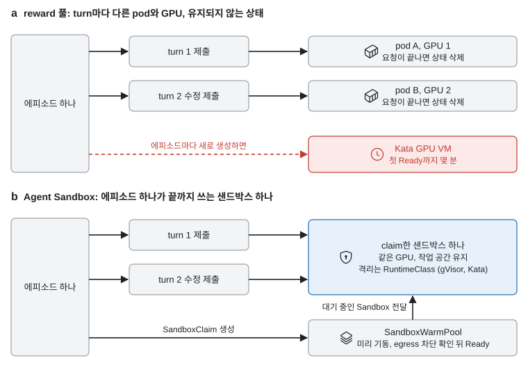

# 06 Agent Sandbox로 확장

!!! info "TL;DR"
    한 에피소드에서 여러 번 코드를 고쳐 실행한다면, 그동안 같은 샌드박스를 쓰는 편이 자연스럽습니다. Agent Sandbox는 샌드박스를 할당하고 회수합니다. 실행 격리는 gVisor나 Kata 같은 런타임이 맡습니다.

## 에피소드마다 샌드박스를 할당하는 이유

에이전트가 첫 턴에서 파일을 만들고 다음 턴에서 실행 결과를 읽은 뒤 코드를 고친다고 해 봅시다. 턴마다 새 샌드박스를 받으면 앞 턴의 파일을 다시 준비해야 합니다. 에피소드 동안 하나를 쓰면 이전 작업을 이어갈 수 있고 다음 에피소드에는 새 샌드박스를 할당할 수 있습니다.

이 저장소의 채점 서버는 제출마다 작업 디렉터리와 남은 프로세스를 정리합니다. 에피소드 동안 같은 pod, GPU, 채점 버전을 쓰되 턴마다 코드 전체를 다시 제출합니다. 기존 reward 풀에서는 턴마다 다른 pod가 답을 채점할 수 있습니다.



## 채점 풀과 에피소드 할당의 차이

| 비교 항목 | 일반 reward 풀 | Agent Sandbox 확장 |
|---|---|---|
| 샌드박스를 고르는 시점 | 제출을 받을 때마다 준비된 pod를 고릅니다. | 에피소드 시작에 하나를 요청합니다. |
| 다음 제출의 실행 위치 | 다른 pod로 갈 수 있습니다. | 같은 에피소드라면 할당받은 pod를 사용합니다. |
| 작업이 끝난 뒤 | pod는 다음 제출의 채점에 다시 쓰입니다. | 에피소드가 끝나면 할당된 pod도 정리합니다. |

에피소드 전체를 같은 환경에서 평가해야 할 때 할당 방식이 유용합니다. 요청마다 독립적으로 점수만 필요하다면 기존 reward 풀을 쓸 수 있습니다.

## 샌드박스 할당에 쓰는 리소스

| 리소스 | 하는 일 |
|---|---|
| `SandboxTemplate` | 이미지, 런타임, CPU나 GPU 요구량을 정합니다. |
| `SandboxWarmPool` | 템플릿으로 샌드박스를 미리 띄워 둡니다. |
| `SandboxClaim` | 실행기가 에피소드 시작에 샌드박스 하나를 요청합니다. 종료 때 claim을 삭제합니다. |

**RuntimeClass**는 Kubernetes pod를 어떤 런타임으로 실행할지 지정합니다. `SandboxTemplate`에 RuntimeClass를 넣으면 Agent Sandbox는 그 설정으로 pod를 만들고 할당합니다. 샌드박스를 언제 만들고 지울지는 Agent Sandbox가 정하고, 제출 코드가 어느 커널에서 실행되는지는 런타임이 정합니다.

미리 띄우면 첫 턴의 대기 시간을 줄일 수 있지만 대기 중에도 CPU나 GPU를 점유합니다. GPU warm pool을 얼마나 크게 둘지는 대기 시간과 비용을 함께 보고 결정합니다.

[Multi-turn 핸즈온](../handson/11_multi_turn.md)에서는 CPU 풀로 시작합니다. 로그에서 `claim`이 한 에피소드의 턴 동안 같은지, 마지막에 `released: true`가 나오는지 확인할 수 있습니다. 이 저장소의 AWS 실습에서는 Kata GPU 템플릿과 veRL 연동을 검증하지 않았습니다.

## 더 살펴보기

??? note "Agent Sandbox는 RuntimeClass를 그대로 따릅니다"
    Agent Sandbox는 pod의 수명과 할당을 관리하고, 격리 방식은 podTemplate의 `runtimeClassName`이 결정합니다. 그래서 노드가 해당 RuntimeClass를 지원한다면, 같은 template에 런타임 프로필만 바꿔 넣어 gVisor와 Kata(Cloud Hypervisor 또는 QEMU)를 모두 쓸 수 있습니다. 프로필은 RuntimeClass와 함께 노드 선택 조건과 GPU 리소스 이름(`nvidia.com/gpu` 또는 `nvidia.com/pgpu`)도 지정합니다.

    | 조합 | 근거 | 상태 |
    |---|---|---|
    | Kata on AKS | upstream 예제 `kata-aks`, `kata-aks-sandbox` | upstream 예제 |
    | Kata on GKE (`kata-qemu`, 선택으로 `kata-clh`) | upstream 예제 `kata-gke-sandbox`. N2 노드의 nested virtualization을 씁니다 | upstream 예제 |
    | gVisor + L4 GPU on GKE | upstream 예제 `gpu-l4-snapshot-sandbox`. GKE Sandbox(gVisor)와 Pod snapshot으로 GPU 메모리까지 저장하고 복원합니다 | upstream 예제. snapshot은 GKE 기능이며, 이 문서는 EKS에서 같은 기능을 확인하지 않았습니다 |
    | gVisor on EKS (CPU) | AWS 블로그 1부, 2부: Agent Sandbox v1.0.5, gVisor release-20260928.0, EKS 1.36, `m7i.xlarge` | 블로그 저자가 구성하고 측정 |
    | Kata on EKS | AWS 블로그 3부: 에이블리는 현재 runc로 운영하고, Agent Sandbox API는 유지한 채 런타임만 Kata(microVM)로 바꾸는 평가를 계획 | 계획 단계 |
    | 이 저장소 (`gvisor`, `gvisor-cpu`, `gvisor-hyperpod`, `kata-qemu`, `kata-clh`, `kata-clh-cpu`, `kata-qemu-cpu` 프로필) | `template.yaml.tpl`이 일곱 프로필 모두에서 렌더링됨 | 로컬 렌더링 테스트만 통과. 클러스터 미실행. SandboxTemplate 안의 Kata GPU(`kata-qemu-nvidia-gpu` + `nvidia.com/pgpu`)는 미검증 |

    AWS에서 각 RuntimeClass를 실행할 수 있는 위치는 Agent Sandbox와 상관없이 [02 격리 런타임 비교](02_isolation_runtimes.md)의 위치 표와 같습니다.

    - **Kata + GPU**: 이 저장소의 x86 구성에서 `g4dn.metal`에서만 실행됩니다.
    - **Kata CPU**: nested virtualization 인스턴스에서도 실행됩니다.
    - **gVisor + GPU**: 일반 GPU VM에서 실행됩니다.

    !!! question "❓ 오해: Agent Sandbox는 gVisor용 도구다"
        Agent Sandbox는 격리를 직접 구현하지 않고 RuntimeClass로 지정한 런타임에 맡깁니다. upstream 예제도 Kata(AKS, GKE)와 gVisor(GKE)를 함께 다룹니다. AWS 블로그 1부도 강한 격리를 "RuntimeClass로 지정하는 gVisor나 Kata"로 설명합니다. 블로그 시리즈가 EKS에서 gVisor를 쓴 것은 블로그 저자의 선택이며, Agent Sandbox의 제약 때문이 아닙니다.

??? note "veRL multi-turn rollout에 연결하기"
    [`rl/verl/sandbox_tool.py`](https://github.com/daekeun-ml/gpu-sandbox-on-aws/blob/main/rl/verl/sandbox_tool.py)는 veRL v0.9.1용 multi-turn tool이고, [`rl/verl/sandbox_tool_config.yaml`](https://github.com/daekeun-ml/gpu-sandbox-on-aws/blob/main/rl/verl/sandbox_tool_config.yaml)은 그 tool의 설정 예시입니다. veRL v0.9.1 소스를 읽고 작성했으며, veRL에서 실행한 적은 없습니다. 로컬 테스트(`tests/test_multiturn.py`)는 veRL 없이 fake Kubernetes API로 tool의 동작만 확인합니다. 아래 소스 위치는 v0.9.1 기준이므로 설치한 버전에서 다시 확인하세요.

    | 구성 요소 | 하는 일 |
    |---|---|
    | `KernelSandboxTool` (tool 이름 `submit_kernel`) | 모델이 `submit_kernel(code=...)`를 호출하면, trajectory의 첫 호출에서 warm pool의 샌드박스 하나를 claim하고(`EpisodeSandbox`) 이후 호출도 같은 샌드박스에서 평가합니다. verdict 요약(`format_feedback`)을 tool response로 반환하고, 모델은 이를 읽고 다음 turn을 생성합니다 |
    | `compute_score` | veRL custom reward 함수입니다. `extra_info`에 들어 있는 에피소드 요약에서 마지막 제출의 점수를 반환합니다 |
    | `SandboxToolAgentLoop` (`sandbox_tool_agent`로 등록) | `ToolAgentLoop`의 `run()`을 감쌉니다. trajectory마다 episode key를 만들어 `tools_kwargs`에 넣고, trajectory가 끝나면 claim을 삭제합니다 |
    | `sandbox_tool_config.yaml` | `tools[].class_name: sandbox_tool.KernelSandboxTool`, `config.type: native`, OpenAI function 형식의 `tool_schema`. `config`에는 `warm_pool`, `max_turns`(3), `require_triton`, `max_feedback_chars`(240), `idle_release_s`(600), `claim_lifetime_s`(3600), `ready_timeout_s`(600)가 있습니다 |

    - **`KernelSandboxTool`이 claim을 삭제하는 때**: solved, `max_turns`회 제출, `sandbox_error` 중 하나가 되면 claim을 삭제합니다.
    - **`compute_score`가 GPU 평가를 다시 하지 않는 이유**: 샌드박스가 rollout 중에 모든 제출을 이미 채점했으므로, trajectory마다 GPU 평가를 다시 하지 않습니다.

    ### veRL v0.9.1의 동작과 이 구현의 대응

    veRL v0.9.1은 tool을 아래와 같이 호출합니다. 그래서 `create`에서 claim하고 `release`에서 반납하거나 `calc_reward`로 에피소드를 채점하는 방식은 v0.9.1에서 동작하지 않습니다.

    | veRL v0.9.1의 동작 (소스) | 이 구현의 대응 |
    |---|---|
    | `ToolAgentLoop`는 tool 호출마다 `create`, `execute`, `release`를 실행합니다(`tool_agent_loop.py` 485~496행). tool 인스턴스는 trajectory 하나가 아니라 호출 하나 동안만 유지되고, `execute`가 반환하는 metrics 값은 사용되지 않습니다 | 에피소드를 tool 객체의 registry에 보관하고, trajectory의 `agent_data.extra_fields`에 저장한 key로 찾습니다(trajectory마다 `AgentData`가 하나). `release`는 호출마다 실행되므로 claim을 삭제하지 않습니다 |
    | `agent_data.request_id`는 `rollout.full_determinism`을 켜면 `det-<priority>`가 되고, priority는 batch마다 0부터 다시 시작합니다 | `request_id`를 에피소드 key로 쓰지 않습니다 |
    | `calc_reward`는 `base_tool.py`에만 정의되어 있고, v0.9.1에는 이를 호출하는 코드가 없습니다 | 에피소드 요약을 `agent_data.extra_fields["gpusandbox_episode"]`에 기록합니다. reward loop가 `extra_fields`를 reward 함수의 `extra_info`에 합치고(`reward_loop/reward_manager/naive.py`), `compute_score`가 그 값을 읽습니다. `calc_reward`도 같은 점수를 반환하도록 구현했지만 호출되지 않습니다 |
    | `ToolAgentLoop`에는 trajectory가 끝날 때 tool을 호출하는 hook이 없습니다 | `SandboxToolAgentLoop`가 `run()`이 끝나면 claim을 삭제합니다. 기본 `tool_agent` loop의 경우는 표 아래 목록 |
    | tool response가 `multi_turn.max_tool_response_length`(기본 256)보다 길면 잘립니다 | 피드백을 `max_feedback_chars`(기본 240)자로 제한합니다. 이 값은 veRL 설정 이하로 유지하세요 |

    - **기본 `tool_agent` loop를 쓸 때**: 기본 `tool_agent` loop에는 별도 타이머가 없습니다. 다음 tool 호출의 `create()`가 `idle_release_s`(기본 600초)보다 오래 호출이 없던 에피소드의 샌드박스를 반납하고, 후속 호출이 없으면 claim의 `shutdownTime`이 마지막 안전장치입니다. `idle_release_s`는 두 turn 사이의 가장 긴 생성 시간보다 커야 합니다.

    ### reward와 자원

    - **trajectory reward는 마지막 제출의 `score_verdict`입니다.** `python -m gpusandbox.tools multiturn`과 같은 규칙입니다. `execute`는 turn마다 reward 0.0을 반환합니다. 실패한 turn에도 점수를 주면 적은 노력으로 여러 번 제출하는 행동이 reward를 받기 때문입니다(코드 주석).
    - **인프라 오류를 오답으로 처리하지 않습니다.** claim 실패를 포함한 `sandbox_error`는 [Production 06 veRL로 확장](../production/06_scaling_with_verl.md)의 규칙과 같이(`reward_fn.py`) format 점수만 주고 `sandbox_error: 1`로 표시합니다. 제출이 없으면 점수는 0.0이고 status는 `no_submission`입니다.
    - **`compute_score`는 결과와 관계없이 같은 key를 반환합니다**(`score`, `status`, `turns`, `first_turn_reward`, `sandbox_error`). veRL이 `reward_extra_info`를 key별로 batch에 쌓기 때문입니다.
    - **블로킹 호출은 스레드로 실행합니다.** `EpisodeSandbox`는 Ready를 기다리는 동안과 평가하는 동안 호출한 스레드를 블로킹하므로, tool은 claim과 평가를 `asyncio.to_thread`로 실행해 rollout 이벤트 루프가 블로킹되지 않게 합니다. worker 하나의 모든 에피소드는 `BackgroundLoop` 하나를 공유합니다.
    - **warm pool 크기는 기다리지 않고 시작할 수 있는 에피소드 수를 정합니다.** claim한 샌드박스는 pool에서 빠지고 pool은 대기분을 다시 채웁니다. 실행 중인 GPU 에피소드는 첫 제출부터 반납까지 GPU 하나를 점유하므로, 동시 에피소드 수의 상한은 GPU 수입니다. 동시 에피소드가 대기 없이 시작하게 하려면 replicas를 그 수에 맞추세요.

    ### 설정 (veRL v0.9.1 key)

    ```text
    actor_rollout_ref.rollout.multi_turn.enable=True
    actor_rollout_ref.rollout.multi_turn.tool_config_path=/opt/gpusandbox/rl/verl/sandbox_tool_config.yaml
    actor_rollout_ref.rollout.multi_turn.max_assistant_turns=4     # >= max_turns submissions
    actor_rollout_ref.rollout.agent.default_agent_loop=sandbox_tool_agent
    reward.custom_reward_function.path=pkg://sandbox_tool
    reward.custom_reward_function.name=compute_score
    ```

    - veRL은 tool class를 module 이름으로 import하므로(`tool_registry.get_tool_class`), `sandbox_tool.py`가 있는 디렉터리(veRL 이미지의 `/opt/gpusandbox/rl/verl`)가 모든 Ray worker의 `PYTHONPATH`에 있어야 합니다. module을 이름으로 import하면 `SandboxToolAgentLoop`도 등록되고, `pkg://`는 같은 module에서 reward 함수를 읽습니다.
    - `SandboxToolAgentLoop`는 task id를 `extra_info.task_id`에서 읽습니다(`rl/verl/prepare_data.py`가 기록). 기본 `tool_agent` loop를 쓰면 데이터의 각 행에 `extra_info.tools_kwargs.submit_kernel.create_kwargs.task_id`가 있어야 합니다.

    ### 확인하지 않은 것

    veRL에서 실행하지 않았으므로 다음 항목은 확인되지 않았습니다(코드의 `# TODO verify`).

    - **tool 전체의 동작과 `SandboxToolAgentLoop` 등록.** 등록은 `AgentLoopWorker`가 `default_agent_loop`를 찾기 전에 tool(즉 이 module)을 먼저 load한다는 전제에 의존합니다. 이 전제는 v0.9.1 `agent_loop.py`를 읽고 판단한 것입니다.
    - **Ray worker의 `PYTHONPATH`에 `rl/verl`을 넣는 방법.** RayCluster pod의 env와 `ray job submit --runtime-env-json`의 `env_vars` 중 어느 쪽이 동작하는지 클러스터에서 확인해야 합니다.
    - **`extra_fields`가 `extra_info`로 전달되는 경로.** reward-loop manager(naive, remote, limited)에서만 소스로 확인했습니다.
    - **rollout worker의 실행 조건.** `k8s/production/raycluster-verl.yaml.tpl`의 worker에는 `gpusandbox/client=true` label과 `grpo-trainer` ServiceAccount가 이미 있습니다. 이 계정은 warm pool의 기본 허용 subject이고, `install`이 적용하는 `sandbox-claims` RoleBinding에도 들어 있습니다. 빠진 것은 다음과 같습니다.
        - Kubernetes API 토큰(`automountServiceAccountToken: false`)
        - veRL 이미지의 `kubernetes` Python 패키지(`client` extra만 설치)
        - `SANDBOX_TOKEN_FILE`의 sandbox audience 토큰(지금 마운트된 토큰은 gateway audience)

        rollout worker가 claim을 직접 만들지, broker에 맡길지도 먼저 정하세요(위 조건 표).

??? note "AWS 블로그 시리즈의 교훈을 GPU 샌드박스에 적용하기"
    출처는 AWS 기술 블로그 "AWS에서 AI 에이전트 실행 환경 격리하기" 1부, 2부, 3부입니다. 표의 수치는 모두 블로그 저자가 EKS의 CPU 샌드박스에서 측정한 값이며, 이 저장소의 측정이 아닙니다.

    | 교훈 (출처) | GPU 샌드박스에서의 의미 | 이 저장소의 대응 |
    |---|---|---|
    | VPC CNI NetworkPolicy를 먼저 켭니다. 켜기 전에는 샌드박스에서 IMDS와 Kubernetes API에 접근할 수 있었습니다 (1부, 2부) | enforcer가 없으면 NetworkPolicy 객체가 있어도 트래픽이 차단되지 않습니다 | CDK 스택(`cdk/gpusandbox_cdk/stack.py`)이 vpc-cni add-on에 `enableNetworkPolicy`를 켜고, readiness 검사가 IMDS, API server, kubelet 차단을 확인한 뒤에만 pod가 Ready가 됩니다 |
    | SandboxTemplate의 기본 정책은 sandbox-router에서 오는 ingress만 허용하고, egress는 `0.0.0.0/0`에서 RFC1918과 `169.254.0.0/16`을 제외한 범위를 허용합니다 (2부) | GPU 샌드박스에서 채굴이 일어나면 그만큼 GPU 비용이 발생합니다 | `networkPolicy`를 직접 지정합니다. ingress는 trainer만, egress는 `[]` |
    | 기본 DNS 주입(`dnsPolicy: None`, `8.8.8.8`, `1.1.1.1`)은 Route 53 Resolver를 우회합니다 (2부) | 외부 resolver를 쓰면 DNS 질의로 데이터를 외부에 전송할 수 있습니다(추론) | `dnsPolicy: None`과 `127.0.0.1`을 명시하고, egress가 `[]`이므로 DNS 트래픽도 차단됩니다 |
    | sandbox-router의 기본 authorization 설정은 모든 요청을 허용하고, SDK v1.0.5는 인증 헤더를 보내지 않았습니다 (2부) | GPU 평가는 컴파일과 timing 때문에 30초를 넘길 수 있습니다(추론). port-forward 권한이 있으면 네트워크 경계를 우회할 수 있습니다 | router와 SDK를 쓰지 않습니다. 서버가 audience, issuer, subject 허용 목록을 직접 확인하고, 클라이언트 요청 timeout은 300초(`SandboxPool` 기본값)입니다 |
    | RuntimeClass의 scheduling 설정만으로는 같은 taint를 허용하는 다른 pod가 그 노드에 배치되는 것을 막을 수 없습니다 (1부) | GPU 샌드박스 노드에 다른 pod가 배치되면 노드당 샌드박스 하나라는 가정이 성립하지 않습니다(추론) | 전용 taint `gpusandbox/role`과 node guard를 씁니다. `kubectl get pods -A -o wide --field-selector spec.nodeName=<node>`로 노드에서 실행 중인 pod를 직접 확인하세요 |
    | 전용 노드 그룹에 IMDSv2 필수와 hop limit 1을 설정합니다 (1부). EKS Best Practices도 같은 방법을 권장합니다 | 샌드박스가 노드 IAM 자격 증명에 접근하지 못하게 합니다 | CDK 스택의 모든 노드 그룹 launch template이 IMDSv2 필수와 hop limit 1을 쓰고, Karpenter는 기본 hop limit 1입니다. readiness 검사도 IMDS 차단을 확인합니다 |
    | EKS Auto Mode에는 runsc를 등록할 수 없습니다 (1부) | 커스텀 런타임이 필요한 GPU 샌드박스에도 같은 제약이 적용됩니다 | CDK 스택의 EKS 관리형 노드 그룹과 Karpenter NodePool을 씁니다 |
    | warm pool을 쓰자 SandboxClaim 생성부터 Ready까지 걸리는 시간이 cold start 약 2 s에서 약 55 ms로 줄었습니다 (2부: EKS 1.36, `m7i.xlarge`, CPU, NetworkPolicy를 켜기 전, pool마다 10회) | GPU 샌드박스의 cold start는 더 길 수 있습니다. Kata GPU VM은 첫 Ready까지 몇 분이 걸릴 수 있으므로(템플릿 주석) warm pool의 효과와 비용이 모두 커집니다 | 블로그 수치이며 이 저장소의 측정이 아닙니다. 이 확장에서 claim을 만들어 주소를 얻기까지 걸린 시간은 `episode_start` 이벤트의 `claim_ready_s`에 기록됩니다 |
    | 3개짜리 pool에 claim 6개를 동시에 보내자 3개는 100~179 ms, 나머지 3개 중 2개는 약 15 s가 걸렸습니다. 원인은 VPC CNI의 IP cooldown이었고, 블로그는 Prefix Delegation, `WARM_IP_TARGET`, peak 기준 pool 크기 설정을 권장합니다 (2부) | gVisor GPU 프로필은 노드당 샌드박스가 하나이므로 IP보다 GPU와 노드 수가 먼저 제약이 될 수 있습니다(추론) | pool replicas를 동시 에피소드 수에 맞춥니다 |
    | gVisor의 오버헤드는 syscall 수에 비례합니다. syscall당 시간은 약 0.18 us에서 2.2 us로, 파일 작업과 프로세스 생성은 4.7~6.5배, exec는 0.6 ms에서 3.8 ms로 늘었고, 순수 연산은 차이가 없었습니다 (2부) | 이 harness는 요청마다 새 프로세스 트리를 만들므로 평가마다 고정 오버헤드가 늘어날 수 있습니다(추론) | [08 런타임 벤치마크](../handson/08_benchmark.md)로 직접 측정합니다 |
    | pause는 Pod를 삭제하고 Sandbox 객체와 PVC를 유지하며, 메모리 상태는 보존하지 않습니다 (2부) | pause하면 GPU가 해제되지만, resume은 cold start이므로 Kata GPU라면 몇 분이 걸릴 수 있습니다(추론) | 이 확장은 pause를 쓰지 않고, 에피소드가 끝나면 claim을 삭제합니다 |
    | `SandboxClaim.spec.env`를 쓰면 warm pool을 거치지 않고 template으로 Sandbox를 새로 만듭니다 (3부, upstream v1.0.8). v1.0.11 소스 주석에도 같은 내용이 있고, claim에 `volumeClaimTemplates`를 지정해도 cold start가 발생합니다 | GPU 샌드박스에서는 cold start에 몇 분이 걸릴 수 있습니다 | `envVarsInjectionPolicy: Disallowed`로 claim에서 env를 지정하지 못하게 하고, `EpisodeSandbox`는 env와 볼륨을 지정하지 않습니다 |
    | 에이블리는 전용 on-demand Karpenter NodePool에 `karpenter.sh/do-not-disrupt`와 일정 기반 disruption budget을 씁니다 (3부) | 에피소드 도중 노드가 종료되면 그 에피소드는 폐기해야 합니다 | GPU 샌드박스 NodePool은 `consolidationPolicy: WhenEmpty`라 샌드박스가 실행 중인 노드를 consolidation하지 않습니다. `sandbox-kata-cpu`는 `WhenEmptyOrUnderutilized`이므로, CPU 계층에서 에피소드 샌드박스를 실행한다면 `do-not-disrupt`를 검토하세요 |

    - **SandboxTemplate의 기본 정책 (2부)**: 인터넷 접근이 허용되므로 이 정책으로는 데이터 유출, C2 통신, 채굴을 차단할 수 없습니다. 블로그는 사용자 정의 정책, egress proxy, AWS Network Firewall을 권장합니다.
    - **sandbox-router와 port-forward (2부)**: TokenReview는 토큰의 유효성만 확인하고 권한은 확인하지 않습니다. port-forward(Tunnel 모드)는 NetworkPolicy를 우회하고, 30초를 넘는 명령은 502 오류가 발생했습니다. 이 저장소에서는 `sandbox` 네임스페이스의 `pods/portforward`, `pods/exec` 권한을 최소한으로 부여하세요.
    - **warm pool 측정과 비교 (2부)**: 이 저장소의 CLI가 claim을 1초 간격으로 조회하므로, `claim_ready_s`를 블로그의 55 ms와 직접 비교하기는 어렵습니다.

    gVisor 프로필은 `g5.xlarge` 한 대에 샌드박스 하나를 실행하므로, 대기 샌드박스 하나가 시간당 1.006 USD인 노드 한 대를 점유합니다. Kata GPU 샌드박스는 `g4dn.metal`(시간당 7.824 USD, T4 8개)의 T4 하나를 쓰므로, 단순 나눗셈으로 계산하면 T4 하나에 시간당 약 0.978 USD입니다(가격은 us-east-1과 us-west-2 온디맨드 요금).

??? note "AI on EKS의 Agent Sandbox 솔루션과 비교"
    awslabs의 AI on EKS 프로젝트에 있는 [Agent Sandbox on EKS](https://awslabs.github.io/ai-on-eks/ko/docs/infra/agents/agent-sandbox) 솔루션도 kubernetes-sigs/agent-sandbox를 씁니다. 이 솔루션은 모델이 생성한 코드를 실행하는 에이전트를 대상으로 하고, 페이지에는 GPU 언급이 없습니다(2026-11 확인). 이 저장소는 GPU 커널 채점을 대상으로 합니다.

    | 항목 | AI on EKS Agent Sandbox 솔루션 | 이 저장소 |
    |---|---|---|
    | 구성 | gVisor 커널 격리, agent-sandbox CRD(`Sandbox`, `SandboxTemplate`, `SandboxWarmPool`, `SandboxClaim`, `v1beta1`), FQDN 기반 egress 제어 | gVisor + nvproxy 또는 Kata + VFIO GPU 샌드박스와 Deployment 기반 reward 풀. 에피소드 단위 SandboxClaim은 선택 확장 |
    | 런타임 계층 | `standard`(runc), `gvisor`(Standard EKS만, Auto Mode는 gVisor를 지원하지 않음), `isolated-sandbox`(Nitro Sandboxes, EKS Auto Mode의 Kubernetes 1.36 이상 또는 custom AMI를 쓰는 Standard EKS). Kata + Firecracker는 향후 계층으로 적혀 있고 포함되지 않음 | `gvisor`, `kata-qemu`, `kata-clh`, `kata-clh-cpu`, `kata-qemu-cpu` 프로필 |
    | egress | 허용한 도메인으로만 허용. Standard EKS는 Cilium(aws-cni chaining 모드)의 FQDN 필터, Auto Mode는 `ApplicationNetworkPolicy` | template의 `networkPolicy.egress: []`로 모두 차단. DNS 트래픽도 차단 |
    | 리소스 구성 | KRO가 여러 리소스를 `AgentSandbox` 리소스 하나로 묶음 | `template.yaml.tpl`을 프로필마다 렌더링 |
    | 노드 | Karpenter와 gVisor NodePool(`runsc` shim을 AL2023 user data로 설치) | CDK 스택의 EKS 관리형 노드 그룹과 Karpenter NodePool |

    - **GPU가 필요 없고 허용한 도메인으로만 외부 접속을 허용하는 에이전트 샌드박스라면**: AI on EKS 솔루션이 해당합니다.
    - **샌드박스 안에서 GPU로 reward를 측정한다면**: 이 저장소의 GPU 프로필을 쓰세요.
    - **Nitro Sandboxes(`isolated-sandbox`)**: 출시 시점에 GPU passthrough를 지원하지 않으므로([검증된 사실과 출처](../reference/sources.md)), GPU 커널 채점에는 쓸 수 없습니다.

??? note "적용 범위와 한계"
    - **로컬 테스트로 확인한 것:** claim 본문, 주소 해석, claim 후 반납, Ready가 되지 않을 때의 반납(fake Kubernetes API), 일곱 프로필의 template 렌더링과 하드닝 값(비어 있는 egress, `runtimeClassName`, `automountServiceAccountToken: false`, `dnsPolicy: None`)입니다.
    - **multi-turn 경로의 로컬 테스트:** 에피소드마다 claim 하나, 중지 조건, `sandbox_error` 처리, policy가 실패할 때의 claim 반납, 피드백 길이, `multiturn` CLI를 fake Kubernetes API로 확인했습니다. veRL tool은 veRL 없이 trajectory 하나에 샌드박스 하나, 방치된 trajectory의 반납, trajectory 종료 시 반납, claim 실패, 설정 파일과 tool의 일치를 확인했습니다. 에피소드 Job 매니페스트(API 토큰과 하드닝, claim 권한, 허용 subject)도 확인했고, loopback 샌드박스 서버 두 개(CPU harness)에서 에피소드 두 개를 끝까지 실행했습니다.
    - **클러스터에서 실행한 것:** 시나리오 C에서 `install`, `pool kata-clh-cpu 1`, `claim kata-clh-cpu`. claim이 샌드박스 주소를 받고 반납한 뒤 warm pool이 새 샌드박스를 채웠습니다([10 c8i 단독 저비용 경로](../handson/10_cpu_only.md)의 9단계). 이어서 `episodes kata-clh-cpu 2 3`이 pod 안의 `EpisodeSandbox`로 에피소드 2개를 실행했고, 에피소드마다 claim과 샌드박스가 하나씩이었으며 끝나면 claim이 반납됐습니다([11 multi-turn 에피소드 실습](../handson/11_multi_turn.md)).
    - **클러스터에서 실행하지 않은 것:** 위의 평가 확인 절차입니다. SandboxTemplate 안의 Kata GPU(`kata-qemu-nvidia-gpu` + `nvidia.com/pgpu`)도 검증하지 않았습니다. veRL tool은 veRL에서 실행하지 않았습니다(위 "확인하지 않은 것").
    - **trainer에서 바로 쓰려면 추가 준비가 필요합니다.** 위 조건 표에 있는 API 토큰과 `kubernetes` 패키지를 준비하고, broker 사용 여부를 결정하세요.
    - **template 이름에 버전이 없습니다.** `VERSION_FILE=v2`로 `pool`을 다시 적용하면 같은 `kernel-eval-<runtime>` template이 수정됩니다. `OnReplenish`는 대기 중인 이전 버전 샌드박스를 claim되거나 삭제될 때까지 유지하므로, 전환 중에는 claim마다 v1과 v2가 섞일 수 있습니다(upstream 주석 기준 추론).
        - **`multiturn` CLI에서는**: 각 `turn` 이벤트의 `version`으로 확인할 수 있습니다.
        - **veRL tool에서는**: veRL tool은 에피소드 요약과 `compute_score` 결과에 버전을 싣지 않으므로, GRPO group 안에서 버전이 섞이면 안 되는 veRL 학습이라면 그 값을 직접 기록하거나 버전마다 이름이 다른 template과 pool을 만들어 group의 claim을 한 풀로 보내세요(둘 다 이 저장소에 없음).
    - **template에는 livenessProbe가 없습니다.** Deployment 풀과 달리 GPU 오류로 draining된 샌드박스를 kubelet이 다시 시작하지 않습니다. 그 에피소드의 남은 평가는 `sandbox_error`가 되므로(코드 기준), 에피소드를 폐기하고 새 claim을 만드세요.
    - **`loop`를 전달하지 않은 `EpisodeSandbox`는 인스턴스마다 이벤트 루프 스레드를 하나 만들고 닫지 않습니다.** 한 프로세스에서 에피소드를 매우 많이 실행하면 스레드가 계속 늘어나므로, `BackgroundLoop` 하나를 `loop`로 전달하세요(코드 검토 결과). `multiturn` CLI와 veRL tool은 루프 하나를 공유합니다.
    - **upstream이 빠르게 변경되고 있습니다.** 필드 이름은 v1.0.11의 `sandboxclaim_types.go`를 따릅니다.

    ??? note "참고 자료"
        | 주제 | 링크 |
        |---|---|
        | Agent Sandbox 저장소, 릴리스 (v1.0.11) | https://github.com/kubernetes-sigs/agent-sandbox , https://github.com/kubernetes-sigs/agent-sandbox/releases |
        | SandboxClaim, SandboxTemplate, SandboxWarmPool, Sandbox 타입 (v1.0.11) | https://github.com/kubernetes-sigs/agent-sandbox/blob/v1.0.11/extensions/api/v1beta1/sandboxclaim_types.go , https://github.com/kubernetes-sigs/agent-sandbox/blob/v1.0.11/extensions/api/v1beta1/sandboxtemplate_types.go , https://github.com/kubernetes-sigs/agent-sandbox/blob/v1.0.11/extensions/api/v1beta1/sandboxwarmpool_types.go , https://github.com/kubernetes-sigs/agent-sandbox/blob/v1.0.11/api/v1beta1/sandbox_types.go |
        | AWS 기술 블로그 2부: 이 페이지가 인용한 기본 정책, DNS, router 점검과 warm pool 측정 | https://aws.amazon.com/ko/blogs/tech/aws-ai-agent-sandbox-eks-isolation-part-2/ |
        | Amazon EKS NetworkPolicy (VPC CNI), policy agent | https://docs.aws.amazon.com/eks/latest/userguide/cni-network-policy-configure.html , https://github.com/aws/aws-network-policy-agent |
        | veRL `ToolAgentLoop` (v0.9.1, tool 호출마다 create, execute, release) | https://github.com/verl-project/verl/blob/v0.9.1/verl/experimental/agent_loop/tool_agent_loop.py |

        [관련 대표 자료](../reference/references.md#ref-concepts-06-agent-sandbox)
