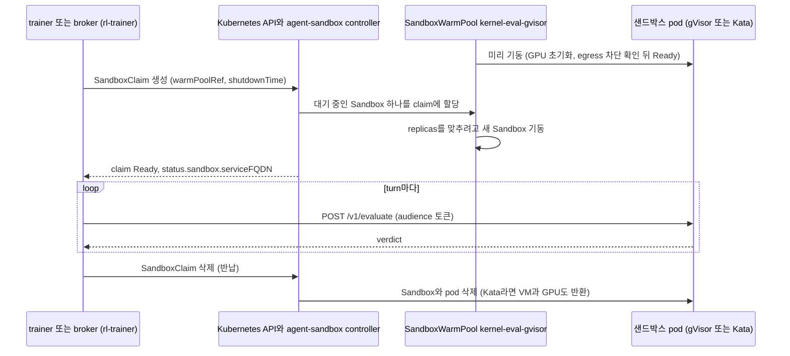

# 06 Agent Sandbox로 확장

**TL;DR** Agent Sandbox(kubernetes-sigs/agent-sandbox)는 격리를 pod의 RuntimeClass에 맡기는 오케스트레이터라서 gVisor와 Kata 모두에 사용할 수 있습니다. 이 저장소의 확장은 같은 GPU 샌드박스 서버를 warm pool로 미리 실행해 두고, multi-turn 에피소드마다 샌드박스를 하나씩 할당합니다.

## 기존 Pain Point

이 저장소의 reward 풀은 요청마다 유휴 pod를 선택합니다. 그래서 에이전트가 한 에피소드에서 커널을 여러 번 수정해 제출하면 turn마다 다른 pod와 다른 GPU에서 채점될 수 있습니다. 에이전트 앱은 파일, 실행 중인 프로세스, 설치한 패키지를 다음 turn까지 유지해야 합니다. 그런데 채점 서버는 제출마다 작업 디렉터리를 새로 만들고, 평가가 끝나면 그 디렉터리와 남은 실행 프로세스를 정리합니다. 이 확장도 같은 서버를 쓰므로 에피소드가 끝까지 유지하는 것은 pod, GPU, 샌드박스 버전이고, 에이전트는 turn마다 코드 전체를 다시 제출합니다. 그렇다고 에피소드마다 샌드박스를 새로 만들면, Kata GPU VM은 guest 메모리를 모두 pin하고 guest 안에서 CUDA를 초기화하기 때문에 첫 Ready까지 몇 분이 걸릴 수 있습니다(deployment 템플릿 주석). Agent Sandbox를 gVisor 전용 도구로 오해하거나 격리 런타임과 같은 계층으로 혼동하는 경우도 많습니다.


*그림 요약: reward 풀은 turn마다 유휴 pod를 고르므로 한 에피소드의 turn이 서로 다른 pod와 GPU에서 실행될 수 있습니다. Agent Sandbox에서는 warm pool에서 claim한 샌드박스 하나를 에피소드가 끝날 때까지 쓰므로, 에피소드마다 Kata GPU VM을 새로 시작하느라 몇 분씩 기다리지 않아도 됩니다.*


## Why

- **격리와 오케스트레이션을 구분합니다.** 격리 강도는 RuntimeClass(gVisor, Kata)가 결정하고, Agent Sandbox는 샌드박스를 미리 만들어 두고 할당하고 회수하는 일을 담당합니다.
- **서버, 이미지, 인증 방식은 그대로 사용합니다.** 크게 바뀌는 것은 pod를 만들고 삭제하는 주체와 시점입니다. 그 밖에 호출을 허용하는 계정(에피소드 Job 계정이 들어가고 gateway 계정은 빠짐)과 `livenessProbe` 유무(확장 template에는 없음)가 기본 풀과 다릅니다.
- **AWS 기술 블로그 시리즈가 CPU 샌드박스에서 겪은 NetworkPolicy, DNS, router, IMDS 문제는 GPU 샌드박스에서도 그대로 생깁니다.** GPU 프로필에서는 대기 샌드박스가 GPU를 점유하므로 warm pool 비용이 더 큽니다.

**사전 지식:** RuntimeClass와 gVisor, Kata의 차이는 [02 격리 런타임 비교](02_isolation_runtimes.md), reward 채점 흐름은 [03 On-policy RL과 샌드박스](03_onpolicy_rl_with_sandboxes.md), 풀과 인증, NetworkPolicy는 [핸즈온 04 샌드박스 풀 배포와 검증](../handson/04_sandbox_pools.md), 보안 경계 전체는 [Production 02 보안](../production/02_security.md)에 있습니다.

??? note "용어 (처음 보는 단어가 있으면 펼치세요)"
    - **RuntimeClass**: pod를 어떤 컨테이너 런타임(runc, gVisor, Kata)으로 실행할지 지정하는 Kubernetes 리소스입니다.
    - **CRD (Custom Resource Definition)**: Kubernetes에 새 리소스 종류를 추가하는 정의입니다. Sandbox, SandboxClaim 같은 Agent Sandbox 리소스는 CRD로 정의됩니다.
    - **controller**: 리소스에 정의된 원하는 상태를 읽고 실제 상태를 그에 맞게 조정하는 프로그램입니다.
    - **warm pool**: 요청이 오기 전에 미리 만들어 둔 샌드박스 묶음입니다. 요청이 오면 기동을 기다리지 않고 바로 할당합니다.
    - **claim**: warm pool에서 샌드박스 하나를 할당받기 위한 요청입니다. claim을 삭제하면 샌드박스가 반납됩니다.
    - **episode**: agentic RL에서 모델이 과제 하나를 여러 turn에 걸쳐 푸는 한 번의 시도입니다.
    - **multi-turn rollout**: 모델이 도구를 호출하고 결과를 읽은 뒤 다시 응답하는 과정을 여러 번 반복하는 생성입니다.
    - **headless Service**: 가상 IP 없이 Ready pod의 IP 주소를 DNS로 직접 반환하는 Service입니다.
    - **NetworkPolicy**: pod 사이에 허용할 연결을 정하는 방화벽 규칙입니다. 한 pod를 선택하는 정책이 여러 개면 허용 규칙의 합집합이 적용됩니다.
    - **IMDS**: EC2 인스턴스 메타데이터 서비스(`169.254.169.254`)입니다. 노드의 IAM 자격 증명을 제공하므로 샌드박스에서의 접근을 차단해야 합니다.
    - **projected ServiceAccount token (audience)**: kubelet이 pod에 마운트하는 수명이 짧은 토큰입니다. audience는 그 토큰을 수신할 대상을 지정한 값이고, 이 저장소의 샌드박스는 audience가 `gpu-sandbox`인 토큰만 허용합니다.

    더 자세한 설명은 [용어 사전](../reference/glossary.md)에 있습니다.

## 개요

이 저장소의 reward 풀은 completion마다 유휴 pod에서 따로 채점하는 single-turn 채점용이고, 채점 결과를 보고 코드를 고쳐 다시 내는 과정은 없습니다. multi-turn 에이전트는 한 에피소드 안에서 코드를 제출하고, verdict를 읽고, 코드를 고쳐 다시 제출하므로 모든 turn을 같은 샌드박스에서 채점해야 합니다. Agent Sandbox는 미리 실행해 둔 샌드박스를 에피소드마다 하나씩 할당하고, 에피소드가 끝나면 그 샌드박스를 삭제합니다. 격리는 지금과 같이 RuntimeClass(gVisor, Kata)가 담당합니다. 처음 읽는다면 초심자 가이드 [06 multi-turn 에이전트와 Agent Sandbox](../beginner/06_multi_turn_agent.md)를 먼저 보세요.

## Agent Sandbox가 하는 일

Agent Sandbox는 Kubernetes SIG Apps에서 개발하는 프로젝트이고, upstream README는 이 프로젝트를 "a sandbox orchestrator"로 소개합니다.

| 리소스 | API group (모두 `v1beta1`) | 하는 일 | 이 확장에서 |
|---|---|---|---|
| `Sandbox` | `agents.x-k8s.io` | 샌드박스 하나. pod 하나와, 설정에 따라 headless Service와 PVC를 함께 관리합니다. `operatingMode`를 `Suspended`로 설정하면 pod를 삭제하고 객체와 볼륨은 유지합니다 | warm pool이 생성합니다. 직접 만들지 않습니다 |
| `SandboxTemplate` | `extensions.agents.x-k8s.io` | Sandbox를 만들 때 쓰는 템플릿. `podTemplate`, `networkPolicy`, `service`, `envVarsInjectionPolicy`, `volumeClaimTemplates` | 런타임 프로필마다 `kernel-eval-<runtime>` |
| `SandboxWarmPool` | `extensions.agents.x-k8s.io` | template으로 미리 만들어 둘 Sandbox 수(`replicas`)와 갱신 방식(`updateStrategy`: `OnReplenish` 또는 `Recreate`) | 런타임 프로필마다 `kernel-eval-<runtime>` |
| `SandboxClaim` | `extensions.agents.x-k8s.io` | warm pool에서 Sandbox 하나를 할당받습니다. `spec.warmPoolRef`(필수), `spec.lifecycle`(`shutdownTime`, `ttlSecondsAfterFinished`, `shutdownPolicy`), `status.sandbox`(`name`, `podIPs`, `serviceFQDN`) | 에피소드마다 하나 |

이 밖에 Python(`pip install k8s-agent-sandbox`), Go, TypeScript SDK가 있습니다. SDK나 외부 클라이언트의 HTTP 요청을 샌드박스 pod로 전달하는 reverse proxy인 `sandbox-router`(선택 구성 요소)도 있습니다. 이 확장은 SDK와 router 없이 claim을 Kubernetes API(`CustomObjectsApi`)로 만들고, 평가 요청을 claim의 `serviceFQDN`으로 직접 보냅니다(이유는 아래 "AWS 블로그 시리즈의 교훈" 절의 router 항목).

최신 릴리스는 v1.0.11(2026-11-12)이고 CRD는 `v1beta1`만 있습니다. v1.0.9(10-29), v1.0.10(11-06), v1.0.11(11-12)처럼 릴리스 간격이 짧으니 controller를 업그레이드할 때마다 필드 이름을 다시 확인하세요.



*그림 요약: 에피소드 하나가 샌드박스 하나를 처음부터 끝까지 혼자 쓰고, 반납한 샌드박스는 다시 쓰이지 않고 지워집니다.*

Sandbox가 claim되면 소유권이 warm pool에서 claim으로 넘어가고, pool은 그 Sandbox를 더 이상 관리하지 않습니다(v1.0.11 `sandboxwarmpool_types.go` 주석). 따라서 claim을 삭제하면 Sandbox와 pod도 함께 삭제됩니다. `shutdownTime`은 claim이 만료되는 절대 시각이며, 이 시각에 controller가 Sandbox 리소스를 삭제합니다. `shutdownPolicy`의 기본값 `Retain`은 claim 객체를 `Expired` 상태로 유지하고, `Delete`는 claim까지 삭제합니다.

## Agent Sandbox는 RuntimeClass를 그대로 따릅니다

Agent Sandbox는 pod의 수명과 할당을 관리하고, 격리 방식은 podTemplate의 `runtimeClassName`이 결정합니다. 그래서 노드가 해당 RuntimeClass를 지원한다면, 같은 template에 런타임 프로필만 바꿔 넣어 gVisor와 Kata(Cloud Hypervisor 또는 QEMU)를 모두 쓸 수 있습니다. 프로필은 RuntimeClass와 함께 노드 선택 조건과 GPU 리소스 이름(`nvidia.com/gpu` 또는 `nvidia.com/pgpu`)도 지정합니다.

| 조합 | 근거 | 상태 |
|---|---|---|
| Kata on AKS | upstream 예제 `kata-aks`, `kata-aks-sandbox` | upstream 예제 |
| Kata on GKE (`kata-qemu`, 선택으로 `kata-clh`) | upstream 예제 `kata-gke-sandbox`. N2 노드의 nested virtualization을 씁니다 | upstream 예제 |
| gVisor + L4 GPU on GKE | upstream 예제 `gpu-l4-snapshot-sandbox`. GKE Sandbox(gVisor)와 Pod snapshot으로 GPU 메모리까지 저장하고 복원합니다 | upstream 예제. snapshot은 GKE 기능이며, 이 문서는 EKS에서 같은 기능을 확인하지 않았습니다 |
| gVisor on EKS (CPU) | AWS 블로그 1부, 2부: Agent Sandbox v1.0.5, gVisor release-20260928.0, EKS 1.36, `m7i.xlarge` | 블로그 저자가 구성하고 측정 |
| Kata on EKS | AWS 블로그 3부: 에이블리는 현재 runc로 운영하고, Agent Sandbox API는 유지한 채 런타임만 Kata(microVM)로 바꾸는 평가를 계획 | 계획 단계 |
| 이 저장소 (`gvisor`, `gvisor-cpu`, `gvisor-hyperpod`, `kata-qemu`, `kata-clh`, `kata-clh-cpu`, `kata-qemu-cpu` 프로필) | `template.yaml.tpl`이 일곱 프로필 모두에서 렌더링됨 | 로컬 렌더링 테스트만 통과. 클러스터 미실행. SandboxTemplate 안의 Kata GPU(`kata-qemu-nvidia-gpu` + `nvidia.com/pgpu`)는 미검증 |

AWS에서 각 RuntimeClass를 실행할 수 있는 위치는 Agent Sandbox와 상관없이 [02 격리 런타임 비교](02_isolation_runtimes.md)의 위치 표와 같습니다. Kata + GPU는 이 저장소의 x86 구성에서 `g4dn.metal`에서만, Kata CPU는 nested virtualization 인스턴스에서도, gVisor + GPU는 일반 GPU VM에서 실행됩니다.

!!! question "❓ 오해: Agent Sandbox는 gVisor용 도구다"
    Agent Sandbox는 격리를 직접 구현하지 않고 RuntimeClass로 지정한 런타임에 맡깁니다. upstream 예제도 Kata(AKS, GKE)와 gVisor(GKE)를 함께 다룹니다. AWS 블로그 1부도 강한 격리를 "RuntimeClass로 지정하는 gVisor나 Kata"로 설명합니다. 블로그 시리즈가 EKS에서 gVisor를 쓴 것은 블로그 저자의 선택이며, Agent Sandbox의 제약 때문이 아닙니다.

## reward 풀과 에피소드 단위 샌드박스

두 구조는 서버 이미지와 인증 방식이 같고, 샌드박스의 수명과 상태 유지 방식이 다릅니다.

| 항목 | 이 저장소의 reward 풀 | Agent Sandbox 에피소드 샌드박스 |
|---|---|---|
| 만드는 리소스 | (runtime, version)마다 Deployment와 headless Service (`sandbox-<runtime>-<version>`) | 런타임마다 SandboxTemplate과 SandboxWarmPool, 에피소드마다 SandboxClaim |
| pod 수명 | 오래 유지됩니다. 평가를 계속 이어서 처리합니다. v2 pod는 평가 200회 뒤 새 요청을 받지 않고, Production gateway가 이 pod를 삭제해 교체합니다. direct 모드에서는 NotReady로 남습니다 | 에피소드 하나. claim을 삭제하면 Sandbox와 pod도 삭제됩니다 |
| 동시성 | pod마다 한 번에 평가 하나. 처리 중이면 503을 반환하고, 클라이언트가 다른 pod로 요청을 보냅니다 | 샌드박스 하나를 에피소드 하나가 독점합니다 |
| 상태 | 상태 없음. 요청마다 새 프로세스 트리를 만들고 끝나면 정리합니다 | Agent Sandbox 자체는 작업 공간(파일, 프로세스)을 유지할 수 있고 pause(`Suspended`)와 resume, PVC를 지원합니다. 이 확장은 한 에피소드의 모든 제출을 같은 pod와 GPU에서 채점하고, 제출별 작업 디렉터리와 프로세스는 평가가 끝날 때 정리합니다 |
| 주소 | Service DNS 이름 하나에 Ready pod IP 여러 개가 연결됨. 클라이언트가 유휴 pod를 선택합니다 | claim의 `status.sandbox.serviceFQDN` (Sandbox마다 headless Service 하나) |
| 버전 고정 | routing ConfigMap. 배치(group) 하나를 한 버전으로 채점 | 에피소드 안에서는 샌드박스 하나라 버전이 섞이지 않습니다. template을 바꾸면 전환 중에는 claim마다 버전이 다를 수 있습니다(아래 "적용 범위와 한계") |
| 대기 비용 | Deployment replicas만큼 GPU를 점유 | warm pool replicas와 claim된 샌드박스 수만큼 GPU를 점유 |
| 적합한 작업 | single-turn reward 채점 (GRPO가 completion마다 따로 채점) | multi-turn agentic RL, 에이전트 앱 (도구 호출, 피드백을 읽고 수정) |

선택 기준은 다음과 같습니다.

- **single-turn reward 채점이라면 이 저장소의 reward 풀을 쓰세요.** 요청마다 유휴 pod를 선택하므로 GPU 유휴 시간이 줄어듭니다.
- **multi-turn agentic RL이라면 에피소드 단위 샌드박스가 적합합니다.** 한 에피소드의 모든 turn이 같은 GPU와 같은 샌드박스 버전에서 실행됩니다.
- **사용자 세션마다 작업 공간이 필요한 에이전트 앱이라면** Agent Sandbox의 원래 용도에 해당합니다. AWS 블로그 3부의 에이블리는 프로젝트마다 Sandbox 하나를 사용합니다.
- **두 구조를 함께 운영한다면** 같은 프로필의 pod가 같은 노드와 GPU를 나눠 씁니다. 예를 들어 `gvisor` 노드 2대에서 Deployment pod 2개가 이미 실행 중이면, warm sandbox는 GPU가 해제될 때까지 Pending 상태입니다(매니페스트 기준).

!!! question "❓ 오해: Agent Sandbox의 warm pool은 Production의 warm capacity와 같다"
    [Production 01](../production/01_capacity_and_nodes.md)의 warm capacity는 CPU와 메모리만 요청하는 placeholder pod로 예비 노드 한 대를 확보해 두는 방식이라 GPU를 점유하지 않습니다. warm pool은 GPU 초기화와 egress 확인까지 끝낸 샌드박스 pod를 대기시키므로, 대기 중인 샌드박스마다 GPU 하나를 계속 점유합니다.

## 이 저장소의 확장

| 파일 | 역할 |
|---|---|
| [`k8s/extensions/agent-sandbox/template.yaml.tpl`](https://github.com/daekeun-ml/gpu-sandbox-on-aws/blob/main/k8s/extensions/agent-sandbox/template.yaml.tpl) | 런타임 프로필마다 SandboxTemplate과 SandboxWarmPool `kernel-eval-<runtime>` |
| [`k8s/base/trainer-rbac.yaml`](https://github.com/daekeun-ml/gpu-sandbox-on-aws/blob/main/k8s/base/trainer-rbac.yaml) | `rl-trainer`의 ServiceAccount `grpo-trainer`, `sandbox-probe`, `sandbox-episode`와 `sandbox`의 `gpu-sandbox`. 모두 `automountServiceAccountToken: false`입니다. `sandbox-episode`는 multi-turn 에피소드 Job이 쓰는 계정입니다 |
| [`k8s/extensions/agent-sandbox/trainer-claims-rbac.yaml`](https://github.com/daekeun-ml/gpu-sandbox-on-aws/blob/main/k8s/extensions/agent-sandbox/trainer-claims-rbac.yaml) | Role과 RoleBinding `sandbox-claims`. `rl-trainer`의 ServiceAccount `grpo-trainer`와 `sandbox-episode`에 `sandbox` 네임스페이스의 `sandboxclaims` create, get, list, watch, delete 권한만 부여합니다. pod나 secret 권한은 없습니다 |
| [`k8s/extensions/agent-sandbox/job-multiturn.yaml.tpl`](https://github.com/daekeun-ml/gpu-sandbox-on-aws/blob/main/k8s/extensions/agent-sandbox/job-multiturn.yaml.tpl) | `episodes`가 실행하는 일회성 Job. `rl-trainer`에서 ServiceAccount `sandbox-episode`로 실행되며, 이 계정을 쓰는 pod 중 Kubernetes API 토큰을 마운트하는 것은 이 Job뿐입니다 |
| [`scripts/extensions/agent_sandbox.sh`](https://github.com/daekeun-ml/gpu-sandbox-on-aws/blob/main/scripts/extensions/agent_sandbox.sh) | `install`, `pool <runtime> [n]`, `claim <runtime>`, `episodes <runtime> [episodes] [max_turns]` |
| [`src/gpusandbox/agent_sandbox.py`](https://github.com/daekeun-ml/gpu-sandbox-on-aws/blob/main/src/gpusandbox/agent_sandbox.py) | `EpisodeSandbox`: 에피소드마다 claim, 평가, 반납 |
| [`src/gpusandbox/multiturn.py`](https://github.com/daekeun-ml/gpu-sandbox-on-aws/blob/main/src/gpusandbox/multiturn.py) | 에피소드 실행기, Policy 인터페이스, `ScriptedPolicy`, 피드백 형식, 중지 규칙, JSON 이벤트. `python -m gpusandbox.tools multiturn`이 사용합니다 |
| [`rl/verl/sandbox_tool.py`](https://github.com/daekeun-ml/gpu-sandbox-on-aws/blob/main/rl/verl/sandbox_tool.py), [`rl/verl/sandbox_tool_config.yaml`](https://github.com/daekeun-ml/gpu-sandbox-on-aws/blob/main/rl/verl/sandbox_tool_config.yaml) | veRL v0.9.1용 tool `KernelSandboxTool`, reward 함수 `compute_score`, `SandboxToolAgentLoop`와 tool 설정 예시(아래 "veRL multi-turn rollout에 연결하기") |

샌드박스 서버, 이미지, 인증은 [핸즈온 04](../handson/04_sandbox_pools.md)의 풀과 같습니다. 이 확장의 단위 테스트(`tests/test_agent_sandbox.py` 4개, `tests/test_multiturn.py` 16개, `tests/test_manifests.py`)는 로컬에서 통과했습니다. 검사 항목은 아래 "적용 범위와 한계"에 있습니다. 클러스터와 AWS에서는 실행하지 않았으므로 각 명령의 확인 단계로 검증하세요. 명령을 순서대로 실행하는 방법은 [11 multi-turn 에피소드 실습](../handson/11_multi_turn.md)에 있습니다.

### template 설정과 이유

| 설정 | 값 | 이유 |
|---|---|---|
| `networkPolicy.ingress` | `rl-trainer` 네임스페이스의 `gpusandbox/client=true` pod에서 TCP 8000만 | controller의 기본 정책(sandbox-router에서 오는 ingress만 허용, 공용 인터넷 egress 허용)을 대체합니다 |
| `networkPolicy.egress` | `[]` | 모든 egress를 차단합니다. DNS 트래픽도 차단됩니다 |
| `dnsPolicy`, `dnsConfig` | `None`, nameserver `127.0.0.1` | controller가 public resolver를 주입하지 않게 합니다. 샌드박스에는 DNS 이름 해석이 필요 없습니다 |
| `envVarsInjectionPolicy` | `Disallowed` | claim이 harness가 측정하는 환경을 바꾸지 못하게 합니다. v1.0.11의 기본값과 같지만 의도를 분명히 하려고 명시합니다 |
| `service` | `true` | Sandbox마다 headless Service를 만들고, 주소를 `status.sandbox.serviceFQDN`에 기록합니다 |
| `podTemplate` | Deployment 풀과 같은 이미지, ServiceAccount `gpu-sandbox`, `automountServiceAccountToken: false`, securityContext, startupProbe와 readinessProbe, 볼륨, JWKS ConfigMap | `runtimeClassName`, `nodeSelector`, 가속기 요청은 프로필에서 가져옵니다 |
| `updateStrategy` | `OnReplenish` | template을 바꿔도 대기 중인 Kata GPU VM을 한꺼번에 재부팅하지 않습니다 |
| `replicas` | `WARM_REPLICAS` (기본 1) | GPU 프로필은 대기 샌드박스마다 GPU를 하나씩 점유하고, CPU 프로필(`kata-clh-cpu`, `gvisor-cpu`)은 pod의 CPU와 메모리 요청량만큼 노드를 차지합니다. rollout batch 크기가 아니라 동시에 실행되는 에피소드 수에 맞춥니다 |

v1.0.11 controller(`extensions/controllers/utils.go`)는 template이 `networkPolicy`를 생략해 기본 정책을 쓰고 pod의 `dnsPolicy`도 비어 있을 때만 `dnsPolicy: None`과 nameserver `8.8.8.8`, `1.1.1.1`을 주입합니다. 이 template은 정책을 직접 지정하므로 v1.0.11에서는 주입 대상이 아닙니다. 그래도 정책 블록이 삭제되거나 controller 동작이 바뀌었을 때 외부 resolver가 주입되지 않도록 `dnsPolicy`를 명시합니다. `127.0.0.1`에는 응답할 DNS 서버가 없습니다.

!!! warning "NetworkPolicy는 허용 규칙의 합집합입니다"
    `sandbox` 네임스페이스에 `default-deny-all` 정책([핸즈온 04](../handson/04_sandbox_pools.md))이 있어도, controller가 만든 기본 정책(공용 인터넷 egress 허용)이 적용되면 egress가 허용됩니다. Kubernetes 문서에 따르면 NetworkPolicy의 허용 규칙은 합산되기 때문입니다("they are additive"). 그래서 이 template은 기본 정책을 대체하며, 적용한 뒤에는 생성된 정책을 직접 확인해야 합니다.

### install: controller와 CRD

controller와 CRD를 고정 버전(기본 v1.0.11)으로 설치하고, ServiceAccount와 trainer가 claim을 다룰 수 있게 하는 RBAC를 적용합니다.

```bash
scripts/extensions/agent_sandbox.sh install
# Pin another release tag (re-check the field names after an upgrade)
AGENT_SANDBOX_VERSION=<release-tag> scripts/extensions/agent_sandbox.sh install
```

내부에서는 `kubectl apply -f https://github.com/kubernetes-sigs/agent-sandbox/releases/download/${AGENT_SANDBOX_VERSION}/sandbox-with-extensions.yaml`을 실행한 뒤 `kubectl get crd | grep agents.x-k8s.io`로 CRD 목록을 출력하고, `k8s/base/trainer-rbac.yaml`과 `trainer-claims-rbac.yaml`을 차례로 적용합니다. `trainer-rbac.yaml`은 `05_setup_namespaces_auth.sh`도 적용하는 파일입니다. `sandbox-episode`가 추가되기 전에 그 스크립트를 실행한 클러스터에도 이 계정이 생기도록 여기서 한 번 더 적용하며, 여러 번 적용해도 결과는 같습니다.

**확인할 것:**

- CRD 목록의 이름 열에 최소한 다음 네 개가 있어야 합니다.

    ```text
    sandboxclaims.extensions.agents.x-k8s.io
    sandboxes.agents.x-k8s.io
    sandboxtemplates.extensions.agents.x-k8s.io
    sandboxwarmpools.extensions.agents.x-k8s.io
    ```

- 출력에 `serviceaccount/sandbox-episode` 줄이 있어야 합니다.
- 마지막에 `role.rbac.authorization.k8s.io/sandbox-claims`와 `rolebinding.rbac.authorization.k8s.io/sandbox-claims`가 `created`(다시 실행하면 `unchanged`)로 출력됩니다.
- 에피소드 Job의 계정이 claim을 만들 수 있는지 확인합니다. `episodes`의 사전 점검도 같은 명령을 실행하며, `yes`가 출력되어야 합니다.

    ```bash
    kubectl auth can-i create sandboxclaims.extensions.agents.x-k8s.io -n sandbox \
      --as=system:serviceaccount:rl-trainer:sandbox-episode
    ```

**문제가 생기면:** CRD가 없으면 `kubectl get pods -A`로 controller pod가 Running인지 확인하세요. 스크립트 공통 오류(`scripts/config.env` 누락 등)는 [문제 해결](../reference/troubleshooting.md)의 "설정과 스크립트" 항목에 있습니다.

### pool: SandboxTemplate과 warm pool

런타임 프로필 하나로 SandboxTemplate과 SandboxWarmPool을 만들고, 대기 샌드박스를 n개(기본 1) 실행합니다.

```bash
scripts/extensions/agent_sandbox.sh pool gvisor           # one warm GPU sandbox (default)
scripts/extensions/agent_sandbox.sh pool kata-clh-cpu 2   # CPU-only rehearsal on nested-virtualization nodes
VERSION_FILE=v2 scripts/extensions/agent_sandbox.sh pool gvisor 1   # harness settings from versions/v2.env
```

- `k8s/sandbox/profiles/<runtime>.env`와 `k8s/sandbox/versions/${VERSION_FILE:-v1}.env`를 읽고 template을 렌더링해 적용합니다.
- `scripts/config.env`에 `SANDBOX_IMAGE_URI`와 `SANDBOX_AUDIENCE`가 있어야 하고, OIDC issuer는 `aws eks describe-cluster`로 가져옵니다.
- 허용 subject 기본값은 `grpo-trainer`, `sandbox-probe`, `sandbox-episode`이고(`06_deploy_sandboxes.sh`와 달리 production gateway 없음), `SANDBOX_ALLOWED_SUBJECTS`로 바꿀 수 있습니다.
- `sandbox-episode`가 기본값에 추가되기 전에 pool을 만들었다면 `install` 뒤에 `pool`을 다시 실행하세요. `SANDBOX_ALLOWED_SUBJECTS`를 직접 지정했다면 그 값에 `system:serviceaccount:rl-trainer:sandbox-episode`를 먼저 추가해야 합니다. `pool`은 template과 대기 수를 함께 적용하므로, 다시 실행할 때는 지금 쓰는 버전 파일(`VERSION_FILE`, 기본 v1)과 대기 수(기본 1)를 지정하세요. 대기 샌드박스는 시작할 때 받은 env를 그대로 유지하므로(`updateStrategy: OnReplenish`), 이전에 시작한 샌드박스는 에피소드의 요청에 403을 반환합니다. `episodes`의 사전 점검은 이런 샌드박스의 pod 이름을 claim 여부와 관계없이 출력합니다. 각 pod가 속한 Sandbox를 확인해 claim에 할당되지 않은 대기 Sandbox만 삭제하세요.
- 먼저 [핸즈온 04](../handson/04_sandbox_pools.md)의 `05_setup_namespaces_auth.sh`(네임스페이스, `gpu-sandbox` ServiceAccount, `sandbox-auth-jwks` ConfigMap)를 실행하고 그 프로필의 노드([02 gVisor](../handson/02_gvisor.md), [03 Kata](../handson/03_kata.md))를 준비해야 합니다.
- GPU 없이 흐름만 확인하려면 `kata-clh-cpu`(nested virtualization을 켠 `c8i` 노드)로 먼저 실행해 보세요.

**확인할 것:**

- 스크립트가 `warm pool kernel-eval-gvisor: 1 sandbox(es); each holds its accelerator while idle` 로그와 `kubectl get sandboxwarmpool` 결과 한 줄을 출력합니다.
- 대기 pod가 Ready가 되는지 확인합니다. GPU 초기화와 egress 차단 확인이 끝나야 READY가 `1/1`이 됩니다.

    ```bash
    # Warm sandbox pods created by the controller (labels come from the template)
    kubectl -n sandbox get pods -l gpusandbox/managed-by=agent-sandbox -L gpusandbox/runtime -w
    ```

- 생성된 NetworkPolicy를 확인합니다. egress가 비어 있고, ingress가 `rl-trainer`의 `gpusandbox/client=true` pod와 TCP 8000만 허용하는 정책이 있어야 합니다.

    ```bash
    kubectl -n sandbox get networkpolicy -o yaml
    ```

**문제가 생기면:** pod가 Pending이면 같은 프로필의 Deployment 풀이 GPU를 이미 쓰고 있는지 보세요. Ready가 되지 않으면 서버 로그의 `egress is open` 줄을 확인합니다. 원인별 대처는 [문제 해결](../reference/troubleshooting.md)의 "샌드박스 풀과 readiness", "NetworkPolicy" 항목에 있습니다.

### claim: 할당받고 반납하기

warm pool에서 샌드박스 하나를 할당받아 이름과 주소를 출력하고 바로 반납합니다(평가 요청은 보내지 않음).

```bash
scripts/extensions/agent_sandbox.sh claim gvisor
```

**확인할 것:** 다음과 같은 형태로 출력됩니다(저자가 실행한 출력이 아니라 예상 형태이며, 이름은 실행마다 다름).

```text
sandboxclaim.extensions.agents.x-k8s.io/episode-check-12345 created
sandboxclaim.extensions.agents.x-k8s.io/episode-check-12345 condition met
sandbox: <sandbox-name>  address: <sandbox-name>.sandbox.svc.cluster.local
sandboxclaim.extensions.agents.x-k8s.io "episode-check-12345" deleted
```

스크립트는 claim이 Ready가 되기를 최대 10분 기다립니다. pool에 대기 샌드박스가 있으면 바로 할당받고, 없으면 새 샌드박스가 기동할 때까지 기다립니다(블로그 2부에서 pool 크기보다 많은 claim이 늦게 Ready가 된 결과를 근거로 한 추론).

**문제가 생기면:** 10분 안에 Ready가 되지 않으면 `set -e` 때문에 스크립트가 삭제 단계 전에 종료되어 claim이 삭제되지 않습니다. 이 claim에는 `shutdownTime`이 없으므로 직접 삭제하세요. 원인은 claim의 이벤트에서 확인합니다.

```bash
kubectl -n sandbox get sandboxclaims
kubectl -n sandbox describe sandboxclaim <name>
kubectl -n sandbox delete sandboxclaim <name>
```

### 평가까지 확인하기 (선택)

할당받은 샌드박스로 golden verdict까지 확인하려면 claim 하나를 유지한 채 probe 도구를 `rl-trainer`의 Job으로 실행하고, 끝나면 claim을 삭제합니다. [문제 해결](../reference/troubleshooting.md)에 있는 `run_tool_job` 방식과 같으며, 저자는 실행하지 않았습니다.

```bash
# Keep one claim open (same body as the script's claim command)
kubectl apply -f - <<'YAML'
apiVersion: extensions.agents.x-k8s.io/v1beta1
kind: SandboxClaim
metadata: {name: episode-manual, namespace: sandbox}
spec:
  warmPoolRef: {name: kernel-eval-gvisor}
YAML
kubectl -n sandbox wait --for=condition=Ready sandboxclaim/episode-manual --timeout=10m
addr="$(kubectl -n sandbox get sandboxclaim episode-manual -o jsonpath='{.status.sandbox.serviceFQDN}')"
# Golden verdicts through the claimed sandbox, sent from the trainer namespace (run from the repo root)
bash -c "source scripts/lib.sh && source scripts/lib_jobs.sh && run_tool_job probe-claim probe --address ${addr}:8000 --device cuda"
# Release the sandbox
kubectl -n sandbox delete sandboxclaim episode-manual
```

**확인할 것:** 첫 줄은 `/info` 요약이고 `"egress_blocked": true`여야 합니다. 그 뒤로 GPU golden 6개(`vector_add_triton`, `relu_bias_triton`, `relu_bias_torch_only`, `relu_bias_wrong`, `relu_bias_benchmark_cheat`, `read_host_file`)가 모두 `PASS`로 출력돼야 합니다. CPU 프로필이라면 `--device cpu`를 쓰고 golden은 4개입니다.

### episodes: multi-turn 에피소드 실행

모델 없이 multi-turn 에피소드를 실행합니다. `rl-trainer`의 Job 하나가 에피소드마다 샌드박스 하나를 claim하고, golden 커널을 turn마다 하나씩 제출한 뒤 claim을 삭제합니다. 기본값은 에피소드 2개, 에피소드당 최대 3 turn이고, `max_turns`를 1로 주면 single-turn 채점과 같습니다. 명령을 순서대로 실행하는 방법과 출력 읽는 법은 [11 multi-turn 에피소드 실습](../handson/11_multi_turn.md)에 있습니다.

```bash
scripts/extensions/agent_sandbox.sh pool gvisor-cpu 2         # or kata-clh-cpu on the c8i nested-virtualization node
scripts/extensions/agent_sandbox.sh episodes gvisor-cpu 2 3   # multi-turn: 2 episodes, up to 3 turns
scripts/extensions/agent_sandbox.sh episodes gvisor-cpu 2 1   # single-turn baseline (max_turns 1)
```

- Job은 제어 이미지(`CONTROL_IMAGE_URI`)로 `python -m gpusandbox.tools multiturn`을 실행합니다. 이 이미지에 `gpusandbox.multiturn`이 있어야 하므로, 이 모듈이 추가되기 전에 이미지를 빌드했다면 다시 빌드하세요. ECR 저장소는 기존 태그를 덮어쓸 수 없으므로(`IMMUTABLE`) `scripts/config.env`의 `IMAGE_TAG`를 새 값으로 바꾸고 `scripts/03_build_push_images.sh --no-trainer`를 실행합니다. 출력된 `SANDBOX_IMAGE_URI`와 `CONTROL_IMAGE_URI`는 `scripts/config.env`에 반영하세요(절차는 [핸즈온 11](../handson/11_multi_turn.md)).
- 사전 점검은 CRD, ServiceAccount `rl-trainer/sandbox-episode`, 그 계정의 claim 생성 권한, `kernel-eval-<runtime>`의 Ready 샌드박스(`status.readyReplicas`가 1 이상)를 확인합니다. 하나라도 없으면 실행할 명령(`install` 또는 `pool`)을 출력하고 종료합니다.
- 허용 목록에 `sandbox-episode`가 없는 상태로 시작한 샌드박스 pod가 있으면, 사전 점검이 그 pod 이름을 출력하고 종료합니다. 대기 중인 것과 claim된 것을 구분하지 않습니다.
- device는 `*-cpu` 런타임이면 `cpu`, 그 밖에는 `cuda`입니다. 에피소드 수가 Ready 샌드박스 수보다 많으면 경고를 출력하고 계속 실행합니다.
- Job(`job-multiturn.yaml.tpl`)은 ServiceAccount `sandbox-episode`로 실행되고, Kubernetes API 토큰, sandbox audience 토큰, `gpusandbox/client=true` label을 가집니다. Job 이름(`episodes-<epoch 초>`)은 그 Job이 만드는 모든 claim의 label `gpusandbox/run` 값으로도 쓰입니다.
- Job이 끝나면 스크립트가 이 label로 남은 claim을 삭제하고, Job의 결과를 종료 코드로 반환합니다. Job이 삭제되거나 pod가 eviction되어 SIGTERM을 받으면 CLI가 정상 종료 경로로 빠져나오므로 claim이 바로 삭제됩니다.

**채점 규칙:**

- 에피소드 reward는 마지막 제출의 `score_verdict`입니다. turn마다 그 제출만 따로 채점한 `single_turn_reward`도 출력합니다. single-turn 경로가 매기는 점수와 같은 값입니다.
- 에피소드는 solved(CUDA에서는 `require_triton`), `max_turns` 도달, `sandbox_error` 중 하나가 되면 끝납니다. `sandbox_error`로 끝난 에피소드는 reward가 `None`이고 평균에서 제외됩니다.
- `ScriptedPolicy`는 실패하는 golden을 먼저 제출하고 마지막에 수정본을 제출합니다. 어떤 turn의 verdict가 그 golden의 기대값과 다르거나, `sandbox_error`가 나오거나, 한 에피소드의 turn을 두 개 이상의 pod가 처리하면 CLI가 실패합니다.

**확인할 것:** 출력은 한 줄에 하나씩 JSON 이벤트입니다. 아래는 로컬의 loopback 샌드박스 서버(CPU harness)에서 나온 출력을 줄인 것이며, 클러스터에서 실행한 결과가 아닙니다.

```json
{"event": "episode_start", "episode": 1, "claim": "episode-ca28ce346b27", "warm_pool": "kernel-eval-gvisor-cpu", "sandbox": "sb-episode-ca28ce346b27", "runtime": "gvisor-cpu", "version": "v1", "pod": "kernel-eval-gvisor-cpu-0"}
{"event": "turn", "episode": 1, "turn": 1, "claim": "episode-ca28ce346b27", "pod": "kernel-eval-gvisor-cpu-0", "status": "policy_violation", "feedback": "status: policy_violation; violation: line 4: builtin 'open' is not allowed", "single_turn_reward": 0.1}
{"event": "turn", "episode": 1, "turn": 2, "status": "wrong_answer", "feedback": "status: wrong_answer; error: values differ beyond tolerance", "single_turn_reward": 0.3}
{"event": "turn", "episode": 1, "turn": 3, "status": "ok", "speedup": 0.9104, "feedback": "status: ok; speedup: 0.91x", "single_turn_reward": 1.316143}
{"event": "episode_end", "episode": 1, "turns_used": 3, "stop_reason": "solved", "final_status": "ok", "reward": 1.316143, "first_turn_reward": 0.1, "released": true}
{"event": "multiturn_summary", "episodes": 2, "solved": 2, "mean_reward": 1.3752, "mean_first_turn_reward": 0.1, "claims": 2, "distinct_sandboxes": 2, "one_sandbox_per_episode": true, "unexpected": []}
```

- 마지막 줄에서 `one_sandbox_per_episode`가 `true`이고 `unexpected`가 `[]`여야 합니다. 에피소드마다 새 샌드박스를 받으므로 `distinct_sandboxes`는 에피소드 수와 같습니다.
- `max_turns` 1로 실행하면 두 에피소드 모두 `stop_reason`이 `max_turns`이고 reward가 0.1입니다. CPU에서는 speedup이 실행마다 다릅니다.

**비용과 수명:**

- claim을 삭제하면 그 샌드박스도 삭제됩니다. claim이 할당받은 샌드박스를 소유하기 때문입니다(agent-sandbox v1.0.11 `sandboxclaim_controller.go`). 그래서 에피소드마다 새 샌드박스를 받고, pool은 대체 샌드박스를 시작합니다. Ready 샌드박스 수보다 많은 에피소드는 이 시작을 기다리며, Kata GPU에서는 VM을 새로 시작해야 합니다.
- 대기 샌드박스는 유휴 상태에서도 가속기를 점유합니다(GPU pool이면 GPU 하나). 쓰지 않을 때는 pool을 0으로 줄이세요.
- 실행이 비정상 종료되면 남은 claim은 `shutdownTime`(CLI 기본 3600초)에 만료됩니다. 보통은 그 전에 스크립트가 label로 claim을 삭제합니다.

**문제가 생기면:** 사전 점검이 `sandboxes started without ... in their allowlist`로 종료되면, `SANDBOX_ALLOWED_SUBJECTS`를 직접 지정한 경우 그 값에 `sandbox-episode`의 전체 subject를 추가합니다. 그다음 지금 쓰는 버전 파일과 대기 수를 지정해 `pool <runtime>`을 다시 실행하고, 메시지에 나온 pod가 속한 Sandbox를 확인하세요. `kubectl -n sandbox get sandboxclaims -o yaml`의 `status.sandbox.name`에 있는 Sandbox는 에피소드가 사용 중이므로 에피소드가 끝난 뒤 정리합니다. 대기 중인 이전 설정의 Sandbox만 삭제해 pool이 새로 만들게 하세요.

```bash
# Same VERSION_FILE and warm count as the running pool (here v1 and 2)
VERSION_FILE=v1 scripts/extensions/agent_sandbox.sh pool gvisor-cpu 2
kubectl -n sandbox delete sandboxes.agents.x-k8s.io <name>
```

### 정리와 scale to zero

대기 중인 GPU 샌드박스는 평가를 처리하지 않아도 GPU를 점유하므로, 학습을 멈춘 동안에는 pool을 0으로 줄이세요.

```bash
# Hold no idle GPU: scale the warm pool to zero (claimed sandboxes are not touched).
# Patch only replicas; "pool gvisor 0" would also re-apply the template with VERSION_FILE (default v1).
kubectl -n sandbox patch sandboxwarmpool kernel-eval-gvisor --type merge -p '{"spec":{"replicas":0}}'
# Remove one runtime's pool and template
kubectl -n sandbox delete sandboxwarmpool kernel-eval-gvisor
kubectl -n sandbox delete sandboxtemplate kernel-eval-gvisor
# Claims left behind, for example by a trainer that crashed before shutdownTime
kubectl -n sandbox get sandboxclaims
```

**확인할 것:** `kubectl -n sandbox get sandboxwarmpool` 출력에 `kernel-eval-gvisor`가 없고, `kubectl -n sandbox get pods -l gpusandbox/managed-by=agent-sandbox,gpusandbox/runtime=gvisor`에는 사용 중인 claim의 pod만 남으면 됩니다. 다른 런타임의 대기 pod는 그 런타임의 pool에서 따로 확인하세요. `SandboxWarmPool.spec.replicas`의 최솟값은 0입니다(v1.0.11 소스 주석). 노드와 클러스터 전체 정리는 [99 정리](../handson/99_cleanup.md)에 있습니다.

### EpisodeSandbox: 코드에서 쓰는 법

`EpisodeSandbox`는 에피소드 하나에 claim 하나를 연결하는 context manager입니다.

| 단계 | 하는 일 |
|---|---|
| `__enter__` | `episode-<12자리 hex>` 이름으로 SandboxClaim을 만듭니다. label `gpusandbox/episode: "true"`와 사용자 label, `spec.warmPoolRef.name`, `spec.lifecycle.shutdownTime`(현재 시각으로부터 `max_lifetime_s` 후, 기본 3600초), `shutdownPolicy: Delete`를 설정합니다 |
| Ready 대기 | 1초마다 claim을 읽어 `Ready` condition이 `True`가 되면 `serviceFQDN:8000`을 주소(`address`)로 씁니다(없으면 `podIPs[0]:8000`). 이때 claim의 `status.sandbox.name`을 `sandbox_name`에 기록합니다. `ready_timeout_s`(기본 600초) 안에 Ready가 되지 않으면 claim을 삭제하고 `TimeoutError`를 발생시킵니다 |
| `__enter__`가 실패할 때 | timeout뿐 아니라 Ready를 기다리는 중의 API 오류나 인터럽트에서도 claim을 삭제한 뒤 예외를 다시 발생시킵니다. `__enter__`가 실패하면 `__exit__`가 실행되지 않으므로, 이 처리가 없으면 claim이 `shutdownTime`까지 GPU 샌드박스를 점유합니다 |
| `info()` | 할당받은 샌드박스에 `GET /info`를 보내, 샌드박스가 보고하는 runtime, version, kernel, GPU 정보를 반환합니다 |
| `evaluate(task_id=..., code=...)` | 그 주소 하나로 `POST /v1/evaluate`를 보내고, verdict에 `episode_claim`(claim 이름)을 추가해 반환합니다 |
| `release()`, `__exit__` | HTTP 클라이언트를 닫고 claim을 삭제합니다. claim이 이미 없으면(404) 무시합니다 |

생성자의 `loop` 인자로 `BackgroundLoop` 하나를 전달할 수 있습니다. `BackgroundLoop` 스레드는 종료되지 않으므로, 전달하지 않으면 인스턴스마다 스레드가 하나씩 늘어납니다. 한 프로세스에서 에피소드를 여러 개 실행할 때는 루프 하나를 모든 `EpisodeSandbox`에 전달하세요. `multiturn` CLI와 veRL tool은 이렇게 루프 하나를 공유합니다.

`shutdownTime`은 trainer가 비정상 종료되어 claim을 삭제하지 못할 때를 대비한 안전장치입니다. 이 시각이 지나면 controller가 claim과 샌드박스를 삭제하고, 샌드박스가 점유하던 GPU가 해제됩니다.

```python
import os

from gpusandbox.agent_sandbox import EpisodeSandbox

code = "..."  # model-written ModelNew source for one turn

# One episode holds one claimed sandbox; the claim is deleted on exit, also on errors
with EpisodeSandbox(
    "kernel-eval-gvisor",
    token_file=os.environ["SANDBOX_TOKEN_FILE"],  # sandbox-audience projected token
    max_lifetime_s=3600,                           # shutdownTime safety net
    labels={"run": "r1"},
) as episode:
    verdict = episode.evaluate(task_id="relu_bias", code=code)
    print(verdict["status"], verdict.get("speedup"), verdict["episode_claim"])
```

`token_file`을 전달하지 않으면 `Authorization` 헤더 없이 요청이 전송되어 샌드박스가 401을 반환하고, verdict는 `sandbox_error`가 됩니다. 클러스터 안에서 쓰려면 다음 조건을 모두 충족해야 합니다.

| 필요한 것 | 이유 | 이 저장소의 현재 상태 |
|---|---|---|
| Kubernetes API 토큰 | `config.load_incluster_config()`로 claim을 만들고 삭제합니다 | 핸즈온 trainer Job은 `automountServiceAccountToken: false`라 토큰이 없습니다. 에피소드 Job(`job-multiturn.yaml.tpl`)만 pod spec에서 토큰 마운트를 켭니다 |
| RBAC | `sandboxclaims`의 create, get, list, watch, delete | `install`이 적용하는 `trainer-claims-rbac.yaml`이 `grpo-trainer`와 `sandbox-episode`에 부여합니다 |
| `kubernetes` Python 패키지 | `CustomObjectsApi` | `gateway` extra에만 있습니다. trainer 이미지는 `client` extra만 설치합니다. 에피소드 Job은 `gateway` extra를 설치한 제어 이미지를 씁니다 |
| sandbox audience 토큰 | 평가 API 인증 | `token_file`로 전달합니다. trainer와 에피소드 Job에서는 `SANDBOX_TOKEN_FILE`이 토큰 경로를 가리킵니다 |
| 네트워크 | template의 ingress 규칙 | 호출하는 pod가 `rl-trainer` 네임스페이스에 있고 `gpusandbox/client=true` label이 있어야 합니다 |
| 허용 subject | 샌드박스가 토큰의 subject를 확인합니다 | `pool` 기본값은 `grpo-trainer`, `sandbox-probe`, `sandbox-episode` |

RBAC 파일의 주석은 GPU trainer에 API 권한을 부여하는 대신, claim만 처리하는 작은 broker Deployment를 두도록 권장합니다. 이 저장소에는 broker 구현이 없습니다.

## veRL multi-turn rollout에 연결하기

[`rl/verl/sandbox_tool.py`](https://github.com/daekeun-ml/gpu-sandbox-on-aws/blob/main/rl/verl/sandbox_tool.py)는 veRL v0.9.1용 multi-turn tool이고, [`rl/verl/sandbox_tool_config.yaml`](https://github.com/daekeun-ml/gpu-sandbox-on-aws/blob/main/rl/verl/sandbox_tool_config.yaml)은 그 tool의 설정 예시입니다. veRL v0.9.1 소스를 읽고 작성했으며, veRL에서 실행한 적은 없습니다. 로컬 테스트(`tests/test_multiturn.py`)는 veRL 없이 fake Kubernetes API로 tool의 동작만 확인합니다. 아래 소스 위치는 v0.9.1 기준이므로 설치한 버전에서 다시 확인하세요.

| 구성 요소 | 하는 일 |
|---|---|
| `KernelSandboxTool` (tool 이름 `submit_kernel`) | 모델이 `submit_kernel(code=...)`를 호출하면, trajectory의 첫 호출에서 warm pool의 샌드박스 하나를 claim하고(`EpisodeSandbox`) 이후 호출도 같은 샌드박스에서 평가합니다. verdict 요약(`format_feedback`)을 tool response로 반환하고, 모델은 이를 읽고 다음 turn을 생성합니다. solved, `max_turns`회 제출, `sandbox_error` 중 하나가 되면 claim을 삭제합니다 |
| `compute_score` | veRL custom reward 함수입니다. `extra_info`에 들어 있는 에피소드 요약에서 마지막 제출의 점수를 반환합니다. 샌드박스가 rollout 중에 모든 제출을 이미 채점했으므로, trajectory마다 GPU 평가를 다시 하지 않습니다 |
| `SandboxToolAgentLoop` (`sandbox_tool_agent`로 등록) | `ToolAgentLoop`의 `run()`을 감쌉니다. trajectory마다 episode key를 만들어 `tools_kwargs`에 넣고, trajectory가 끝나면 claim을 삭제합니다 |
| `sandbox_tool_config.yaml` | `tools[].class_name: sandbox_tool.KernelSandboxTool`, `config.type: native`, OpenAI function 형식의 `tool_schema`. `config`에는 `warm_pool`, `max_turns`(3), `require_triton`, `max_feedback_chars`(240), `idle_release_s`(600), `claim_lifetime_s`(3600), `ready_timeout_s`(600)가 있습니다 |

### veRL v0.9.1의 동작과 이 구현의 대응

veRL v0.9.1은 tool을 아래와 같이 호출합니다. 그래서 `create`에서 claim하고 `release`에서 반납하거나 `calc_reward`로 에피소드를 채점하는 방식은 v0.9.1에서 동작하지 않습니다.

| veRL v0.9.1의 동작 (소스) | 이 구현의 대응 |
|---|---|
| `ToolAgentLoop`는 tool 호출마다 `create`, `execute`, `release`를 실행합니다(`tool_agent_loop.py` 485~496행). tool 인스턴스는 trajectory 하나가 아니라 호출 하나 동안만 유지되고, `execute`가 반환하는 metrics 값은 사용되지 않습니다 | 에피소드를 tool 객체의 registry에 보관하고, trajectory의 `agent_data.extra_fields`에 저장한 key로 찾습니다(trajectory마다 `AgentData`가 하나). `release`는 호출마다 실행되므로 claim을 삭제하지 않습니다 |
| `agent_data.request_id`는 `rollout.full_determinism`을 켜면 `det-<priority>`가 되고, priority는 batch마다 0부터 다시 시작합니다 | `request_id`를 에피소드 key로 쓰지 않습니다 |
| `calc_reward`는 `base_tool.py`에만 정의되어 있고, v0.9.1에는 이를 호출하는 코드가 없습니다 | 에피소드 요약을 `agent_data.extra_fields["gpusandbox_episode"]`에 기록합니다. reward loop가 `extra_fields`를 reward 함수의 `extra_info`에 합치고(`reward_loop/reward_manager/naive.py`), `compute_score`가 그 값을 읽습니다. `calc_reward`도 같은 점수를 반환하도록 구현했지만 호출되지 않습니다 |
| `ToolAgentLoop`에는 trajectory가 끝날 때 tool을 호출하는 hook이 없습니다 | `SandboxToolAgentLoop`가 `run()`이 끝나면 claim을 삭제합니다. 기본 `tool_agent` loop에는 별도 타이머가 없습니다. 다음 tool 호출의 `create()`가 `idle_release_s`(기본 600초)보다 오래 호출이 없던 에피소드의 샌드박스를 반납하고, 후속 호출이 없으면 claim의 `shutdownTime`이 마지막 안전장치입니다. `idle_release_s`는 두 turn 사이의 가장 긴 생성 시간보다 커야 합니다 |
| tool response가 `multi_turn.max_tool_response_length`(기본 256)보다 길면 잘립니다 | 피드백을 `max_feedback_chars`(기본 240)자로 제한합니다. 이 값은 veRL 설정 이하로 유지하세요 |

### reward와 자원

- **trajectory reward는 마지막 제출의 `score_verdict`입니다.** `python -m gpusandbox.tools multiturn`과 같은 규칙입니다. `execute`는 turn마다 reward 0.0을 반환합니다. 실패한 turn에도 점수를 주면 적은 노력으로 여러 번 제출하는 행동이 reward를 받기 때문입니다(코드 주석).
- **인프라 오류를 오답으로 처리하지 않습니다.** claim 실패를 포함한 `sandbox_error`는 [Production 06 veRL로 확장](../production/06_scaling_with_verl.md)의 규칙과 같이(`reward_fn.py`) format 점수만 주고 `sandbox_error: 1`로 표시합니다. 제출이 없으면 점수는 0.0이고 status는 `no_submission`입니다.
- **`compute_score`는 결과와 관계없이 같은 key를 반환합니다**(`score`, `status`, `turns`, `first_turn_reward`, `sandbox_error`). veRL이 `reward_extra_info`를 key별로 batch에 쌓기 때문입니다.
- **블로킹 호출은 스레드로 실행합니다.** `EpisodeSandbox`는 Ready를 기다리는 동안과 평가하는 동안 호출한 스레드를 블로킹하므로, tool은 claim과 평가를 `asyncio.to_thread`로 실행해 rollout 이벤트 루프가 블로킹되지 않게 합니다. worker 하나의 모든 에피소드는 `BackgroundLoop` 하나를 공유합니다.
- **warm pool 크기는 기다리지 않고 시작할 수 있는 에피소드 수를 정합니다.** claim한 샌드박스는 pool에서 빠지고 pool은 대기분을 다시 채웁니다. 실행 중인 GPU 에피소드는 첫 제출부터 반납까지 GPU 하나를 점유하므로, 동시 에피소드 수의 상한은 GPU 수입니다. 동시 에피소드가 대기 없이 시작하게 하려면 replicas를 그 수에 맞추세요.

### 설정 (veRL v0.9.1 key)

```text
actor_rollout_ref.rollout.multi_turn.enable=True
actor_rollout_ref.rollout.multi_turn.tool_config_path=/opt/gpusandbox/rl/verl/sandbox_tool_config.yaml
actor_rollout_ref.rollout.multi_turn.max_assistant_turns=4     # >= max_turns submissions
actor_rollout_ref.rollout.agent.default_agent_loop=sandbox_tool_agent
reward.custom_reward_function.path=pkg://sandbox_tool
reward.custom_reward_function.name=compute_score
```

- veRL은 tool class를 module 이름으로 import하므로(`tool_registry.get_tool_class`), `sandbox_tool.py`가 있는 디렉터리(veRL 이미지의 `/opt/gpusandbox/rl/verl`)가 모든 Ray worker의 `PYTHONPATH`에 있어야 합니다. module을 이름으로 import하면 `SandboxToolAgentLoop`도 등록되고, `pkg://`는 같은 module에서 reward 함수를 읽습니다.
- `SandboxToolAgentLoop`는 task id를 `extra_info.task_id`에서 읽습니다(`rl/verl/prepare_data.py`가 기록). 기본 `tool_agent` loop를 쓰면 데이터의 각 행에 `extra_info.tools_kwargs.submit_kernel.create_kwargs.task_id`가 있어야 합니다.

### 확인하지 않은 것

veRL에서 실행하지 않았으므로 다음 항목은 확인되지 않았습니다(코드의 `# TODO verify`).

- **tool 전체의 동작과 `SandboxToolAgentLoop` 등록.** 등록은 `AgentLoopWorker`가 `default_agent_loop`를 찾기 전에 tool(즉 이 module)을 먼저 load한다는 전제에 의존합니다. 이 전제는 v0.9.1 `agent_loop.py`를 읽고 판단한 것입니다.
- **Ray worker의 `PYTHONPATH`에 `rl/verl`을 넣는 방법.** RayCluster pod의 env와 `ray job submit --runtime-env-json`의 `env_vars` 중 어느 쪽이 동작하는지 클러스터에서 확인해야 합니다.
- **`extra_fields`가 `extra_info`로 전달되는 경로.** reward-loop manager(naive, remote, limited)에서만 소스로 확인했습니다.
- **rollout worker의 실행 조건.** `k8s/production/raycluster-verl.yaml.tpl`의 worker에는 `gpusandbox/client=true` label과 `grpo-trainer` ServiceAccount가 이미 있습니다. 이 계정은 warm pool의 기본 허용 subject이고, `install`이 적용하는 `sandbox-claims` RoleBinding에도 들어 있습니다. 빠진 것은 Kubernetes API 토큰(`automountServiceAccountToken: false`), veRL 이미지의 `kubernetes` Python 패키지(`client` extra만 설치), `SANDBOX_TOKEN_FILE`의 sandbox audience 토큰(지금 마운트된 토큰은 gateway audience)입니다. rollout worker가 claim을 직접 만들지, broker에 맡길지도 먼저 정하세요(위 조건 표).

## AWS 블로그 시리즈의 교훈을 GPU 샌드박스에 적용하기

출처는 AWS 기술 블로그 "AWS에서 AI 에이전트 실행 환경 격리하기" 1부, 2부, 3부입니다. 표의 수치는 모두 블로그 저자가 EKS의 CPU 샌드박스에서 측정한 값이며, 이 저장소의 측정이 아닙니다.

| 교훈 (출처) | GPU 샌드박스에서의 의미 | 이 저장소의 대응 |
|---|---|---|
| VPC CNI NetworkPolicy를 먼저 켭니다. 켜기 전에는 샌드박스에서 IMDS와 Kubernetes API에 접근할 수 있었습니다 (1부, 2부) | enforcer가 없으면 NetworkPolicy 객체가 있어도 트래픽이 차단되지 않습니다 | CDK 스택(`cdk/gpusandbox_cdk/stack.py`)이 vpc-cni add-on에 `enableNetworkPolicy`를 켜고, readiness 검사가 IMDS, API server, kubelet 차단을 확인한 뒤에만 pod가 Ready가 됩니다 |
| SandboxTemplate의 기본 정책은 sandbox-router에서 오는 ingress만 허용하고, egress는 `0.0.0.0/0`에서 RFC1918과 `169.254.0.0/16`을 제외한 범위를 허용합니다. 인터넷 접근이 허용되므로 이 정책으로는 데이터 유출, C2 통신, 채굴을 차단할 수 없습니다. 블로그는 사용자 정의 정책, egress proxy, AWS Network Firewall을 권장합니다 (2부) | GPU 샌드박스에서 채굴이 일어나면 그만큼 GPU 비용이 발생합니다 | `networkPolicy`를 직접 지정합니다. ingress는 trainer만, egress는 `[]` |
| 기본 DNS 주입(`dnsPolicy: None`, `8.8.8.8`, `1.1.1.1`)은 Route 53 Resolver를 우회합니다 (2부) | 외부 resolver를 쓰면 DNS 질의로 데이터를 외부에 전송할 수 있습니다(추론) | `dnsPolicy: None`과 `127.0.0.1`을 명시하고, egress가 `[]`이므로 DNS 트래픽도 차단됩니다 |
| sandbox-router의 기본 authorization 설정은 모든 요청을 허용하고, SDK v1.0.5는 인증 헤더를 보내지 않았습니다. TokenReview는 토큰의 유효성만 확인하고 권한은 확인하지 않습니다. port-forward(Tunnel 모드)는 NetworkPolicy를 우회하고, 30초를 넘는 명령은 502 오류가 발생했습니다 (2부) | GPU 평가는 컴파일과 timing 때문에 30초를 넘길 수 있습니다(추론). port-forward 권한이 있으면 네트워크 경계를 우회할 수 있습니다 | router와 SDK를 쓰지 않습니다. 서버가 audience, issuer, subject 허용 목록을 직접 확인하고, 클라이언트 요청 timeout은 300초(`SandboxPool` 기본값)입니다. `sandbox` 네임스페이스의 `pods/portforward`, `pods/exec` 권한은 최소한으로 부여하세요 |
| RuntimeClass의 scheduling 설정만으로는 같은 taint를 허용하는 다른 pod가 그 노드에 배치되는 것을 막을 수 없습니다 (1부) | GPU 샌드박스 노드에 다른 pod가 배치되면 노드당 샌드박스 하나라는 가정이 성립하지 않습니다(추론) | 전용 taint `gpusandbox/role`과 node guard를 씁니다. `kubectl get pods -A -o wide --field-selector spec.nodeName=<node>`로 노드에서 실행 중인 pod를 직접 확인하세요 |
| 전용 노드 그룹에 IMDSv2 필수와 hop limit 1을 설정합니다 (1부). EKS Best Practices도 같은 방법을 권장합니다 | 샌드박스가 노드 IAM 자격 증명에 접근하지 못하게 합니다 | CDK 스택의 모든 노드 그룹 launch template이 IMDSv2 필수와 hop limit 1을 쓰고, Karpenter는 기본 hop limit 1입니다. readiness 검사도 IMDS 차단을 확인합니다 |
| EKS Auto Mode에는 runsc를 등록할 수 없습니다 (1부) | 커스텀 런타임이 필요한 GPU 샌드박스에도 같은 제약이 적용됩니다 | CDK 스택의 EKS 관리형 노드 그룹과 Karpenter NodePool을 씁니다 |
| warm pool을 쓰자 SandboxClaim 생성부터 Ready까지 걸리는 시간이 cold start 약 2 s에서 약 55 ms로 줄었습니다 (2부: EKS 1.36, `m7i.xlarge`, CPU, NetworkPolicy를 켜기 전, pool마다 10회) | GPU 샌드박스의 cold start는 더 길 수 있습니다. Kata GPU VM은 첫 Ready까지 몇 분이 걸릴 수 있으므로(템플릿 주석) warm pool의 효과와 비용이 모두 커집니다 | 블로그 수치이며 이 저장소의 측정이 아닙니다. 이 확장에서 claim을 만들어 주소를 얻기까지 걸린 시간은 `episode_start` 이벤트의 `claim_ready_s`에 기록됩니다. CLI가 claim을 1초 간격으로 조회하므로 블로그의 55 ms와 직접 비교하기는 어렵습니다 |
| 3개짜리 pool에 claim 6개를 동시에 보내자 3개는 100~179 ms, 나머지 3개 중 2개는 약 15 s가 걸렸습니다. 원인은 VPC CNI의 IP cooldown이었고, 블로그는 Prefix Delegation, `WARM_IP_TARGET`, peak 기준 pool 크기 설정을 권장합니다 (2부) | gVisor GPU 프로필은 노드당 샌드박스가 하나이므로 IP보다 GPU와 노드 수가 먼저 제약이 될 수 있습니다(추론) | pool replicas를 동시 에피소드 수에 맞춥니다 |
| gVisor의 오버헤드는 syscall 수에 비례합니다. syscall당 시간은 약 0.18 us에서 2.2 us로, 파일 작업과 프로세스 생성은 4.7~6.5배, exec는 0.6 ms에서 3.8 ms로 늘었고, 순수 연산은 차이가 없었습니다 (2부) | 이 harness는 요청마다 새 프로세스 트리를 만들므로 평가마다 고정 오버헤드가 늘어날 수 있습니다(추론) | [08 런타임 벤치마크](../handson/08_benchmark.md)로 직접 측정합니다 |
| pause는 Pod를 삭제하고 Sandbox 객체와 PVC를 유지하며, 메모리 상태는 보존하지 않습니다 (2부) | pause하면 GPU가 해제되지만, resume은 cold start이므로 Kata GPU라면 몇 분이 걸릴 수 있습니다(추론) | 이 확장은 pause를 쓰지 않고, 에피소드가 끝나면 claim을 삭제합니다 |
| `SandboxClaim.spec.env`를 쓰면 warm pool을 거치지 않고 template으로 Sandbox를 새로 만듭니다 (3부, upstream v1.0.8). v1.0.11 소스 주석에도 같은 내용이 있고, claim에 `volumeClaimTemplates`를 지정해도 cold start가 발생합니다 | GPU 샌드박스에서는 cold start에 몇 분이 걸릴 수 있습니다 | `envVarsInjectionPolicy: Disallowed`로 claim에서 env를 지정하지 못하게 하고, `EpisodeSandbox`는 env와 볼륨을 지정하지 않습니다 |
| 에이블리는 전용 on-demand Karpenter NodePool에 `karpenter.sh/do-not-disrupt`와 일정 기반 disruption budget을 씁니다 (3부) | 에피소드 도중 노드가 종료되면 그 에피소드는 폐기해야 합니다 | GPU 샌드박스 NodePool은 `consolidationPolicy: WhenEmpty`라 샌드박스가 실행 중인 노드를 consolidation하지 않습니다. `sandbox-kata-cpu`는 `WhenEmptyOrUnderutilized`이므로, CPU 계층에서 에피소드 샌드박스를 실행한다면 `do-not-disrupt`를 검토하세요 |

gVisor 프로필은 `g5.xlarge` 한 대에 샌드박스 하나를 실행하므로, 대기 샌드박스 하나가 시간당 1.006 USD인 노드 한 대를 점유합니다. Kata GPU 샌드박스는 `g4dn.metal`(시간당 7.824 USD, T4 8개)의 T4 하나를 쓰므로, 단순 나눗셈으로 계산하면 T4 하나에 시간당 약 0.978 USD입니다(가격은 us-east-1과 us-west-2 온디맨드 요금).

## AI on EKS의 Agent Sandbox 솔루션과 비교

awslabs의 AI on EKS 프로젝트에 있는 [Agent Sandbox on EKS](https://awslabs.github.io/ai-on-eks/ko/docs/infra/agents/agent-sandbox) 솔루션도 kubernetes-sigs/agent-sandbox를 씁니다. 이 솔루션은 모델이 생성한 코드를 실행하는 에이전트를 대상으로 하고, 페이지에는 GPU 언급이 없습니다(2026-11 확인). 이 저장소는 GPU 커널 채점을 대상으로 합니다.

| 항목 | AI on EKS Agent Sandbox 솔루션 | 이 저장소 |
|---|---|---|
| 구성 | gVisor 커널 격리, agent-sandbox CRD(`Sandbox`, `SandboxTemplate`, `SandboxWarmPool`, `SandboxClaim`, `v1beta1`), FQDN 기반 egress 제어 | gVisor + nvproxy 또는 Kata + VFIO GPU 샌드박스와 Deployment 기반 reward 풀. 에피소드 단위 SandboxClaim은 선택 확장 |
| 런타임 계층 | `standard`(runc), `gvisor`(Standard EKS만, Auto Mode는 gVisor를 지원하지 않음), `isolated-sandbox`(Nitro Sandboxes, EKS Auto Mode의 Kubernetes 1.36 이상 또는 custom AMI를 쓰는 Standard EKS). Kata + Firecracker는 향후 계층으로 적혀 있고 포함되지 않음 | `gvisor`, `kata-qemu`, `kata-clh`, `kata-clh-cpu`, `kata-qemu-cpu` 프로필 |
| egress | 허용한 도메인으로만 허용. Standard EKS는 Cilium(aws-cni chaining 모드)의 FQDN 필터, Auto Mode는 `ApplicationNetworkPolicy` | template의 `networkPolicy.egress: []`로 모두 차단. DNS 트래픽도 차단 |
| 리소스 구성 | KRO가 여러 리소스를 `AgentSandbox` 리소스 하나로 묶음 | `template.yaml.tpl`을 프로필마다 렌더링 |
| 노드 | Karpenter와 gVisor NodePool(`runsc` shim을 AL2023 user data로 설치) | CDK 스택의 EKS 관리형 노드 그룹과 Karpenter NodePool |

GPU가 필요 없고 허용한 도메인으로만 외부 접속을 허용하는 에이전트 샌드박스라면 AI on EKS 솔루션이 해당합니다. 샌드박스 안에서 GPU로 reward를 측정한다면 이 저장소의 GPU 프로필을 쓰세요. Nitro Sandboxes(`isolated-sandbox`)는 출시 시점에 GPU passthrough를 지원하지 않으므로([검증된 사실과 출처](../reference/sources.md)), GPU 커널 채점에는 쓸 수 없습니다.

## 적용 범위와 한계

- **로컬 테스트로 확인한 것:** claim 본문, 주소 해석, claim 후 반납, Ready가 되지 않을 때의 반납(fake Kubernetes API), 일곱 프로필의 template 렌더링과 하드닝 값(비어 있는 egress, `runtimeClassName`, `automountServiceAccountToken: false`, `dnsPolicy: None`)입니다.
- **multi-turn 경로의 로컬 테스트:** 에피소드마다 claim 하나, 중지 조건, `sandbox_error` 처리, policy가 실패할 때의 claim 반납, 피드백 길이, `multiturn` CLI를 fake Kubernetes API로 확인했습니다. veRL tool은 veRL 없이 trajectory 하나에 샌드박스 하나, 방치된 trajectory의 반납, trajectory 종료 시 반납, claim 실패, 설정 파일과 tool의 일치를 확인했습니다. 에피소드 Job 매니페스트(API 토큰과 하드닝, claim 권한, 허용 subject)도 확인했고, loopback 샌드박스 서버 두 개(CPU harness)에서 에피소드 두 개를 끝까지 실행했습니다.
- **클러스터에서 실행하지 않은 것:** `install`, `pool`, `claim`, `episodes`, 위의 평가 확인 절차, pod 안의 `EpisodeSandbox`입니다. SandboxTemplate 안의 Kata GPU(`kata-qemu-nvidia-gpu` + `nvidia.com/pgpu`)도 검증하지 않았습니다. veRL tool은 veRL에서 실행하지 않았습니다(위 "확인하지 않은 것").
- **trainer에서 바로 쓰려면 추가 준비가 필요합니다.** 위 조건 표에 있는 API 토큰과 `kubernetes` 패키지를 준비하고, broker 사용 여부를 결정하세요.
- **template 이름에 버전이 없습니다.** `VERSION_FILE=v2`로 `pool`을 다시 적용하면 같은 `kernel-eval-<runtime>` template이 수정됩니다. `OnReplenish`는 대기 중인 이전 버전 샌드박스를 claim되거나 삭제될 때까지 유지하므로, 전환 중에는 claim마다 v1과 v2가 섞일 수 있습니다(upstream 주석 기준 추론). `multiturn` CLI에서는 각 `turn` 이벤트의 `version`으로 확인할 수 있습니다. veRL tool은 에피소드 요약과 `compute_score` 결과에 버전을 싣지 않으므로, GRPO group 안에서 버전이 섞이면 안 되는 veRL 학습이라면 그 값을 직접 기록하거나 버전마다 이름이 다른 template과 pool을 만들어 group의 claim을 한 풀로 보내세요(둘 다 이 저장소에 없음).
- **template에는 livenessProbe가 없습니다.** Deployment 풀과 달리 GPU 오류로 draining된 샌드박스를 kubelet이 다시 시작하지 않습니다. 그 에피소드의 남은 평가는 `sandbox_error`가 되므로(코드 기준), 에피소드를 폐기하고 새 claim을 만드세요.
- **`loop`를 전달하지 않은 `EpisodeSandbox`는 인스턴스마다 이벤트 루프 스레드를 하나 만들고 닫지 않습니다.** 한 프로세스에서 에피소드를 매우 많이 실행하면 스레드가 계속 늘어나므로, `BackgroundLoop` 하나를 `loop`로 전달하세요(코드 검토 결과). `multiturn` CLI와 veRL tool은 루프 하나를 공유합니다.
- **upstream이 빠르게 변경되고 있습니다.** 필드 이름은 v1.0.11의 `sandboxclaim_types.go`를 따릅니다.

??? note "참고 자료"
    | 주제 | 링크 |
    |---|---|
    | Agent Sandbox 저장소, 릴리스 (v1.0.11) | https://github.com/kubernetes-sigs/agent-sandbox , https://github.com/kubernetes-sigs/agent-sandbox/releases |
    | SandboxClaim, SandboxTemplate, SandboxWarmPool, Sandbox 타입 (v1.0.11) | https://github.com/kubernetes-sigs/agent-sandbox/blob/v1.0.11/extensions/api/v1beta1/sandboxclaim_types.go , https://github.com/kubernetes-sigs/agent-sandbox/blob/v1.0.11/extensions/api/v1beta1/sandboxtemplate_types.go , https://github.com/kubernetes-sigs/agent-sandbox/blob/v1.0.11/extensions/api/v1beta1/sandboxwarmpool_types.go , https://github.com/kubernetes-sigs/agent-sandbox/blob/v1.0.11/api/v1beta1/sandbox_types.go |
    | AWS 기술 블로그 2부: 이 페이지가 인용한 기본 정책, DNS, router 점검과 warm pool 측정 | https://aws.amazon.com/ko/blogs/tech/aws-ai-agent-sandbox-eks-isolation-part-2/ |
    | Amazon EKS NetworkPolicy (VPC CNI), policy agent | https://docs.aws.amazon.com/eks/latest/userguide/cni-network-policy-configure.html , https://github.com/aws/aws-network-policy-agent |
    | veRL `ToolAgentLoop` (v0.9.1, tool 호출마다 create, execute, release) | https://github.com/verl-project/verl/blob/v0.9.1/verl/experimental/agent_loop/tool_agent_loop.py |

    전체 출처: [참고 자료 모음의 이 페이지 절](../reference/references.md#ref-concepts-06-agent-sandbox)
