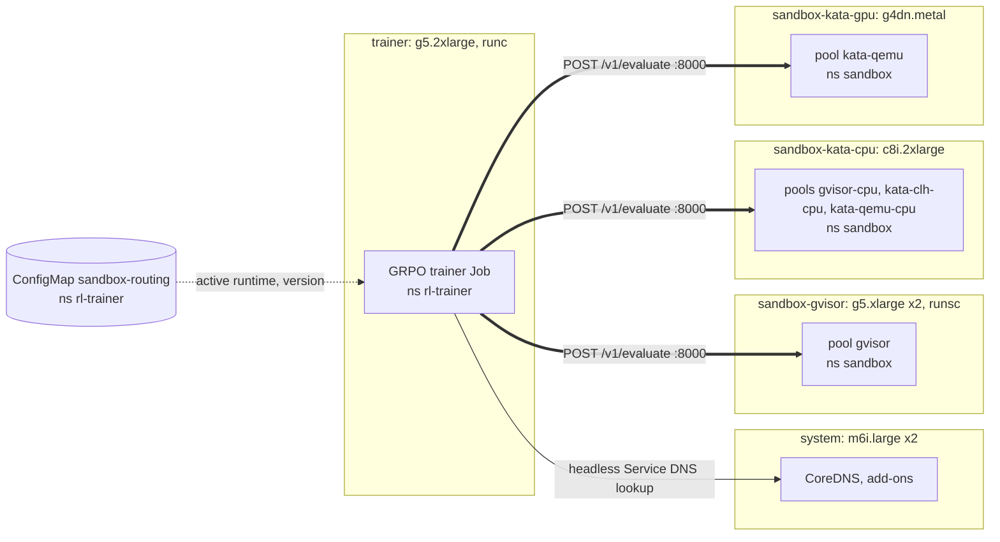
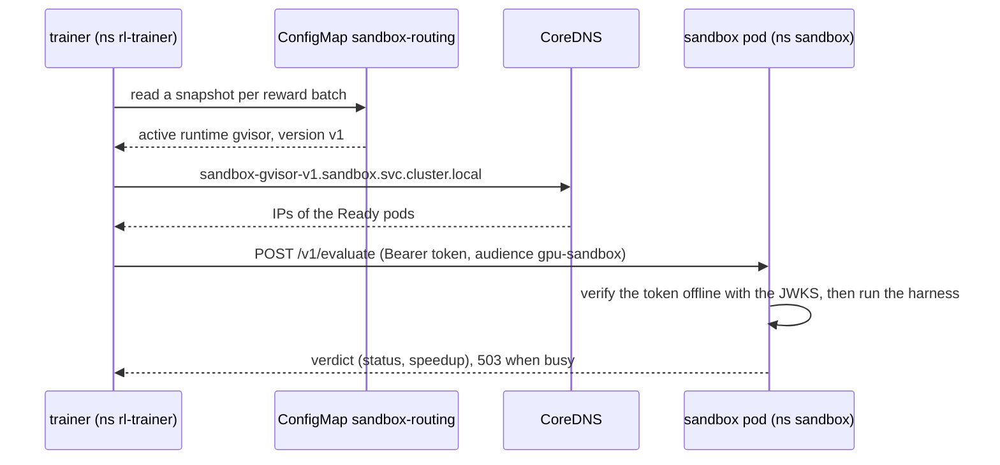
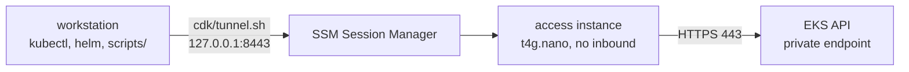
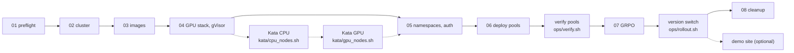

# 00 Hands-on overview

**TL;DR** Run the numbered scripts in order on one EKS cluster built with CDK, starting with the gVisor-only minimal path (about 3.4 USD per hour of compute) and adding Kata CPU and Kata GPU (`g4dn.metal`, 7.824 USD per hour) when you need them (estimates from On-Demand list prices).

## Pain point

The runtime smoke test (`04_install_gpu_stack.sh`) needs the images (`03_build_push_images.sh`) and the sandbox pools (`06_deploy_sandboxes.sh`) need the namespaces and auth (`05_setup_namespaces_auth.sh`), so skipping ahead ends in `set ... in scripts/config.env` errors or pods that never turn Ready. If you do not know which step starts which billable node, costs keep running after you finish. The smallest unit for Kata + GPU is one `g4dn.metal` (8x T4), so even mistakes unrelated to the GPU get debugged on a 7.8 USD per hour node. The `Running On-Demand G and VT instances` quota counts vCPUs and its documented default can be 0; unless you raise it first, node group creation in `02_create_cluster.sh` fails.

![a: four things that are easy to miss. Skipping 03_build_push_images.sh or 05_setup_namespaces_auth.sh gives a config.env error and pods that never turn Ready, an unraised G and VT quota makes node group creation in 02_create_cluster.sh fail, not knowing which step starts which node keeps nodes billing after you finish, and GPU-unrelated mistakes get debugged on g4dn.metal at 7.824 USD per hour. b: running in number order, scripts stop at an empty or __SET_ME__ value; running the prerequisite check (01_check_prereqs.sh) before 02_create_cluster.sh reads the G and VT quota; running the cleanup (08_cleanup.sh) when done releases every billable resource after a typed confirmation word; running the Kata CPU node step (kata/cpu_nodes.sh) before the Kata GPU node step (kata/gpu_nodes.sh) rehearses on c8i.2xlarge so g4dn.metal is used only for GPU passthrough](../images/figures/handson-00_overview.svg)

*Takeaway: Miss the order, the quota, a running node or the node you debug on, and you spend more time on debugging and cost control than on the exercise. Number order, the prerequisite check (`01_check_prereqs.sh`), the cleanup (`08_cleanup.sh`) and a `c8i.2xlarge` rehearsal handle each one.*


## Why

- **The number is the run order, and missing values stop it.** Scripts stop at an empty or `__SET_ME__` value in `scripts/config.env`, and the deploy that adds `g4dn.metal` and the delete (`08_cleanup.sh`) wait for a typed confirmation word.
- **Node groups are added to one CDK stack.** Rerun `02_create_cluster.sh` after changing the scenario, `WITH_KATA_CPU` or `WITH_KATA_GPU`, and CDK changes only what differs, so you can verify the gVisor minimal path before adding Kata.
- **Kata starts with a cheap rehearsal.** Bring up `kata-clh` and `kata-qemu` first on `c8i.2xlarge`, which supports nested virtualization, and turn on `g4dn.metal` only when you need GPU passthrough.

**Before you start:** finish the local smoke test and the `scripts/config.env` setup in [Getting started](../getting_started.md) first. Runtime differences are in [02 Isolation runtimes](../concepts/02_isolation_runtimes.md), and unfamiliar terms in the "Terms" box below and the [Glossary](../reference/glossary.md).

??? note "Terms (expand if a word is new to you)"
    - **AWS CDK, stack**: a tool that defines AWS infrastructure in code (Python here) and deploys it through CloudFormation, and the set of resources that are created and deleted together.
    - **Private endpoint, SSM tunnel**: the EKS API address reachable only inside the VPC, and the connection (`cdk/tunnel.sh`) that links a local port on your PC to it through SSM Session Manager.
    - **Node group**: a set of EKS worker nodes with the same instance type and settings. This hands-on creates one node group per role.
    - **Namespace**: a partition of resources and permissions inside one cluster. Here they are `rl-trainer` and `sandbox`.
    - **Taint, toleration**: a taint is a mark on a node that says "only pods that tolerate this may come"; a toleration is the pod setting that declares it tolerates that mark.
    - **RuntimeClass**: a Kubernetes object that selects the runtime (runc, gVisor, Kata) a pod runs with.
    - **Headless Service**: a Service without a virtual IP whose DNS lookup returns the IPs of the Ready pods directly.
    - **ConfigMap**: a Kubernetes object that holds configuration data and can be mounted into pods as files. The routing table lives in one.
    - **NetworkPolicy, default-deny**: rules that decide which connections between pods are allowed, and the baseline policy that blocks every connection not explicitly allowed.
    - **Projected ServiceAccount token, audience**: a short-lived token Kubernetes puts into a pod, and the field that names who may accept it (here `gpu-sandbox`).
    - **JWKS**: the list of public keys that verifies token signatures. It is not a secret.
    - **Smoke pod**: a test pod that briefly checks whether a runtime is installed correctly and then exits.

## Architecture

### AWS layout per scenario

The four scenarios use the same CDK stack (private EKS API, SSM tunnel, KMS key, logs) and differ only in where the trainer and the sandboxes run. The diagram sources (`.drawio`) and an arrow-by-arrow guide are in `diagrams/` in the repository.

=== "A: EC2 GPU"

    [](../images/architecture/scenario-a.drawio.png)

    *Takeaway: The trainer and the gVisor pools both run on EC2 nodes of EKS, and the model comes from Hugging Face Hub through the NAT.*

=== "B1: training on HyperPod"

    [](../images/architecture/scenario-b1.drawio.png)

    *Takeaway: Only the trainer moves to a HyperPod instance group (ml.g5.2xlarge), booted with lifecycle scripts from S3; the sandboxes stay on the same EC2 gVisor nodes as in A.*

=== "B2: training and sandboxes on HyperPod"

    [](../images/architecture/scenario-b2.drawio.png)

    *Takeaway: The sandboxes also move to a HyperPod instance group (ml.g5.xlarge x2), whose nodes boot from a custom AMI baked once (driver 580.178.04). This experimental path has not been run on AWS.*

=== "C: CPU only"

    [](../images/architecture/scenario-c.drawio.png)

    *Takeaway: With no GPU node, the pools of three runtimes share one c8i.2xlarge, and a simulate Job on the system nodes sends golden code in place of the trainer.*

### Node groups and namespaces

Training jobs and sandbox pods use separate node groups and namespaces, and a dedicated taint (`gpusandbox/role`) on the sandbox node groups admits only sandbox pods with the matching toleration.



*Takeaway: only the trainer calls the sandbox pools, and the routing ConfigMap decides which pool it calls.*

| Node group | Default instance | RuntimeClass | Sandbox pool (argument to `06_deploy_sandboxes.sh`) | Created by |
|---|---|---|---|---|
| `system` | `m6i.large` x2 | runc | none (CoreDNS, add-ons) | `02_create_cluster.sh` |
| `trainer` | `g5.2xlarge` (A10G 24 GB) | runc | none (training Job, scenario A only) | `02_create_cluster.sh` |
| `sandbox-gvisor` | `g5.xlarge` x2 (A10G) | `gvisor` (runsc + nvproxy) | `gvisor` | `02_create_cluster.sh` |
| `sandbox-kata-cpu` | `c8i.2xlarge` (nested virtualization) | `kata-clh`, `kata-qemu`, `gvisor-cpu` (runsc, no nvproxy) | `kata-clh-cpu`, `kata-qemu-cpu`, `gvisor-cpu` | `02_create_cluster.sh` (scenario C or `WITH_KATA_CPU=1`); Kata is installed by `kata/cpu_nodes.sh` |
| `sandbox-kata-gpu` | `g4dn.metal` (8x T4) | `kata-qemu-nvidia-gpu` (experimental `kata-clh-nvidia-gpu`) | `kata-qemu` (experimental `kata-clh`) | `02_create_cluster.sh` (`WITH_KATA_GPU=1`); the AMI and GPU Operator come from `kata/gpu_nodes.sh` |

!!! note "Scenario B (HyperPod)"
    `scripts/02_create_cluster.sh --hyperpod` (B1) creates no trainer node group; training runs on a HyperPod instance group (`ml.g5.2xlarge`, one instance) attached to the same EKS cluster. B2 (experimental), created with `--hyperpod-b2`, has no EC2 GPU node groups and puts the sandboxes on HyperPod too (B2 tab above). See [07 HyperPod scenario](07_hyperpod.md).

!!! tip "Scenario C (no GPU, c8i only)"
    With no GPU quota yet, or to cut cost first, start with `scripts/02_create_cluster.sh --cpu-only`. The system nodes and one `c8i.2xlarge` run CPU pools of all three runtimes (`gvisor-cpu`, `kata-clh-cpu`, `kata-qemu-cpu`), and a model-free reward loop (`scripts/ops/simulate.sh`) tries the version swap (`scripts/ops/rollout.sh`). Compute is about 0.57 USD per hour (estimate); the steps are in [10 CPU-only path on c8i](10_cpu_only.md).

### Request path

The trainer skips the Service virtual IP and sends one request at a time directly to each Ready pod; when a busy pod answers `503 busy`, the client retries on another pod.



*Takeaway: sandbox pods never call the Kubernetes API; they check tokens with public keys only, so requests are authenticated without any secret in the pod.*

The `sandbox` namespace is default-deny, so only pods labelled `gpusandbox/client=true` in `rl-trainer` reach port 8000. Authentication (the JWKS ConfigMap) and network policies are covered in [04 Deploy and verify sandbox pools](04_sandbox_pools.md).

### Infrastructure and access (CDK, tunnel)

The CloudFormation stack `<CLUSTER_NAME>-cdk` that `02_create_cluster.sh` creates with `cdk/deploy.sh` holds the VPC (2 AZs, 1 NAT gateway), the EKS cluster with only a private endpoint, the add-ons, the node groups of the scenario and the access instance. The scripts in `scripts/`, not CDK, install everything inside the cluster (device plugin, RuntimeClasses, kata-deploy, sandbox pools).



*Takeaway: there is no path from the internet to the cluster API; your workstation reaches it only through one SSM session.*

Run the steps that use kubectl or helm (`04_install_gpu_stack.sh` onward, including the HyperPod scripts) with `cdk/tunnel.sh` running in a second terminal. The tunnel needs the Session Manager plugin on your workstation and creates the kubectl context `<CLUSTER_NAME>-tunnel`. How to open it is in [01 Cluster and images](01_cluster_and_images.md), and the stack's security defaults are in [Production 09 CDK](../production/09_cdk.md).

## Step order

Expected durations are the scripts' guidance or timeouts; only values marked "measured" were timed in the practice account (2026-11-14; `07_run_grpo.sh` on 2026-11-18). The numbered scripts (01 to 08) are the main path, run in order in scenario A. Optional and operational scripts live in folders by purpose (`scripts/kata/`, `scripts/ops/`, `scripts/extensions/`, `scripts/hyperpod/`).

### Main path

| Script | What it does | Expected duration | Resources that start billing here |
|---|---|---|---|
| `scripts/01_check_prereqs.sh` | checks tools (including the CDK CLI and the Session Manager plugin), AWS identity, the G and VT and Standard vCPU quotas, nested virtualization support and which AZs offer the GPU instances (read-only) | short (lookups only) | none |
| `scripts/02_create_cluster.sh` (`--hyperpod`, `--hyperpod-b2`, `--cpu-only`) | one CDK stack: VPC, EKS control plane (private endpoint), add-ons, system nodes, the node groups of the scenario (A: trainer and gVisor, B1: gVisor, C: Kata CPU), access instance | 20 to 30 min (guidance), about 20 min for scenario C (measured) | EKS control plane, NAT gateway, `m6i.large` x2, `t4g.nano`, `g5.xlarge` x2 (A, B1), `g5.2xlarge` (A only), `c8i.2xlarge` (C or `WITH_KATA_CPU=1`), `g4dn.metal` (`WITH_KATA_GPU=1`) |
| `scripts/03_build_push_images.sh` (`--no-trainer`) | builds the sandbox, trainer and control images for `linux/amd64` and pushes them to ECR | depends on the build host and network | ECR storage |
| `scripts/04_install_gpu_stack.sh` | NVIDIA device plugin (CDI mode), then the `gvisor` RuntimeClass and a smoke pod | Helm `--wait` for the device plugin, smoke pod timeout 15 min | none |
| `scripts/05_setup_namespaces_auth.sh` | namespaces, NetworkPolicies, ServiceAccounts, JWKS, routing ConfigMap | short | none |
| `scripts/06_deploy_sandboxes.sh <runtime> [version] [replicas]` | sandbox pool (Deployment + headless Service) | rollout timeout 30 min | none (uses existing nodes) |
| `scripts/07_run_grpo.sh [max_steps]` | GRPO training Job (60 steps by default) | see [05](05_grpo_training.md); 5 steps took about 12 min including the image pull and model download (measured, `g5.2xlarge`) | none |
| `scripts/08_cleanup.sh` (`--images`) | deletes pools, Jobs, the CDK stack (cluster, node groups, VPC, access instance), the AMIs and (ECR) | not recorded (waits for the CloudFormation deletion) | releases everything (the secrets KMS key waits 7 days for deletion) |

After deploying a pool with `06_deploy_sandboxes.sh`, run the pool verification (`scripts/ops/verify.sh`); after starting training with `07_run_grpo.sh`, run the version switch (`scripts/ops/rollout.sh`). Both are in the table below, and the full run order is in the figure under "Minimal path and full path".

### Optional and operations

| Script | What it does | Expected duration | Resources that start billing here |
|---|---|---|---|
| `scripts/kata/cpu_nodes.sh` | checks that the Kata CPU node group exists, kata-deploy, the `gvisor-cpu` RuntimeClass, `gvisor-cpu`, `kata-clh` and `kata-qemu` smoke pods | about 14 min (measured, mostly kata-deploy), kata-deploy timeout 20 min | none (the node comes from `02_create_cluster.sh`) |
| `scripts/kata/gpu_nodes.sh` | the first run bakes the IOMMU AMI and stops; after rerunning `02_create_cluster.sh`: GPU Operator, kata-deploy, checks `nvidia.com/pgpu` | AMI about 10 min (guidance), pgpu wait up to 20 min | AMI builder `m6i.large` (briefly), AMI snapshot (`g4dn.metal` when `02_create_cluster.sh` is rerun) |
| `scripts/ops/verify.sh <runtime> [version]` | isolation evidence, egress denial, golden verdicts, NetworkPolicy check | a few minutes (including the probe Job) | none |
| `scripts/ops/simulate.sh [steps] [interval_s]` (scenario C) | sends reward batches of golden submissions without a model to watch a version swap; not training | 30 batches x 20 s by default (about 10 min) | none |
| `scripts/ops/rollout.sh <runtime> <from> <to> [--finish]` | switches v1 to v2 during training | see [06](06_sandbox_update.md) | none |
| `scripts/ops/bench.sh [requests]` | compares cold start, latency and speedup per runtime | see [08](08_benchmark.md) | none |
| `scripts/extensions/agent_sandbox.sh` (`install`, `pool`, `claim`, `episodes`) | claims one sandbox per episode from an Agent Sandbox warm pool and runs multi-turn episodes ([11 Multi-turn episodes](11_multi_turn.md)) | not recorded (local tests only, not run on AWS) | none (uses existing nodes). Each idle warm sandbox holds one accelerator |
| `scripts/hyperpod/build_b2_ami.sh` (scenario B2) | builds the custom AMI for the sandbox instance group; run before `hyperpod/create.sh --b2` | 20 to 40 min (estimate) | builder `m6i.large` (during the build), AMI snapshot |
| `scripts/hyperpod/create.sh` (`--b2`) | creates the HyperPod cluster and attaches it to the same EKS cluster; `--b2` adds the sandbox instance group | 15 to 30 min until InService (guidance) | HyperPod `ml.g5.2xlarge` (B2 adds `ml.g5.xlarge` x2) |
| `scripts/hyperpod/check_gvisor.sh` (scenario B2) | prints each HyperPod node's driver version and whether gVisor nvproxy supports it (read-only apart from short-lived debug pods) | see [07](07_hyperpod.md) | none |
| `scripts/hyperpod/run_grpo.sh [max_steps]` | GRPO training that scenario B runs instead of `07_run_grpo.sh` | see [07](07_hyperpod.md) | none |
| `scripts/hyperpod/delete.sh` | deletes the HyperPodPyTorchJobs, the HyperPod cluster, the execution role and the lifecycle bucket | see [07](07_hyperpod.md) | releases the HyperPod resources |
| see [09 Demo site](09_demo_site.md) (optional) | deploys a static demo site that replays a recorded evaluation log (JSON) through a private S3 bucket and CloudFront. Visitors never reach the cluster or a GPU | see [09](09_demo_site.md) | S3 storage, CloudFront requests and transfer |

Scenario B runs `scripts/hyperpod/create.sh` after `02_create_cluster.sh` (15 to 30 min until InService, per its guidance) and uses `scripts/hyperpod/run_grpo.sh` instead of `07_run_grpo.sh`. For cleanup, run `scripts/hyperpod/delete.sh` before `08_cleanup.sh`.

The Kata node groups have no script of their own; rerunning `02_create_cluster.sh` adds them. For Kata CPU, add `WITH_KATA_CPU=1` to `scripts/config.env`, then run `02_create_cluster.sh` and `kata/cpu_nodes.sh`. For Kata GPU, the first run of `kata/gpu_nodes.sh` bakes the AMI; add `KATA_IOMMU_AMI_ID` and `WITH_KATA_GPU=1`, then run `02_create_cluster.sh` and `kata/gpu_nodes.sh` again. Rerun `02_create_cluster.sh` with the same option as the first time (`--hyperpod`, `--cpu-only` and so on).

## Minimal path and full path



*Takeaway: following the solid arrows completes the gVisor minimal path; the dotted steps (Kata CPU, Kata GPU, demo site) slot in when you need them.*

| Item | Minimal path (gVisor only) | Full path (gVisor + Kata CPU + Kata GPU) |
|---|---|---|
| Steps | 01 to 08, pool verification (`ops/verify.sh`), version switch (`ops/rollout.sh`) (the benchmark `ops/bench.sh` and the 09 demo site are optional) | minimal path + rerun of `02_create_cluster.sh` (`WITH_KATA_CPU`, `WITH_KATA_GPU`), `kata/cpu_nodes.sh`, `kata/gpu_nodes.sh`, `06_deploy_sandboxes.sh` and `ops/verify.sh` for the Kata pools, `ops/bench.sh` |
| Sandbox pools | `gvisor` | `gvisor`, `gvisor-cpu`, `kata-clh-cpu`, `kata-qemu-cpu`, `kata-qemu` (experimental `kata-clh`) |
| Extra nodes | none | `c8i.2xlarge` x1, `g4dn.metal` x1 |
| G and VT vCPUs (scenario A) | 16 (`g5.2xlarge` 8 + `g5.xlarge` 4 x 2) | 112 (16 + `g4dn.metal` 96) |
| When | your first run, or when gVisor's isolation level is enough | to compare VM-boundary isolation, or when you need Kata + GPU |

Every runtime uses the same sandbox image, `/v1/evaluate` API and verification script (`ops/verify.sh`). The 09 demo site is optional and independent of the cluster, so you can deploy it right away with the recording shipped in the repository (made on a laptop CPU pool).

## Time and cost

The table below is an **estimate** from On-Demand list prices, not a measured bill (us-east-1 and us-west-2 are the same).

| Resource | Count | Unit price (USD/hour) | Minimal path | Full path |
|---|---|---|---|---|
| `m6i.large` (system) | 2 | 0.096 | 0.192 | 0.192 |
| `g5.2xlarge` (trainer, scenario A) | 1 | 1.212 | 1.212 | 1.212 |
| `g5.xlarge` (gVisor) | 2 | 1.006 | 2.012 | 2.012 |
| `c8i.2xlarge` (Kata CPU) | 1 | 0.37484 | n/a | 0.37484 |
| `g4dn.metal` (Kata GPU) | 1 | 7.824 | n/a | 7.824 |
| **Compute total** | | | **about 3.42** | **about 11.61** |
| EKS control plane (standard support) | 1 | 0.10 | 0.10 | 0.10 |

- In scenario B the trainer becomes `ml.g5.2xlarge` (1.515 USD/hour), so the compute total is about 3.72 for the minimal path and about 11.92 for the full path.
- Not included above: the access instance (`t4g.nano`), the secrets KMS key, CloudWatch logs (control plane logs, VPC flow log), the NAT gateway (hourly and per-GB charges), EBS volumes (system 50 GB x2, trainer 200 GB, gVisor 100 GB x2, Kata CPU 100 GB, Kata GPU 200 GB), data transfer, ECR storage, AMI snapshots, the image build host, and S3 and CloudFront for the 09 demo site.
- `g4dn.metal` in the Seoul Region (ap-northeast-2) is 9.624 USD per hour.

!!! warning "GPU nodes bill until you delete them"
    Scaling a Deployment to zero does not stop node charges, so scale the node group to zero while you pause and run [99 Cleanup](99_cleanup.md) when you finish. Rerun `02_create_cluster.sh` with `WITH_KATA_GPU=1` only right before the Kata GPU exercise. For example, the Kata GPU node group:

    ```bash
    source scripts/config.env
    aws eks update-nodegroup-config --region "$AWS_REGION" --cluster-name "$CLUSTER_NAME" \
      --nodegroup-name sandbox-kata-gpu --scaling-config minSize=0,maxSize=1,desiredSize=0
    ```

    **What to look for:** the command returns JSON with `"type": "ConfigUpdate"`. After a few minutes, with the tunnel open, `kubectl get nodes -l gpusandbox/kata-gpu=true` shows no nodes. The values for each node group and how to scale back up are in the "Pausing" section of [99 Cleanup](99_cleanup.md).

## Prerequisites

1. **Tools:** `aws`, `cdk` (AWS CDK CLI 2.1148.1 or later), `node` (Node.js 22 or 24), `kubectl`, `helm`, `docker` (with buildx), `python3`, `jq`, `session-manager-plugin` (Session Manager plugin for the AWS CLI). Scenario B also needs `git`, and `01_check_prereqs.sh` checks this list. The one-time CDK setup (installing `cdk/requirements.txt`, `cdk bootstrap`) is in [01 Cluster and images](01_cluster_and_images.md).
2. **Settings file:** `cp scripts/config.env.example scripts/config.env`, then check `SCENARIO`, `WITH_KATA_CPU` and `WITH_KATA_GPU`. If you leave `ADMIN_PRINCIPAL_ARN` empty, the IAM role you are using becomes the cluster admin (details in [01 Cluster and images](01_cluster_and_images.md)).
3. **EC2 quotas (vCPU-based):**
    - `Running On-Demand G and VT instances`: 16 for the minimal path, 112 for the full path (one `g4dn.metal` is 96). The documented default can be 0.
    - `Running On-Demand Standard (A, C, D, H, I, M, R, T, Z) instances`: the system nodes 4 (`m6i.large` 2 x 2) plus the access instance 2 (`t4g.nano`, T family) make 6 for the minimal path; the full path adds `c8i.2xlarge` 8 and the AMI builder 2, up to 16. The documented default is 5, so check it even for the minimal path (vCPU counts computed from the instance specs).
    - Scenario B: the SageMaker `ml.g5.2xlarge for cluster usage` quota. B2 also needs 2 of the `ml.g5.xlarge for cluster usage` quota for the `sandbox` instance group (`HYPERPOD_SANDBOX_COUNT`).

    Find the quotas in the Service Quotas console → AWS services → Amazon EC2 by searching for `Running On-Demand`, in `AWS_REGION` because values differ by Region. The "Applied account-level quota value" must exceed what you need.

    

    *An example from a practice account (2026-11-14, ap-south-1). Account identifiers are masked; values differ by account and Region.*
4. **Region:** the default is `us-west-2`; `01_check_prereqs.sh` shows instance support and AZ availability there.
5. **Build host:** the base images (PyTorch, vLLM) are large, so if your workstation is arm64, run `03_build_push_images.sh` on an x86_64 host with 100+ GB of disk.
6. **Account:** use a sandbox account, not a production one. CDK (CloudFormation) needs permission to create EC2 and VPC, EKS, IAM role, KMS, CloudWatch Logs, Lambda and SSM resources.

## How to verify

The detailed output is under "What to look for" on each page; when something fails, see the matching section of [Troubleshooting](../reference/troubleshooting.md) (config and scripts, cluster and nodes, gVisor, Kata, sandbox pools and readiness).

| Script | Success signal |
|---|---|
| `01_check_prereqs.sh` | quota values, `nested-virtualization` support and AZ lists are printed, and the last log line is `Done. Request quota increases before 02_create_cluster.sh ...` |
| `02_create_cluster.sh` | the CDK `Outputs` show `EndpointPublicAccess = false`; with the tunnel open, `kubectl get nodes` shows 2 system nodes plus the scenario's nodes (A: 1 trainer, 2 sandbox-gvisor; C: 1 sandbox-kata) |
| `03_build_push_images.sh` | three export lines: `SANDBOX_IMAGE_URI`, `TRAINER_IMAGE_URI`, `CONTROL_IMAGE_URI` |
| `04_install_gpu_stack.sh` | GPU 1 on every `gpusandbox/device-plugin=cdi` node (it can briefly be `0` right after the plugin restarts), then `cuda ok: NVIDIA A10G 2048.0` from the smoke pod |
| `kata/cpu_nodes.sh` | the `kernel seen inside: ...` kernels of `gvisor-cpu`, `kata-clh` and `kata-qemu` all differ from the host kernel |
| `kata/gpu_nodes.sh` | `pgpu=8  cc.ready.state=false` |
| `05_setup_namespaces_auth.sh` | the start of routing.json shows `"active": {"runtime": "gvisor", "version": "v1"}` |
| `06_deploy_sandboxes.sh` | rollout complete, pods `1/1 Running` |
| `ops/verify.sh` | `pool sandbox-<runtime>-<version> verified` after all four checks pass |

!!! warning "Validation status"
    What has been run on AWS:

    - **2026-11-14:** the author deployed and deleted the scenario C CDK stack twice in a practice account (us-west-2) and ran the Kata CPU node step (`kata/cpu_nodes.sh`). The `02_create_cluster.sh` (scenario C) and `kata/cpu_nodes.sh` signals above are real output from that run.
    - **2026-11-18:** in the practice account (us-west-2), `03_build_push_images.sh` (all three images), `04_install_gpu_stack.sh`, `05_setup_namespaces_auth.sh`, `06_deploy_sandboxes.sh gvisor v1` (1 replica) with `ops/verify.sh gvisor v1`, `07_run_grpo.sh 5` on `g5.2xlarge` and `08_cleanup.sh --images` were run. The smoke pod's `cuda ok: NVIDIA A10G 2048.0` and the `ops/verify.sh` pass were seen in that run.
    - **How the cluster was created (2026-11-18):** initial creates that included GPU node groups rolled back completely on `InsufficientInstanceCapacity`. So the cluster was first created as the system-only layout (`02_create_cluster.sh --hyperpod-b2`), then updated with `CHANGE_SCENARIO=1` to B1 (adds the gVisor node group) and to A (adds the trainer).
    - **2026-11-18 (continued):** the same day, on another cluster, `kata/gpu_nodes.sh` (IOMMU AMI, GPU Operator, `pgpu=8`), `kata/cpu_nodes.sh`, `ops/verify.sh` for `kata-qemu` and the three CPU pools, and `ops/bench.sh` on five pools were run ([08](08_benchmark.md), [03](03_kata.md)).
    - **Not run:** `ops/rollout.sh` during training (scenario A), HyperPod B1 and B2 (from the HyperPod cluster creation on), and the experimental Kata CLH GPU (attempted; the VM did not start). The signals of these steps come from the script code.

    Locally (CPU, no AWS) the 94 `pytest` tests (including manifest rendering and user data) and the 18 CDK tests in `cdk/tests` pass, so verify each step yourself with the "What to look for" checks on each page.

## Next step

Run `01_check_prereqs.sh`, `02_create_cluster.sh` and `03_build_push_images.sh` in [01 Cluster and images](01_cluster_and_images.md).

??? note "References"
    | Topic | Link |
    |---|---|
    | EC2 On-Demand pricing | https://aws.amazon.com/ec2/pricing/on-demand/ |
    | EC2 instance type quotas | https://docs.aws.amazon.com/ec2/latest/instancetypes/ec2-instance-quotas.html |
    | AWS CDK v2 Developer Guide | https://docs.aws.amazon.com/cdk/v2/guide/home.html |
    | Install the Session Manager plugin | https://docs.aws.amazon.com/systems-manager/latest/userguide/session-manager-working-with-install-plugin.html |
    | This repository | https://github.com/daekeun-ml/gpu-sandbox-on-aws |

    All sources: [this page in All references](../reference/references.md#ref-handson-00-overview)
