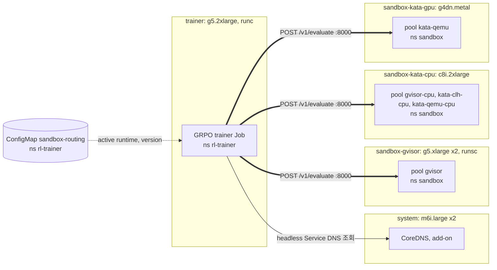
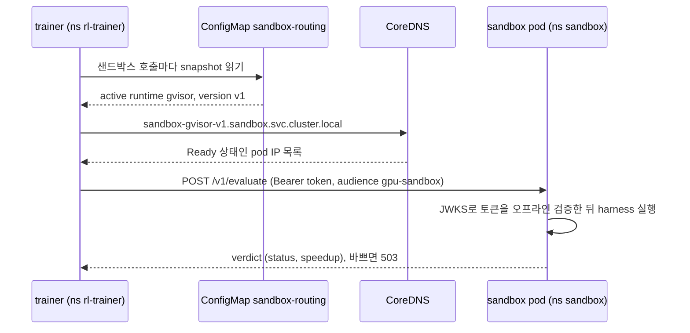
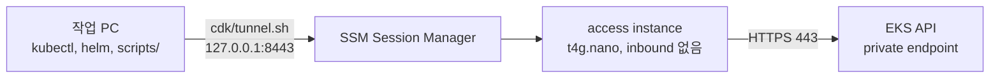
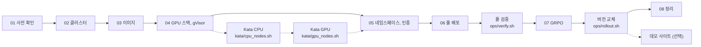
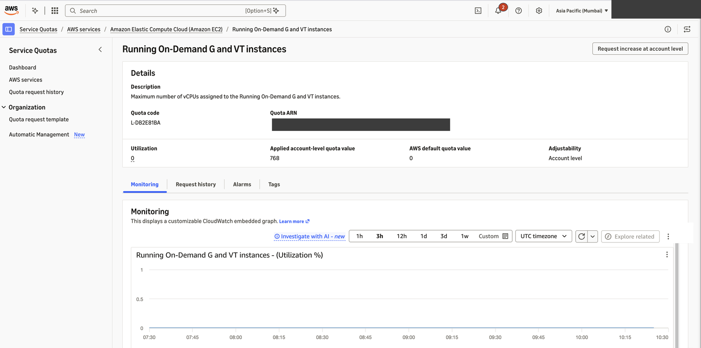

# 00 핸즈온 전체 흐름

**TL;DR** CDK로 만든 EKS 클러스터 하나에서 번호가 붙은 스크립트를 순서대로 실행합니다. gVisor만 쓰는 최소 구성(컴퓨트 시간당 약 3.4 USD)으로 시작하고, 필요하면 Kata CPU 노드와 Kata GPU 노드(`g4dn.metal`, 시간당 7.824 USD)를 추가합니다(추정, 온디맨드 요금).

## 기존 Pain Point

런타임 smoke test(`04_install_gpu_stack.sh`)는 이미지(`03_build_push_images.sh`)가 먼저 있어야 하고, 샌드박스 풀(`06_deploy_sandboxes.sh`)은 네임스페이스와 인증(`05_setup_namespaces_auth.sh`)이 먼저 있어야 합니다. 이미지를 건너뛰면 이미지 URI가 없어 `set ... in scripts/config.env` 에러로 멈추고, 네임스페이스 설정을 건너뛰면 `sandbox` 네임스페이스가 없어 풀 배포가 실패합니다. 어느 단계가 어떤 과금 노드를 만드는지 모르면 실습이 끝난 뒤에도 노드가 남아 비용이 나가요. Kata + GPU 구성에는 최소 `g4dn.metal`(8x T4) 한 대가 필요하므로, GPU와 무관한 설정 실수도 시간당 7.8 USD인 노드에서 디버깅하게 됩니다. vCPU 기준인 `Running On-Demand G and VT instances` 쿼터는 문서상 기본값이 0일 수 있어, 먼저 올리지 않으면 `02_create_cluster.sh`의 노드 그룹 생성이 실패합니다.

![a: 놓치기 쉬운 네 가지와 그 결과입니다. 03_build_push_images.sh를 건너뛰면 이미지 URI가 없어 config.env 에러로 멈추고, 05_setup_namespaces_auth.sh를 건너뛰면 sandbox 네임스페이스가 없어 풀 배포가 실패합니다. G and VT 쿼터를 올리지 않으면 02_create_cluster.sh에서 노드 그룹 생성이 실패합니다. 어느 단계가 노드를 켜는지 모르면 실습 뒤에도 노드 요금이 나갑니다. GPU와 무관한 설정 실수를 시간당 7.824 USD인 g4dn.metal에서 디버깅하게 됩니다. b: 이 핸즈온의 대응입니다. 번호 순서대로 실행하고, 각 스크립트는 그 단계에 필요한 설정값이 비었거나 __SET_ME__이면 중단됩니다. 02_create_cluster.sh 전에 실행하는 사전 확인(01_check_prereqs.sh)이 G and VT 쿼터를 조회합니다(읽기 전용). 끝나면 실행하는 정리(08_cleanup.sh)가 클러스터 이름을 입력받은 뒤 CDK 스택을 지우고, 설정에 기록된 AMI는 하나씩 확인한 뒤 지우며, ECR은 --images를 붙일 때만 지웁니다. Kata GPU 노드 추가(kata/gpu_nodes.sh)보다 Kata CPU 노드 추가(kata/cpu_nodes.sh)를 먼저 실행해 c8i.2xlarge에서 리허설하면 g4dn.metal은 GPU passthrough 확인에만 씁니다.](../images/figures/handson-00_overview.svg)

*그림 요약: 실행 순서, G and VT 쿼터, 과금되는 노드, 디버깅에 쓸 노드 중 하나라도 놓치면 실습보다 오류 처리와 비용 관리에 시간이 더 듭니다. 번호 순서대로 실행하고, 클러스터를 만들기 전에 쿼터를 확인하고(`01_check_prereqs.sh`), 끝나면 정리하세요(`08_cleanup.sh`). GPU와 무관한 설정은 `c8i.2xlarge`에서 먼저 점검합니다.*


## Why

- **번호가 실행 순서이고, 빠진 값이 있으면 스크립트가 멈춥니다.** 각 스크립트는 그 단계에 필요한 `scripts/config.env` 변수가 비어 있거나 `__SET_ME__`를 포함하면 멈추고, `g4dn.metal`을 추가하는 배포와 삭제(`08_cleanup.sh`)는 확인 단어를 입력해야 진행돼요.
- **노드 그룹은 CDK 스택 하나에 차례로 추가합니다.** `WITH_KATA_CPU`나 `WITH_KATA_GPU`를 바꿔 `02_create_cluster.sh`를 다시 실행하면 CDK가 달라진 부분만 변경하므로, gVisor 최소 경로를 검증한 뒤 Kata 노드 그룹을 추가하면 됩니다. 시나리오 자체를 바꿀 때는 `CHANGE_SCENARIO=1`도 붙여야 하고, 없으면 배포 스크립트가 멈춰요.
- **Kata는 비용이 적은 노드에서 먼저 리허설합니다.** nested virtualization을 지원하는 `c8i.2xlarge`에서 `kata-clh`와 `kata-qemu`를 먼저 실행해 보고, GPU passthrough가 필요할 때만 `g4dn.metal` 노드를 만들어요.

**사전 지식:** [시작하기](../getting_started.md)에서 로컬 smoke test와 `scripts/config.env` 준비를 먼저 끝내세요. 런타임 차이는 [02 격리 런타임 비교](../concepts/02_isolation_runtimes.md)에, 처음 보는 용어는 아래 "용어" 상자와 [용어 사전](../reference/glossary.md)에 있습니다.

??? note "용어 (처음 보는 단어가 있으면 펼치세요)"
    - **AWS CDK, 스택**: 코드(여기서는 Python)로 AWS 인프라를 정의해 CloudFormation으로 배포하는 도구와, 함께 만들고 함께 지우는 리소스 묶음입니다.
    - **private endpoint, SSM 터널**: VPC 안에서만 접근할 수 있는 EKS API 주소와, SSM Session Manager로 내 PC의 로컬 포트를 그 주소에 연결하는 터널(`cdk/tunnel.sh`)입니다.
    - **노드 그룹**: 같은 인스턴스 타입과 설정으로 묶인 EKS worker 노드 집합입니다. 이 핸즈온은 역할마다 노드 그룹을 따로 만듭니다.
    - **네임스페이스**: 한 클러스터 안에서 리소스와 권한을 나누는 구획입니다. 여기서는 `rl-trainer`와 `sandbox`를 씁니다.
    - **taint, toleration**: taint는 노드에 붙이는 표시이고, 이 taint에 맞는 toleration이 없는 pod는 그 노드에 배치되지 않습니다. toleration은 pod가 특정 taint가 있는 노드에도 배치될 수 있다고 선언하는 설정입니다.
    - **RuntimeClass**: pod를 어떤 런타임(runc, gVisor, Kata)으로 실행할지 지정하는 Kubernetes 객체입니다.
    - **headless Service**: 가상 IP 없이, DNS 조회 결과로 Ready 상태인 pod의 IP 목록을 바로 반환하는 Service입니다.
    - **ConfigMap**: 설정 데이터를 담아 pod에 파일로 마운트할 수 있는 Kubernetes 객체입니다. routing 표를 여기에 저장합니다.
    - **NetworkPolicy, default-deny**: pod 사이에 허용할 연결을 정하는 규칙과, 명시하지 않은 연결은 모두 차단하는 기본 정책입니다.
    - **projected ServiceAccount token, audience**: Kubernetes가 pod에 마운트하는 수명이 짧은 토큰과, 그 토큰을 받는 대상을 지정하는 필드(여기서는 `gpu-sandbox`)입니다.
    - **JWKS**: 토큰 서명을 확인하는 공개 키 목록입니다. 비밀 값이 아닙니다.
    - **smoke pod**: 런타임이 제대로 설치됐는지 짧게 확인하고 종료되는 테스트용 pod입니다.

## 아키텍처

### 시나리오별 AWS 구성

네 시나리오는 같은 CDK 스택(private EKS API, SSM 터널, KMS 키, 로그)을 쓰고, trainer와 샌드박스가 배치되는 위치만 다릅니다. 그림 원본(`.drawio`)과 화살표별 설명은 저장소의 `diagrams/`에 있어요.

=== "A: EC2 GPU"

    [](../images/architecture/scenario-a.drawio.png)

    *그림 요약: trainer와 gVisor 풀이 모두 EKS의 EC2 노드에 있고, 모델은 NAT를 거쳐 Hugging Face Hub에서 받습니다.*

=== "B1: HyperPod 학습"

    [](../images/architecture/scenario-b1.drawio.png)

    *그림 요약: trainer만 HyperPod 인스턴스 그룹(ml.g5.2xlarge)으로 옮겨 S3의 lifecycle 스크립트로 부팅하고, 샌드박스는 A와 같은 EC2 gVisor 노드에 남습니다.*

=== "B2: HyperPod 학습과 샌드박스"

    [](../images/architecture/scenario-b2.drawio.png)

    *그림 요약: 샌드박스도 HyperPod 인스턴스 그룹(ml.g5.xlarge x2)에 올라가고, 이 노드는 한 번 빌드하는 custom AMI(드라이버 580.178.04)로 부팅해요. AWS에서 실행해 보지 않은 실험 경로입니다.*

=== "C: CPU 전용"

    [](../images/architecture/scenario-c.drawio.png)

    *그림 요약: GPU 노드 없이 c8i.2xlarge 한 대에 세 런타임의 풀이 서고, system 노드의 simulate Job이 trainer 대신 golden 코드를 보냅니다.*

### 노드 그룹과 네임스페이스

학습 Job과 샌드박스 pod는 서로 다른 노드 그룹과 네임스페이스를 씁니다. 샌드박스 노드 그룹에는 전용 taint(`gpusandbox/role`)가 있어서, 이 taint를 허용(toleration)하지 않는 pod는 배치되지 않습니다. 이 노드에는 샌드박스 pod와 함께 NVIDIA device plugin 같은 노드 관리용 DaemonSet도 실행돼요.



*그림 요약: 학습할 때는 trainer가 routing ConfigMap이 가리키는 풀을 부릅니다. 풀을 검증할 때는 `sandbox-probe` 계정의 Job이 부르고요.*

| 노드 그룹 | 기본 인스턴스 | RuntimeClass | 샌드박스 풀 (`06_deploy_sandboxes.sh`의 인자) | 만드는 스크립트 |
|---|---|---|---|---|
| `system` | `m6i.large` x2 | runc | 없음 (CoreDNS, add-on) | `02_create_cluster.sh` |
| `trainer` | `g5.2xlarge` (A10G 24 GB) | runc | 없음 (학습 Job, 시나리오 A만) | `02_create_cluster.sh` |
| `sandbox-gvisor` | `g5.xlarge` x2 (A10G) | `gvisor` (runsc + nvproxy) | `gvisor` | `02_create_cluster.sh` |
| `sandbox-kata-cpu` | `c8i.2xlarge` (nested virtualization) | `kata-clh`, `kata-qemu`, `gvisor-cpu` (runsc, nvproxy 없음) | `kata-clh-cpu`, `kata-qemu-cpu`, `gvisor-cpu` | `02_create_cluster.sh` (시나리오 C 또는 `WITH_KATA_CPU=1`), Kata 설치는 `kata/cpu_nodes.sh` |
| `sandbox-kata-gpu` | `g4dn.metal` (8x T4) | `kata-qemu-nvidia-gpu` (실험적 `kata-clh-nvidia-gpu`) | `kata-qemu` (실험적 `kata-clh`) | `02_create_cluster.sh` (`WITH_KATA_GPU=1`), AMI와 GPU Operator는 `kata/gpu_nodes.sh` |

!!! note "시나리오 B (HyperPod)"
    `scripts/02_create_cluster.sh --hyperpod`(B1)는 trainer 노드 그룹을 만들지 않습니다. 학습은 같은 EKS 클러스터에 연결한 HyperPod 인스턴스 그룹(`ml.g5.2xlarge`, 1대)에서 실행됩니다. B2(실험)는 `--hyperpod-b2`로 EC2 GPU 노드 그룹 없이 클러스터를 만들고, 샌드박스도 HyperPod에 배치합니다(위 B2 탭). 자세한 내용은 [07 HyperPod 시나리오](07_hyperpod.md)를 보세요.

!!! tip "시나리오 C (GPU 없음, c8i 단독)"
    GPU 쿼터가 없거나 비용을 먼저 줄이려면 `scripts/02_create_cluster.sh --cpu-only`로 시작하세요. system 노드와 `c8i.2xlarge` 한 대만으로 세 런타임의 CPU 풀(`gvisor-cpu`, `kata-clh-cpu`, `kata-qemu-cpu`)을 실행하고, 모델 없이 reward 배치를 보내는 루프(`scripts/ops/simulate.sh`)로 버전 교체(`scripts/ops/rollout.sh`)까지 진행합니다. 컴퓨트는 시간당 약 0.57 USD(추정)이고, 순서는 [10 c8i 단독 저비용 경로](10_cpu_only.md)에 있어요.

### 요청 경로

trainer는 Service 가상 IP를 거치지 않고 Ready 상태인 각 pod에 요청을 하나씩 직접 보냅니다. pod가 이미 평가 중이면 `503 busy`를 반환하고, trainer는 다른 pod로 다시 시도합니다.



*그림 요약: 샌드박스 pod는 Kubernetes API를 부르지 않고 공개 키만으로 토큰을 확인하므로, 비밀 값 없이 요청을 인증합니다.*

`sandbox` 네임스페이스에는 default-deny 정책이 있어서, `rl-trainer` 네임스페이스에서 `gpusandbox/client=true` label이 붙은 pod만 8000번 포트로 접속할 수 있습니다. 인증(JWKS ConfigMap)과 네트워크 정책은 [04 샌드박스 풀 배포와 검증](04_sandbox_pools.md)에서 다룹니다.

### 인프라와 접속 (CDK, 터널)

`02_create_cluster.sh`가 `cdk/deploy.sh`로 만드는 CloudFormation 스택 `<CLUSTER_NAME>-cdk`에는 VPC(AZ 2개, NAT gateway 1개), private endpoint만 활성화한 EKS 클러스터, add-on, 시나리오별 노드 그룹, access instance가 들어 있습니다. 클러스터 내부 구성 요소(device plugin, RuntimeClass, kata-deploy, 샌드박스 풀)는 CDK가 아니라 `scripts/`의 스크립트가 설치해요.



*그림 요약: 인터넷에서 클러스터 API로 들어오는 경로는 없고, 작업 PC는 SSM 세션 하나로만 API에 접속합니다.*

kubectl이나 helm을 쓰는 단계(`04_install_gpu_stack.sh` 이후, HyperPod 스크립트 포함)는 두 번째 터미널에서 `cdk/tunnel.sh`로 터널을 열어 둔 상태로 실행합니다. 터널을 열려면 작업 PC에 Session Manager plugin이 있어야 하고, `cdk/tunnel.sh`가 kubectl context `<CLUSTER_NAME>-tunnel`을 만들어요. 터널을 여는 방법은 [01 클러스터와 이미지](01_cluster_and_images.md)에, 스택의 보안 기본값은 [Production 09 CDK](../production/09_cdk.md)에 있습니다.

## 단계 순서

예상 시간은 스크립트의 안내값이나 timeout이고, "실측"으로 적은 값만 실습 계정에서 측정한 것입니다(2026-11-14, `07_run_grpo.sh`는 2026-11-18). 번호가 붙은 스크립트(01~08)는 시나리오 A에서 순서대로 실행하는 필수 경로입니다. 선택 기능과 운영용 스크립트는 용도별 폴더(`scripts/kata/`, `scripts/ops/`, `scripts/extensions/`, `scripts/hyperpod/`)에 있습니다.

### 필수 경로

| 스크립트 | 하는 일 | 예상 시간 | 이 단계에서 과금이 시작되는 리소스 |
|---|---|---|---|
| `scripts/01_check_prereqs.sh` | 도구(CDK CLI, Session Manager plugin 포함), AWS identity, G and VT와 Standard vCPU 쿼터, nested virtualization 지원, GPU 인스턴스의 AZ별 제공 여부 확인 (읽기 전용) | 짧음 (조회만) | 없음 |
| `scripts/02_create_cluster.sh` (`--hyperpod`, `--hyperpod-b2`, `--cpu-only`) | CDK 스택 하나: VPC, EKS 컨트롤 플레인(private endpoint), add-on, system 노드, 시나리오별 노드 그룹(A: trainer와 gVisor, B1: gVisor, C: Kata CPU), access instance | 20~30분 (안내값), 시나리오 C 약 20분 (실측) | EKS 컨트롤 플레인, NAT gateway, `m6i.large` x2, `t4g.nano`, `g5.xlarge` x2(A, B1), `g5.2xlarge`(A만), `c8i.2xlarge`(C 또는 `WITH_KATA_CPU=1`), `g4dn.metal`(`WITH_KATA_GPU=1`) |
| `scripts/03_build_push_images.sh` (`--no-trainer`) | sandbox, trainer, control 이미지를 `linux/amd64`로 빌드해 ECR에 push. `--no-trainer`는 trainer 이미지를 건너뜀 | 빌드 호스트와 네트워크에 따라 다름 | ECR 저장 용량 |
| `scripts/04_install_gpu_stack.sh` | NVIDIA device plugin (CDI 모드)을 설치한 뒤 `gvisor` RuntimeClass와 smoke pod | device plugin은 Helm `--wait`, smoke pod timeout 15분 | 없음 |
| `scripts/05_setup_namespaces_auth.sh` | 네임스페이스, NetworkPolicy, ServiceAccount, JWKS, routing ConfigMap | 짧음 | 없음 |
| `scripts/06_deploy_sandboxes.sh <runtime> [version] [replicas]` | 샌드박스 풀 (Deployment + headless Service) | rollout timeout 30분 | 없음 (기존 노드 사용) |
| `scripts/07_run_grpo.sh [max_steps]` | GRPO 학습 Job (기본 60 step) | [05](05_grpo_training.md) 참고. 5 step은 이미지 pull과 모델 다운로드를 포함해 약 12분 (실측, `g5.2xlarge`) | 없음 |
| `scripts/08_cleanup.sh` (`--images`) | 풀, Job, CDK 스택(클러스터, 노드 그룹, VPC, access instance), AMI, (ECR) 삭제 | 기록 없음 (CloudFormation 삭제를 기다림) | CDK 스택의 리소스 해제(secrets용 KMS 키는 7일 삭제 대기). AMI는 `config.env`에 ID가 있을 때 확인 후 삭제, ECR은 `--images`를 붙일 때만 삭제. 마지막에 남은 인스턴스를 조회 |

`06_deploy_sandboxes.sh`로 풀을 배포한 뒤에는 풀 검증(`scripts/ops/verify.sh`)을 실행하고, `07_run_grpo.sh`로 학습을 시작한 뒤에는 버전 교체(`scripts/ops/rollout.sh`)를 실행합니다. 두 스크립트는 아래 표에 있고, 전체 실행 순서는 "최소 경로와 전체 경로"의 그림에 있습니다.

### 선택 기능과 운영

| 스크립트 | 하는 일 | 예상 시간 | 이 단계에서 과금이 시작되는 리소스 |
|---|---|---|---|
| `scripts/kata/cpu_nodes.sh` | Kata CPU 노드 그룹이 있는지 확인, kata-deploy, `gvisor-cpu` RuntimeClass, `gvisor-cpu`, `kata-clh`, `kata-qemu` smoke pod | 약 14분 (실측, 대부분 kata-deploy), kata-deploy timeout 20분 | 없음 (노드는 `02_create_cluster.sh`에서 생김) |
| `scripts/kata/gpu_nodes.sh` | `KATA_IOMMU_AMI_ID`가 비어 있으면 IOMMU AMI를 빌드하고 멈춤. `02_create_cluster.sh` 재실행 뒤 GPU Operator, kata-deploy, `nvidia.com/pgpu` 확인 | AMI 약 10분 (안내값), pgpu 대기 최대 20분 | AMI 빌더 `m6i.large`(잠시), AMI 스냅샷 (`g4dn.metal`은 `02_create_cluster.sh` 재실행 때) |
| `scripts/ops/verify.sh <runtime> [version]` | 격리 증거, egress 차단, golden verdict, NetworkPolicy 확인 | 수 분 (probe Job 포함) | 없음 |
| `scripts/ops/simulate.sh [steps] [interval_s]` (시나리오 C) | 모델 없이 golden 제출물로 reward 배치를 계속 보내며 버전 교체를 관찰. 학습이 아님 | 기본 30배치, 배치 사이 20초 대기 29회. 2026-11-17 실행(`kata-clh-cpu`)은 약 16분 (배치마다 평가 시간이 더해짐) | 없음 |
| `scripts/ops/rollout.sh <runtime> <from> <to> [--finish]` | 학습 중 v1 옆에 v2를 배포하고 검증한 뒤 routing을 v2로 전환. trainer 로그에서 전환을 확인한 뒤 같은 명령에 `--finish`를 붙여 v1을 0으로 줄임(`--finish`는 배포와 전환을 건너뜀) | [06](06_sandbox_update.md) 참고 | gVisor는 v2용 `g5.xlarge` 2대(시간당 2.012 USD, 노드 그룹을 4대로 늘린 동안). Kata QEMU는 추가 노드 없음(v1과 v2가 4개씩 `g4dn.metal`의 T4 8개를 모두 씀. 실험용 `kata-clh` pod가 GPU를 쓰고 있으면 v2가 배치되지 않음) |
| `scripts/ops/bench.sh [requests]` | 런타임별 cold start, latency, speedup 비교 | [08](08_benchmark.md) 참고 | 없음 |
| `scripts/extensions/agent_sandbox.sh` (`install`, `pool`, `claim`, `episodes`) | Agent Sandbox의 warm pool에서 에피소드마다 샌드박스를 하나씩 할당받아 multi-turn 에피소드를 실행합니다([11 multi-turn 에피소드 실습](11_multi_turn.md)) | 기록 없음 (로컬 테스트만 했고 AWS에서는 실행하지 않음) | 없음 (기존 노드 사용). 대기 중인 warm sandbox도 가속기를 하나씩 점유 |
| `scripts/hyperpod/build_b2_ami.sh` (시나리오 B2) | sandbox 인스턴스 그룹용 custom AMI 빌드. `hyperpod/create.sh --b2` 전에 실행 | 20~40분 (추정) | 빌더 `m6i.large`(빌드 중), AMI 스냅샷 |
| `scripts/hyperpod/create.sh` (`--b2`) | HyperPod 클러스터를 만들어 같은 EKS 클러스터에 연결. `--b2`는 sandbox 인스턴스 그룹을 추가 | InService까지 15~30분 (안내값) | HyperPod `ml.g5.2xlarge` (B2는 `ml.g5.xlarge` x2 추가) |
| `scripts/hyperpod/check_gvisor.sh` (시나리오 B2) | HyperPod 노드마다 드라이버 버전과 gVisor nvproxy 지원 여부 출력 (노드마다 debug pod를 만들고, 끝에 `default` namespace에서 이름이 `node-debugger-`로 시작하는 pod를 모두 삭제) | [07](07_hyperpod.md) 참고 | 없음 |
| `scripts/hyperpod/run_grpo.sh [max_steps]` | 시나리오 B에서 `07_run_grpo.sh` 대신 실행하는 GRPO 학습 | [07](07_hyperpod.md) 참고 | 없음 |
| `scripts/hyperpod/delete.sh` | HyperPodPyTorchJob, HyperPod 클러스터, execution role, lifecycle bucket 삭제 | [07](07_hyperpod.md) 참고 | HyperPod 리소스 해제 |
| [09 데모 사이트](09_demo_site.md) 참고 (선택) | 녹화된 평가 기록(JSON)을 재생하는 정적 데모 사이트를 private S3와 CloudFront로 배포. 방문자는 클러스터나 GPU에 접근하지 않음 | [09](09_demo_site.md) 참고 | S3 저장, CloudFront 요청과 전송, AWS WAF(방문자가 없어도 월 약 10 USD) |

시나리오 B는 `02_create_cluster.sh` 뒤 `scripts/hyperpod/create.sh`(InService까지 15~30분 안내)를 실행하고(B2는 custom AMI를 만든 뒤 `--b2`를 붙여 샌드박스 인스턴스 그룹까지 만듦) `07_run_grpo.sh` 대신 `scripts/hyperpod/run_grpo.sh`를 씁니다. 정리할 때는 `08_cleanup.sh`보다 먼저 `scripts/hyperpod/delete.sh`를 실행하세요.

Kata 노드 그룹은 따로 만드는 스크립트 없이 `02_create_cluster.sh`를 다시 실행해 추가합니다. Kata CPU는 `scripts/config.env`에 `WITH_KATA_CPU=1`을 넣고 `02_create_cluster.sh`, `kata/cpu_nodes.sh` 순으로 실행하세요. Kata GPU는 `KATA_IOMMU_AMI_ID`를 비운 채 `kata/gpu_nodes.sh`를 실행해 AMI를 빌드한 뒤 출력된 `export KATA_IOMMU_AMI_ID=...` 줄을 그대로 넣고 `WITH_KATA_GPU`를 `"1"`로 바꿔 `02_create_cluster.sh`, `kata/gpu_nodes.sh` 순으로 다시 실행합니다. `02_create_cluster.sh`는 처음과 같은 옵션(`--hyperpod`, `--cpu-only` 등)으로 다시 실행하세요.

## 최소 경로와 전체 경로



*그림 요약: 실선만 따라가면 gVisor 최소 경로가 끝나고, 점선 단계(Kata CPU, Kata GPU, 데모 사이트)는 필요할 때 끼워 넣습니다.*

| 구분 | 최소 경로 (gVisor만) | 전체 경로 (gVisor + Kata CPU + Kata GPU) |
|---|---|---|
| 실행 단계 | 01~08, 풀 검증(`ops/verify.sh`), 버전 교체(`ops/rollout.sh`) (벤치마크 `ops/bench.sh`와 09 데모 사이트는 선택) | 최소 경로 + `02_create_cluster.sh` 재실행(`WITH_KATA_CPU`, `WITH_KATA_GPU`), `kata/cpu_nodes.sh`, `kata/gpu_nodes.sh`, Kata 풀에 대한 `06_deploy_sandboxes.sh`와 `ops/verify.sh`, `ops/bench.sh` |
| 샌드박스 풀 | `gvisor` | `gvisor`, `gvisor-cpu`, `kata-clh-cpu`, `kata-qemu-cpu`, `kata-qemu` (실험적 `kata-clh`) |
| 추가 노드 | 없음 | `c8i.2xlarge` x1, `g4dn.metal` x1 |
| G and VT vCPU (시나리오 A) | 16 (`g5.2xlarge` 8 + `g5.xlarge` 4 x 2), 버전 교체 중 24 (`g5.xlarge` 4대) | 112 (16 + `g4dn.metal` 96), 버전 교체 중 120 |
| 이런 경우에 | 처음 해 볼 때, gVisor의 격리 수준으로 충분할 때 | VM 경계 격리를 비교하거나 Kata + GPU가 필요할 때 |

런타임이 달라도 샌드박스 이미지, `/v1/evaluate` API, 검증 스크립트(`ops/verify.sh`)는 같습니다. 09 데모 사이트는 클러스터와 독립된 선택 단계라, 저장소에 포함된 녹화 기록(노트북의 CPU 풀로 만든 것)으로 바로 배포할 수 있어요.

## 소요 시간과 비용

아래 표는 청구 금액이 아니라 온디맨드 요금을 합산한 **추정치**입니다(us-east-1과 us-west-2 동일).

| 리소스 | 수 | 단가 (USD/시간) | 최소 경로 | 전체 경로 |
|---|---|---|---|---|
| `m6i.large` (system) | 2 | 0.096 | 0.192 | 0.192 |
| `g5.2xlarge` (trainer, 시나리오 A) | 1 | 1.212 | 1.212 | 1.212 |
| `g5.xlarge` (gVisor) | 2 | 1.006 | 2.012 | 2.012 |
| `c8i.2xlarge` (Kata CPU) | 1 | 0.37484 | 해당 없음 | 0.37484 |
| `g4dn.metal` (Kata GPU) | 1 | 7.824 | 해당 없음 | 7.824 |
| **컴퓨트 합계** | | | **약 3.42** | **약 11.61** |
| EKS 컨트롤 플레인 (표준 지원) | 1 | 0.10 | 0.10 | 0.10 |

- 시나리오 B1은 trainer가 `ml.g5.2xlarge`(1.515 USD/시간)로 바뀌어 컴퓨트 합계가 최소 경로 약 3.72, 전체 경로 약 11.92가 됩니다. B2는 샌드박스도 `ml.g5.xlarge` 두 대로 옮겨 기본 구성이 약 4.52입니다([07](07_hyperpod.md)).
- 합계에서 빠진 항목: access instance(`t4g.nano`), secrets용 KMS 키, CloudWatch 로그(control plane 로그, VPC flow log), NAT gateway(시간 요금과 처리량 요금), EBS 볼륨(system 50 GB x2, trainer 200 GB, gVisor 100 GB x2, Kata CPU 100 GB, Kata GPU 200 GB), 데이터 전송, ECR 저장 용량, AMI 스냅샷, 이미지 빌드 호스트, 09 데모 사이트의 S3, CloudFront, AWS WAF.
- 서울 리전(ap-northeast-2)의 `g4dn.metal`은 시간당 9.624 USD입니다.

!!! warning "GPU 노드는 지울 때까지 과금됩니다"
    Deployment를 0으로 줄여도 노드 요금은 계속 나갑니다. 실습을 쉬는 동안에는 노드 그룹을 0으로 줄이고, 실습이 끝나면 [99 정리](99_cleanup.md)를 실행하세요. `WITH_KATA_GPU=1`로 `02_create_cluster.sh`를 다시 실행하는 작업은 Kata GPU 실습 직전에 하세요. 예를 들어 Kata GPU 노드 그룹은 다음 명령으로 줄입니다.

    ```bash
    source scripts/config.env
    aws eks update-nodegroup-config --region "$AWS_REGION" --cluster-name "$CLUSTER_NAME" \
      --nodegroup-name sandbox-kata-gpu --scaling-config minSize=0,maxSize=1,desiredSize=0
    ```

    **확인할 것:** 명령은 `"type": "ConfigUpdate"`가 포함된 JSON을 출력합니다. 몇 분 뒤 터널을 연 상태에서 `kubectl get nodes -l gpusandbox/kata-gpu=true`를 실행해 노드가 나오지 않으면 됩니다. 노드 그룹마다 넣을 값과 다시 늘리는 법은 [99 정리](99_cleanup.md)의 "일시 정지" 절에 있어요.

## 사전 준비

1. **도구:** `aws`, `cdk`(AWS CDK CLI 2.1148.1 이상), `node`(Node.js 22 또는 24), `kubectl`, `helm`, `docker`, `python3`, `jq`, `session-manager-plugin`(Session Manager plugin for the AWS CLI). `01_check_prereqs.sh`가 이 목록을 확인해요. 이미지 빌드에 쓰는 buildx는 확인하지 않으니 `docker buildx version`으로 따로 보세요. 시나리오 B는 `git`도 필요합니다(`hyperpod/create.sh`가 확인). CDK를 처음 쓰기 전의 준비(`cdk/requirements.txt` 설치, `cdk bootstrap`)는 [01 클러스터와 이미지](01_cluster_and_images.md)에 있습니다.
2. **설정 파일:** [시작하기](../getting_started.md)에서 만든 `scripts/config.env`를 열어 `SCENARIO`, `WITH_KATA_CPU`, `WITH_KATA_GPU`를 확인합니다. 파일이 없을 때만 `cp scripts/config.env.example scripts/config.env`로 만드세요. 이미 채운 파일에 다시 복사하면 값이 예시값으로 돌아갑니다. `ADMIN_PRINCIPAL_ARN`을 비워 두면 지금 쓰는 IAM 사용자나 역할이 클러스터 관리자가 됩니다. 역할 세션에서는 역할 ARN을 세션 정보로 추정하므로, 역할에 path가 있으면 `ADMIN_PRINCIPAL_ARN`에 전체 ARN을 적으세요(자세히는 [01 클러스터와 이미지](01_cluster_and_images.md)).
3. **EC2 쿼터 (vCPU 기준):**
    - `Running On-Demand G and VT instances`: 최소 경로 16, 전체 경로 112(`g4dn.metal` 한 대가 96). 버전 교체(`ops/rollout.sh`)는 v1을 둔 채 v2 pod 두 개를 띄우므로 그동안 `g5.xlarge` 두 대(8)가 더 필요해 각각 24와 120입니다. 문서상 기본값은 0일 수 있습니다.
    - `Running On-Demand Standard (A, C, D, H, I, M, R, T, Z) instances`: system 노드 4(`m6i.large` 2 x 2)와 access instance 2(`t4g.nano`, T 계열)로 최소 경로 6, 전체 경로는 `c8i.2xlarge` 8과 AMI 빌더 2가 더해져 최대 16입니다. 문서상 기본값이 5이므로 최소 경로라도 먼저 확인하세요(vCPU 수는 인스턴스 사양으로 계산한 값).
    - 시나리오 B: SageMaker의 `ml.g5.2xlarge for cluster usage` 쿼터. B2는 `sandbox` 인스턴스 그룹용 `ml.g5.xlarge for cluster usage` 쿼터 2(`HYPERPOD_SANDBOX_COUNT`)도 필요합니다.

    EC2 vCPU 쿼터는 Service Quotas 콘솔 → AWS services → Amazon EC2에서 `Running On-Demand`로 검색합니다. 시나리오 B의 `ml.* for cluster usage` 쿼터는 같은 콘솔의 Amazon SageMaker에서 따로 확인하세요(`01_check_prereqs.sh`는 EC2 쿼터 두 개만 조회). 쿼터는 리전마다 다르니 `AWS_REGION`에서 확인합니다. "Applied account-level quota value"가 필요한 값보다 크면 됩니다.

    

    *실습 계정의 예시 화면입니다(2026-11-14, ap-south-1). 계정 식별자는 가렸고, 값은 계정과 리전마다 다릅니다.*
4. **리전:** 기본값은 `us-west-2`이고, 그 리전의 인스턴스 지원과 AZ별 제공 여부는 `01_check_prereqs.sh`가 출력합니다.
5. **빌드 호스트:** 베이스 이미지(PyTorch, vLLM)가 크므로, 작업 PC가 arm64라면 디스크 100 GB 이상인 x86_64 호스트에서 `03_build_push_images.sh`를 실행하세요.
6. **계정:** 운영(production) 계정 대신 실습용 계정을 권장합니다. CDK(CloudFormation)에는 EC2와 VPC, EKS, IAM 역할, KMS, CloudWatch Logs, Lambda, SSM 리소스를 만들 권한이 필요해요.

## 확인 방법

자세한 출력은 각 페이지의 "확인할 것"에 있습니다. 단계가 실패하면 [문제 해결](../reference/troubleshooting.md)의 해당 항목(설정과 스크립트, 클러스터와 노드, gVisor, Kata, 샌드박스 풀과 readiness)을 보세요.

| 스크립트 | 성공 신호 |
|---|---|
| `01_check_prereqs.sh` | 쿼터 값, `nested-virtualization` 지원, AZ 목록이 출력되고 마지막 로그가 `Done. Request quota increases before 02_create_cluster.sh ...` |
| `02_create_cluster.sh` | CDK `Outputs`에 `EndpointPublicAccess = false`, 터널을 연 뒤 `kubectl get nodes`에 system 2대와 시나리오의 노드(A: trainer 1대, sandbox-gvisor 2대, C: sandbox-kata 1대) |
| `03_build_push_images.sh` | `SANDBOX_IMAGE_URI`, `TRAINER_IMAGE_URI`, `CONTROL_IMAGE_URI` export 줄 3개(`--no-trainer`는 `TRAINER_IMAGE_URI`가 빠진 2개) |
| `04_install_gpu_stack.sh` | `gpusandbox/device-plugin=cdi` 노드마다 GPU 1(plugin 재시작 직후에는 잠시 `0`일 수 있음). A와 B1은 이어서 smoke pod의 `cuda ok: NVIDIA A10G 2048.0`, B2와 C는 `skipping the gvisor RuntimeClass and the smoke pod` 로그로 끝남(GPU 노드가 아직 없으면 GPU 표는 비어 있음) |
| `kata/cpu_nodes.sh` | `gvisor-cpu`, `kata-clh`, `kata-qemu`의 `kernel seen inside: ...` 커널이 모두 호스트 커널과 다름 |
| `kata/gpu_nodes.sh` | `pgpu=8  cc.ready.state=false` |
| `05_setup_namespaces_auth.sh` | routing.json 앞부분의 `"active"`가 처음 쓸 풀과 같음. A와 B1은 기본값 `{"runtime": "gvisor", "version": "v1"}`, B2는 `gvisor-hyperpod`, C는 `kata-clh-cpu`(각각 `ACTIVE_RUNTIME`으로 지정) |
| `06_deploy_sandboxes.sh` | rollout 완료, pod가 `1/1 Running` |
| `ops/verify.sh` | 2번에서 4번 검사를 통과한 뒤 `pool sandbox-<runtime>-<version> verified`. 1번 커널 비교는 스크립트가 판정하지 않으니 출력된 두 값이 다른지 직접 확인 |

!!! warning "검증 상태"
    AWS에서 실행한 범위는 다음과 같습니다.

    - **2026-11-14:** 저자가 실습 계정(us-west-2)에서 시나리오 C의 CDK 스택을 두 번 배포하고 삭제하면서 Kata CPU 노드 추가(`kata/cpu_nodes.sh`)까지 실행했습니다. 위 표의 `02_create_cluster.sh`(시나리오 C)와 `kata/cpu_nodes.sh` 신호가 이때의 실제 출력입니다.
    - **2026-11-18:** 실습 계정(us-west-2)에서 `03_build_push_images.sh`(이미지 세 개), `04_install_gpu_stack.sh`, `05_setup_namespaces_auth.sh`, `06_deploy_sandboxes.sh gvisor v1`(replica 1개)과 `ops/verify.sh gvisor v1`, `g5.2xlarge`에서 `07_run_grpo.sh 5`, `08_cleanup.sh --images`를 실행했습니다. smoke pod의 `cuda ok: NVIDIA A10G 2048.0`과 `ops/verify.sh` 통과는 이때 확인한 것입니다.
    - **클러스터를 만든 방법 (2026-11-18):** GPU 노드 그룹을 포함한 처음 생성이 `InsufficientInstanceCapacity`로 전부 롤백됐습니다. 그래서 system 노드만 있는 구성(`02_create_cluster.sh --hyperpod-b2`)으로 먼저 만들고, `CHANGE_SCENARIO=1`로 B1(gVisor 노드 그룹 추가)과 A(trainer 추가)로 차례로 업데이트했어요.
    - **2026-11-18 (계속):** 같은 날 다른 클러스터에서 `kata/gpu_nodes.sh`(IOMMU AMI, GPU Operator, `pgpu=8`), `kata/cpu_nodes.sh`, `kata-qemu`와 CPU 풀 세 개의 `ops/verify.sh`, 다섯 개 풀의 `ops/bench.sh`를 실행했습니다([08](08_benchmark.md), [03](03_kata.md)).
    - **실행하지 않은 것:** 학습 중의 `ops/rollout.sh`(시나리오 A), HyperPod B1과 B2(HyperPod 클러스터 생성부터), 실험용 Kata CLH GPU(시도했지만 VM이 시작되지 않음). 이 단계의 신호는 스크립트 코드를 보고 적은 것입니다.

    로컬(CPU, AWS 없음)에서는 `pytest` 테스트(당시 94개, 현재는 105개, 매니페스트 렌더링과 user data 포함)와 `cdk/tests`의 CDK 테스트 18개를 통과했습니다. AWS 단계는 각 페이지의 "확인할 것"으로 직접 검증하세요.

## 다음 단계

[01 클러스터와 이미지](01_cluster_and_images.md)에서 `01_check_prereqs.sh`, `02_create_cluster.sh`, `03_build_push_images.sh`를 실행합니다.

??? note "참고 자료"
    | 주제 | 링크 |
    |---|---|
    | EC2 On-Demand 요금 | https://aws.amazon.com/ec2/pricing/on-demand/ |
    | EC2 instance type quotas | https://docs.aws.amazon.com/ec2/latest/instancetypes/ec2-instance-quotas.html |
    | AWS CDK v2 개발자 가이드 | https://docs.aws.amazon.com/cdk/v2/guide/home.html |
    | Session Manager plugin 설치 | https://docs.aws.amazon.com/systems-manager/latest/userguide/session-manager-working-with-install-plugin.html |
    | 이 저장소 | https://github.com/daekeun-ml/gpu-sandbox-on-aws |

    전체 출처: [참고 자료 모음의 이 페이지 절](../reference/references.md#ref-handson-00-overview)
