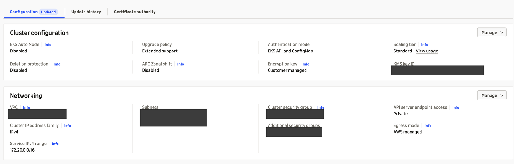
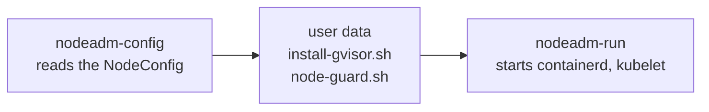

# 01 Cluster and images

**TL;DR** Check tools and quotas, create a private EKS cluster and its node groups as one CDK stack, check the nodes through the tunnel, then push three images to ECR.

## Pain point

An EKS cluster created with defaults leaves settings that are risky for sandboxes. With an IMDS hop limit of 2 or more on the node, pods can reach the node's instance credentials, and a public API endpoint can be tried from anywhere on the internet even though IAM authentication still applies, so company account security checks flag it (for example Security Hub control EKS.1). eksctl, which this repository used before, does not support creating a cluster with only the private endpoint enabled (eksctl docs). On the image side, TRL, vLLM, torch and transformers pin each other's version ranges, so if pip upgrades one of them, imports break.


*Takeaway: With these settings left in place, there is a way from the internet to the cluster API and from code in a pod to the node's credentials. The CDK stack enables only the private endpoint and sets the IMDS hop limit to 1, which closes both.*


## Why

- **The infrastructure is one CDK stack, and a rerun changes only what differs.** The stack uses only the EKS CloudFormation resources and applies no Kubernetes manifests, so it never overlaps with, or tangles the order of, the device plugin, RuntimeClasses and kata-deploy that the scripts from `04_install_gpu_stack.sh` onward install.
- **The API endpoint is private only, reached through a tunnel.**
- **Node preparation is part of the boot.** The per-runtime preparation lives in the launch template's user data, so a replaced node comes up in the same state.

**Before you start:** read the step table in [00 Overview](00_overview.md) and the local Python environment in [Getting started](../getting_started.md) first. The full list of the CDK stack's security defaults is in [Production 09 CDK](../production/09_cdk.md), and unfamiliar terms in the "Terms" box below and the [Glossary](../reference/glossary.md).

??? note "Terms (expand if a word is new to you)"
    - **AWS CDK, stack, synth**: a tool that defines AWS infrastructure in code (Python here) and deploys it through CloudFormation, the set of resources created and deleted together, and the step that turns the code into a CloudFormation template.
    - **Bootstrap**: the one-time task per account and Region that creates the S3 bucket and IAM roles CDK uses for deployments (stack `CDKToolkit`).
    - **cdk-nag**: an open source tool that checks CDK code against AWS best-practice rules. When a rule is broken on purpose, the reason is written down as an acknowledgement.
    - **Managed node group**: a node group whose EC2 Auto Scaling group EKS manages for you.
    - **IMDS, hop limit**: IMDS is the instance metadata service (the address `169.254.169.254` that hands out node credentials); the hop limit is how many network hops its response may cross. With 1, a pod cannot receive the response.
    - **Public, private endpoint**: the EKS API server address reachable from the internet, and the one reachable only inside the VPC.
    - **SSM Session Manager port forwarding, access instance**: a feature that links a local port on your PC to an address inside the VPC through an instance running the SSM agent, and the small instance used as that hop. It needs no inbound port and no public IP.
    - **Access entry**: the EKS resource that decides which permissions an IAM role has in an EKS cluster.
    - **NAT gateway**: the gateway that lets nodes in private subnets send outbound requests (image pulls and so on) to the internet.
    - **VPC CNI**: the network plugin that gives EKS pods VPC IPs. Here it also enforces NetworkPolicies.
    - **NodeConfig, nodeadm**: the settings document of an EKS AL2023 node, and the tool that applies it on every boot.
    - **User data, MIME multipart**: the script an instance runs on its first boot, and the format that puts several parts (a NodeConfig, shell scripts) into one user data document.
    - **containerd handler, shim**: the runtime name registered in containerd (`runsc`), and the small program that actually runs that runtime (`containerd-shim-runsc-v1`).
    - **Device plugin**: the component that advertises a node's GPUs as Kubernetes resources such as `nvidia.com/gpu`.
    - **ECR tag immutability**: an ECR setting that prevents an existing image tag from being overwritten by another image.
    - **iptables, conntrack**: Linux packet filter rules, and the feature that tracks connection state (new connection or reply).

## Preparation 1: `scripts/config.env`

Create the settings file.

```bash
cp scripts/config.env.example scripts/config.env
```

**What to look for:** the file `scripts/config.env` exists. With the defaults, `02_create_cluster.sh` creates scenario A.

Every script reads this file through `scripts/lib.sh`; if a required value is empty or contains `__SET_ME__`, `require_vars` prints `set <VAR> in scripts/config.env` and stops. `cdk/deploy.sh` reads it too, so scripts and CDK agree on instance types and pinned versions.

| Variable | Default | Meaning |
|---|---|---|
| `AWS_REGION` | `us-west-2` | the Region where every resource is created |
| `CLUSTER_NAME` | `gpu-sandbox` | the EKS cluster name, also used in the CDK stack name (`<CLUSTER_NAME>-cdk`), the kubectl context (`<CLUSTER_NAME>-tunnel`) and AMI names |
| `K8S_VERSION` | `1.36` | inside EKS standard support (until 2027-08-02) and the versions in the HyperPod EKS AMI release notes (the HyperPod prerequisites page still says up to 1.35) |
| `SCENARIO` | `A` | what `02_create_cluster.sh` builds (A, B1, B2, C). An option to `02_create_cluster.sh` (`--hyperpod` and so on) wins over it |
| `WITH_KATA_CPU`, `WITH_KATA_GPU` | `0`, `0` | `1` adds the Kata CPU node (`c8i.2xlarge`) and the Kata GPU node (`g4dn.metal`, needs `KATA_IOMMU_AMI_ID`) to any scenario ([03 Kata sandboxes](03_kata.md)) |
| `ADMIN_PRINCIPAL_ARN` | empty | IAM role or user ARNs (comma-separated) that get the cluster admin access entry. Empty: `cdk/deploy.sh` uses the role of your current session |
| `EKS_PUBLIC_ACCESS_CIDR` | none (commented out) | only if you accept a public endpoint: your workstation's single IPv4 address as `/32`. Other ranges are rejected when the settings are read |
| `ECR_REPO_PREFIX`, `IMAGE_TAG` | `gpu-sandbox`, `v1` | ECR repository prefix and image tag |
| `GVISOR_RELEASE` | `20261109.0` | the release installed on the gVisor nodes |
| `GVISOR_NODES` | `2` | number of gVisor nodes (one sandbox per node) |

If your role has a path (for example one created by IAM Identity Center), put the ARN from `aws iam get-role --role-name <role> --query Role.Arn --output text` into `ADMIN_PRINCIPAL_ARN`. Access entries do not accept STS session ARNs.

!!! note "config.env values win over command-line environment variables"
    `lib.sh` sources `config.env`, so a variable defined there (`IMAGE_TAG`, `GVISOR_NODES`, `SCENARIO` and so on) overrides `IMAGE_TAG=v2 scripts/...` on the command line. Edit config.env for those, and pass variables not in config.env (`HYPERPOD`, `ACTIVE_RUNTIME`, `ENABLE_EXPERIMENTAL_CLH_GPU`, `KATA_QEMU_REPLICAS` and others) on the command line.

## Preparation 2 (once): CDK and the Session Manager plugin

1. **Node.js and the CDK CLI.** Install Node.js 22 or 24 LTS, then the CDK CLI. The `aws-cdk-lib` 2.276.0 pinned in `cdk/requirements.txt` needs CLI 2.1148.1 or later.

    ```bash
    node --version            # expect v22.x or v24.x
    npm install -g aws-cdk
    cdk --version             # expect 2.1148.1 or later
    ```

    **What to look for:** `cdk --version` prints a version number.

2. **Session Manager plugin.** The AWS CLI plugin `cdk/tunnel.sh` uses; install it per the [AWS documentation](https://docs.aws.amazon.com/systems-manager/latest/userguide/session-manager-working-with-install-plugin.html) for your OS.

    ```bash
    session-manager-plugin --version
    ```

    **What to look for:** a version number (the AWS documentation asks for 1.2.764.0 or later).

3. **Python libraries.** Install them into the virtual environment from [Getting started](../getting_started.md). `cdk/cdk.json` calls `python3 app.py`, so run `02_create_cluster.sh` with this environment activated too.

    ```bash
    source .venv/bin/activate
    uv pip install -r cdk/requirements.txt    # or: pip install -r cdk/requirements.txt
    ```

    **What to look for:** `aws-cdk-lib`, `constructs` and `cdk-nag` install without errors.

4. **Bootstrap.** Once per account and Region, create the stack `CDKToolkit` (S3 bucket, ECR repository, IAM roles).

    ```bash
    source scripts/config.env
    cdk bootstrap "aws://$(aws sts get-caller-identity --query Account --output text)/$AWS_REGION"
    ```

    **What to look for:** in the CloudFormation console for `AWS_REGION`, the `CDKToolkit` stack shows `CREATE_COMPLETE` (or its existing state if it was already there).

    By CDK default the CloudFormation execution role gets `AdministratorAccess` (to narrow it, see the preparation section of [Production 09 CDK](../production/09_cdk.md)). The cleanup script (`08_cleanup.sh`) keeps `CDKToolkit` for the next deployment.

!!! warning "AWS steps on this page"
    The `02_create_cluster.sh` Outputs, tunnel output and duration below are from the author's scenario C (`--cpu-only`) run in a practice account (us-west-2) on 2026-11-14. In the practice account on 2026-11-18, the image build (`03_build_push_images.sh`, all three images) was also run, and the scenario A cluster was created in the capacity workaround order under "If it fails" below (created as B2, then updated to B1 and A). The other "What to look for" items, such as the scenario A node list, are expected output from the code and official documentation, so compare them with yours.

## Preflight: `01_check_prereqs.sh`

This read-only check prints the following, in order.

```bash
scripts/01_check_prereqs.sh
```

1. local tools (`aws`, `cdk`, `node`, `kubectl`, `helm`, `docker`, `python3`, `jq`, `session-manager-plugin`) and required variables (`AWS_REGION`, `CLUSTER_NAME`, `K8S_VERSION`)
2. the current AWS identity (`aws sts get-caller-identity`)
3. cdk, node, kubectl, helm and docker versions
4. the `Running On-Demand G and VT instances` quota (vCPUs)
5. the `Running On-Demand Standard (A, C, D, H, I, M, R, T, Z) instances` quota (vCPUs)
6. the `SupportedFeatures` of `KATA_CPU_INSTANCE_TYPE` (`c8i.2xlarge`), for the Kata CPU node
7. the AZs that offer the trainer, gVisor and Kata GPU instance types (`NOT OFFERED` if none)

**What to look for:** the G and VT quota is at least 16 for the minimal path (at least 112 for the full path), and the Standard quota is at least 6 for the minimal path (system nodes 4 plus the access instance 2; 14 for scenario C, up to 16 for the full path). Item 6 contains `nested-virtualization`, and item 7 has no `NOT OFFERED`. The last log line is `Done. Request quota increases before 02_create_cluster.sh if any value above is too low.`

Request increases for low quotas in the Service Quotas console (the vCPU math is in the prerequisites section of [00 Overview](00_overview.md)).

**If it fails:** for `missing tool` or `set ... in scripts/config.env`, see the "config and scripts" section of [Troubleshooting](../reference/troubleshooting.md).

## Create the cluster (CDK): `02_create_cluster.sh`

Run the one line that matches your scenario.

```bash
scripts/02_create_cluster.sh                 # scenario A: EC2 trainer + gVisor GPU nodes
scripts/02_create_cluster.sh --hyperpod      # scenario B1: gVisor GPU nodes, the trainer runs on HyperPod
scripts/02_create_cluster.sh --hyperpod-b2   # scenario B2: no EC2 GPU node groups (see 07)
scripts/02_create_cluster.sh --cpu-only      # scenario C: the c8i node only, no GPU (see 10)
```

`scripts/02_create_cluster.sh` sets the scenario from the option and calls `cdk/deploy.sh`, which proceeds as follows.

1. It reads `scripts/config.env`.
2. With `WITH_KATA_GPU=1`, it states the `g4dn.metal` cost and asks for the confirmation word `metal`.
3. It runs `cdk deploy <CLUSTER_NAME>-cdk --require-approval broadening`. During synth, cdk-nag (AwsSolutions rules) checks the template that the CDK app (`cdk/app.py`) builds, and any unacknowledged finding stops the deploy.
4. If a change broadens IAM roles or security groups (on a first deploy, the new roles and rules do), it lists the changes and asks `Do you wish to deploy these changes (y/n)?`.
5. CloudFormation creates the resources (20 to 30 minutes).

**What to look for:**

1. If `ADMIN_PRINCIPAL_ARN` is empty, a warning `using arn:aws:iam::<account>:role/<role>; if the role has a path, set ADMIN_PRINCIPAL_ARN from: ...` appears at the start. If your role has a path, answer `n` to the item 4 question, put the ARN from the `aws iam get-role` command in the warning into `ADMIN_PRINCIPAL_ARN`, and run it again.
2. In the list of IAM and security group changes, check that no inbound rule is open to `0.0.0.0/0`, then press `y`. The only inbound rule the stack creates is 443 from the access instance to the control plane.
3. At the end, `Outputs` lists `ClusterName`, `ClusterEndpoint`, `AccessInstanceId` and `EndpointPublicAccess = false`, followed by this guidance:

```text
Next:
  cdk/tunnel.sh                       # in a second terminal; keep it running
  kubectl get nodes -L gpusandbox/role
  then the in-cluster steps of the hands-on (04_install_gpu_stack.sh or kata/cpu_nodes.sh,
  05_setup_namespaces_auth.sh, 06_deploy_sandboxes.sh, ops/verify.sh, ...)
```

In the EKS console, the cluster's Networking tab must show API server endpoint access as `Private`.



*Scenario C in a practice account (2026-11-14, us-west-2; account and resource identifiers masked).*

**If it fails:**

- For a bootstrap error such as `Has the environment been bootstrapped?`, run item 4 of preparation 2.
- `ValidationFailed` is a new cdk-nag finding. Fix it using the rule ID and resource in the output; do not acknowledge it without a reason.
- For `ADMIN_PRINCIPAL_ARN must list IAM role or user ARNs, not sts assumed-role ARNs`, write the ARN yourself as `arn:aws:iam::<account>:role/<role>`.
- `Cloud assembly schema version mismatch` means the CLI is older than the library; upgrade it with item 1 of preparation 2.
- For vCPU limit errors, unsupported AZs or failed node group creation, see the "cluster and nodes" section of [Troubleshooting](../reference/troubleshooting.md).
- When a GPU node group cannot launch (`InsufficientInstanceCapacity`), CloudFormation waits about 30 minutes, then rolls back the whole initial create. In that case, create the cluster without GPU node groups first and add them with updates. A failed update rolls back only that update. The last line assumes `SCENARIO` in config.env is the default `A`.

    ```bash
    scripts/02_create_cluster.sh --hyperpod-b2                  # system nodes only, no GPU node groups
    CHANGE_SCENARIO=1 scripts/02_create_cluster.sh --hyperpod   # adds the gVisor nodes (B1)
    CHANGE_SCENARIO=1 scripts/02_create_cluster.sh              # adds the trainer (A)
    ```

    To check capacity, launch an instance and terminate it at once. An On-Demand Capacity Reservation request can report no capacity even when a launch succeeds. You can override the instance types per run in `scripts/config.env` (for example, `g6` when it has capacity).

### Open the tunnel (cdk/tunnel.sh)

Keep it running in a second terminal while you use kubectl or helm. It reads the endpoint and the access instance ID from the stack Outputs, creates and switches to the kubeconfig context `<CLUSTER_NAME>-tunnel` (server `https://127.0.0.1:8443`) and opens an SSM port forwarding session.

```bash
cdk/tunnel.sh
```

**What to look for:** the log line `kubectl context <CLUSTER_NAME>-tunnel -> 127.0.0.1:8443 -> <endpoint> (via i-...); Ctrl-C closes it`, followed by `Waiting for connections...`. The tunnel listens only on `127.0.0.1` of your workstation.

In the first terminal, list the nodes.

```bash
kubectl get nodes -L gpusandbox/role,node.kubernetes.io/instance-type
```

**What to look for:** for scenario A, a shape like the one below (an example; names and ages differ).

```text
NAME                                      STATUS   ROLES    AGE   VERSION   ROLE             INSTANCE-TYPE
ip-10-0-x-x.us-west-2.compute.internal    Ready    <none>   15m   v1.36.x   system           m6i.large
ip-10-0-x-x.us-west-2.compute.internal    Ready    <none>   15m   v1.36.x   system           m6i.large
ip-10-0-x-x.us-west-2.compute.internal    Ready    <none>   12m   v1.36.x   trainer          g5.2xlarge
ip-10-0-x-x.us-west-2.compute.internal    Ready    <none>   12m   v1.36.x   sandbox-gvisor   g5.xlarge
ip-10-0-x-x.us-west-2.compute.internal    Ready    <none>   12m   v1.36.x   sandbox-gvisor   g5.xlarge
```

B1 (`--hyperpod`) has no trainer line, B2 only the two system nodes, and C two system nodes and one `sandbox-kata` node (`c8i.2xlarge`, checked in the practice account).

**If it fails:**

- `TargetNotConnected` means the access instance's SSM agent has not registered yet; right after the deploy, wait a few minutes and retry.
- For `missing tool: session-manager-plugin`, do item 2 of preparation 2.
- For `stack <CLUSTER_NAME>-cdk has no outputs; run cdk/deploy.sh first`, finish the cluster creation (`02_create_cluster.sh`) first.
- For `Unable to connect to the server`, check that the tunnel is still running; after using another cluster, switch back with `kubectl config use-context <CLUSTER_NAME>-tunnel`.

### What the CDK stack creates

The stack code is in `cdk/gpusandbox_cdk/stack.py`; `cdk/tests` checks the security defaults below in the synthesized template. The authentication mode and VPC CNI settings already meet the HyperPod requirements, so scenario B needs no new cluster.

| Resource | Value | Reason |
|---|---|---|
| VPC | 2 AZs, 1 NAT gateway, public subnets (only the NAT, no automatic public IPs) and private subnets. The private subnets are tagged `kubernetes.io/role/internal-elb=1` and `karpenter.sh/discovery=<CLUSTER_NAME>` | nodes stay in private subnets. The HyperPod script ([07](07_hyperpod.md)) finds a subnet by the internal-elb tag, and the Production Karpenter EC2NodeClasses by the discovery tag |
| EKS version | `${K8S_VERSION}` (1.36) | inside EKS standard support |
| API endpoint | private only. Public only for a single /32 when `EKS_PUBLIC_ACCESS_CIDR` is set | keeps the cluster API off the internet |
| Authentication | mode `API_AND_CONFIG_MAP`, access entry (`AmazonEKSClusterAdminPolicy`) for `ADMIN_PRINCIPAL_ARN` | HyperPod requires `API` or `API_AND_CONFIG_MAP`. The CloudFormation execution role gets no cluster admin permissions |
| Secrets encryption, logs | Kubernetes secrets encrypted with a KMS key (automatic rotation), 5 control plane log types (api, audit, authenticator, controllerManager, scheduler, 30-day retention), VPC flow log (rejected traffic) | audits and incident investigation |
| Service CIDR | `172.20.0.0/16` | set explicitly because the Kata GPU node's NodeConfig must state it |
| Add-ons | `vpc-cni` (`{"enableNetworkPolicy": "true"}`), `kube-proxy`, `coredns`, `eks-pod-identity-agent` | eBPF-based NetworkPolicy, needs VPC CNI 1.21+ (HyperPod needs 1.18.3+). The self-managed copies of these components are not installed (`BootstrapSelfManagedAddons: false`) |
| Access instance | `t4g.nano`, private subnet, no inbound rules, HTTPS egress only, IMDSv2 | the hop for the SSM tunnel |
| `system` managed node group | `m6i.large` x2 (min 2, max 3), 50 GB, label `gpusandbox/role=system` | CoreDNS and add-ons |
| Launch templates of all nodes | IMDSv2 required, hop limit 1, encrypted gp3 root volume, instance tag `project=gpu-sandbox-on-aws` | pods cannot reach node credentials. The cleanup script (`08_cleanup.sh`) finds leftover instances by this tag |

### Node groups per scenario

| Scenario (`02_create_cluster.sh` option) | Node groups created |
|---|---|
| A (no option) | `system`, `trainer`, `sandbox-gvisor` |
| B1 (`--hyperpod`) | `system`, `sandbox-gvisor` |
| B2 (`--hyperpod-b2`) | `system` |
| C (`--cpu-only`) | `system`, `sandbox-kata-cpu` |
| Any scenario | `WITH_KATA_CPU=1` adds `sandbox-kata-cpu`; `WITH_KATA_GPU=1` with `KATA_IOMMU_AMI_ID` adds `sandbox-kata-gpu` |

!!! warning "Pass the same option when you rerun `02_create_cluster.sh`"
    Without the option, the `SCENARIO` from config.env (default `A`) is used, and a different scenario replaces node groups wholesale with no y/n question (from C to A, for example, the Kata CPU node group goes and GPU node groups appear). So `cdk/deploy.sh` stops if the scenario differs from the one recorded in the stack (the `Scenario` output). Keep the scenario in `SCENARIO` in config.env, and add `CHANGE_SCENARIO=1` only to switch on purpose.

### Trainer and gVisor node groups

| Item | `trainer` (scenario A only) | `sandbox-gvisor` (A, B1) |
|---|---|---|
| Instance | `${TRAINER_INSTANCE_TYPE}` (`g5.2xlarge`, one A10G) | `${GVISOR_INSTANCE_TYPE}` (`g5.xlarge`, one A10G) |
| AMI | `AmiType: AL2023_x86_64_NVIDIA` (EKS AL2023 NVIDIA AMI) | same |
| Size | desired 1, min 0, max 1, 200 GB | desired `${GVISOR_NODES}` (2), min 0, max 4, 100 GB |
| Network, IMDS | private subnets, IMDSv2 and hop limit 1 from the launch template | same |
| Labels | `gpusandbox/role=trainer`, `gpusandbox/device-plugin=cdi`, `nvidia.com/gpu.deploy.operands=false` | `gpusandbox/role=sandbox-gvisor`, `gpusandbox/device-plugin=cdi`, `nvidia.com/gpu.deploy.operands=false` |
| Taint | `gpusandbox/role=trainer:NoSchedule` | `gpusandbox/role=sandbox-gvisor:NoSchedule` |
| User data | none | MIME multipart: a NodeConfig (adds a `runsc` runtime handler to containerd), `install-gvisor.sh`, `node-guard.sh` |
| Container runtime | runc (trusted training code) | runsc (model-written code) |

`gpusandbox/device-plugin=cdi` selects the nodes for the device plugin that `04_install_gpu_stack.sh` installs, and `nvidia.com/gpu.deploy.operands=false` keeps the GPU Operator that the Kata GPU node step (`scripts/kata/gpu_nodes.sh`) installs away from these nodes.

`infra/eks/userdata.py` builds the gVisor node group's user data. The launch template sets no AMI, so EKS merges in the bootstrap the node needs to join (per the EKS launch template documentation). nodeadm merges the first part, the NodeConfig, on every boot, so the `runsc` handler survives reboots. The next command prints it locally, without AWS.

```bash
source scripts/config.env
python3 infra/eks/userdata.py gvisor-gpu "$GVISOR_RELEASE" | head -23
```

**What to look for:** run locally with the example settings, the first 23 lines are:

```text
MIME-Version: 1.0
Content-Type: multipart/mixed; boundary="GPUSANDBOX"

--GPUSANDBOX
Content-Type: application/node.eks.aws

apiVersion: node.eks.aws/v1alpha1
kind: NodeConfig
spec:
  containerd:
    config: |
      [plugins.'io.containerd.cri.v1.runtime'.containerd.runtimes.runsc]
        runtime_type = 'io.containerd.runsc.v1'
      [plugins.'io.containerd.cri.v1.runtime'.containerd.runtimes.runsc.options]
        TypeUrl = 'io.containerd.runsc.v1.options'
        ConfigPath = '/etc/containerd/runsc.toml'

--GPUSANDBOX
Content-Type: text/x-shellscript; charset="us-ascii"

#!/bin/bash
export GVISOR_RELEASE="20261109.0"
export GVISOR_NVPROXY="true"
```

The AMI ships containerd 2.3.7 with config schema v3, and the RuntimeClass that `04_install_gpu_stack.sh` registers uses `handler: runsc` to match the `runtimes.runsc` key here.

### Boot order of a gVisor node



*Takeaway: user data runs before containerd and kubelet, so `runsc` and the node guard are ready before the node accepts pods.*

### install-gvisor.sh

`infra/gvisor/install-gvisor.sh` installs a pinned gVisor release (shipped as tarballs only since release-20260831).

1. It builds the URL from the `GVISOR_RELEASE` exported at the top of the user data and `uname -m`: `https://storage.googleapis.com/gvisor/releases/release/${GVISOR_RELEASE}/${ARCH}`
2. It installs `bzip2` if missing and downloads `gvisor.tar.bz2` and `gvisor.tar.bz2.sha512`.
3. It checks integrity with `sha512sum -c gvisor.tar.bz2.sha512`; on failure, `set -euo pipefail` stops it right there.
4. It unpacks `runsc`, `containerd-shim-runsc-v1` and `gvisor-bin/` into `/usr/local/bin` (`gvisor-bin/` must stay next to `runsc`).
5. It writes `/etc/containerd/runsc.toml` (explained in [02 gVisor GPU sandboxes](02_gvisor.md)) and warns if the loaded NVIDIA driver is not in `runsc nvproxy list-supported-drivers`.

### node-guard.sh

An iptables rule set for sandbox nodes only (gVisor, Kata CPU, Kata GPU). The VPC CNI network policy agent always allows traffic between a pod and its own node's IP so that kubelet probes are never blocked (per the policy agent source). A default-deny NetworkPolicy alone therefore does not stop candidate code from reaching node-local daemons (kubelet, hostNetwork services, metrics ports). The script installs the rules below; you do not run them.

```bash
iptables -w -N GPUSANDBOX-GUARD 2>/dev/null || iptables -w -F GPUSANDBOX-GUARD
iptables -w -A GPUSANDBOX-GUARD -m conntrack --ctstate ESTABLISHED,RELATED -j RETURN
iptables -w -A GPUSANDBOX-GUARD -j DROP
iptables -w -C INPUT -i eni+ -j GPUSANDBOX-GUARD 2>/dev/null \
  || iptables -w -I INPUT 1 -i eni+ -j GPUSANDBOX-GUARD
```

New connections from the VPC CNI pod veth interfaces (prefix `eni`) to the node are dropped; replies to connections the node opened (kubelet probes) pass. The rules are registered as the systemd unit `gpusandbox-node-guard.service` (oneshot, `Before=kubelet.service`) and applied on every boot; the sandbox pod's readiness self-test and the pool verification (`scripts/ops/verify.sh`) check that traffic is actually blocked ([04 Deploy and verify sandbox pools](04_sandbox_pools.md)).

### Manifest rendering (render.py)

The scripts from `04_install_gpu_stack.sh` onward fill the templates under `k8s/` (`*.tpl`) with `scripts/render.py` and apply them. It substitutes `${VAR}` from environment variables and `KEY=VALUE` arguments and, unlike envsubst, fails on a missing variable, so a typo never yields a manifest with an empty image name or namespace. For the `$$` (literal `$`) and `@@include path@@` syntax, see the [Repository map](../reference/repository_map.md).

You can see the rendered result locally, without contacting AWS.

```bash
source scripts/config.env
python3 scripts/render.py k8s/base/routing.json.tpl ACTIVE_RUNTIME=gvisor ACTIVE_VERSION=v1 | head -3
```

**What to look for:** the start of the routing table that `05_setup_namespaces_auth.sh` creates.

```text
{
  "active": {"runtime": "gvisor", "version": "v1"},
  "pools": {
```

**If it fails:** `render: <template>: missing variable 'X'` means that variable is not in config.env, your shell or the arguments; see the "config and scripts" section of [Troubleshooting](../reference/troubleshooting.md).

## Build and push the images: `03_build_push_images.sh`

Build the three images and push them to ECR. For scenario B, use the second line from the start to save a tag.

```bash
scripts/03_build_push_images.sh
HYPERPOD=1 scripts/03_build_push_images.sh    # scenario B: the trainer image also gets hyperpodrun
```

The script logs in to ECR, creates missing repositories with `scanOnPush=true` and `--image-tag-mutability IMMUTABLE`, and builds and pushes each image with `docker buildx build --platform linux/amd64 ... --push`.

**What to look for:** it ends by printing these three lines; paste them into `scripts/config.env`.

```text
Add to scripts/config.env:
export SANDBOX_IMAGE_URI="<account>.dkr.ecr.<region>.amazonaws.com/gpu-sandbox/sandbox:v1"
export TRAINER_IMAGE_URI="<account>.dkr.ecr.<region>.amazonaws.com/gpu-sandbox/trainer:v1"
export CONTROL_IMAGE_URI="<account>.dkr.ecr.<region>.amazonaws.com/gpu-sandbox/control:v1"
```

**If it fails:** if the build is very slow or a push fails, see the "config and scripts" section of [Troubleshooting](../reference/troubleshooting.md).

!!! warning "Tags cannot be overwritten (IMMUTABLE)"
    Pushing a tag that already exists returns `ImageTagAlreadyExistsException`. This is deliberate: if one tag pointed at different images, you could not trace which sandbox version scored a reward. To rebuild, bump `IMAGE_TAG` in `scripts/config.env` (for example `v2`), rerun the script and update config.env with the three printed URIs.

The base images (PyTorch, vLLM) are large, so the build needs a lot of disk and time; on an arm64 workstation, build on an x86_64 host with 100+ GB of disk.

### What the three images contain

| Image | Dockerfile | Base image | Contents | Runs as |
|---|---|---|---|---|
| `sandbox` | `sandbox/Dockerfile` | `pytorch/pytorch:2.14.1-cuda12.6-cudnn9-runtime` | `gcc`, `libc6-dev` (to compile the Triton launcher), `tini` (PID 1), `gpusandbox[server]` (FastAPI, uvicorn, prometheus-client, PyJWT) | uid 10001 |
| `trainer` | `trainer/Dockerfile` | `vllm/vllm-openai:v0.33.0` | TRL 1.18.0, PEFT 0.21.3, `datasets>=4.7`, `gpusandbox[client]`, `rl/`, `hyperpod-elastic-agent` (with `HYPERPOD=1`) | base image default |
| `control` | `gateway/Dockerfile` | `public.ecr.aws/docker/library/python:3.14-slim` | `gpusandbox[gateway]`, the gateway and operator tools (`probe`, `parity`, `bench`, `sync-jwks` of `python -m gpusandbox.tools`), no torch and no GPU | uid 10001 |

gVisor and Kata share the sandbox image. It carries no credentials and no NVIDIA kernel driver, only the CUDA user-space libraries from the PyTorch wheel; gVisor uses the host driver through nvproxy, Kata the driver inside the guest VM. The CUDA 12.6 build supports the T4 (sm_75) used with Kata and runs on lower driver versions than a CUDA 13 build. The pod spec enforces `runAsNonRoot` and a read-only root filesystem; only `/work` and `/tmp` are writable emptyDirs.

### Version pinning in the trainer image

| Component | Version | Pinned by |
|---|---|---|
| vLLM | 0.33.0 | base image `vllm/vllm-openai:v0.33.0` |
| TRL | 1.18.0 | `ARG TRL_VERSION`; TRL allows `vllm>=0.23.0,<0.34.0` |
| torch | 2.14.0 | pinned by vLLM 0.33.0 |
| transformers | `>=5.16.1,<5.21` | pinned by vLLM 0.33.0 |
| PEFT | 0.21.3 | `ARG PEFT_VERSION` |

The Dockerfile writes the torch, transformers, vllm and triton versions from `pip freeze` to a constraints file and adds `-c /tmp/constraints.txt` to every later `pip install`, so pip cannot quietly upgrade torch or vLLM while installing TRL or PEFT. The final `python -c "import trl, peft, vllm, gpusandbox.rewards; ..."` checks import compatibility during the build.

The two images may differ in torch version (sandbox 2.14.1, trainer 2.14.0): they talk only through JSON over HTTP, and the reference kernel is timed with the sandbox's torch.

## How to verify

Read the sandbox repository's tags (read-only) to confirm the push.

```bash
source scripts/config.env
aws ecr describe-images --region "$AWS_REGION" --repository-name "$ECR_REPO_PREFIX/sandbox" \
  --query 'imageDetails[].imageTags' --output text
```

**What to look for:** the `IMAGE_TAG` value (default `v1`). Replace `sandbox` in the repository name with `trainer` and `control` to check the others.

!!! question "❓ Misconception: with only the private endpoint, you cannot use kubectl from your workstation"
    You can, through the `cdk/tunnel.sh` tunnel. kubectl connects to `127.0.0.1` but verifies the API server certificate against the real endpoint name (`--tls-server-name`), so TLS verification stays on. Traffic between nodes and the control plane still uses the private endpoint inside the VPC.

!!! question "❓ Misconception: once you pick the NVIDIA AMI type, the GPU is ready"
    The EKS AL2023 NVIDIA AMI (v20261107) includes the driver (580.178.04 by default), nvidia-container-toolkit 1.20.1 and containerd 2.3.7, but no device plugin. For the GPU to appear as the `nvidia.com/gpu` resource you need the device plugin that `04_install_gpu_stack.sh` installs, and to run it under gVisor you also need the `runsc` install on this page and the RuntimeClass that the same script registers.

## Time and cost

| Script | Expected duration | Billing |
|---|---|---|
| `01_check_prereqs.sh` | short (lookups only) | none |
| `02_create_cluster.sh` | 20 to 30 min (script guidance), about 20 min for scenario C in the practice account | EKS control plane 0.10 USD/hour, NAT gateway, `m6i.large` x2 (0.192), access instance `t4g.nano`, KMS key, logs, `g5.xlarge` x2 (2.012, A and B1), `g5.2xlarge` (1.212, A) |
| `03_build_push_images.sh` | depends on the build host and network | ECR storage, build host |

From `02_create_cluster.sh` on, compute alone costs about 3.42 USD per hour (scenario A, estimate, On-Demand list prices). If you pause, scale the GPU node groups to zero (keep `maxSize` at the stack's value).

```bash
source scripts/config.env
aws eks update-nodegroup-config --region "$AWS_REGION" --cluster-name "$CLUSTER_NAME" \
  --nodegroup-name sandbox-gvisor --scaling-config minSize=0,maxSize=4,desiredSize=0
aws eks update-nodegroup-config --region "$AWS_REGION" --cluster-name "$CLUSTER_NAME" \
  --nodegroup-name trainer --scaling-config minSize=0,maxSize=1,desiredSize=0
# resume later: the same commands with desiredSize=2 (sandbox-gvisor) and desiredSize=1 (trainer)
```

**What to look for:** each command returns JSON with `"status": "InProgress"` and `"type": "ConfigUpdate"`. After a few minutes, with the tunnel open, `kubectl get nodes -L gpusandbox/role` shows only the two system nodes. Without the tunnel, use `aws eks describe-nodegroup --region "$AWS_REGION" --cluster-name "$CLUSTER_NAME" --nodegroup-name sandbox-gvisor --query nodegroup.scalingConfig`. When you finish the hands-on, delete the whole stack with [99 Cleanup](99_cleanup.md).

!!! note "These values change outside the CDK stack"
    These commands bypass CloudFormation, so the node count then differs from the stack's desired value (sandbox-gvisor 2, trainer 1); set it back with the same command before rerunning `02_create_cluster.sh`. What CloudFormation does if you redeploy without setting it back was not checked.

## Next step

Keep the tunnel running and continue with `04_install_gpu_stack.sh` in [02 gVisor GPU sandboxes](02_gvisor.md).

??? note "References"
    | Topic | Link |
    |---|---|
    | EKS cluster API server endpoint (public, private, CIDR) | https://docs.aws.amazon.com/eks/latest/userguide/cluster-endpoint.html |
    | EKS managed node group launch templates (user data merge, hop limit) | https://docs.aws.amazon.com/eks/latest/userguide/launch-templates.html |
    | Getting started with the AWS CDK (CLI install) | https://docs.aws.amazon.com/cdk/v2/guide/getting-started.html |
    | Install the Session Manager plugin | https://docs.aws.amazon.com/systems-manager/latest/userguide/session-manager-working-with-install-plugin.html |
    | CDK stack (stack.py) | https://github.com/daekeun-ml/gpu-sandbox-on-aws/blob/main/cdk/gpusandbox_cdk/stack.py |

    All sources: [this page in All references](../reference/references.md#ref-handson-01-cluster-and-images)
