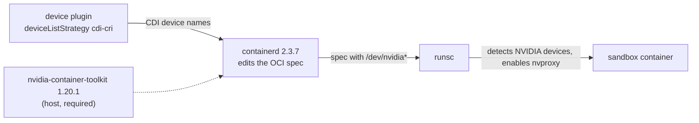
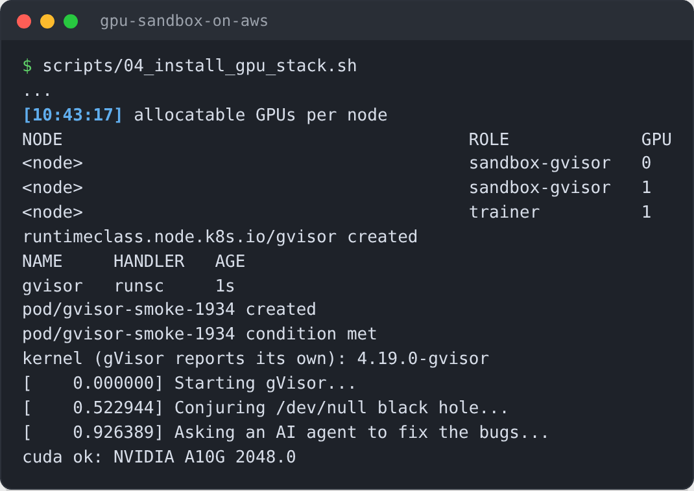

# 02 gVisor GPU sandboxes

Chapter [01](01_cluster_and_images.md) left the nodes `Ready`. Now check **whether a pod can compute on a GPU**. Use the gVisor nodes from A or B1 and the `SANDBOX_IMAGE_URI` you saved. Leave the tunnel open and run the [GPU setup script](#install-the-gpu-stack-and-gvisor-04_install_gpu_stacksh) in your work terminal.

In the [test pod output](#runtimeclass-and-smoke-pod), look for `Starting gVisor...` and then `cuda ok: NVIDIA A10G 2048.0`. The first line identifies the runtime. The last gives the GPU's name and the expected sum of 2048. Once you see both, continue to [grading pool deployment](04_sandbox_pools.md).

??? note "Terms (expand if a word is new to you)"
    - **gVisor Sentry**: a kernel running in user space that receives the container's syscalls instead of the host kernel.
    - **runsc**: gVisor's runtime binary. containerd calls it through a shim (`containerd-shim-runsc-v1`).
    - **nvproxy**: the gVisor feature that forwards to the host NVIDIA driver only the GPU ioctls on the allowlist for that driver version.
    - **ioctl**: the syscall a program uses to send commands to a device driver.
    - **Device plugin**: the component that advertises a node's GPUs as the `nvidia.com/gpu` resource and attaches devices to pods.
    - **CDI, `cdi-cri`**: CDI is a standard that describes the devices to put into a container by name; `cdi-cri` is the mode in which the device plugin passes those names to containerd through a CRI field.
    - **OCI spec**: the container execution specification (JSON) handed to the runtime. The device list goes into it too.
    - **Helm, DaemonSet**: Helm is the Kubernetes package manager; a DaemonSet runs one pod on every matching node.
    - **systrap**: the default way (platform) the Sentry intercepts syscalls. It works on regular VMs without `/dev/kvm`.
    - **GSP, open kernel module, proprietary kernel module**: GSP is a co-processor in recent NVIDIA GPUs; the open kernel module is the NVIDIA driver kernel module whose source NVIDIA publishes. The proprietary kernel module is the older kernel module whose source is not published.
    - **CDI hook**: a helper command listed in the CDI specification that the runtime runs while creating the container.

??? note "What the practice-account run covered"
    `04_install_gpu_stack.sh` was run in the practice account (`g5.xlarge`, [run record](../reference/sources.md#aws-run-record)). The smoke pod's `cuda ok: NVIDIA A10G 2048.0` line and the GPU count briefly showing `0` were seen in that run; the rest of the output is an example of the shape. Compare the "What to look for" items below with your actual output.

## Install the GPU stack and gVisor: `04_install_gpu_stack.sh`

One script installs the device plugin and prints the GPU count per node, then registers the `gvisor` RuntimeClass and runs one smoke pod on a gVisor node.

```bash
scripts/04_install_gpu_stack.sh
```

If the stack runs scenario B2 or C, there are no EC2 gVisor GPU nodes, so the script installs only the device plugin and ends with `scenario <B2 or C> has no EC2 gVisor GPU nodes: skipping the gvisor RuntimeClass and the smoke pod`.

<details class="note" markdown="1">
<summary>How the device plugin assigns a GPU</summary>

## NVIDIA device plugin (CDI mode)

The device plugin advertises `nvidia.com/gpu` and passes allocated devices to the runtime through CDI.

`04_install_gpu_stack.sh` works in this order. The script runs the `kubectl` command in step 2, so you do not run it yourself.

1. It adds the `nvdp` Helm repository, installs `nvdp/nvidia-device-plugin` with `--version "${NVIDIA_DEVICE_PLUGIN_VERSION}"` (default 0.20.1) into `kube-system`, and waits for the DaemonSet with `--wait`.
2. It sets the plugin's `--cdi-disable-hooks` flag with the command below and waits for the rollout. Chart v0.20.1 does not expose this flag as a value, so it goes in as an environment variable.

    ```bash
    kubectl -n kube-system set env ds/nvdp-nvidia-device-plugin CDI_DISABLE_HOOKS=disable-device-node-modification
    ```

??? note "Why the CDI hook is turned off"
    - nvidia-container-toolkit 1.20.1 on the AMI adds a `disable-device-node-modification` CDI hook, which reads `<rootfs>/proc/driver/nvidia/params`.
    - runsc runs CDI hooks in the gofer, before the container has a `/proc`, so the hook fails.
    - As a result every gVisor GPU pod ends in `StartError` with `OCI runtime start failed: starting container: reading mounts file: error unmarshaling mounts: unexpected end of JSON input`. The runsc debug log shows `error opening nvidia driver params file: openat proc/driver/nvidia/params: no such file or directory`.
    - The problem does not depend on the GPU model, so `g6` is affected too. A gVisor pod without a GPU on the same node ran fine.
    - runc pods (the trainer) lose only this hook. Without `CAP_MKNOD` they cannot create device nodes anyway.

**What to look for:**

- GPU 1 on every node (example shape; scenario B has no trainer line).
- Right after the plugin restarts, the gVisor node can briefly show `0`. The smoke pod requests one GPU and is placed once a node has its GPU registered again, so judge success by the final `cuda ok:` log.

```text
daemonset.apps/nvdp-nvidia-device-plugin env updated
daemon set "nvdp-nvidia-device-plugin" successfully rolled out
[hh:mm:ss] allocatable GPUs per node
NODE                                         ROLE             GPU
ip-192-168-x-x.us-west-2.compute.internal    trainer          1
ip-192-168-x-x.us-west-2.compute.internal    sandbox-gvisor   1
ip-192-168-x-x.us-west-2.compute.internal    sandbox-gvisor   1
```

**If it fails:** if the GPU column is empty or `<none>`, `nvidia.com/gpu` is not registered in that node's `status.allocatable`. Check in `kube-system` whether a device plugin pod was placed on that node and read its logs. The commands are in the "gVisor" section of [Troubleshooting](../reference/troubleshooting.md).

The settings in `infra/gpu/nvidia-device-plugin-values.yaml`:

| Setting | Value | Reason |
|---|---|---|
| `deviceListStrategy` | `cdi-cri` | passes CDI devices through the CRI `CDIDevices` field, the injection path gVisor documents |
| `nvidiaDriverRoot` | `/` | the EKS AL2023 NVIDIA AMI installs the driver at the host root |
| `nodeSelector` | `gpusandbox/device-plugin: cdi` | installs only on the EC2 trainer and gVisor nodes and the B2 HyperPod sandbox nodes |
| `affinity` | `{}` | the chart's default affinity requires NFD labels, so it is cleared |
| `tolerations` | `nvidia.com/gpu`, `gpusandbox/role` (Exists) | so the plugin also runs on nodes with the dedicated taints |

!!! note "Where the device plugin runs"
    This plugin runs only on nodes labelled `gpusandbox/device-plugin=cdi`: the EC2 trainer and gVisor nodes, and the B2 HyperPod sandbox instance group (`sandbox`). The Kata GPU node uses the GPU Operator's sandbox device plugin (`nvidia.com/pgpu`, [03 Kata sandboxes](03_kata.md)), and the HyperPod trainer nodes the plugin in the HyperPod Helm chart ([07 HyperPod scenario](07_hyperpod.md)).

### Why CDI



*Takeaway: runsc turns on nvproxy from the NVIDIA devices in the OCI spec alone, without a prestart hook, so the device plugin only has to hand the devices over through CDI.*

- **runsc and CDI**: per the gVisor documentation, runsc is fully CDI-compatible and configures the devices itself (skipping `nvidia-container-runtime-hook`), so no `nvidia-container-runtime` shim is needed, but the host still needs nvidia-container-toolkit.
- **What the AMI holds**: the EKS AL2023 NVIDIA AMI (v20261107) has the driver, nvidia-container-toolkit 1.20.1 and containerd 2.3.7 but no device plugin.
- **CDI enablement**: nodeadm enables CDI for kubelet 1.32 and later.

</details>

## RuntimeClass and smoke pod

Compare two parts of the output. `Starting gVisor...` comes from the runtime. The value `2048.0` is the sum of a 1,024-element vector of ones after multiplying each element by two.

An advertised GPU confirms device registration. `cuda ok:` confirms a CUDA calculation completed inside gVisor. If the first succeeds and the latter fails, check pod events.

Once the device plugin is installed, the same script registers the RuntimeClass and runs one smoke pod on a gVisor node. There is no separate command to run for this part.

The script first applies `k8s/runtimes/runtimeclass-gvisor.yaml`.

```yaml
apiVersion: node.k8s.io/v1
kind: RuntimeClass
metadata:
  name: gvisor
handler: runsc
scheduling:
  nodeSelector:
    gpusandbox/role: sandbox-gvisor
  tolerations:
    - key: gpusandbox/role
      operator: Equal
      value: sandbox-gvisor
      effect: NoSchedule
```

`handler: runsc` must equal the `runtimes.runsc` key of the NodeConfig in [01 Cluster and images](01_cluster_and_images.md). `scheduling` merges into the pod at admission (nodeSelectors intersect, tolerations are added), so a pod that only sets `runtimeClassName: gvisor` still lands on a gVisor node.

Next it starts one smoke pod in the `default` namespace (the sandbox image `SANDBOX_IMAGE_URI`, `nvidia.com/gpu: 1`, 2 CPUs, 8Gi of memory) that prints the three things below, waits up to 15 minutes for `Succeeded` (including the first pull of the large image) and shows the logs. An EXIT trap deletes the pod when the script ends, whether it succeeded or failed, and the delete output is not shown.

1. `uname -r`: the kernel version the Sentry reports (not the node's kernel)
2. `dmesg | head -3`: boot messages generated by gVisor (not the host kernel log)
3. the sum of `torch.ones(1024, device='cuda')` times 2 (2048), and the GPU name: evidence that a CUDA kernel ran through nvproxy

**What to look for:** output of this shape (example; the number in the pod name changes every time).

```text
runtimeclass.node.k8s.io/gvisor created
NAME     HANDLER   AGE
gvisor   runsc     0s
pod/gvisor-smoke-12345 created
pod/gvisor-smoke-12345 condition met
kernel (gVisor reports its own): 4.19.0-gvisor
[    0.000000] Starting gVisor...
[    0.xxxxxx] <a random boot message chosen by gVisor>
[    0.xxxxxx] <a random boot message chosen by gVisor>
cuda ok: NVIDIA A10G 2048.0
```



- The kernel string is the default `4.19.0-gvisor` in the gVisor source (`version.go`). If it differs from the node's kernel (`kubectl get node <node> -o jsonpath='{.status.nodeInfo.kernelVersion}'`), the pod is not using the host kernel directly. The RuntimeClass `gvisor` and the dmesg line `Starting gVisor...` below show that it is gVisor.
- The first dmesg line is `Starting gVisor...`; gVisor picks the following lines at random.

**If it fails:**

- **If the `cuda ok:` line is missing or you see `smoke pod did not succeed`**: read "nvproxy driver version matching" below first, then the "gVisor" section of [Troubleshooting](../reference/troubleshooting.md) (which also covers a pod stuck in `ContainerCreating`).
- **If the pod ends in `StartError` with `reading mounts file: error unmarshaling mounts: unexpected end of JSON input`**: the CDI hook setting above is missing. Check it with `kubectl -n kube-system get ds nvdp-nvidia-device-plugin -o yaml | grep -A1 CDI_DISABLE_HOOKS`.

## nvproxy driver version matching

The driver version must match nvproxy. For a failed CUDA initialization, see [gVisor troubleshooting](../reference/troubleshooting.md#gvisor).

??? note "nvproxy driver version matching"
    nvproxy works only when the driver version matches exactly, and gVisor sorts drivers into three classes.

    | Class | Meaning | runsc behavior |
    |---|---|---|
    | supported | versions gVisor has verified | runs normally |
    | unsupported | defined in the source but not verified | fails to start by default; with `--nvproxy-allow-unsupported-driver` it logs a warning and tries to run |
    | unknown | not defined in the source | always fails to start, even with the flag |

    This hands-on's combinations:

    | Driver | Where it comes from | gVisor release-20261109.0 | Result |
    |---|---|---|---|
    | 580.178.04 | default driver of the EKS AL2023 NVIDIA AMI v20261107; loaded as the proprietary module (GSP off) on `g5` and as the open module on `g6` | supported (since release-20260831.0) | works |
    | 595.91.07 | in the same AMI but for `g7` only; the driver of the HyperPod EKS AMI | unknown | container fails to start |

    Reward sandboxes run untrusted code, so this repository sticks to supported combinations instead of `--nvproxy-allow-unsupported-driver`.

### Common blockers

If the node temporarily reports zero GPUs, wait for the device plugin. If the smoke pod fails with a GPU available, check its events and [driver diagnostics](../reference/troubleshooting.md#gvisor).

<details class="note" markdown="1">
<summary>runsc configuration and driver support</summary>

## runsc.toml settings

The `/etc/containerd/runsc.toml` written by `install-gvisor.sh`:

```toml
# Read by containerd-shim-runsc-v1 through the runtime's ConfigPath option.
[runsc_config]
  # GPU support turns on automatically when NVIDIA devices are in the OCI spec; being explicit
  # documents intent and is harmless.
  nvproxy = "true"
  # compute,utility is the default. Do not add profiling, rdma or graphics for reward sandboxes.
  nvproxy-allowed-driver-capabilities = "compute,utility"
```

- runsc flags are set in this file, the one the NodeConfig `ConfigPath` points to, not in the RuntimeClass or the pod spec.
- `compute,utility` (the default) allows only CUDA compute (compute) and management interfaces such as nvidia-smi and NVML (utility). The gVisor documentation warns that each additional capability widens the host driver surface exposed to the sandbox, and running and timing kernels needs only these two.
- `g5.xlarge` is a virtual instance, so gVisor runs on systrap; the KVM platform is for bare metal only.

## Driver and verification scope of g5 nodes

The EKS AL2023 NVIDIA AMI (v20261107) loads the proprietary kernel module with GSP off on `g4dn`, `g5` and `g5g`, and the open kernel module 580.178.04 on `g6`. On a `g5.xlarge` node deployed on 2026-11-18, `/proc/driver/nvidia/version` showed `NVIDIA UNIX x86_64 Kernel Module  580.178.04` and `/proc/driver/nvidia/params` showed `EnableGpuFirmware: 0`.

The gVisor documentation describes nvproxy against NVIDIA's open driver and does not mention the proprietary driver. Regardless of the driver flavor, 580.178.04 is in the supported list of runsc `release-20261109.0` (`runsc nvproxy list-supported-drivers`).

| Instance | GPU | Kernel module loaded (AMI v20261107) | Driver flavor in the gVisor documentation | This repository | On-Demand (USD/hour) |
|---|---|---|---|---|---|
| `g5.xlarge` (default) | 1x A10G | proprietary 580.178.04, GSP off | not covered | verified in the practice account (2026-11-18) | 1.006 |
| `g6.xlarge` (alternative) | 1x L4 | open 580.178.04 | covered | not run | 0.8048 |
| `g4dn.xlarge` | 1x T4 | proprietary, GSP off | not covered | not tested (unverified) | 0.526 |

Prices are us-east-1 and us-west-2 list prices.

**What this repository verified** (2026-11-18, us-west-2, practice account, `g5.xlarge` with the proprietary, GSP-off module):

- The gVisor smoke test printed `cuda ok: NVIDIA A10G 2048.0`.
- `ops/verify.sh gvisor v1` passed: 6 golden verdicts PASS (including `vector_add_triton` and `relu_bias_triton`), 4 egress targets blocked, and the NetworkPolicy blocked connections from the `default` namespace.
- A 5-step GRPO run with the trainer on `g5.2xlarge` finished.

This combination was verified by this repository in a practice account, so after changing the instance type, driver, AMI or gVisor version, re-run the `04_install_gpu_stack.sh` smoke test and `scripts/ops/verify.sh`.

If the default pool (`sandbox-gvisor-v1`, 2 replicas) holds the GPUs of both nodes, the smoke pod cannot get a GPU. The script then stops before it starts the smoke pod, with `every GPU on the sandbox-gvisor nodes is in use` and the command to scale the pool down.

1. Free one GPU with `kubectl -n sandbox scale deployment/sandbox-gvisor-v1 --replicas=1` and run it again.
2. Once you see `cuda ok:`, bring the pool back to 2 with `scripts/06_deploy_sandboxes.sh gvisor v1` and run `verify.sh`.

`g6` is a supported alternative. It loads the open driver, which the gVisor documentation covers, and it costs less (`g6.xlarge` 0.8048, `g6.2xlarge` 0.9776). To use it, change `GVISOR_INSTANCE_TYPE` and `TRAINER_INSTANCE_TYPE` (`HYPERPOD_*` for HyperPod) in `scripts/config.env`.

!!! question "❓ Misconception: gVisor does not support T4"
    The GPU list in the gVisor documentation includes T4, A100/A10G, L4 and H100, and says other GPUs of the same architectures will likely work. T4 (`g4dn`) has the same driver condition as `g5` (proprietary, GSP off), so the driver flavor is not a reason to exclude it. It has not been tested under gVisor in this repository, though, so it stays unverified. T4 is the Kata QEMU GPU on `g4dn.metal`.

!!! question "❓ Misconception: the gVisor sandbox image needs the NVIDIA driver"
    The kernel driver lives on the host and the container uses it through nvproxy, so the image only needs the CUDA user-space libraries (included in the PyTorch wheel). The GPU is the host's real A10G, not a virtual GPU.

## Isolation strength and operating rules

Despite the nvproxy ioctl allowlist, the gVisor documentation states that it is much less effective at mitigating vulnerabilities within the NVIDIA driver itself. Things like DMA buffers are not validated. So this setup treats the gVisor + GPU boundary as weaker than a VM boundary (Kata).

- **Do not share GPUs.** The GKE Sandbox documentation also advises against GPU time-sharing in sandbox pods, and this repository runs one A10G per node, one sandbox pod per GPU and one evaluation per pod at a time (503 when busy).
- **Open the minimum driver capabilities.** The `compute,utility` setting above.
- **Consider Kata when you need a stronger boundary.** See GPU passthrough in [03 Kata sandboxes](03_kata.md) or [02 Isolation runtimes](../concepts/02_isolation_runtimes.md).

!!! note "EKS isolated pods (Nitro Sandboxes)"
    EKS isolated pods, launched on 2026-11-09 (`runtimeClassName: isolated-sandbox` and others, Kubernetes 1.36+), do not support GPU or device passthrough at launch, so treat them as a CPU-only managed alternative.

</details>

## Scope and limits

- On AWS only `g5` (A10G, the proprietary GSP-off module the gVisor documentation does not cover) has been run. The smoke test, `ops/verify.sh` and the 5-step training used `g5.xlarge` sandboxes; the benchmark on another cluster (`ops/bench.sh`, [08](08_benchmark.md)) used a gVisor pool on `g5.2xlarge`. `g6` and T4 have not been run with gVisor.
- The kernel string and dmesg lines can change between gVisor releases, so the test is not the value but whether the kernel differs from the node's and the first dmesg line is `Starting gVisor...`.

## Time and cost

| Step | Expected duration | Newly billed resources |
|---|---|---|
| `04_install_gpu_stack.sh`: device plugin | Helm `--wait` (until the DaemonSet is ready), then the rollout wait after the CDI hook setting | none |
| `04_install_gpu_stack.sh`: RuntimeClass and smoke pod | smoke pod timeout 15 min (including the first image pull) | none |

The two gVisor nodes have been billing since `02_create_cluster.sh` at about 2.01 USD per hour (2 x 1.006, On-Demand list price), so scale them to zero if there is a gap before the next step.

```bash
source scripts/config.env
aws eks update-nodegroup-config --region "$AWS_REGION" --cluster-name "$CLUSTER_NAME" \
  --nodegroup-name sandbox-gvisor --scaling-config minSize=0,maxSize=4,desiredSize=0
```

**What to look for:**

- The command returns JSON with `"type": "ConfigUpdate"`.
- After a few minutes, `kubectl get nodes -l gpusandbox/role=sandbox-gvisor` (needs the tunnel) lists no nodes.

When you continue, run it with `desiredSize=2` (why this value lives outside the stack: "Time and cost" in [01 Cluster and images](01_cluster_and_images.md)). When you finish the hands-on, run [99 Cleanup](99_cleanup.md).

## Next step

To compare with Kata, continue with [03 Kata sandboxes (CLH, QEMU)](03_kata.md); for the gVisor-only minimal path, go to [04 Deploy and verify sandbox pools](04_sandbox_pools.md).

??? note "References"
    | Topic | Link |
    |---|---|
    | Accelerated computing instance types (g5, g6, g4dn) | https://docs.aws.amazon.com/ec2/latest/instancetypes/ac.html |
    | gVisor GPU support (nvproxy, driver policy, CDI) | https://gvisor.dev/docs/user_guide/gpu/ |
    | Kubernetes RuntimeClass | https://kubernetes.io/docs/concepts/containers/runtime-class/ |
    | NVIDIA k8s-device-plugin | https://github.com/NVIDIA/k8s-device-plugin |
    | GPU stack and gVisor install script (04_install_gpu_stack.sh) | https://github.com/daekeun-ml/gpu-sandbox-on-aws/blob/main/scripts/04_install_gpu_stack.sh |

    [Selected references on this topic](../reference/references.md#ref-handson-02-gvisor)
