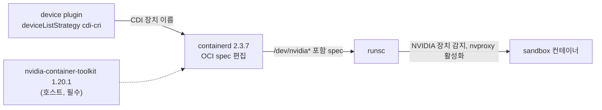
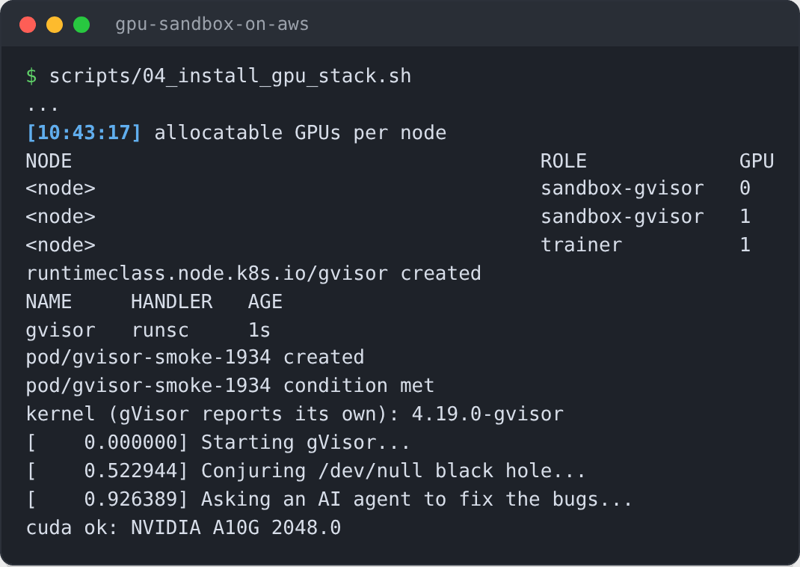

# 02 gVisor GPU 샌드박스

[01편](01_cluster_and_images.md)에서 노드가 `Ready`였다면 이번에는 **pod 안에서 GPU 계산이 되는지** 확인합니다. A와 B1의 gVisor 노드와 `SANDBOX_IMAGE_URI`를 사용합니다. 터널은 열어 두고 작업 터미널에서 [GPU 설치 스크립트](#gpu-스택과-gvisor-설치-04_install_gpu_stacksh)를 실행하세요.

[시험용 pod의 출력](#runtimeclass와-smoke-pod)에서 `Starting gVisor...`와 `cuda ok: NVIDIA A10G 2048.0`을 차례로 찾으세요. 첫 줄은 어떤 런타임이 코드를 실행했는지, 마지막 줄은 GPU에서 계산한 합이 기대값 2048과 맞는지 보여 줍니다. 둘을 확인했으면 [채점 pool 배포](04_sandbox_pools.md)로 넘어가세요.

??? note "용어 (처음 보는 단어가 있으면 펼치세요)"
    - **gVisor Sentry**: 컨테이너의 syscall을 host 커널 대신 처리하는, 사용자 공간에서 실행되는 커널입니다.
    - **runsc**: gVisor의 런타임 실행 파일입니다. containerd는 shim(`containerd-shim-runsc-v1`)을 통해 runsc를 실행합니다.
    - **nvproxy**: GPU ioctl 중 드라이버 버전별 허용 목록에 있는 것만 host NVIDIA 드라이버로 전달하는 gVisor 기능입니다.
    - **ioctl**: 프로그램이 장치 드라이버에 명령을 보내는 syscall입니다.
    - **device plugin**: 노드의 GPU를 `nvidia.com/gpu` 리소스로 등록하고, pod에 장치를 할당하는 구성 요소입니다.
    - **CDI, `cdi-cri`**: CDI는 컨테이너에 넣을 장치를 이름으로 기술하는 표준이고, `cdi-cri`는 device plugin이 그 이름을 CRI 필드로 containerd에 전달하는 방식입니다.
    - **OCI spec**: 런타임에 전달하는 컨테이너 실행 명세(JSON)입니다. 장치 목록도 여기에 들어갑니다.
    - **Helm, DaemonSet**: Helm은 Kubernetes 패키지 관리자이고, DaemonSet은 조건에 맞는 노드마다 pod를 하나씩 실행하는 리소스입니다.
    - **systrap**: Sentry가 syscall을 가로채는 기본 방식(플랫폼)으로, `/dev/kvm` 없이 일반 VM에서 동작합니다.
    - **GSP, open 커널 모듈, proprietary 커널 모듈**: GSP는 최신 NVIDIA GPU에 들어 있는 보조 프로세서이고, open 커널 모듈은 NVIDIA가 소스를 공개한 드라이버 커널 모듈입니다. proprietary 커널 모듈은 소스를 공개하지 않은 기존 커널 모듈입니다.
    - **CDI hook**: CDI 명세에 들어 있어 컨테이너를 만들 때 런타임이 실행하는 보조 명령입니다.

??? note "실습 계정에서 확인한 범위"
    `04_install_gpu_stack.sh`는 실습 계정에서 실행했습니다(`g5.xlarge`, [실행 기록](../reference/sources.md#aws-실행-기록)). smoke pod의 `cuda ok: NVIDIA A10G 2048.0` 줄과 GPU 수가 잠시 `0`으로 보이는 현상은 그 실행에서 확인한 것이고, 나머지 출력은 형태를 보여 주는 예시입니다. 아래 "확인할 것"을 실제 출력과 비교하세요.

## GPU 스택과 gVisor 설치: `04_install_gpu_stack.sh`

스크립트 하나가 device plugin을 설치해 노드별 GPU 수를 출력하고, 이어서 `gvisor` RuntimeClass를 등록한 뒤 gVisor 노드에서 smoke pod 하나를 실행합니다.

```bash
scripts/04_install_gpu_stack.sh
```

**확인할 것**　A 또는 B1에서 `cuda ok: NVIDIA A10G 2048.0`이 나오면 gVisor에서 CUDA 연산을 마친 것입니다. 출력이 다르면 [smoke pod 결과](#runtimeclass와-smoke-pod)를 확인하세요.

스택의 시나리오가 B2나 C라면 EC2 gVisor GPU 노드가 없으므로, 스크립트는 device plugin만 설치하고 `scenario <B2 또는 C> has no EC2 gVisor GPU nodes: skipping the gvisor RuntimeClass and the smoke pod`를 출력한 뒤 끝납니다.

<details class="note" markdown="1">
<summary>device plugin이 GPU를 할당하는 과정</summary>

## NVIDIA device plugin (CDI 모드)

device plugin은 노드의 GPU를 `nvidia.com/gpu`로 등록하고 할당한 GPU를 CDI로 런타임에 전달합니다. gVisor와 CDI의 관계는 [런타임 비교](../concepts/02_isolation_runtimes.md)에서 볼 수 있습니다.

`04_install_gpu_stack.sh`는 다음 순서로 동작합니다. 2번의 `kubectl` 명령은 스크립트가 실행하므로 직접 실행하지 않습니다.

1. `nvdp` Helm 리포지토리를 추가해 `nvdp/nvidia-device-plugin`을 `--version "${NVIDIA_DEVICE_PLUGIN_VERSION}"`(기본 0.20.1)으로 `kube-system`에 설치하고, `--wait`로 DaemonSet이 준비될 때까지 기다립니다.
2. 아래 명령으로 plugin의 `--cdi-disable-hooks` 플래그를 설정하고 rollout이 끝날 때까지 기다립니다. 차트 v0.20.1은 이 플래그를 value로 제공하지 않아서 환경변수로 넣습니다.

    ```bash
    kubectl -n kube-system set env ds/nvdp-nvidia-device-plugin CDI_DISABLE_HOOKS=disable-device-node-modification
    ```

??? note "CDI hook을 끄는 이유"
    - AMI의 nvidia-container-toolkit 1.20.1은 `disable-device-node-modification` CDI hook을 추가하고, 이 hook은 `<rootfs>/proc/driver/nvidia/params`를 읽습니다.
    - runsc는 CDI hook을 gofer에서, 컨테이너에 `/proc`이 생기기 전에 실행합니다. 그래서 hook이 실패합니다.
    - 그 결과 gVisor GPU pod는 모두 `StartError`로 끝나고, 메시지는 `OCI runtime start failed: starting container: reading mounts file: error unmarshaling mounts: unexpected end of JSON input`입니다. runsc debug 로그에는 `error opening nvidia driver params file: openat proc/driver/nvidia/params: no such file or directory`가 남습니다.
    - GPU 종류와 무관한 문제라 `g6`도 같은 영향을 받습니다. 같은 노드에서 GPU를 쓰지 않는 gVisor pod는 정상으로 실행됐습니다.
    - runc pod(trainer)는 이 hook 하나만 빠집니다. runc pod는 `CAP_MKNOD`가 없으면 어차피 장치 노드를 만들 수 없습니다.

**확인할 것:**

- 노드마다 GPU가 1이어야 합니다(예시 형태, 시나리오 B에서는 trainer 줄이 없음).
- plugin이 재시작된 직후에는 gVisor 노드의 GPU가 잠시 `0`으로 보일 수 있습니다. GPU 1개를 요청하는 smoke pod는 GPU가 다시 등록된 노드에 배치되니, 성공 여부는 마지막의 `cuda ok:` 로그로 판단하세요.

```text
daemonset.apps/nvdp-nvidia-device-plugin env updated
daemon set "nvdp-nvidia-device-plugin" successfully rolled out
[hh:mm:ss] allocatable GPUs per node
NODE                                         ROLE             GPU
ip-192-168-x-x.us-west-2.compute.internal    trainer          1
ip-192-168-x-x.us-west-2.compute.internal    sandbox-gvisor   1
ip-192-168-x-x.us-west-2.compute.internal    sandbox-gvisor   1
```

**문제가 생기면:** GPU 칸이 비었거나 `<none>`이면 그 노드의 `status.allocatable`에 `nvidia.com/gpu`가 등록되지 않은 것입니다. `kube-system`에서 device plugin pod가 그 노드에 배치됐는지와 로그를 확인하세요. 확인 명령은 [문제 해결](../reference/troubleshooting.md)의 "gVisor" 항목에 있습니다.

`infra/gpu/nvidia-device-plugin-values.yaml`의 설정입니다.

| 설정 | 값 | 이유 |
|---|---|---|
| `deviceListStrategy` | `cdi-cri` | CRI의 `CDIDevices` 필드로 CDI 장치를 전달. gVisor가 문서화한 주입 경로 |
| `nvidiaDriverRoot` | `/` | EKS AL2023 NVIDIA AMI는 드라이버를 호스트 루트에 설치 |
| `nodeSelector` | `gpusandbox/device-plugin: cdi` | EC2 trainer와 gVisor 노드, B2 HyperPod 샌드박스 노드에만 설치 |
| `affinity` | `{}` | 차트 기본 affinity는 NFD label을 요구하므로 비움 |
| `tolerations` | `nvidia.com/gpu`, `gpusandbox/role` (Exists) | 전용 taint가 있는 노드에도 배치되도록 |

!!! note "device plugin이 실행되는 노드"
    이 plugin은 `gpusandbox/device-plugin=cdi` label이 붙은 노드에서만 실행됩니다. EC2 trainer와 gVisor 노드, B2의 HyperPod 샌드박스 인스턴스 그룹(`sandbox`)이 여기에 해당합니다. Kata GPU 노드는 GPU Operator의 sandbox device plugin(`nvidia.com/pgpu`, [03 Kata 샌드박스](03_kata.md))을, HyperPod trainer 노드는 HyperPod Helm 차트의 plugin([07 HyperPod 시나리오](07_hyperpod.md))을 씁니다.

### CDI를 쓰는 이유



*그림 요약: runsc는 prestart hook 없이 OCI spec에 들어온 NVIDIA 장치만 보고 nvproxy를 켜므로, device plugin이 CDI로 장치를 컨테이너에 연결하기만 하면 됩니다.*

- **runsc와 CDI**: gVisor 문서에 따르면 runsc는 CDI와 완전히 호환되고 장치를 직접 구성합니다(`nvidia-container-runtime-hook`을 사용하지 않음). 그래서 `nvidia-container-runtime` shim은 필요 없지만, 호스트에 nvidia-container-toolkit은 설치되어 있어야 합니다.
- **AMI에 든 것**: EKS AL2023 NVIDIA AMI(v20261107)에는 드라이버, nvidia-container-toolkit 1.20.1, containerd 2.3.7이 들어 있고 device plugin은 없습니다.
- **CDI 활성화**: kubelet 1.32 이상에서는 nodeadm이 CDI를 활성화합니다.

</details>

## RuntimeClass와 smoke pod

출력 두 곳을 대조하세요. `Starting gVisor...`는 런타임의 시작 메시지이고 `2048.0`은 길이 1024인 벡터의 각 원소 1에 2를 곱해 더한 값입니다.

노드에 GPU가 표시되면 device plugin이 장치를 등록한 것입니다. `cuda ok:`는 한 단계 더 나아가 gVisor pod 안에서 CUDA 계산이 실행됐다는 뜻입니다. GPU 수는 보이지만 계산이 실패하면 pod 이벤트에서 런타임이나 드라이버 오류를 확인하세요.

device plugin 설치가 끝나면 같은 스크립트가 RuntimeClass를 등록하고 gVisor 노드에서 smoke pod 하나를 실행합니다. 이 부분을 위해 따로 실행할 명령은 없습니다.

스크립트는 먼저 `k8s/runtimes/runtimeclass-gvisor.yaml`을 적용합니다.

```yaml
apiVersion: node.k8s.io/v1
kind: RuntimeClass
metadata:
  name: gvisor
handler: runsc
scheduling:
  nodeSelector:
    gpusandbox/role: sandbox-gvisor
  tolerations:
    - key: gpusandbox/role
      operator: Equal
      value: sandbox-gvisor
      effect: NoSchedule
```

`handler: runsc`는 [01 클러스터와 이미지](01_cluster_and_images.md)의 NodeConfig에 있는 `runtimes.runsc` 키와 같아야 합니다. `scheduling` 설정은 admission 단계에서 pod 스펙에 병합되므로(nodeSelector는 교집합, toleration은 합집합), `runtimeClassName: gvisor`만 지정한 pod도 gVisor 노드에 배치됩니다.

그다음 `default` 네임스페이스에 smoke pod 하나(샌드박스 이미지 `SANDBOX_IMAGE_URI`, `nvidia.com/gpu: 1`, CPU 2, 메모리 8Gi)를 실행해 아래 세 가지를 출력합니다. 스크립트는 pod가 `Succeeded`가 될 때까지 최대 15분(큰 이미지의 첫 pull 포함) 기다린 뒤 로그를 출력합니다. pod는 스크립트가 끝날 때 성공, 실패와 관계없이 EXIT trap이 지우고, 삭제 출력은 표시하지 않습니다.

1. `uname -r`: Sentry가 보고하는 커널 버전(노드 커널이 아님)
2. `dmesg | head -3`: gVisor가 만든 부팅 메시지(호스트 커널 로그가 아님)
3. `torch.ones(1024, device='cuda')`에 2를 곱해 더한 값(2048)과 GPU 이름: nvproxy를 거쳐 CUDA 커널이 실행됐다는 증거

**확인할 것:** 아래와 같은 형태로 나옵니다(예시, pod 이름의 숫자는 매번 다름).

```text
runtimeclass.node.k8s.io/gvisor created
NAME     HANDLER   AGE
gvisor   runsc     0s
pod/gvisor-smoke-12345 created
pod/gvisor-smoke-12345 condition met
kernel (gVisor reports its own): 4.19.0-gvisor
[    0.000000] Starting gVisor...
[    0.xxxxxx] <gVisor가 고르는 임의의 부팅 메시지>
[    0.xxxxxx] <gVisor가 고르는 임의의 부팅 메시지>
cuda ok: NVIDIA A10G 2048.0
```



- 커널 문자열은 gVisor 소스(`version.go`)의 기본값 `4.19.0-gvisor`입니다. 노드의 커널(`kubectl get node <node> -o jsonpath='{.status.nodeInfo.kernelVersion}'`)과 다르면 pod가 호스트 커널을 직접 쓰지 않는다는 뜻입니다. gVisor인지는 RuntimeClass `gvisor`와 아래 dmesg의 `Starting gVisor...`로 확인합니다.
- dmesg의 첫 줄은 `Starting gVisor...`이고, 이어지는 줄은 gVisor가 임의로 선택한 메시지입니다.

**문제가 생기면:**

- **`cuda ok:` 줄이 없거나 `smoke pod did not succeed`가 나오면**: 먼저 아래 "nvproxy의 드라이버 버전 매칭" 절을 보고, 그다음 [문제 해결](../reference/troubleshooting.md)의 "gVisor" 항목(`ContainerCreating`에 머무는 경우 포함)을 확인하세요.
- **pod가 `StartError`로 끝나고 `reading mounts file: error unmarshaling mounts: unexpected end of JSON input`가 보이면**: 위 CDI hook 설정이 빠진 것입니다. `kubectl -n kube-system get ds nvdp-nvidia-device-plugin -o yaml | grep -A1 CDI_DISABLE_HOOKS`로 확인하세요.

## nvproxy의 드라이버 버전 매칭

nvproxy는 노드 드라이버의 버전과 정확히 맞아야 합니다. CUDA 초기화에 실패하면 [gVisor 진단](../reference/troubleshooting.md#gvisor)에서 지원 버전을 확인하세요.

??? note "nvproxy의 드라이버 버전 매칭"
    nvproxy는 드라이버 버전이 정확히 일치해야 동작하고, gVisor는 드라이버를 세 부류로 나눕니다.

    | 부류 | 의미 | runsc 동작 |
    |---|---|---|
    | supported | gVisor가 검증한 버전 | 정상 실행 |
    | unsupported | 소스에 정의돼 있지만 검증되지 않은 버전 | 기본적으로 시작 실패, `--nvproxy-allow-unsupported-driver`를 주면 경고를 남기고 실행 시도 |
    | unknown | 소스에 정의되지 않은 버전 | 플래그를 줘도 항상 시작 실패 |

    이 핸즈온의 조합입니다.

    | 드라이버 | 포함된 곳 | gVisor release-20261109.0 | 결과 |
    |---|---|---|---|
    | 580.178.04 | EKS AL2023 NVIDIA AMI v20261107의 기본 드라이버. `g5`에서는 proprietary 모듈(GSP off), `g6`에서는 open 모듈로 로드 | supported (release-20260831.0부터) | 정상 |
    | 595.91.07 | 같은 AMI에 있지만 `g7` 전용, HyperPod EKS AMI의 드라이버 | unknown | 컨테이너 시작 실패 |

    reward 샌드박스는 신뢰할 수 없는 코드를 실행하므로, 이 저장소는 `--nvproxy-allow-unsupported-driver`를 쓰지 않고 지원되는 드라이버 조합만 씁니다.

### 자주 막히는 지점

- GPU가 `0`이면 device plugin이 준비될 때까지 기다렸다가 노드의 GPU 할당 가능 수량을 다시 확인하세요.
- GPU가 보이는데 smoke pod가 시작되지 않으면 스크립트 마지막에 출력된 pod 이벤트를 보세요. `nvproxy`가 드라이버 버전을 인식하지 못하면 [노드에서 드라이버 확인](../reference/troubleshooting.md#노드에서-직접-확인하기) 절차로 실제 설치된 버전을 비교하세요.

<details class="note" markdown="1">
<summary>runsc 설정과 드라이버 지원 범위</summary>

## runsc.toml 설정

`install-gvisor.sh`가 작성하는 `/etc/containerd/runsc.toml`입니다.

```toml
# Read by containerd-shim-runsc-v1 through the runtime's ConfigPath option.
[runsc_config]
  # GPU support turns on automatically when NVIDIA devices are in the OCI spec; being explicit
  # documents intent and is harmless.
  nvproxy = "true"
  # compute,utility is the default. Do not add profiling, rdma or graphics for reward sandboxes.
  nvproxy-allowed-driver-capabilities = "compute,utility"
```

- runsc 플래그는 RuntimeClass나 pod 스펙이 아니라, NodeConfig의 `ConfigPath`가 가리키는 이 파일에서 설정합니다.
- `compute,utility`(기본값)는 CUDA 연산(compute)과 nvidia-smi, NVML 같은 관리 인터페이스(utility)만 허용합니다. gVisor 문서는 허용 기능을 늘릴수록 샌드박스에 노출되는 호스트 드라이버의 공격 표면이 넓어진다고 경고합니다. 커널을 실행하고 시간을 측정하는 데는 이 두 가지로 충분합니다.
- `g5.xlarge`는 가상 인스턴스라 gVisor는 systrap 플랫폼으로 실행되고, KVM platform은 bare metal에서만 씁니다.

## g5 노드의 드라이버와 검증 범위

EKS AL2023 NVIDIA AMI(v20261107)는 `g4dn`, `g5`, `g5g`에서 GSP를 끈 proprietary 커널 모듈을 로드하고, `g6`에서는 open 커널 모듈 580.178.04를 로드합니다. 2026-11-18에 배포한 `g5.xlarge` 노드에서는 `/proc/driver/nvidia/version`이 `NVIDIA UNIX x86_64 Kernel Module  580.178.04`, `/proc/driver/nvidia/params`가 `EnableGpuFirmware: 0`이었습니다.

gVisor 문서는 nvproxy를 NVIDIA open 드라이버 기준으로 설명하고, proprietary 드라이버는 언급하지 않습니다. 드라이버 종류와 관계없이 580.178.04는 runsc `release-20261109.0`의 지원 목록(`runsc nvproxy list-supported-drivers`)에 있습니다.

| 인스턴스 | GPU | 로드되는 커널 모듈 (AMI v20261107) | gVisor 문서의 드라이버 기준 | 이 저장소 | 온디맨드 요금 (USD/시간) |
|---|---|---|---|---|---|
| `g5.xlarge` (기본) | A10G x1 | proprietary 580.178.04, GSP off | 다루지 않음 | 실습 계정에서 검증 (2026-11-18) | 1.006 |
| `g6.xlarge` (대안) | L4 x1 | open 580.178.04 | 다룸 | 실행하지 않음 | 0.8048 |
| `g4dn.xlarge` | T4 x1 | proprietary, GSP off | 다루지 않음 | 시험하지 않음 (미검증) | 0.526 |

가격은 us-east-1과 us-west-2 온디맨드 요금입니다.

**이 저장소가 검증한 것** (2026-11-18, us-west-2, 실습 계정, GSP를 끈 proprietary 모듈이 로드된 `g5.xlarge`):

- gVisor smoke test가 `cuda ok: NVIDIA A10G 2048.0`을 출력했습니다.
- `ops/verify.sh gvisor v1`이 통과했습니다. golden verdict 6개가 PASS(`vector_add_triton`, `relu_bias_triton` 포함)였고, egress 대상 4개가 차단됐으며, NetworkPolicy가 `default` 네임스페이스에서 들어오는 연결을 막았습니다.
- trainer를 `g5.2xlarge`에 둔 5 step GRPO 학습이 끝났습니다.

이 조합은 이 저장소가 실습 계정에서 검증한 것이므로, 인스턴스 타입, 드라이버, AMI, gVisor 버전을 바꾼 뒤에는 `04_install_gpu_stack.sh`의 smoke test와 `scripts/ops/verify.sh`를 다시 실행하세요.

기본 pool(`sandbox-gvisor-v1`, replica 2)이 두 노드의 GPU를 모두 쓰고 있으면 smoke pod가 GPU를 받을 수 없습니다. 이때 스크립트는 smoke pod를 띄우기 전에 `every GPU on the sandbox-gvisor nodes is in use`로 멈추고 pool을 줄이는 명령을 안내합니다.

1. `kubectl -n sandbox scale deployment/sandbox-gvisor-v1 --replicas=1`로 GPU 하나를 비운 뒤 다시 실행하세요.
2. `cuda ok:`를 확인하면 `scripts/06_deploy_sandboxes.sh gvisor v1`로 replica를 2로 되돌리고 `verify.sh`를 실행합니다.

`g6`는 지원하는 대안입니다. open 드라이버라 gVisor 문서가 다루는 조합이고, 요금도 더 낮습니다(`g6.xlarge` 0.8048, `g6.2xlarge` 0.9776). 쓰려면 `scripts/config.env`의 `GVISOR_INSTANCE_TYPE`과 `TRAINER_INSTANCE_TYPE`(HyperPod는 `HYPERPOD_*`)을 바꾸세요.

!!! question "❓ 오해: gVisor는 T4를 지원하지 않는다"
    gVisor 문서의 GPU 목록에는 T4, A100/A10G, L4, H100이 있고, 같은 아키텍처의 다른 GPU도 동작할 가능성이 높다고 적혀 있습니다. T4(`g4dn`)는 `g5`와 드라이버 조건(proprietary, GSP off)이 같아서 드라이버 종류 때문에 제외할 이유는 없습니다. 다만 이 저장소에서 gVisor로 시험하지 않았으므로 미검증으로 둡니다. T4는 `g4dn.metal`에서 Kata QEMU의 GPU로 씁니다.

!!! question "❓ 오해: gVisor 샌드박스 이미지에 NVIDIA 드라이버를 넣어야 한다"
    커널 드라이버는 호스트에 있고 컨테이너는 nvproxy를 통해 그 드라이버를 쓰므로, 이미지에는 CUDA user-space 라이브러리(PyTorch wheel에 포함)만 있으면 됩니다. 컨테이너가 쓰는 GPU도 가상 GPU가 아니라 호스트의 실제 A10G입니다.

## 격리 강도와 운영 규칙

격리 방식은 [런타임 비교](../concepts/02_isolation_runtimes.md)를 참고하세요.

gVisor 문서에 따르면 nvproxy에 ioctl 허용 목록이 있어도 NVIDIA 드라이버 자체의 취약점을 완화하는 효과는 훨씬 작습니다. nvproxy는 DMA 버퍼 같은 데이터는 검증하지 않습니다. 그래서 이 저장소는 gVisor + GPU 격리 경계를 VM 경계(Kata)보다 약한 것으로 보고 운영합니다.

- **GPU는 공유하지 않습니다.** GKE Sandbox 문서도 샌드박스 pod에서 GPU time-sharing을 쓰지 말라고 안내합니다. 이 저장소는 노드당 A10G 하나, GPU당 샌드박스 pod 하나, pod당 동시 평가 하나(평가 중이면 503)로 운영합니다.
- **드라이버 기능을 최소한만 허용합니다.** 위의 `compute,utility` 설정입니다.
- **더 강한 경계가 필요할 때는 Kata를 고려합니다.** [03 Kata 샌드박스](03_kata.md)의 GPU passthrough나 [02 격리 런타임 비교](../concepts/02_isolation_runtimes.md)를 보세요.

!!! note "EKS isolated pods (Nitro Sandboxes)"
    2026-11-09에 출시된 EKS isolated pods(`runtimeClassName: isolated-sandbox` 등, Kubernetes 1.36+)는 출시 시점에 GPU와 장치 passthrough를 지원하지 않으므로, CPU 워크로드용 관리형 대안으로만 쓸 수 있습니다.

</details>

## 적용 범위와 한계

- AWS에서는 `g5`(A10G, gVisor 문서가 다루지 않는 proprietary GSP off 모듈)만 실행했습니다. smoke test, `ops/verify.sh`, 5 step 학습은 `g5.xlarge` 샌드박스로, 다른 클러스터의 벤치마크(`ops/bench.sh`, [08](08_benchmark.md))는 `g5.2xlarge`의 gVisor pool로 했습니다. `g6`와 T4는 gVisor로 실행하지 않았습니다.
- 커널 문자열과 dmesg 줄은 gVisor 릴리스에 따라 바뀔 수 있습니다. 특정 값과 일치하는지보다 노드 커널과 다른지, dmesg 첫 줄이 `Starting gVisor...`인지를 확인하세요.

## 소요 시간과 비용

| 단계 | 예상 시간 | 새로 과금되는 리소스 |
|---|---|---|
| `04_install_gpu_stack.sh`: device plugin | Helm `--wait` (DaemonSet 준비까지), CDI hook 설정 뒤 rollout 대기 | 없음 |
| `04_install_gpu_stack.sh`: RuntimeClass와 smoke pod | smoke pod timeout 15분 (첫 이미지 pull 포함) | 없음 |

gVisor 노드 두 대는 `02_create_cluster.sh`를 실행한 뒤부터 시간당 약 2.01 USD(2 x 1.006, 온디맨드 요금)로 과금되고 있으니, 다음 단계를 바로 진행하지 않는다면 노드 그룹을 0으로 줄여 두세요.

```bash
source scripts/config.env
aws eks update-nodegroup-config --region "$AWS_REGION" --cluster-name "$CLUSTER_NAME" \
  --nodegroup-name sandbox-gvisor --scaling-config minSize=0,maxSize=4,desiredSize=0
```

**확인할 것:**

- 명령은 `"type": "ConfigUpdate"`가 포함된 JSON을 출력합니다.
- 몇 분 뒤 `kubectl get nodes -l gpusandbox/role=sandbox-gvisor`(터널 필요)를 실행해 노드가 나오지 않으면 됩니다.

노드를 다시 쓸 때는 `desiredSize=2`로 같은 명령을 실행하세요(스택 밖에서 바꾸는 값이라는 점은 [01 클러스터와 이미지](01_cluster_and_images.md)의 "소요 시간과 비용" 참고). 실습을 마치면 [99 정리](99_cleanup.md)를 실행합니다.

## 다음 단계

Kata까지 비교하려면 [03 Kata 샌드박스 (CLH, QEMU)](03_kata.md)로, gVisor만 쓰는 최소 경로라면 [04 샌드박스 pool 배포와 검증](04_sandbox_pools.md)으로 갑니다.

??? note "참고 자료"
    | 주제 | 링크 |
    |---|---|
    | Accelerated computing instance types (g5, g6, g4dn) | https://docs.aws.amazon.com/ec2/latest/instancetypes/ac.html |
    | gVisor GPU support (nvproxy, 드라이버 정책, CDI) | https://gvisor.dev/docs/user_guide/gpu/ |
    | Kubernetes RuntimeClass | https://kubernetes.io/docs/concepts/containers/runtime-class/ |
    | NVIDIA k8s-device-plugin | https://github.com/NVIDIA/k8s-device-plugin |
    | GPU 스택과 gVisor 설치 스크립트 (04_install_gpu_stack.sh) | https://github.com/daekeun-ml/gpu-sandbox-on-aws/blob/main/scripts/04_install_gpu_stack.sh |

    [관련 대표 자료](../reference/references.md#ref-handson-02-gvisor)
