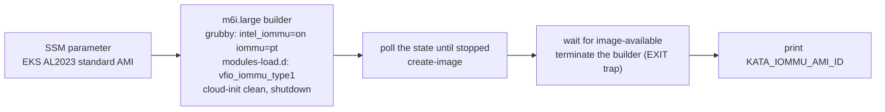
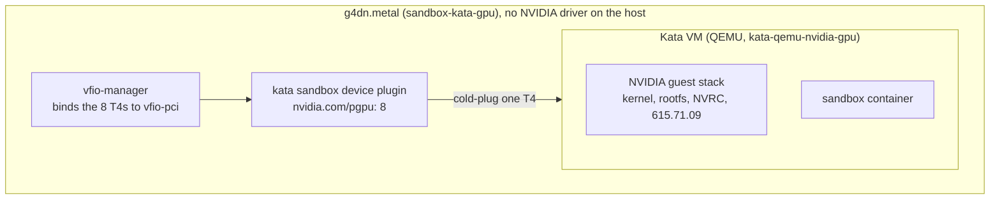

# 03 Kata sandboxes (CLH, QEMU)

!!! info "TL;DR"
    Rehearse `kata-clh` and `kata-qemu` cheaply with nested virtualization on `c8i.2xlarge`, then, only when you need GPU passthrough, hand one T4 to each VM on a `g4dn.metal` booted from an IOMMU AMI.

## Pain point

Kata starts a lightweight VM per pod, so the node needs `/dev/kvm` (QEMU and Cloud Hypervisor use KVM), and regular GPU VMs such as `g5.xlarge` do not have it. Passing a GPU through also needs the IOMMU turned on and a host that leaves the NVIDIA driver unloaded and binds the GPU to `vfio-pci` to hand it to the VM. On AWS the only x86 NVIDIA instance that meets this is the bare-metal `g4dn.metal` (7.824 USD per hour). Even mistakes unrelated to the GPU, such as kata-deploy, containerd drop-ins or RuntimeClasses, then get debugged on this node. On top of that, the AL2023 kernel does not turn the IOMMU on by default, and nodeadm rewrites `/etc/containerd/config.toml` on every boot, so the runtime handlers kata-deploy adds may disappear after a reboot.


*Takeaway: `g4dn.metal` is the only x86 NVIDIA instance on AWS that can hand a GPU to a Kata VM, so even GPU-unrelated debugging lands on a 7.824 USD per hour node. Checking the GPU-unrelated parts on `c8i.2xlarge` (0.37484 USD per hour) first leaves only GPU passthrough for `g4dn.metal`.*


## Why

- **Split into two stages to cut cost.** The CPU stage (`c8i.2xlarge`) installs kata-deploy and the RuntimeClasses and checks the kernels of the three runtimes. If you deploy the CPU pools of [04](04_sandbox_pools.md) before adding the GPU node, `scripts/ops/verify.sh` checks the network blocking (NetworkPolicy, node guard) and `scripts/ops/bench.sh` shows the time from pod creation to Ready.
- **Bake the kernel arguments into an AMI.** A cheap `m6i.large` builder puts `intel_iommu=on iommu=pt` into the AMI. `g4dn.metal` applies them from its first boot, so it needs no reboot for this setting.
- **The upstream-supported GPU path is the default.** That is QEMU, cold-plug and the Go shim (`kata-qemu-nvidia-gpu`); Cloud Hypervisor GPU is an experiment that turns on only with an environment variable (RuntimeClass label `gpusandbox/support: experimental`).

**Before you start:** finish [01 Cluster and images](01_cluster_and_images.md). How Kata handles GPUs is in the "Kata + VFIO passthrough" section of [02 Isolation runtimes](../concepts/02_isolation_runtimes.md), and unfamiliar terms in the "Terms" box below and the [Glossary](../reference/glossary.md).

??? note "Terms (expand if a word is new to you)"
    - **Kata Containers**: a runtime that starts a small VM per pod and runs the containers inside it. So every pod uses its own guest kernel.
    - **QEMU, Cloud Hypervisor (CLH)**: the two hypervisors Kata uses to create VMs. Upstream supports GPU passthrough only on the QEMU path.
    - **KVM, `/dev/kvm`**: the Linux hardware virtualization feature and its device file. A node needs it to start VMs.
    - **Nested virtualization**: starting VMs inside a VM. On EC2 it gives some instance families a `/dev/kvm`.
    - **Launch template, CpuOptions**: a bundle of EC2 instance launch settings, and the CPU options inside it (here, enabling nested virtualization). In this repository the CDK stack creates one per node group.
    - **IOMMU**: hardware that limits the memory a device can reach with direct memory access (DMA). When a GPU is handed to a VM, it confines access to that VM's memory.
    - **VFIO, vfio-pci**: the Linux framework that hands a physical device to a VM safely, and the driver that holds the device for it.
    - **Cold-plug**: attaching a device before the VM starts.
    - **Go shim, runtime-rs**: the two implementations of the Kata runtime. runtime-rs (Rust) is the default since 4.0.0, but this setup uses the Go shim because of the GPU.
    - **kata-deploy**: the Helm chart that installs the Kata binaries and configuration on nodes and creates the RuntimeClasses.
    - **GPU Operator, vfio-manager, `nvidia.com/pgpu`**: the operator that manages NVIDIA GPU components, its component that binds GPUs to vfio-pci, and the resource name for GPUs that can be handed to VMs.
    - **NVRC**: the init program of the NVIDIA guest stack that kata-deploy ships.
    - **`overhead.podFixed`**: a value in the RuntimeClass that tells the scheduler to add the VM's own memory and CPU to the pod's requests.

!!! warning "AWS steps on this page"
    The Kata CPU path on this page (`scripts/kata/cpu_nodes.sh`, CDK scenario C) and the Kata GPU path (baking the IOMMU AMI, `scripts/kata/gpu_nodes.sh`, the `g4dn.metal` node group and the `kata-qemu` pool) ran in a practice account (EKS 1.36). The smoke pod output, the stage 2 output and the durations below are what those runs showed, and the `vfio_iommu_type1` module problem and the AMI builder problem found there are fixed in the scripts (stage 2). The combination is still not verified upstream (see "Scope and limits" below), and the experimental CLH GPU VM did not start (stage 3). The dated run record is in [Verified facts and sources](../reference/sources.md#aws-run-record).

## RuntimeClasses

| RuntimeClass | Hypervisor | Devices | Node group | `overhead.podFixed` | Upstream support |
|---|---|---|---|---|---|
| `kata-clh` | Cloud Hypervisor | none | `sandbox-kata-cpu` (`c8i.2xlarge`) | 130Mi, 250m | supported |
| `kata-qemu` | QEMU | none | `sandbox-kata-cpu` | 320Mi, 250m | supported |
| `kata-qemu-nvidia-gpu` | QEMU (Go shim) | one T4 (VFIO cold-plug) | `sandbox-kata-gpu` (`g4dn.metal`) | 10240Mi, 1 CPU | supported (T4 is outside upstream CI) |
| `kata-clh-nvidia-gpu` | Cloud Hypervisor (experimental) | one T4 | `sandbox-kata-gpu` | 10240Mi, 1 CPU (values file) | not supported |

The `overhead.podFixed` values are those of Kata 4.3.1. The upstream metrics CI (3.28.0, different machines, wide tolerance) reports boot-to-workload times of 0.39 s for CLH and 0.71 s for QEMU; these were not measured in this repository, and this repository's measurements and method are in [08 Runtime benchmark](08_benchmark.md).

## Stage 1: rehearse with nested virtualization (`kata/cpu_nodes.sh`)

The CDK stack of `02_create_cluster.sh` creates the Kata CPU node group (`sandbox-kata-cpu`, `c8i.2xlarge`), which already exists in scenario C. In other scenarios, set `export WITH_KATA_CPU="1"` in `scripts/config.env` and rerun `02_create_cluster.sh` as below. CDK adds only this node group and its launch template.

```bash
# after setting export WITH_KATA_CPU="1" in scripts/config.env
scripts/02_create_cluster.sh    # scenario A; add the option of your first run for B1 or B2
aws eks describe-nodegroup --region "$AWS_REGION" --cluster-name "$CLUSTER_NAME" \
  --nodegroup-name sandbox-kata-cpu --query nodegroup.status --output text
```

**What to look for:** the last command prints `ACTIVE`. If `AWS_REGION` and `CLUSTER_NAME` are not set in your shell, run `source scripts/config.env` first.

Then run the Kata CPU node script once.

```bash
scripts/kata/cpu_nodes.sh    # kata-deploy, the gvisor-cpu RuntimeClass, smoke pods
```

The script first checks that the `sandbox-kata-cpu` node group exists. In the practice account it took about 14 minutes, mostly for kata-deploy.

**If it fails:** `no sandbox-kata-cpu node group: set WITH_KATA_CPU=1 in scripts/config.env and run scripts/02_create_cluster.sh again` appears whenever the node group lookup fails, whatever the cause. Run the `aws eks describe-nodegroup` command above yourself: on `ResourceNotFoundException`, check `CLUSTER_NAME` and `AWS_REGION`, then rerun `02_create_cluster.sh` with the commands above; on `AccessDeniedException`, check the `eks:DescribeNodegroup` permission. If `c8i.2xlarge` does not support nested virtualization in your Region, the node group creation fails or the smoke pods never finish; see the `SupportedFeatures` output of `01_check_prereqs.sh` and the "Kata" section of [Troubleshooting](../reference/troubleshooting.md).

### Launch template of the Kata CPU node (CDK stack)

The CDK stack (`cdk/gpusandbox_cdk/stack.py`) creates this node group's EC2 launch template, `nested_cpu_node` in `infra/eks/userdata.py` builds its user data, and the CPU options go straight into the CloudFormation launch template resource.

| Item | Value | Reason |
|---|---|---|
| `CpuOptions` | `CoreCount` 4, `ThreadsPerCore` 2 (`c8i.2xlarge`), `NestedVirtualization: enabled` | creates `/dev/kvm` inside a virtual instance. The API wants the core and thread counts together with other CPU options. The values come from the table in `cdk/gpusandbox_cdk/config.py` |
| `MetadataOptions` | `HttpTokens: required`, `HttpPutResponseHopLimit: 1` | IMDSv2 only, so pods cannot reach node credentials |
| `BlockDeviceMappings` | `/dev/xvda` 100 GB gp3, encrypted | images and VM assets |
| `UserData` (MIME multipart) | NodeConfig (containerd `imports` and the gVisor `runsc` handler), creates `/etc/containerd/conf.d`, installs pinned gVisor (no nvproxy), node guard | explained below. gVisor is installed too so that all three runtimes can be compared on one node ([10 CPU-only path on c8i](10_cpu_only.md)) |
| `ImageId` | not set | EKS picks the EKS-optimized AMI (`AL2023_x86_64_STANDARD`) and merges its own bootstrap user data |
| Node group | desired 1, min 0, max 2, labels `gpusandbox/role=sandbox-kata` and `gpusandbox/kata-gpu=false`, taint `gpusandbox/role=sandbox-kata:NoSchedule` | dedicated to Kata sandboxes. The smoke pods and the CPU pools select this node with `gpusandbox/kata-gpu=false` |

The EKS documentation does not say whether a managed node group passes the launch template's `NestedVirtualization` on to the node. It was passed in the practice account (2026-11-14, the node had `/dev/kvm`), but this may change, so check it after the first deployment. The command below reads the instance ID from the Kata CPU node of the current kubectl context (the tunnel), so it never reads a node of another cluster that this repository created in the same Region.

```bash
provider_id="$(kubectl get nodes -l gpusandbox/kata-gpu=false -o jsonpath='{.items[0].spec.providerID}')"
aws ec2 describe-instances --region "$AWS_REGION" --instance-ids "${provider_id##*/}" \
  --query 'Reservations[].Instances[].CpuOptions'
```

**What to look for:** the result must contain `"NestedVirtualization": "enabled"`. Without it, the Kata smoke pods cannot open KVM and fail.

The NodeConfig in user data adds `imports = ["/etc/containerd/conf.d/*.toml"]` to the containerd configuration so that, even when nodeadm rewrites `config.toml` on every boot, the runtime handlers in the drop-in directory are read again. This is an inference, not documented behavior, so after rebooting a node, check that a pod still starts with a Kata RuntimeClass.

### kata-deploy 4.3.1 (DaemonSet mode)

`kata/cpu_nodes.sh` runs this command internally (you do not run it), and `kata/gpu_nodes.sh` runs `upgrade --install` on the same chart.

```bash
helm upgrade --install kata-deploy oci://ghcr.io/kata-containers/kata-deploy-charts/kata-deploy \
  --version "${KATA_VERSION}" --namespace kube-system \
  -f "${REPO_ROOT}/infra/kata/kata-deploy-values.yaml" --wait --timeout 20m
```

| Setting (`infra/kata/kata-deploy-values.yaml`) | Value | Reason |
|---|---|---|
| `deploymentMode` | `daemonset` | the chart default `job` installs only on nodes that exist at install time. These node groups scale from zero, so a DaemonSet that also covers later nodes is used |
| `nodeSelector`, `tolerations` | `gpusandbox/role: sandbox-kata` | installs only on Kata nodes (CPU, GPU) |
| `shims.disableAll` | `true` | enables only the shims in use |
| Enabled shims | `qemu`, `clh`, `qemu-nvidia-gpu` (amd64) | the RuntimeClass table above |
| `allowedHypervisorAnnotations` | `[]` | empty, so pod annotations cannot change hypervisor settings |
| `qemu-nvidia-gpu.runtimeClass.nodeSelector` | `nvidia.com/cc.ready.state: "false"` | the label the GPU Operator's cc-manager sets on nodes with confidential computing off. T4 has no CC |
| `qemu-nvidia-gpu.nvrc.enableDCGM` | `false` | turns off the DCGM feature of the NVIDIA guest stack (NVRC) |
| `defaultShim.amd64` | `qemu` | default shim |
| `runtimeClasses` | `enabled: true`, `createDefault: false`, `overheadEnabled: true` | creates the RuntimeClasses and keeps the overhead so the scheduler accounts for each VM's own memory and CPU |

### Smoke pods: gvisor-cpu, kata-clh and kata-qemu

The script checks the `katacontainers.io/kata-runtime` label that kata-deploy sets on the Kata CPU node and the `kata-clh`, `kata-qemu` and `gvisor-cpu` RuntimeClasses, then starts one smoke pod (`public.ecr.aws/amazonlinux/amazonlinux:2023`) per RuntimeClass that prints the kernel version it sees (`uname -r`, `uname -v`).

**What to look for:** output of this shape (example; versions and numbers differ).

```text
[hh:mm:ss] checking /dev/kvm and the runtime classes
true
kata-clh               kata-clh               3m
kata-qemu              kata-qemu              3m
NAME         HANDLER   AGE
gvisor-cpu   runsc     3m
pod/gvisor-cpu-smoke-12345 created
pod/gvisor-cpu-smoke-12345 condition met
gvisor-cpu: kernel seen inside: 4.19.0-gvisor #1 SMP Sun Jan 10 15:06:54 PST 2016
pod "gvisor-cpu-smoke-12345" deleted
pod/kata-clh-smoke-23456 created
pod/kata-clh-smoke-23456 condition met
kata-clh: kernel seen inside: 6.18.56 #1 SMP Fri Oct 16 18:41:32 UTC 2026
pod "kata-clh-smoke-23456" deleted
pod/kata-qemu-smoke-34567 created
pod/kata-qemu-smoke-34567 condition met
kata-qemu: kernel seen inside: 6.18.56 #1 SMP Fri Oct 16 18:41:32 UTC 2026
pod "kata-qemu-smoke-34567" deleted
[hh:mm:ss] host kernel for comparison: 6.18.56-125.164.amzn2023.x86_64
```

If all three kernels differ from the host kernel on the last line, the pods ran inside an isolation runtime (Kata shows the guest kernel inside the VM, gVisor the version its Sentry chooses). Kata's kernel number looks like the host's, but it has no `amzn2023` and a different build date, so it is a different kernel. A non-empty label value (`true` or similar) means kata-deploy has finished installing on that node.

**If it fails:** if the script stops with `kata runtime classes missing` or a smoke pod does not finish, see the commands that check nested virtualization and the Kata components in the "Kata" section of [Troubleshooting](../reference/troubleshooting.md).

!!! question "❓ Misconception: a `hypervisor` flag in the pod's `/proc/cpuinfo` means it ran inside a Kata VM"
    `c8i.2xlarge` is itself a virtual instance, so even a plain runc container usually sees the `hypervisor` flag; on this node the proof of Kata is a guest kernel version that differs from the host's, not the flag. A bare-metal host such as `g4dn.metal` does not have the flag, so there the flag is evidence too.

## Stage 2: GPU passthrough on g4dn.metal (`kata/gpu_nodes.sh`)

!!! warning "Cost: g4dn.metal is 7.824 USD per hour"
    That is the On-Demand list price in us-east-1 and us-west-2; in the Seoul Region it is 9.624 USD. When you rerun `02_create_cluster.sh` with `WITH_KATA_GPU=1`, `cdk/deploy.sh` asks `This adds g4dn.metal (about 7.8 USD/hour) to the stack. Type 'metal' to continue:`, and the node enters the stack only after you type `metal`. When you are not using it, scale it to zero right away with the commands at the end of this page.

Run `kata/gpu_nodes.sh` twice, with a rerun of `02_create_cluster.sh` in between. It bakes the AMI only when `KATA_IOMMU_AMI_ID` is empty. `08_cleanup.sh` deletes the AMI but leaves the ID in `config.env`, so if an ID from an earlier run is still there, check that the AMI exists with `aws ec2 describe-images --region "$AWS_REGION" --image-ids <ID>`, and clear the value if it does not.

```bash
scripts/kata/gpu_nodes.sh       # KATA_IOMMU_AMI_ID empty: bakes the IOMMU AMI, then stops
# in scripts/config.env: paste the printed line  export KATA_IOMMU_AMI_ID="ami-..."
#                        and change  export WITH_KATA_GPU="0"  to  export WITH_KATA_GPU="1"
scripts/02_create_cluster.sh    # same option as your first run; type 'metal' to add g4dn.metal
scripts/kata/gpu_nodes.sh       # second run: GPU Operator, kata-deploy, pgpu check
```

**What to look for (first run):** the script announces about 10 minutes (in the 2026-11-18 run the builder stopped after about 30 s and the AMI was available after about 2 minutes). When it finishes it prints `export KATA_IOMMU_AMI_ID="ami-..."` under `Add to scripts/config.env:` and ends with `[error] add KATA_IOMMU_AMI_ID and WITH_KATA_GPU=1 to scripts/config.env, run scripts/02_create_cluster.sh again, then re-run this script`. This error is expected behavior. Paste the line with its `export`; a bare `KATA_IOMMU_AMI_ID=...` does not reach the CDK Python process as an environment variable.

**What to look for (rerun of `02_create_cluster.sh`):** after you type `metal`, CDK adds the `sandbox-kata-gpu` node group and its launch template. `g4dn.metal` bills from this moment. The second run of `kata/gpu_nodes.sh` stops with `no sandbox-kata-gpu node group: set WITH_KATA_GPU=1 in scripts/config.env and run scripts/02_create_cluster.sh again ...` if it cannot look up this node group. A missing permission gives the same message, so run `aws eks describe-nodegroup ... --nodegroup-name sandbox-kata-gpu` yourself to find the cause. Even if you skipped the Kata CPU node step (`kata/cpu_nodes.sh`), `kata/gpu_nodes.sh` installs kata-deploy.

### Baking the IOMMU-enabled AMI (build-iommu-ami.sh)



*Takeaway: the kernel arguments and the module setting are baked into an AMI on a cheap builder instance, so the expensive `g4dn.metal` boots with the IOMMU on from the start, without a reboot.*

1. It picks the standard (non-NVIDIA) AMI from the SSM parameter `/aws/service/eks/optimized-ami/${K8S_VERSION}/amazon-linux-2023/x86_64/standard/recommended/image_id` (with VM passthrough the host must not load the NVIDIA driver).
2. It starts an `m6i.large` builder in the cluster's first subnet (a private subnet of the CDK stack) (IMDSv2, hop limit 1). User data adds the kernel arguments with `grubby --update-kernel=ALL --args="intel_iommu=on iommu=pt"` and writes `vfio_iommu_type1` to `/etc/modules-load.d/vfio-iommu-type1.conf` so that the module loads on every boot. It then removes per-instance state with `cloud-init clean --logs` and shuts the builder down.
3. It polls the builder's state every 15 seconds until it is stopped, for up to 30 minutes, and stops with an error if the state becomes shutting-down or terminated.
4. It creates an AMI named `eks-al2023-${K8S_VERSION}-iommu-<timestamp>` and waits until the AMI is available. Whether the script succeeds or fails, an EXIT trap terminates the builder.

AL2023 kernels have `CONFIG_INTEL_IOMMU_DEFAULT_ON` unset, so `intel_iommu=on` must be on the kernel command line before VFIO can pass a GPU through. `iommu=pt` skips IOMMU translation for devices the host uses directly. Kernel arguments do not depend on the instance type, so an `m6i.large` can bake them.

AL2023 kernels also build the VFIO type1 IOMMU backend as a module (`CONFIG_VFIO_IOMMU_TYPE1=m`), and on the `g4dn.metal` node of 2026-11-18 nothing loaded it. Without this module QEMU cannot attach the GPU and the Kata GPU pods do not start (see "Pods stuck with `create container timeout`" below), so step 2 puts the `modules-load.d` setting into the AMI.

!!! note "If an earlier version of the script failed"
    If an earlier version stopped with `Waiter InstanceStopped failed ... "pending"`, the builder may still be there. Check for an instance named `<CLUSTER_NAME>-iommu-ami-builder` and terminate it.

### The sandbox-kata-gpu node group

| Item | Value | Reason |
|---|---|---|
| Instance | `${KATA_GPU_INSTANCE_TYPE}` (`g4dn.metal`, 8x T4, 96 vCPU, 384 GiB) | the only x86 bare-metal type with NVIDIA GPUs |
| AMI | `AmiType: CUSTOM`, `${KATA_IOMMU_AMI_ID}` as the launch template's `ImageId` | the IOMMU AMI baked above |
| Size | desired 1, min 0, max 1, 200 GB | one node is enough |
| IMDS | IMDSv2 and hop limit 1 from the launch template | the same setting as every node, so pods cannot reach node credentials |
| Labels | `gpusandbox/role=sandbox-kata`, `gpusandbox/kata-gpu=true`, `nvidia.com/gpu.workload.config=vm-passthrough` | the GPU Operator binds this node's GPUs to vfio-pci |
| Taint | `gpusandbox/role=sandbox-kata:NoSchedule` | dedicated to Kata sandboxes |
| NodeConfig | `cluster` (name, API endpoint, certificate, service CIDR `172.20.0.0/16`), containerd `imports = ["/etc/containerd/conf.d/*.toml"]`, kubelet `runtimeRequestTimeout: 20m` | EKS does not merge its bootstrap when the launch template sets an AMI, so the cluster fields are written here. Keeps kata-deploy's drop-ins, and waits while VFIO pins guest memory |
| User data shell parts | creates `/etc/containerd/conf.d`, `node-guard.sh` | for the node guard see [01](01_cluster_and_images.md) |

### GPU Operator v26.7.2 (sandbox mode)

`kata/gpu_nodes.sh` runs this command internally (you do not run it).

```bash
helm upgrade --install gpu-operator nvidia/gpu-operator --version "${GPU_OPERATOR_VERSION}" \
  --namespace gpu-operator --create-namespace \
  -f "${REPO_ROOT}/infra/kata/gpu-operator-values.yaml" --wait --timeout 20m
```



*Takeaway: the host only holds the GPUs with vfio-pci; the driver exists only in the guest stack inside the VM.*

| Setting (`infra/kata/gpu-operator-values.yaml`) | Value | Reason |
|---|---|---|
| `sandboxWorkloads` | `enabled: true`, `defaultWorkload: container`, `mode: kata` | only nodes labelled `vm-passthrough` are handled as VM passthrough |
| `ccManager.defaultMode` | `"off"` | T4 has no confidential computing. With `on`, cc-manager exits and the `kata-qemu-nvidia-gpu` nodeSelector (`cc.ready.state=false`) never matches the node |
| `nfd` | `enabled: true`, `nodefeaturerules: true` | detects the node's NVIDIA PCI devices |
| `cdi.enabled` | `true` | uses CDI |
| `driver`, `toolkit`, `devicePlugin`, `dcgmExporter`, `gfd`, `migManager`, `vgpuDeviceManager` | all `enabled: false` | the host loads no NVIDIA driver, and no container-mode components are used |
| `vfioManager.enabled` | `true` | binds the 8 T4s to vfio-pci |
| `kataSandboxDevicePlugin.enabled` | `true` | advertises the T4s as `nvidia.com/pgpu` |

The trainer and gVisor nodes carry the label `nvidia.com/gpu.deploy.operands=false`, so the GPU Operator deploys no NVIDIA GPU operands there. The NFD worker, though, is set to tolerate the `gpusandbox/role` taint and runs on these nodes too. Per the NVIDIA documentation a node runs one container runtime mode at a time, so container GPU workloads and VM passthrough do not share a node.

### kata-qemu-nvidia-gpu and VM sizing

`kata-qemu-nvidia-gpu` uses Kata's Go shim instead of runtime-rs, the default since 4.0.0, because runtime-rs GPU cold-plug needs IOMMUFD and AL2023 kernels have no `CONFIG_IOMMUFD`. The Kata documentation states that only cold-plug is supported for NVIDIA GPU passthrough. kata-deploy ships the NVIDIA guest stack (kernel, rootfs, NVRC, open kernel modules 615.71.09), and the README of these modules lists Tesla T4.

| Item | Value |
|---|---|
| `default_memory` of the Go NVIDIA shim | 8192 MiB |
| Container limits (`kata-qemu` profile) | 8 CPUs, 16 GiB memory, `nvidia.com/pgpu: 1` |
| VM memory | 8 GiB + 16 GiB = 24 GiB; VFIO type1 pins all guest RAM (no overcommit) |
| RuntimeClass overhead | 10240Mi, 1 CPU |
| Memory the scheduler reserves per pod | 16 GiB + 10 GiB = 26 GiB |
| With all 8 T4s in use | memory 8 x 26 = 208 GiB (node 384 GiB), CPU 8 x (8 + 1) = 72 vCPU (node 96 vCPU) |
| Default replicas | 4 (change with `KATA_QEMU_REPLICAS`, at most 8, one per T4) |

The overhead (10 GiB) is larger than `default_memory` (8 GiB), which the limits do not count, so the memory the scheduler reserves is never smaller than what VFIO actually pins. A GPU VM pins all its memory before booting and initializes CUDA inside the guest, so the first Ready can take minutes (30 to 36 seconds per pod with cached images on 2026-11-18, see [08 Runtime benchmark](08_benchmark.md)); kubelet's `runtimeRequestTimeout` is therefore raised to 20 minutes and the sandbox Deployment's startupProbe waits up to 10 minutes ([04 Deploy and verify sandbox pools](04_sandbox_pools.md)).

!!! note "Security properties"
    The IOMMU confines the GPU's DMA to that VM's memory, so the unsafe noiommu mode, which turns the IOMMU off, is not used. vfio-pci resets the function (or the bus) when it releases a device, and T4 has been reported with `reset_method=bus` (a third-party report, not an NVIDIA guarantee).

### Checking the result of `kata/gpu_nodes.sh`

**What to look for (second run):** the script waits up to 20 minutes (60 tries every 20 seconds) until the Kata GPU node advertises `nvidia.com/pgpu`, then prints the result in the shape below. The 2026-11-18 run showed `pgpu=8`, and the GPU Operator install, the kata-deploy upgrade and the pgpu wait took about 1 minute. The kata-deploy upgrade did not restart the running CPU pools.

```text
[hh:mm:ss] waiting for the T4s to be advertised as nvidia.com/pgpu on ip-192-168-x-x.us-west-2.compute.internal
pgpu=8  cc.ready.state=false
NAME                   HANDLER                AGE
kata-qemu-nvidia-gpu   kata-qemu-nvidia-gpu   2m
```

**If it fails:** if `pgpu` is empty or 0, the script stops with `no passthrough GPUs advertised; see docs/reference/troubleshooting.md`; check the IOMMU and the vfio-pci binding on the node as below, together with the "Kata" section of [Troubleshooting](../reference/troubleshooting.md).

Start a debug pod with a shell on the Kata GPU node (find it with `kubectl get nodes -l gpusandbox/kata-gpu=true`).

```bash
kubectl debug node/<kata-gpu-node> -it --profile=sysadmin --image=public.ecr.aws/amazonlinux/amazonlinux:2023
```

Run the following in the debug shell.

```bash
cat /proc/cmdline                      # expect intel_iommu=on iommu=pt
ls /sys/kernel/iommu_groups | wc -l    # expect a non-zero number of IOMMU groups
ls /sys/bus/pci/drivers/vfio-pci/      # expect the T4 PCI addresses once vfio-manager has run
grep vfio_iommu_type1 /proc/modules    # expect one line: QEMU needs this VFIO IOMMU backend
```

**What to look for:** `intel_iommu=on iommu=pt` in the first output, a number above 0 from the second, PCI addresses of the form `0000:..` in the third, and a line starting with `vfio_iommu_type1` from the fourth. The node of 2026-11-18 had 257 IOMMU groups and all 8 T4s bound to `vfio-pci`. If the kernel arguments are missing from the first, the node group did not start from the IOMMU AMI; if the fourth prints nothing, see "Pods stuck with `create container timeout`" below. When you are done, delete the debug pod the same way as in "Checking on the node itself" in [02 gVisor](02_gvisor.md).

The actual GPU VMs are started with `scripts/06_deploy_sandboxes.sh kata-qemu` and verified with the pool verification (`scripts/ops/verify.sh`) in [04 Deploy and verify sandbox pools](04_sandbox_pools.md). In the 2026-11-18 run the 4 `kata-qemu` pods became Ready, and `scripts/ops/verify.sh kata-qemu v1` showed:

- GPU `Tesla T4`, guest kernel `6.18.56-nvidia-gpu`
- all 4 egress targets blocked
- 6 golden verdicts PASS, including `vector_add_triton` and `relu_bias_triton`
- the NetworkPolicy blocks callers from the `default` namespace

### Pods stuck with `create container timeout` (vfio_iommu_type1)

The 2026-11-18 run hit this problem. The current `build-iommu-ami.sh` makes the module load at boot; nodes from an AMI built before that fix have the problem.

- **Symptom:** `kata-qemu-nvidia-gpu` pods stay in `ContainerCreating` with the event `failed to create shim task: create container timeout`. The node log shows the QEMU error `vfio 0000:e7:00.0: failed to setup container for group 87: No available IOMMU models` (the PCI address and group number differ per node).
- **Cause:** AL2023 kernels build the VFIO type1 IOMMU backend as a module (`CONFIG_VFIO_IOMMU_TYPE1=m`), and nothing loaded it on that node; `lsmod` showed only `vfio`, `vfio_pci` and `vfio_pci_core`. The IOMMU (257 groups, `intel_iommu=on` on the kernel command line), the `vfio-pci` binding of all 8 T4s and `nvidia.com/pgpu=8` were all fine, so the pgpu check of `kata/gpu_nodes.sh` does not reveal it.
- **Fix (new AMI):** the current `infra/kata/build-iommu-ami.sh` writes `/etc/modules-load.d/vfio-iommu-type1.conf` (`vfio_iommu_type1`) into the AMI. If you run an older AMI, rebuild it with this script, put the printed `KATA_IOMMU_AMI_ID` into `scripts/config.env`, and rerun `02_create_cluster.sh`.
- **Fix (current node):** on a node from an older AMI, load the module by hand from the debug shell above. It has to be loaded again after a reboot.

```bash
# In the debug shell on the Kata GPU node (kubectl debug node/<kata-gpu-node> ... --profile=sysadmin)
chroot /host
journalctl --since "30 min ago" --no-pager | grep "No available IOMMU models" | tail -3   # the symptom
modprobe vfio_iommu_type1
grep vfio_iommu_type1 /proc/modules                                                     # one line now
exit
```

**What to look for:** the last `grep` prints the `vfio_iommu_type1` line. In the 2026-11-18 run the 4 `kata-qemu` pods became Ready after this fix. Check with `kubectl -n sandbox get pods -l gpusandbox/runtime=kata-qemu` that READY turns `1/1`.

## Stage 3 (optional, experimental): Kata + Cloud Hypervisor GPU

!!! danger "Upstream does not support this path"
    In Kata 4.3.1, `docs/hypervisors.md` marks Cloud Hypervisor as unsupported and QEMU as supported in the GPU Support column. A maintainer answered in 2025-08: "You should use the QEMU GPU runtime class. I haven't done any work on CLH to enable proper GPU support." The Go `kata-clh` has VFIO cold-plug code since 3.29.0, but it is untested upstream and disabled in the shipped configuration, and runtime-rs CLH has no VFIO configuration keys. This stage is an evaluation experiment, so if the results feed training, use `kata-qemu-nvidia-gpu`.

`infra/kata/experimental-clh-gpu/values-clh-gpu.yaml` adds a `clh-nvidia-gpu` runtime through kata-deploy's `customRuntimes`. On top of `baseConfig: "clh"` it layers a drop-in with the NVIDIA guest kernel and image, `cold_plug_vfio = "root-port"`, `default_memory = 8192`, `static_sandbox_resource_mgmt = true` and more, then creates the `kata-clh-nvidia-gpu` RuntimeClass (overhead 10240Mi and 1 CPU, nodeSelector `nvidia.com/cc.ready.state: "false"`, label `gpusandbox/support: experimental`) to try the VFIO cold-plug code of the Go CLH shim.

!!! warning "Result on 2026-11-18: the VM never started"
    Even with the values file whose paths are filled in (step 2), the pods of the `kata-clh` pool failed with `create container timeout`. The CLH VM never created its socket, and the logs gave no clearer cause. So [08 Runtime benchmark](08_benchmark.md) records it as "not measured", and the pool was scaled to 0.

1. **Find the guest asset names (for another kata-deploy version).** Start a debug pod on the Kata GPU node.

    ```bash
    kubectl debug node/<kata-node> -it --image=public.ecr.aws/amazonlinux/amazonlinux:2023
    ```

    In the debug shell, list the guest assets kata-deploy installed.

    ```bash
    ls -l /host/opt/kata/share/kata-containers/
    ```

    **What to look for:** a list of guest kernel and image files (file names differ between kata-deploy versions). Note the file names of the NVIDIA kernel and image.

2. **Check the artifact paths.** `kernel` and `image` in the values file point to the links that kata-deploy 4.3.1 installs (checked on a `g4dn.metal` node on 2026-11-18). `vmlinux-nvidia-gpu.container` is the uncompressed kernel that Cloud Hypervisor boots, and `kata-containers-nvidia-gpu.img` is the NVIDIA guest image; the QEMU NVIDIA RuntimeClass boots the compressed `vmlinuz`. If another kata-deploy version names them differently, change them to match the list from step 1.
3. **Install the experimental RuntimeClass.** Rerun `kata/gpu_nodes.sh` with the environment variable.

    ```bash
    ENABLE_EXPERIMENTAL_CLH_GPU=1 scripts/kata/gpu_nodes.sh
    ```

    **What to look for:** the warning `enabling the experimental kata-clh-nvidia-gpu runtime class`, and after it finishes, `kubectl get runtimeclass kata-clh-nvidia-gpu` shows the RuntimeClass.

4. **Check CUDA initialization.** It needs the `sandbox` namespace, so run it after `05_setup_namespaces_auth.sh` in [04](04_sandbox_pools.md).

    ```bash
    infra/kata/experimental-clh-gpu/check-clh-gpu.sh
    ```

    **What to look for:** one pod (`nvidia.com/pgpu: 1`, 4 CPUs, 16Gi memory) prints the guest kernel version. If CUDA initializes it prints the GPU name (for example `Tesla T4`), otherwise `False`, and then the pod is deleted. It waits up to 20 minutes. Without logs you see the warning `no logs: the VM probably never started`.

5. **Deploy a pool (optional).** If CUDA initializes, start the experimental pool with `scripts/06_deploy_sandboxes.sh kata-clh`. The `kata-clh` profile shares the same `g4dn.metal` with `kata-qemu` (2 replicas by default, `KATA_CLH_REPLICAS`).

!!! warning "Do not forget the environment variable on reruns"
    If you rerun `kata/gpu_nodes.sh` without `ENABLE_EXPERIMENTAL_CLH_GPU=1`, `helm upgrade` runs with the default values file only and the experimental runtime and the `kata-clh-nvidia-gpu` RuntimeClass disappear. `kata/cpu_nodes.sh` does not read this variable, so rerunning it after the experiment also removes the experimental runtime.

!!! question "❓ Misconception: Kata needs a .metal instance"
    `.metal` is needed for Kata + GPU passthrough. Kata CPU sandboxes run without `.metal` on virtual instances with EC2 nested virtualization enabled (launched 2026-02), but nested virtualization is not offered on G or P families, so GPU VMs cannot run Kata. Also keep in mind that AWS recommends bare metal for performance-sensitive virtualization workloads.

    | Location | Kata + GPU | Kata CPU only |
    |---|---|---|
    | EC2 `.metal` (`g4dn.metal`) | yes (VFIO passthrough) | yes |
    | EC2 nested virtualization (C8i, M8i, R8i and others) | no: those families have no GPU | yes, no `.metal` needed |
    | EC2 GPU VM (`g5.xlarge` and others) | no: no `/dev/kvm` | no |
    | HyperPod node (`ml.g5` and others) | no | no (likely, unverified) |

## Scope and limits

- **Upstream verification:** NVIDIA's Kata CI covers A100 and H100, not T4, and the OS NVIDIA validated on EKS is Ubuntu, with AL2023 not listed. So this configuration on `g4dn.metal` + AL2023 is not verified upstream.
- **This repository's run:** the Kata GPU path (`g4dn.metal` + AL2023 + `kata-qemu-nvidia-gpu`) ran in the practice account (EKS 1.36, [run record](../reference/sources.md#aws-run-record)). After the `vfio_iommu_type1` fix the 4 `kata-qemu` pods became Ready and `ops/verify.sh kata-qemu v1` passed. That is one run and does not replace upstream verification.
- **Third-party report:** one report says that on Ubuntu 24.04 on `g4dn.metal`, `intel_iommu=on iommu=pt` bound all eight T4s to vfio-pci with IOMMU groups usable for passthrough. This repository saw the same binding on AL2023 (8 T4s, 257 IOMMU groups) and has not checked Ubuntu.
- **Undocumented behavior:** keeping the Kata handlers after a reboot (containerd `imports`) and passing `CpuOptions.NestedVirtualization` on may change, so do not skip the reboot check and the `describe-instances` check in stage 1.
- **Cloud Hypervisor + GPU:** an experimental path. In this repository's run the VM never started even with the artifact paths filled in (`create container timeout`), and no working configuration is known.

## Time and cost

| Step | Duration (measured, guidance or timeout) | Newly billed resources |
|---|---|---|
| Rerun of `02_create_cluster.sh` (`WITH_KATA_CPU=1`) | node group creation (not timed) | `c8i.2xlarge` x1 (0.37484 USD/hour) |
| `kata/cpu_nodes.sh` | about 14 min (measured, mostly kata-deploy). Timeouts: kata-deploy 20 min, smoke pods 10 min each | none |
| `kata/gpu_nodes.sh` first run | the script announces about 10 min. Measured on 2026-11-18: the builder stopped after about 30 s, the AMI was available after about 2 min | builder `m6i.large` (0.096 USD/hour, until the builder is stopped), then the builder's EBS volume while the AMI is created, AMI snapshot (EBS snapshot pricing) |
| Rerun of `02_create_cluster.sh` (`WITH_KATA_GPU=1`) | the `g4dn.metal` node joined in about 3 min (measured on 2026-11-18) | `g4dn.metal` x1 (7.824 USD/hour) |
| `kata/gpu_nodes.sh` second run | about 1 min (measured on 2026-11-18). Timeouts: GPU Operator 20 min, kata-deploy 20 min, pgpu wait up to 20 min | none |
| Stage 3 | `check-clh-gpu.sh` 20 min | none |

Prices are us-east-1 and us-west-2 On-Demand list prices. Scale the Kata nodes to zero when you are not using them.

```bash
source scripts/config.env
aws eks update-nodegroup-config --region "$AWS_REGION" --cluster-name "$CLUSTER_NAME" \
  --nodegroup-name sandbox-kata-gpu --scaling-config minSize=0,maxSize=1,desiredSize=0
aws eks update-nodegroup-config --region "$AWS_REGION" --cluster-name "$CLUSTER_NAME" \
  --nodegroup-name sandbox-kata-cpu --scaling-config minSize=0,maxSize=2,desiredSize=0
```

Run only the commands for the node groups you created: `sandbox-kata-gpu` for the Kata GPU node, `sandbox-kata-cpu` for the Kata CPU node.

**What to look for:** each command you ran returns JSON with `"type": "ConfigUpdate"`, and after a few minutes `kubectl get nodes -l gpusandbox/role=sandbox-kata` lists no nodes. When you continue, run them with `desiredSize=1`. If you will not use the Kata GPU node again, rerun `02_create_cluster.sh` with `WITH_KATA_GPU="0"` to remove it from the stack. [99 Cleanup](99_cleanup.md) deletes the Kata node groups and launch templates with the stack, and after the confirmation word `ami` the IOMMU AMI and its snapshot.

## Next step

Deploy and verify the Kata pools (`kata-clh-cpu`, `kata-qemu-cpu`, `kata-qemu`) in [04 Deploy and verify sandbox pools](04_sandbox_pools.md).

??? note "References"
    | Topic | Link |
    |---|---|
    | EC2 nested virtualization | https://docs.aws.amazon.com/AWSEC2/latest/UserGuide/amazon-ec2-nested-virtualization.html |
    | Accelerated computing instance types (g4dn.metal) | https://docs.aws.amazon.com/ec2/latest/instancetypes/ac.html |
    | NVIDIA GPU Operator with Kata Containers | https://docs.nvidia.com/datacenter/cloud-native/gpu-operator/latest/deploy-kata-containers.html |
    | Kata Containers | https://github.com/kata-containers/kata-containers |
    | Kata 4.3.1 NVIDIA GPU passthrough (QEMU) | https://github.com/kata-containers/kata-containers/blob/4.3.1/docs/use-cases/NVIDIA-GPU-passthrough-and-Kata-QEMU.md |

    All sources: [this page in All references](../reference/references.md#ref-handson-03-kata)
