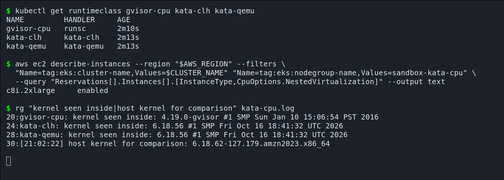
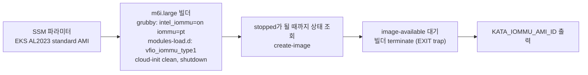
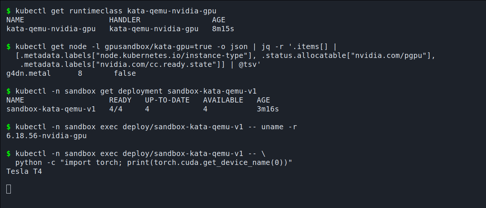

# 03 Kata 샌드박스 (CLH, QEMU)

!!! info "TL;DR"
    Kata는 pod마다 작은 VM을 띄웁니다. 먼저 c8i에서 CPU로 Cloud Hypervisor와 QEMU를 확인하고, GPU passthrough가 필요하면 별도로 metal 노드를 추가합니다. GPU 경로에서는 IOMMU를 켠 `g4dn.metal`에서 VM에 T4를 한 장씩 할당합니다.

    **완료 기준** CPU smoke test와 GPU smoke test는 각각 VM 부팅과 GPU 연결을 확인합니다. CPU 실습만 하려면 1단계까지 진행하세요.

**시작 전에** [01 클러스터와 이미지](01_cluster_and_images.md)를 먼저 마쳐야 합니다. Kata가 GPU를 다루는 방식은 [02 격리 런타임 비교](../concepts/02_isolation_runtimes.md)의 "Kata + VFIO passthrough" 절에, 처음 보는 용어는 아래 "용어" 상자와 [용어 사전](../reference/glossary.md)에 있습니다.

??? note "용어 (처음 보는 단어가 있으면 펼치세요)"
    - **Kata Containers**: pod마다 작은 VM을 만들어 그 안에서 컨테이너를 실행하는 런타임입니다. 그래서 pod마다 별도의 guest 커널을 씁니다.
    - **QEMU, Cloud Hypervisor(CLH)**: Kata가 VM을 만들 때 쓰는 hypervisor 두 가지입니다. 업스트림은 QEMU에서만 GPU passthrough를 지원합니다.
    - **KVM, `/dev/kvm`**: Linux의 하드웨어 가상화 기능과 그 장치 파일입니다. 이것이 있어야 노드에서 VM을 실행할 수 있습니다.
    - **nested virtualization**: VM 안에서 다시 VM을 실행하는 기능입니다. EC2에서는 일부 인스턴스 계열에 `/dev/kvm`을 제공합니다.
    - **launch template, CpuOptions**: EC2 인스턴스의 시작 설정 묶음과, 그 안의 CPU 관련 옵션(여기서는 nested virtualization 활성화)입니다. 이 저장소에서는 CDK 스택이 노드 그룹마다 하나씩 만듭니다.
    - **IOMMU**: 장치가 직접 메모리에 접근(DMA)할 수 있는 범위를 제한하는 하드웨어입니다. GPU를 VM에 직접 할당할 때 접근 범위를 그 VM의 메모리로 한정합니다.
    - **VFIO, vfio-pci**: 물리 장치를 VM에 안전하게 직접 할당하는 Linux 프레임워크와, 그 장치에 바인딩되는 드라이버입니다.
    - **cold-plug**: VM을 시작하기 전에 장치를 연결하는 방식입니다.
    - **Go shim, runtime-rs**: Kata 런타임의 두 구현입니다. runtime-rs(Rust)가 4.0.0부터 기본이지만, 여기서는 GPU 때문에 Go shim을 씁니다.
    - **kata-deploy**: 노드에 Kata 바이너리와 설정을 설치하고 RuntimeClass를 만드는 Helm 차트입니다.
    - **GPU Operator, vfio-manager, `nvidia.com/pgpu`**: NVIDIA GPU 구성 요소를 관리하는 operator, 그중 GPU를 vfio-pci에 바인딩하는 구성 요소, 그리고 VM에 직접 할당할 수 있는 GPU를 나타내는 리소스 이름입니다.
    - **NVRC**: kata-deploy가 함께 배포하는 NVIDIA guest 스택의 초기화 프로그램입니다.
    - **`overhead.podFixed`**: VM 자체가 쓰는 메모리와 CPU를 scheduler가 pod 요청에 더하도록 RuntimeClass에 지정한 값입니다.

!!! warning "이 페이지의 AWS 단계"
    이 페이지의 Kata CPU 경로(`scripts/kata/cpu_nodes.sh`, CDK 시나리오 C)와 Kata GPU 경로(IOMMU AMI 빌드, `scripts/kata/gpu_nodes.sh`, `g4dn.metal` 노드 그룹, `kata-qemu` 풀)는 실습 계정(EKS 1.36)에서 실행했습니다. 아래 smoke pod 출력과 2단계의 출력, 소요 시간은 그 실행에서 관찰한 값이고, 그 실행에서 찾은 `vfio_iommu_type1` 모듈 문제와 AMI 빌더 문제는 스크립트에서 고쳤습니다(2단계). 업스트림에서 검증된 조합은 아니며(아래 "적용 범위와 한계"), 실험용 CLH GPU는 VM이 시작되지 않았습니다(3단계). 날짜별 실행 기록은 [검증된 사실과 출처](../reference/sources.md#aws-실행-기록)에 있습니다.

## RuntimeClass 구성

| RuntimeClass | 하이퍼바이저 | 장치 | 노드 그룹 | `overhead.podFixed` | 업스트림 지원 |
|---|---|---|---|---|---|
| `kata-clh` | Cloud Hypervisor | 없음 | `sandbox-kata-cpu` (`c8i.2xlarge`) | 130Mi, 250m | 지원 |
| `kata-qemu` | QEMU | 없음 | `sandbox-kata-cpu` | 320Mi, 250m | 지원 |
| `kata-qemu-nvidia-gpu` | QEMU (Go shim) | T4 1개 (VFIO cold-plug) | `sandbox-kata-gpu` (`g4dn.metal`) | 10240Mi, 1 CPU | 지원 (T4는 업스트림 CI 대상 아님) |
| `kata-clh-nvidia-gpu` | Cloud Hypervisor (실험) | T4 1개 | `sandbox-kata-gpu` | 10240Mi, 1 CPU (values 파일) | 미지원 |

`overhead.podFixed`는 Kata 4.3.1 기준 값입니다. 업스트림 metrics CI(3.28.0)는 workload 시작까지의 부팅 시간을 CLH 0.39초, QEMU 0.71초로 보고합니다. 업스트림 측정은 장비가 다르고 허용 오차가 큽니다. 이 저장소의 측정값과 측정 방법은 [08 런타임 벤치마크](08_benchmark.md)에 있습니다.

## 1단계: nested virtualization으로 리허설 (`kata/cpu_nodes.sh`)

Kata CPU 노드 그룹(`sandbox-kata-cpu`, `c8i.2xlarge`)은 `02_create_cluster.sh`의 CDK 스택이 만듭니다.

- **시나리오 C라면**: 이미 있습니다.
- **다른 시나리오라면**: `scripts/config.env`에 `export WITH_KATA_CPU="1"`을 넣고 아래처럼 `02_create_cluster.sh`를 다시 실행하세요. CDK는 이 노드 그룹과 launch template만 추가합니다.

```bash
# after setting export WITH_KATA_CPU="1" in scripts/config.env
scripts/02_create_cluster.sh    # scenario A; add the option of your first run for B1 or B2
aws eks describe-nodegroup --region "$AWS_REGION" --cluster-name "$CLUSTER_NAME" \
  --nodegroup-name sandbox-kata-cpu --query nodegroup.status --output text
```

**확인할 것:** 마지막 명령이 `ACTIVE`를 출력합니다. 셸에 `AWS_REGION`과 `CLUSTER_NAME`이 없다면 먼저 `source scripts/config.env`를 실행하세요.

그다음 Kata CPU 노드 추가 스크립트를 한 번 실행합니다.

```bash
scripts/kata/cpu_nodes.sh    # kata-deploy, the gvisor-cpu RuntimeClass, smoke pods
```

스크립트는 먼저 `sandbox-kata-cpu` 노드 그룹이 있는지 확인합니다. 실습 계정에서는 약 14분 걸렸고, 대부분은 kata-deploy 설치 시간이었습니다.

**문제가 생기면:**

- **`no sandbox-kata-cpu node group: set WITH_KATA_CPU=1 in scripts/config.env and run scripts/02_create_cluster.sh again`**: 노드 그룹 조회가 실패하면 원인과 관계없이 나옵니다. 위의 `aws eks describe-nodegroup` 명령을 직접 실행해 원인을 나누세요.
    - **`ResourceNotFoundException`이면**: `CLUSTER_NAME`과 `AWS_REGION`을 확인한 뒤 위 명령으로 `02_create_cluster.sh`를 다시 실행하세요.
    - **`AccessDeniedException`이면**: `eks:DescribeNodegroup` 권한을 확인하세요.
- **그 리전의 `c8i.2xlarge`가 nested virtualization을 지원하지 않으면**: 노드 그룹 생성이 실패하거나 smoke pod가 완료되지 않습니다. `01_check_prereqs.sh`의 `SupportedFeatures` 출력과 [문제 해결](../reference/troubleshooting.md)의 "Kata" 항목을 보세요.

### Kata CPU 노드의 launch template (CDK 스택)

이 노드 그룹의 EC2 launch template은 CDK 스택(`cdk/gpusandbox_cdk/stack.py`)이 만들고, user data는 `infra/eks/userdata.py`의 `nested_cpu_node`가 만듭니다. CPU 옵션은 CloudFormation launch template 리소스에 그대로 들어갑니다.

??? note "상세 설명"
    | 항목 | 값 | 이유 |
    |---|---|---|
    | `CpuOptions` | `CoreCount` 4, `ThreadsPerCore` 2(`c8i.2xlarge`), `NestedVirtualization: enabled` | 가상 인스턴스 안에 `/dev/kvm`을 만듦 |
    | `MetadataOptions` | `HttpTokens: required`, `HttpPutResponseHopLimit: 1` | IMDSv2만 허용, pod가 노드 자격 증명을 읽지 못하게 |
    | `BlockDeviceMappings` | `/dev/xvda` 100 GB gp3, 암호화 | 이미지와 VM 자산 |
    | `UserData` (MIME multipart) | NodeConfig(containerd `imports`와 gVisor `runsc` handler), `/etc/containerd/conf.d` 생성, 고정 버전 gVisor 설치(nvproxy 없음), node guard | 아래 설명 |
    | `ImageId` | 지정하지 않음 | EKS가 EKS 최적화 AMI(`AL2023_x86_64_STANDARD`)를 선택하고 자체 bootstrap user data를 병합 |
    | 노드 그룹 | desired 1, min 0, max 2, label `gpusandbox/role=sandbox-kata`와 `gpusandbox/kata-gpu=false`, taint `gpusandbox/role=sandbox-kata:NoSchedule` | Kata 샌드박스 전용. smoke pod와 CPU 풀은 `gpusandbox/kata-gpu=false`로 이 노드를 선택함 |

    - **`CpuOptions`의 코어 수와 스레드 수**: API가 다른 CPU 옵션과 함께 코어 수와 스레드 수를 요구합니다. 값은 `cdk/gpusandbox_cdk/config.py`의 표에서 읽습니다.
    - **`UserData`의 gVisor**: 같은 노드에서 세 런타임을 비교하려고 함께 설치합니다([10 c8i 단독 저비용 경로](10_cpu_only.md)).

    관리형 노드 그룹이 launch template의 `NestedVirtualization`을 노드에 전달하는지는 EKS 문서에 나와 있지 않습니다. 실습 계정(2026-11-14)에서는 전달됐지만(노드에 `/dev/kvm` 있음) 동작이 바뀔 수 있으니, 처음 배포한 뒤 확인하세요. 아래 명령은 현재 kubectl context(터널)의 Kata CPU 노드에서 인스턴스 ID를 읽으므로, 같은 리전에 이 저장소로 만든 다른 클러스터가 있어도 그 노드를 읽지 않습니다.

    ```bash
    provider_id="$(kubectl get nodes -l gpusandbox/kata-gpu=false -o jsonpath='{.items[0].spec.providerID}')"
    aws ec2 describe-instances --region "$AWS_REGION" --instance-ids "${provider_id##*/}" \
      --query 'Reservations[].Instances[].CpuOptions'
    ```

    **확인할 것:** 결과에 `"NestedVirtualization": "enabled"`가 있어야 합니다. 없으면 Kata smoke pod가 KVM을 열지 못해 실패합니다.

    user data의 NodeConfig는 containerd 설정에 `imports = ["/etc/containerd/conf.d/*.toml"]`을 추가합니다. 그래서 nodeadm이 부팅할 때마다 `config.toml`을 다시 작성해도 containerd가 drop-in 디렉터리의 runtime handler 설정을 다시 읽습니다. 이 동작은 문서로 확인한 것이 아니라 추론이므로, 노드를 재부팅한 뒤 Kata RuntimeClass로 pod가 실행되는지 확인해 보세요.

### kata-deploy 4.3.1 (DaemonSet 모드)

`kata-deploy`는 대상 노드에 Kata 런타임을 설치합니다. 설치가 끝나면 아래 smoke pod로 VM 부팅을 확인합니다.

??? note "상세 설명"
    `kata/cpu_nodes.sh`가 내부에서 실행하는 명령이며(직접 실행할 필요 없음), `kata/gpu_nodes.sh`도 같은 차트를 `upgrade --install`합니다.

    ```bash
    helm upgrade --install kata-deploy oci://ghcr.io/kata-containers/kata-deploy-charts/kata-deploy \
      --version "${KATA_VERSION}" --namespace kube-system \
      -f "${REPO_ROOT}/infra/kata/kata-deploy-values.yaml" --wait --timeout 20m
    ```

    | 설정 (`infra/kata/kata-deploy-values.yaml`) | 값 | 이유 |
    |---|---|---|
    | `deploymentMode` | `daemonset` | 차트 기본값 `job`은 설치 시점의 노드에만 설치. 이 노드 그룹들은 0에서 늘어나므로 나중에 추가되는 노드에도 설치되는 DaemonSet 사용 |
    | `nodeSelector`, `tolerations` | `gpusandbox/role: sandbox-kata` | Kata 노드(CPU, GPU)에만 설치 |
    | `shims.disableAll` | `true` | 사용할 shim만 활성화 |
    | 활성화하는 shim | `qemu`, `clh`, `qemu-nvidia-gpu` (amd64) | 위 RuntimeClass 표 |
    | `allowedHypervisorAnnotations` | `[]` | pod annotation으로 하이퍼바이저 설정을 바꾸지 못하게 비움 |
    | `qemu-nvidia-gpu.runtimeClass.nodeSelector` | `nvidia.com/cc.ready.state: "false"` | GPU Operator의 cc-manager가 confidential computing이 비활성화된 노드에 붙이는 label. T4에는 CC가 없음 |
    | `qemu-nvidia-gpu.nvrc.enableDCGM` | `false` | NVIDIA guest 스택(NVRC)의 DCGM 기능을 비활성화 |
    | `defaultShim.amd64` | `qemu` | 기본 shim |
    | `runtimeClasses` | `enabled: true`, `createDefault: false`, `overheadEnabled: true` | RuntimeClass를 만들고, VM 자체 메모리와 CPU를 scheduler가 계산하도록 overhead 유지 |

### smoke pod: gvisor-cpu, kata-clh, kata-qemu

스크립트는 kata-deploy가 Kata CPU 노드에 붙인 `katacontainers.io/kata-runtime` label과 `kata-clh`, `kata-qemu`, `gvisor-cpu` RuntimeClass를 확인합니다. 그다음 RuntimeClass마다 smoke pod(`public.ecr.aws/amazonlinux/amazonlinux:2023`)를 하나씩 실행해 pod 안에서 보이는 커널 버전(`uname -r`, `uname -v`)을 출력합니다.

**확인할 것:** 아래와 같은 형태로 나옵니다(예시, 버전과 숫자는 환경마다 다름).

```text
[hh:mm:ss] checking /dev/kvm and the runtime classes
true
kata-clh               kata-clh               3m
kata-qemu              kata-qemu              3m
NAME         HANDLER   AGE
gvisor-cpu   runsc     3m
pod/gvisor-cpu-smoke-12345 created
pod/gvisor-cpu-smoke-12345 condition met
gvisor-cpu: kernel seen inside: 4.19.0-gvisor #1 SMP Sun Jan 10 15:06:54 PST 2016
pod "gvisor-cpu-smoke-12345" deleted
pod/kata-clh-smoke-23456 created
pod/kata-clh-smoke-23456 condition met
kata-clh: kernel seen inside: 6.18.56 #1 SMP Fri Oct 16 18:41:32 UTC 2026
pod "kata-clh-smoke-23456" deleted
pod/kata-qemu-smoke-34567 created
pod/kata-qemu-smoke-34567 condition met
kata-qemu: kernel seen inside: 6.18.56 #1 SMP Fri Oct 16 18:41:32 UTC 2026
pod "kata-qemu-smoke-34567" deleted
[hh:mm:ss] host kernel for comparison: 6.18.56-125.164.amzn2023.x86_64
```

- **세 줄의 커널이 마지막 줄의 호스트 커널과 다르면**: pod가 격리 런타임 안에서 실행된 것입니다(Kata는 VM 안의 guest 커널, gVisor는 Sentry가 정한 버전).
- **Kata의 커널 버전 번호**: 호스트와 비슷해 보여도, `amzn2023`이 없고 빌드 날짜가 다르므로 다른 커널입니다.
- **label 값(`true` 등)이 비어 있지 않으면**: kata-deploy가 그 노드에 설치를 마친 것입니다.

**문제가 생기면:** 스크립트가 `kata runtime classes missing`으로 멈추거나 smoke pod가 완료되지 않으면 [문제 해결](../reference/troubleshooting.md)의 "Kata" 항목에서 nested virtualization과 Kata 구성 요소 점검 명령을 보세요.

!!! question "❓ 오해: pod 안 `/proc/cpuinfo`에 `hypervisor` flag가 보이면 Kata VM 안에서 실행된 것이다"
    `c8i.2xlarge`는 그 자체가 가상 인스턴스라 일반 runc 컨테이너에서도 보통 `hypervisor` flag가 보입니다. 그래서 이 노드에서는 flag 대신, guest 커널 버전이 호스트 커널과 다른지로 Kata VM 안에서 실행됐는지 확인합니다. `g4dn.metal` 같은 bare metal 호스트에는 이 flag가 없으므로, bare metal에서는 flag로도 확인할 수 있습니다.

### CPU 노드에서 확인한 세 커널 { #cpu-run }

`c8i.2xlarge`에서 nested virtualization이 `enabled`인 것을 확인하고 세 smoke pod 안에서 `uname -r`를 실행했습니다. 화면 마지막 줄에는 비교할 호스트 커널이 나옵니다.



## 2단계: g4dn.metal GPU passthrough (`kata/gpu_nodes.sh`)

CPU smoke test는 VM을 시작할 수 있는지 확인합니다. 아래 GPU 실습에서는 VM이 물리 GPU를 받아 CUDA 계산까지 마치는지 따로 확인합니다.

!!! warning "비용: g4dn.metal은 시간당 7.824 USD입니다"
    us-east-1과 us-west-2 온디맨드 요금이고, 서울 리전은 9.624 USD입니다. `WITH_KATA_GPU=1`로 `02_create_cluster.sh`를 다시 실행하면 `cdk/deploy.sh`가 `This adds g4dn.metal (about 7.8 USD/hour) to the stack. Type 'metal' to continue:` 메시지로 확인을 요청하고, `metal`을 입력해야 `g4dn.metal` 노드 그룹이 스택에 추가됩니다. 노드를 쓰지 않을 때는 이 페이지 끝의 명령으로 바로 0으로 줄이세요.

`kata/gpu_nodes.sh`는 두 번 실행하고, 그 사이에 `02_create_cluster.sh`를 다시 실행합니다.

- **AMI 빌드 조건**: AMI는 `KATA_IOMMU_AMI_ID`가 비어 있을 때만 빌드됩니다.
- **이전 실습의 ID가 남아 있으면**: `08_cleanup.sh`는 AMI를 지워도 `config.env`의 ID는 그대로 둡니다. `aws ec2 describe-images --region "$AWS_REGION" --image-ids <ID>`로 AMI가 있는지 확인하고, 없으면 값을 비운 뒤 실행하세요.

```bash
scripts/kata/gpu_nodes.sh       # KATA_IOMMU_AMI_ID empty: bakes the IOMMU AMI, then stops
# in scripts/config.env: paste the printed line  export KATA_IOMMU_AMI_ID="ami-..."
#                        and change  export WITH_KATA_GPU="0"  to  export WITH_KATA_GPU="1"
scripts/02_create_cluster.sh    # same option as your first run; type 'metal' to add g4dn.metal
scripts/kata/gpu_nodes.sh       # second run: GPU Operator, kata-deploy, pgpu check
```

**확인할 것 (첫 실행):**

- 스크립트는 약 10분이라고 안내합니다(2026-11-18 실행에서는 빌더가 약 30초 뒤 멈췄고, AMI는 약 2분 뒤 available이 됨).
- 끝나면 `Add to scripts/config.env:` 아래에 `export KATA_IOMMU_AMI_ID="ami-..."` 줄이 출력되고, `[error] add KATA_IOMMU_AMI_ID and WITH_KATA_GPU=1 to scripts/config.env, run scripts/02_create_cluster.sh again, then re-run this script`로 끝납니다. 이 에러는 정상 동작입니다.
- `export`가 붙은 줄을 그대로 붙여 넣으세요. `export` 없이 `KATA_IOMMU_AMI_ID=...`만 적으면 CDK의 Python 프로세스가 이 값을 환경변수로 받지 못합니다.

**확인할 것 (`02_create_cluster.sh` 재실행):**

- `metal`을 입력하면 CDK가 `sandbox-kata-gpu` 노드 그룹과 그 launch template을 추가합니다. 이때부터 `g4dn.metal` 요금이 나갑니다.
- `kata/gpu_nodes.sh`의 두 번째 실행은 이 노드 그룹을 조회하지 못하면 `no sandbox-kata-gpu node group: set WITH_KATA_GPU=1 in scripts/config.env and run scripts/02_create_cluster.sh again ...`으로 멈춥니다. 조회 권한이 없어도 같은 메시지가 나오니, `aws eks describe-nodegroup ... --nodegroup-name sandbox-kata-gpu`를 직접 실행해 원인을 확인하세요.
- Kata CPU 노드 추가(`kata/cpu_nodes.sh`)를 건너뛰어도 `kata/gpu_nodes.sh`가 kata-deploy를 설치합니다.

### IOMMU를 켠 AMI 빌드 (build-iommu-ami.sh)



*그림 요약: 커널 인자와 모듈 설정을 싼 빌더 인스턴스에서 AMI에 포함해 두므로, 비싼 `g4dn.metal`은 재부팅 없이 처음부터 IOMMU가 켜진 채로 뜹니다.*

1. SSM 파라미터 `/aws/service/eks/optimized-ami/${K8S_VERSION}/amazon-linux-2023/x86_64/standard/recommended/image_id`에서 NVIDIA가 아닌 standard AMI ID를 조회합니다(VM passthrough에서는 호스트가 NVIDIA 드라이버를 로드하면 안 됨).
2. 클러스터의 첫 번째 서브넷(CDK 스택의 private subnet)에 `m6i.large` 빌더 인스턴스를 시작합니다(IMDSv2, hop limit 1). 빌더의 user data는 다음을 실행합니다.
    - `grubby --update-kernel=ALL --args="intel_iommu=on iommu=pt"`로 커널 인자를 추가합니다.
    - `/etc/modules-load.d/vfio-iommu-type1.conf`에 `vfio_iommu_type1`을 써서 부팅할 때마다 이 모듈이 로드되게 합니다.
    - `cloud-init clean --logs`로 인스턴스별 상태를 삭제하고 인스턴스를 shutdown합니다.
3. 15초 간격으로 빌더 상태를 조회해 stopped가 될 때까지 최대 30분 기다립니다. 상태가 shutting-down이나 terminated가 되면 오류로 멈춥니다.
4. `eks-al2023-${K8S_VERSION}-iommu-<타임스탬프>` 이름으로 AMI를 만들고, AMI를 쓸 수 있게 될 때까지 기다립니다. 스크립트가 성공하든 실패하든 EXIT trap이 빌더를 terminate합니다.

`vfio_iommu_type1` 모듈이 없으면 QEMU가 GPU를 연결하지 못해 Kata GPU pod가 시작되지 않습니다([Kata 문제 해결](../reference/troubleshooting.md#kata) 참고).

??? note "커널 인자와 모듈 설정을 AMI에 넣는 이유"
    - **`intel_iommu=on`**: AL2023 커널은 `CONFIG_INTEL_IOMMU_DEFAULT_ON`이 꺼져 있어서, 이 인자가 커널 명령줄에 있어야 VFIO가 GPU를 VM에 직접 할당할 수 있습니다.
    - **`iommu=pt`**: 호스트가 직접 쓰는 장치의 IOMMU 변환을 건너뛰게 합니다.
    - **빌더 인스턴스 타입**: 커널 인자는 인스턴스 타입과 무관해서 `m6i.large`에서 빌드해도 됩니다.
    - **`vfio_iommu_type1` 모듈**: AL2023 커널은 VFIO type1 IOMMU backend도 모듈(`CONFIG_VFIO_IOMMU_TYPE1=m`)로 빌드하는데, 2026-11-18의 `g4dn.metal` 노드에서는 아무것도 이 모듈을 로드하지 않았습니다. 그래서 2번 단계에서 `modules-load.d` 설정을 AMI에 넣습니다.

!!! note "이전 버전 스크립트로 실패했다면"
    이전 버전에서 `Waiter InstanceStopped failed ... "pending"`으로 멈췄다면 빌더가 남아 있을 수 있습니다. `<CLUSTER_NAME>-iommu-ami-builder` 이름의 인스턴스가 있는지 확인하고 terminate하세요.

### sandbox-kata-gpu 노드 그룹

??? note "상세 설명"
    | 항목 | 값 | 이유 |
    |---|---|---|
    | 인스턴스 | `${KATA_GPU_INSTANCE_TYPE}` (`g4dn.metal`, T4 x8, 96 vCPU, 384 GiB) | NVIDIA GPU가 있는 x86 bare metal은 이 타입뿐 |
    | AMI | `AmiType: CUSTOM`, launch template의 `ImageId`에 `${KATA_IOMMU_AMI_ID}` | 위에서 빌드한 IOMMU AMI |
    | 크기 | desired 1, min 0, max 1, 200 GB | 한 대로 충분 |
    | IMDS | launch template에서 IMDSv2와 hop limit 1 | 모든 노드와 같은 설정. pod가 노드 자격 증명을 읽지 못하게 |
    | label | `gpusandbox/role=sandbox-kata`, `gpusandbox/kata-gpu=true`, `nvidia.com/gpu.workload.config=vm-passthrough` | GPU Operator가 이 노드의 GPU를 vfio-pci에 바인딩 |
    | taint | `gpusandbox/role=sandbox-kata:NoSchedule` | Kata 샌드박스 전용 |
    | NodeConfig | `cluster`(이름, API endpoint, 인증서, service CIDR `172.20.0.0/16`), containerd `imports = ["/etc/containerd/conf.d/*.toml"]`, kubelet `runtimeRequestTimeout: 20m` | 클러스터 정보를 직접 적음 (아래 목록) |
    | user data 셸 부분 | `/etc/containerd/conf.d` 생성, `node-guard.sh` | node guard는 [01](01_cluster_and_images.md) 참고 |

    - **NodeConfig의 `cluster`**: launch template에 AMI를 지정하면 EKS가 bootstrap을 병합하지 않으므로 클러스터 정보를 직접 적습니다.
    - **NodeConfig의 containerd `imports`**: kata-deploy drop-in을 유지합니다.
    - **NodeConfig의 kubelet `runtimeRequestTimeout`**: VFIO가 guest 메모리를 pin하는 동안 기다립니다.

### GPU Operator v26.7.2 (sandbox 모드)

GPU Operator는 VM에 넘길 GPU를 `nvidia.com/pgpu`로 등록합니다. 아래 결과 확인에서 이 수량을 확인하세요.

??? note "상세 설명"
    `kata/gpu_nodes.sh`가 내부에서 실행하는 명령입니다(직접 실행할 필요 없음).

    ```bash
    helm upgrade --install gpu-operator nvidia/gpu-operator --version "${GPU_OPERATOR_VERSION}" \
      --namespace gpu-operator --create-namespace \
      -f "${REPO_ROOT}/infra/kata/gpu-operator-values.yaml" --wait --timeout 20m
    ```

    ```mermaid
    flowchart TB
        subgraph Node["g4dn.metal (sandbox-kata-gpu), 호스트에 NVIDIA 드라이버 없음"]
            VF["vfio-manager<br/>T4 8개를 vfio-pci에 바인딩"]
            DP["kata sandbox device plugin<br/>nvidia.com/pgpu: 8"]
            subgraph VM["Kata VM (QEMU, kata-qemu-nvidia-gpu)"]
                GS["NVIDIA guest 스택<br/>kernel, rootfs, NVRC, 615.71.09"]
                C["sandbox 컨테이너"]
            end
        end
        VF --> DP -->|"T4 1개 cold-plug"| VM
    ```

    *그림 요약: 호스트는 GPU를 vfio-pci에 바인딩해 두기만 하고, 드라이버는 VM 안의 guest 스택에만 있습니다.*

    | 설정 (`infra/kata/gpu-operator-values.yaml`) | 값 | 이유 |
    |---|---|---|
    | `sandboxWorkloads` | `enabled: true`, `defaultWorkload: container`, `mode: kata` | label이 `vm-passthrough`인 노드만 VM passthrough로 다룸 |
    | `ccManager.defaultMode` | `"off"` | T4에는 confidential computing이 없음. `on`이면 cc-manager가 종료되고 `kata-qemu-nvidia-gpu`의 nodeSelector(`cc.ready.state=false`)가 노드와 맞지 않음 |
    | `nfd` | `enabled: true`, `nodefeaturerules: true` | 노드의 NVIDIA PCI 장치 감지 |
    | `cdi.enabled` | `true` | CDI 사용 |
    | `driver`, `toolkit`, `devicePlugin`, `dcgmExporter`, `gfd`, `migManager`, `vgpuDeviceManager` | 모두 `enabled: false` | 호스트는 NVIDIA 드라이버를 로드하지 않고, 컨테이너 모드 구성 요소도 쓰지 않음 |
    | `vfioManager.enabled` | `true` | T4 8개를 vfio-pci에 바인딩 |
    | `kataSandboxDevicePlugin.enabled` | `true` | T4를 `nvidia.com/pgpu` 리소스로 등록 |

    trainer와 gVisor 노드에는 `nvidia.com/gpu.deploy.operands=false` label이 있어서 GPU Operator가 이 노드에 NVIDIA GPU operand를 배포하지 않습니다. 다만 NFD worker는 `gpusandbox/role` taint를 허용하도록 설정돼 있어 이 노드에서도 실행됩니다. NVIDIA 문서에 따르면 한 노드는 한 번에 한 가지 컨테이너 런타임 모드만 쓸 수 있으므로, 컨테이너 GPU 워크로드와 VM passthrough를 한 노드에서 함께 쓰지 않습니다.

### kata-qemu-nvidia-gpu와 VM 크기

`kata-qemu-nvidia-gpu`는 4.0.0부터 기본값인 runtime-rs 대신 Kata의 Go shim을 씁니다.

??? note "상세 설명"
    ??? note "Go shim과 cold-plug를 쓰는 이유"
        - runtime-rs의 GPU cold-plug에는 IOMMUFD가 필요한데, AL2023 커널에 `CONFIG_IOMMUFD`가 없습니다.
        - Kata 문서는 NVIDIA GPU passthrough에서 cold-plug만 지원한다고 명시합니다.
        - kata-deploy가 함께 배포하는 NVIDIA guest 스택(커널, rootfs, NVRC, open 커널 모듈 615.71.09)의 모듈 README에는 Tesla T4가 있습니다.

    | 항목 | 값 |
    |---|---|
    | Go NVIDIA shim의 `default_memory` | 8192 MiB |
    | 컨테이너 limits (`kata-qemu` 프로필) | CPU 8, 메모리 16 GiB, `nvidia.com/pgpu: 1` |
    | VM 메모리 | 8 GiB + 16 GiB = 24 GiB, VFIO type1이 guest RAM 전체를 pin (overcommit 없음) |
    | RuntimeClass overhead | 10240Mi, CPU 1 |
    | scheduler가 예약하는 pod당 메모리 | 16 GiB + 10 GiB = 26 GiB |
    | T4 8개를 모두 쓸 때 | 메모리 8 x 26 = 208 GiB (노드 384 GiB), CPU 8 x (8 + 1) = 72 vCPU (노드 96 vCPU) |
    | 기본 replicas | 4 (`KATA_QEMU_REPLICAS`로 변경, T4 수만큼 최대 8) |

    - **예약 메모리와 pin하는 메모리**: overhead(10 GiB)가 limits에 포함되지 않는 `default_memory`(8 GiB)보다 크므로, scheduler가 예약하는 메모리가 VFIO가 실제로 pin하는 양보다 작아지지 않습니다.
    - **첫 Ready까지 걸리는 시간**: GPU VM은 부팅 전에 메모리를 모두 pin하고 guest 안에서 CUDA를 초기화하므로, 처음 Ready 상태가 될 때까지 몇 분 걸릴 수 있습니다(2026-11-18에는 이미지가 캐시된 상태에서 pod마다 30에서 36초, [08 런타임 벤치마크](08_benchmark.md)).
    - **늘린 대기 시간**: 그래서 kubelet `runtimeRequestTimeout`을 20분으로 늘렸고, 샌드박스 Deployment의 startupProbe는 최대 10분 기다립니다([04 샌드박스 풀 배포와 검증](04_sandbox_pools.md)).

    !!! note "보안 속성"
        IOMMU가 GPU의 DMA를 해당 VM의 메모리로 제한하므로, IOMMU를 끄는 unsafe noiommu 모드는 쓰지 않습니다. vfio-pci는 장치를 해제할 때 function(또는 bus)을 reset하고, T4는 `reset_method=bus`로 보고됐습니다(제3자 보고이며 NVIDIA의 보증이 아님).

### `kata/gpu_nodes.sh` 결과 확인

**확인할 것 (두 번째 실행):**

- 스크립트는 Kata GPU 노드에 `nvidia.com/pgpu`가 등록될 때까지 최대 20분(20초 간격 60회) 기다린 뒤 아래 형태로 결과를 출력합니다.
- 2026-11-18 실행에서는 `pgpu=8`이 나왔고, GPU Operator 설치, kata-deploy upgrade, pgpu 대기까지 약 1분 걸렸습니다.
- 같은 2026-11-18 실행에서 kata-deploy upgrade는 실행 중인 CPU 풀을 재시작하지 않았습니다.

```text
[hh:mm:ss] waiting for the T4s to be advertised as nvidia.com/pgpu on ip-192-168-x-x.us-west-2.compute.internal
pgpu=8  cc.ready.state=false
NAME                   HANDLER                AGE
kata-qemu-nvidia-gpu   kata-qemu-nvidia-gpu   2m
```

**문제가 생기면:** `pgpu`가 비어 있거나 0이면 스크립트가 `no passthrough GPUs advertised; see docs/reference/troubleshooting.md`를 출력하고 멈춥니다. 이때 아래처럼 노드에서 IOMMU와 vfio-pci 바인딩을 확인하고, [문제 해결](../reference/troubleshooting.md)의 "Kata" 항목도 함께 보세요.

Kata GPU 노드(`kubectl get nodes -l gpusandbox/kata-gpu=true`로 찾음)에서 debug pod 셸을 엽니다.

```bash
kubectl debug node/<kata-gpu-node> -it --profile=sysadmin --image=public.ecr.aws/amazonlinux/amazonlinux:2023
```

debug 셸에서 다음을 실행합니다.

```bash
cat /proc/cmdline                      # expect intel_iommu=on iommu=pt
ls /sys/kernel/iommu_groups | wc -l    # expect a non-zero number of IOMMU groups
ls /sys/bus/pci/drivers/vfio-pci/      # expect the T4 PCI addresses once vfio-manager has run
grep vfio_iommu_type1 /proc/modules    # expect one line: QEMU needs this VFIO IOMMU backend
```

**확인할 것:**

- 첫째 명령 출력에 `intel_iommu=on iommu=pt`가 있습니다.
- 둘째 명령이 0보다 큰 수를 출력합니다.
- 셋째 명령 출력에 `0000:..` 형태의 PCI 주소가 있습니다.
- 넷째 명령이 `vfio_iommu_type1`로 시작하는 줄을 출력합니다.

2026-11-18 노드에서는 IOMMU group이 257개였고 T4 8개가 모두 `vfio-pci`에 바인딩되어 있었습니다.

- **첫째 명령 출력에 커널 인자가 없으면**: 노드가 IOMMU AMI로 부팅되지 않은 것입니다.
- **넷째 명령이 아무것도 출력하지 않으면**: [Kata 문제 해결](../reference/troubleshooting.md#kata)을 보세요.

확인이 끝나면 debug pod를 [02 gVisor](02_gvisor.md)의 "노드에서 직접 확인하기"와 같은 방법으로 삭제하세요.

실제 GPU VM은 [04 샌드박스 풀 배포와 검증](04_sandbox_pools.md)에서 `scripts/06_deploy_sandboxes.sh kata-qemu`로 실행하고 풀 검증(`scripts/ops/verify.sh`)으로 확인합니다. 2026-11-18 실행에서는 `kata-qemu` pod 4개가 Ready가 되었고, `scripts/ops/verify.sh kata-qemu v1`의 결과는 다음과 같았습니다.

- GPU `Tesla T4`, guest 커널 `6.18.56-nvidia-gpu`
- egress 대상 4개 모두 차단
- golden verdict 6개 PASS(`vector_add_triton`, `relu_bias_triton` 포함)
- NetworkPolicy가 `default` namespace에서 온 호출을 차단

### 자주 막히는 지점

GPU pod가 `ContainerCreating`에 머물면 pod 이벤트부터 보세요. `create container timeout`과 함께 노드 로그에 `No available IOMMU models`가 나오면 [`vfio_iommu_type1` 진단 절차](../reference/troubleshooting.md#kata)를 따라가세요.

### Kata VM 안에서 확인한 T4 { #gpu-run }

같은 클러스터에 IOMMU를 켠 `g4dn.metal`을 추가했습니다. 노드가 광고한 `nvidia.com/pgpu` 개수, QEMU 풀의 Ready replica 4개, guest 안에서 PyTorch가 읽은 GPU 이름을 순서대로 확인할 수 있습니다.



## 3단계 (선택, 실험): Kata + Cloud Hypervisor GPU

!!! danger "업스트림이 지원하지 않는 경로입니다"
    Kata 4.3.1의 `docs/hypervisors.md`는 GPU Support 열에서 Cloud Hypervisor를 미지원으로, QEMU를 지원으로 표시합니다. 메인테이너는 2025-08에 "You should use the QEMU GPU runtime class. I haven't done any work on CLH to enable proper GPU support."라고 답했습니다. Go `kata-clh`에는 3.29.0부터 VFIO cold-plug 코드가 있지만 업스트림에서 테스트되지 않았고, 배포되는 설정에서는 비활성화되어 있습니다. runtime-rs의 CLH에는 VFIO 설정 키가 없습니다. 이 단계는 평가용 실험이므로, 결과를 학습에 쓴다면 `kata-qemu-nvidia-gpu`를 쓰세요.

`infra/kata/experimental-clh-gpu/values-clh-gpu.yaml`은 kata-deploy의 `customRuntimes`로 `clh-nvidia-gpu` 런타임을 추가합니다. 이 설정으로 Go CLH shim의 VFIO cold-plug 코드를 활성화해 시험합니다.

- **drop-in**: `baseConfig: "clh"`에 NVIDIA guest 커널과 이미지, `cold_plug_vfio = "root-port"`, `default_memory = 8192`, `static_sandbox_resource_mgmt = true` 등을 추가합니다.
- **RuntimeClass**: `kata-clh-nvidia-gpu`(overhead 10240Mi와 CPU 1, nodeSelector `nvidia.com/cc.ready.state: "false"`, label `gpusandbox/support: experimental`)를 만듭니다.

!!! warning "2026-11-18 결과: VM이 시작되지 않았습니다"
    아래 2번의 경로를 채운 values 파일로도 `kata-clh` 풀의 pod는 `create container timeout`으로 실패했습니다. CLH VM이 socket을 만들지 않았고, 로그에서 더 구체적인 원인은 찾지 못했습니다. 그래서 [08 런타임 벤치마크](08_benchmark.md)에는 "측정 안 됨"으로 기록하고 풀을 0으로 줄였습니다.

1. **guest 자산 이름 확인 (다른 kata-deploy 버전일 때).** Kata GPU 노드에서 debug pod를 실행합니다.

    ```bash
    kubectl debug node/<kata-node> -it --image=public.ecr.aws/amazonlinux/amazonlinux:2023
    ```

    debug 셸에서 kata-deploy가 설치한 guest 자산을 확인합니다.

    ```bash
    ls -l /host/opt/kata/share/kata-containers/
    ```

    **확인할 것:** guest 커널과 이미지 파일 목록이 나옵니다(파일 이름은 kata-deploy 버전마다 다름). NVIDIA용 커널과 이미지의 파일 이름을 메모하세요.

2. **artifact 경로 확인.** values 파일의 `kernel`과 `image`는 kata-deploy 4.3.1이 설치하는 링크로 채워져 있습니다(2026-11-18 `g4dn.metal` 노드에서 확인).
    - `vmlinux-nvidia-gpu.container`는 Cloud Hypervisor가 부팅하는 압축하지 않은 커널이고, `kata-containers-nvidia-gpu.img`는 NVIDIA guest 이미지입니다. QEMU NVIDIA RuntimeClass는 압축된 `vmlinuz`로 부팅합니다.
    - 다른 kata-deploy 버전에서 파일 이름이 다르면 1번 목록에 맞게 바꾸세요.
3. **실험 RuntimeClass 설치.** `kata/gpu_nodes.sh`를 환경변수와 함께 다시 실행합니다.

    ```bash
    ENABLE_EXPERIMENTAL_CLH_GPU=1 scripts/kata/gpu_nodes.sh
    ```

    **확인할 것:** `enabling the experimental kata-clh-nvidia-gpu runtime class` 경고가 나오고, 끝난 뒤 `kubectl get runtimeclass kata-clh-nvidia-gpu`가 RuntimeClass를 출력합니다.

4. **CUDA 초기화 확인.** `sandbox` 네임스페이스가 필요하므로 [04](04_sandbox_pools.md)의 `05_setup_namespaces_auth.sh` 뒤에 실행합니다.

    ```bash
    infra/kata/experimental-clh-gpu/check-clh-gpu.sh
    ```

    **확인할 것:** pod 하나(`nvidia.com/pgpu: 1`, CPU 4, 메모리 16Gi)가 guest 커널 버전과 아래 CUDA 결과를 출력하고, 그 뒤 pod는 삭제됩니다. 스크립트는 최대 20분을 기다립니다.

    - **CUDA가 초기화되면**: GPU 이름(예: `Tesla T4`)을 출력합니다.
    - **초기화되지 않으면**: `False`를 출력합니다.
    - **로그가 없으면**: `no logs: the VM probably never started` 경고가 나옵니다.

5. **풀 배포(선택).** CUDA가 초기화되면 `scripts/06_deploy_sandboxes.sh kata-clh`로 실험 풀을 배포합니다. `kata-clh` 프로필은 `kata-qemu`와 같은 `g4dn.metal` 노드를 함께 씁니다(기본 replicas 2, `KATA_CLH_REPLICAS`).

!!! warning "다시 실행할 때 환경변수를 빠뜨리지 마세요"
    `kata/gpu_nodes.sh`를 `ENABLE_EXPERIMENTAL_CLH_GPU=1` 없이 다시 실행하면 `helm upgrade`가 기본 values 파일만으로 실행되어 실험 runtime과 `kata-clh-nvidia-gpu` RuntimeClass가 제거됩니다. `kata/cpu_nodes.sh`는 이 환경변수를 읽지 않으므로, 실험 뒤에 `kata/cpu_nodes.sh`를 다시 실행해도 실험 runtime이 제거됩니다.

!!! question "❓ 오해: Kata를 쓰려면 .metal 인스턴스가 필요하다"
    `.metal`이 필요한 경우는 Kata + GPU passthrough입니다. Kata CPU 샌드박스는 EC2 nested virtualization(2026-02 출시)을 활성화한 가상 인스턴스에서 `.metal` 없이 실행됩니다. 하지만 nested virtualization은 G나 P 계열에서 제공되지 않으므로 GPU VM 인스턴스에서는 Kata를 쓸 수 없습니다. AWS는 성능에 민감한 가상화 워크로드에 bare metal을 권장한다는 점도 고려하세요.

    | 위치 | Kata + GPU | Kata CPU 전용 |
    |---|---|---|
    | EC2 `.metal` (`g4dn.metal`) | 가능 (VFIO passthrough) | 가능 |
    | EC2 nested virtualization (C8i, M8i, R8i 등) | 불가: 해당 계열에 GPU 없음 | 가능, `.metal` 불필요 |
    | EC2 GPU VM (`g5.xlarge` 등) | 불가: `/dev/kvm` 없음 | 불가 |
    | HyperPod 노드 (`ml.g5` 등) | 불가 | 불가 (추정, 미검증) |

## 적용 범위와 한계

- **업스트림 검증 범위:** NVIDIA의 Kata CI는 A100과 H100을 테스트하고 T4는 테스트하지 않습니다. NVIDIA가 EKS에서 검증한 OS는 Ubuntu이고 AL2023은 목록에 없습니다. 그래서 `g4dn.metal` + AL2023으로 구성한 이 환경은 업스트림에서 검증되지 않은 조합입니다.
- **이 저장소의 실행:** Kata GPU 경로(`g4dn.metal` + AL2023 + `kata-qemu-nvidia-gpu`)는 실습 계정(EKS 1.36)에서 실행했습니다([실행 기록](../reference/sources.md#aws-실행-기록)). `vfio_iommu_type1` 수정 뒤 `kata-qemu` pod 4개가 Ready가 되었고 `ops/verify.sh kata-qemu v1`이 통과했습니다. 한 번의 실행 결과이며, 업스트림 검증을 대신하지 않습니다.
- **제3자 보고:** Ubuntu 24.04의 `g4dn.metal`에서 `intel_iommu=on iommu=pt`로 T4 8개가 vfio-pci에 바인딩되고 IOMMU 그룹도 passthrough에 쓸 수 있었다는 보고가 있습니다. 이 저장소는 AL2023에서 같은 바인딩(T4 8개, IOMMU group 257개)을 확인했고, Ubuntu는 확인하지 않았습니다.
- **문서로 확인하지 않은 동작:** 재부팅 뒤 Kata handler 유지(containerd `imports`)와 `CpuOptions.NestedVirtualization` 전달은 바뀔 수 있으니, 1단계의 재부팅 확인과 `describe-instances` 확인을 건너뛰지 마세요.
- **Cloud Hypervisor + GPU:** 실험 경로입니다. 이 저장소의 실행에서는 artifact 경로를 채운 뒤에도 VM이 시작되지 않았고(`create container timeout`), 동작하는 구성은 확인하지 못했습니다.

## 소요 시간과 비용

| 단계 | 소요 시간과 대기 한도 | 새로 과금되는 리소스 |
|---|---|---|
| `02_create_cluster.sh` 재실행 (`WITH_KATA_CPU=1`) | 노드 그룹 생성 (측정하지 않음) | `c8i.2xlarge` x1 (0.37484 USD/시간) |
| `kata/cpu_nodes.sh` | 실습에서 약 14분. 대부분 kata-deploy 설치에 걸림. timeout은 kata-deploy 20분, smoke pod 각 10분 | 없음 |
| `kata/gpu_nodes.sh` 첫 실행 | 스크립트 안내 약 10분. 2026-11-18 실행에서 빌더 정지까지 약 30초, AMI가 `available`이 되기까지 약 2분 | 빌더 `m6i.large`(0.096 USD/시간), 빌더의 EBS 볼륨, AMI 스냅샷 (아래 목록) |
| `02_create_cluster.sh` 재실행 (`WITH_KATA_GPU=1`) | `g4dn.metal` 노드 합류 약 3분 (2026-11-18 실행) | `g4dn.metal` x1 (7.824 USD/시간) |
| `kata/gpu_nodes.sh` 두 번째 실행 | 약 1분 (2026-11-18 실행). timeout은 GPU Operator 20분, kata-deploy 20분, pgpu 대기 최대 20분 | 없음 |
| 3단계 | `check-clh-gpu.sh` 20분 | 없음 |

- **`kata/gpu_nodes.sh` 첫 실행의 과금**: 빌더 `m6i.large`는 빌더가 stopped가 될 때까지 과금되고, 그 뒤 AMI를 만드는 동안 빌더의 EBS 볼륨이 과금됩니다. AMI 스냅샷에는 EBS 스냅샷 요금이 붙습니다.

가격은 us-east-1과 us-west-2 온디맨드 요금입니다. 쓰지 않는 Kata 노드는 0으로 줄여 두세요.

```bash
source scripts/config.env
aws eks update-nodegroup-config --region "$AWS_REGION" --cluster-name "$CLUSTER_NAME" \
  --nodegroup-name sandbox-kata-gpu --scaling-config minSize=0,maxSize=1,desiredSize=0
aws eks update-nodegroup-config --region "$AWS_REGION" --cluster-name "$CLUSTER_NAME" \
  --nodegroup-name sandbox-kata-cpu --scaling-config minSize=0,maxSize=2,desiredSize=0
```

만든 노드 그룹에 해당하는 명령만 실행하세요. Kata GPU 노드는 `sandbox-kata-gpu`, Kata CPU 노드는 `sandbox-kata-cpu`입니다.

**확인할 것:**

- 실행한 명령마다 `"type": "ConfigUpdate"`가 포함된 JSON이 출력됩니다.
- 몇 분 뒤 `kubectl get nodes -l gpusandbox/role=sandbox-kata`를 실행해 노드가 나오지 않으면 됩니다.

그다음 상황에 따라 진행합니다.

- **노드를 다시 쓸 때**: `desiredSize=1`로 같은 명령을 실행하세요.
- **Kata GPU 노드를 더 이상 쓰지 않는다면**: `WITH_KATA_GPU="0"`으로 `02_create_cluster.sh`를 다시 실행해 스택에서 제거해도 됩니다.
- **실습을 마칠 때**: [99 정리](99_cleanup.md)는 스택과 함께 Kata 노드 그룹과 launch template을 삭제하고, 확인 단어 `ami`를 입력하면 IOMMU AMI와 스냅샷도 삭제합니다.

## 다음 단계

[04 샌드박스 풀 배포와 검증](04_sandbox_pools.md)에서 Kata 풀(`kata-clh-cpu`, `kata-qemu-cpu`, `kata-qemu`)을 배포하고 검증합니다.

??? note "참고 자료"
    | 주제 | 링크 |
    |---|---|
    | EC2 nested virtualization | https://docs.aws.amazon.com/AWSEC2/latest/UserGuide/amazon-ec2-nested-virtualization.html |
    | Accelerated computing instance types (g4dn.metal) | https://docs.aws.amazon.com/ec2/latest/instancetypes/ac.html |
    | NVIDIA GPU Operator with Kata Containers | https://docs.nvidia.com/datacenter/cloud-native/gpu-operator/latest/deploy-kata-containers.html |
    | Kata Containers | https://github.com/kata-containers/kata-containers |
    | Kata 4.3.1 NVIDIA GPU passthrough (QEMU) | https://github.com/kata-containers/kata-containers/blob/4.3.1/docs/use-cases/NVIDIA-GPU-passthrough-and-Kata-QEMU.md |

    [관련 대표 자료](../reference/references.md#ref-handson-03-kata)
