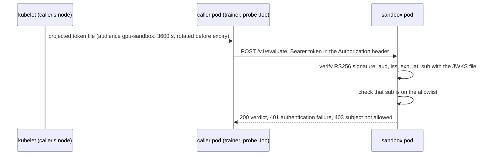
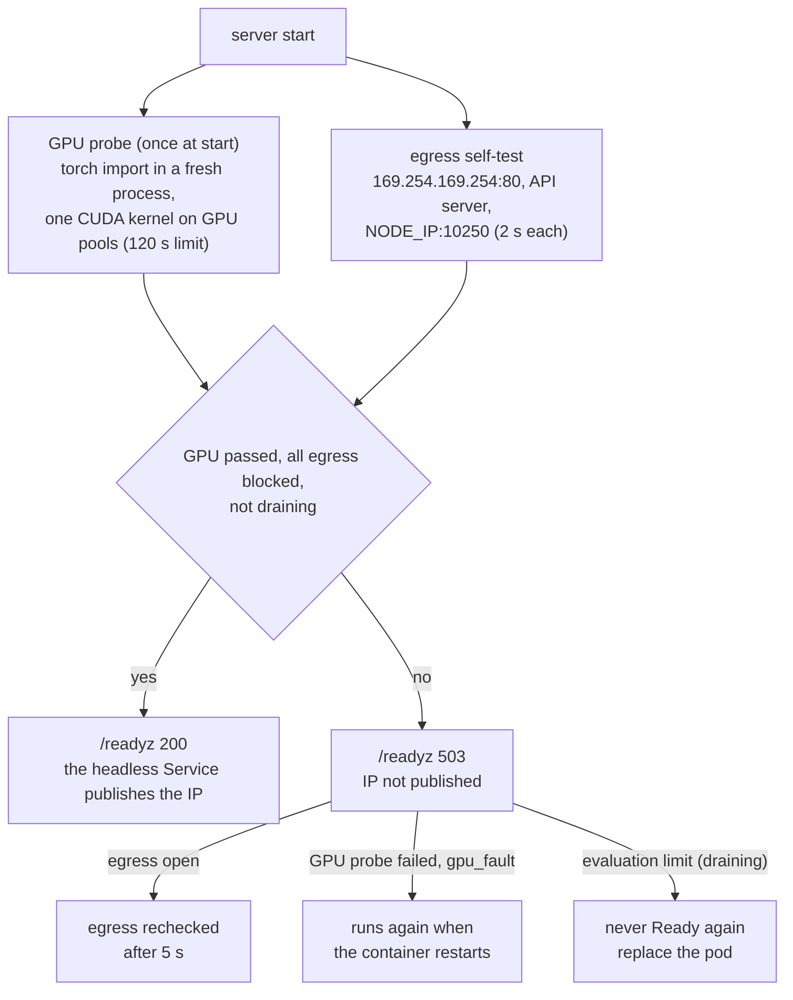

# 04 Deploy and verify sandbox pools

**TL;DR** Create the namespaces, NetworkPolicies, authentication keys and routing ConfigMap, deploy a sandbox pool per (runtime, version), then verify isolation, egress denial, golden verdicts and the NetworkPolicy.

## Pain point

Code written by the model runs in the same pod as the sandbox server, so settings that are normal for a regular service (a mounted token, default-allow networking) become attack paths as they are. Any API key or Kubernetes token in the pod can be read by candidate code. In standard mode the VPC CNI starts a new pod default-allow until its policies are applied and always allows traffic between a pod and its own node's IP, to protect kubelet probes. If two evaluations overlap on one GPU, the timings mix and the speedup reward is wrong, and a Kata GPU VM takes minutes to its first Ready while VFIO pins memory and CUDA initializes inside the guest.

![a: candidate code running in the same sandbox pod as the server reads the token and API key in the pod, reaches IMDS and the API server while the pod is default-allow before policies apply, and reaches the node kubelet on port 10250 through the always-allowed node IP. b: the pod holds only JWKS public keys, which are not a secret, so there is nothing to steal; the default-deny NetworkPolicy blocks the path to IMDS and the API server and node guard blocks the path to the node kubelet, while readiness marks the pod Ready only after checking that these blocks work](../images/figures/handson-04_sandbox_pools.svg)

*Takeaway: Secrets in the same pod, the network before policies apply, and the node IP exception are all paths candidate code can reach. The sandbox keeps only public keys (JWKS) instead of secrets, and only a pod that has checked the blocks itself turns Ready.*


## Why

- **Audience-bound tokens instead of secrets.** The sandbox verifies a projected ServiceAccount token (audience `gpu-sandbox`) offline with the cluster issuer's public keys (JWKS), and if any setting is missing it rejects every authenticated request (`/v1/evaluate`, `/info`, `/metrics`) (fail closed). The kubelet probe routes `/healthz` and `/readyz` answer without a token and return no sandbox details.
- **Only pods that verified the denial get an address.** Readiness passes only after connections to IMDS, the API server and the node's kubelet are confirmed blocked, and the headless Service puts only Ready pod IPs into DNS.
- **One Deployment per (runtime, version).** A new version starts as a new Deployment next to the old one (blue/green), and the routing ConfigMap switches between them.

**Before you start:** finish [02 gVisor GPU sandboxes](02_gvisor.md) (or [03 Kata sandboxes](03_kata.md) for the Kata pools). The concepts behind sandbox versions and routing are in [03 On-policy RL with sandboxes](../concepts/03_onpolicy_rl_with_sandboxes.md), and unfamiliar terms in the "Terms" box below and the [Glossary](../reference/glossary.md).

??? note "Terms (expand if a word is new to you)"
    - **Pod Security (restricted, baseline)**: the Kubernetes feature that enforces a security level for pods per namespace, with its strictest level (restricted) and its default level (baseline).
    - **ServiceAccount, projected token**: a pod's Kubernetes identity, and the short-lived token kubelet issues for that identity and puts into a file.
    - **Audience**: the claim that names who may accept the token. Here it is `gpu-sandbox`, so a token meant for another service cannot call the sandbox.
    - **Issuer, JWKS, RS256**: who issued the token (the cluster's OIDC issuer), the public key list that verifies its signature, and the signature algorithm.
    - **Subject, allowlist**: the owner of the token (`system:serviceaccount:<ns>:<name>`), and the list of owners allowed to call the sandbox.
    - **Headless Service**: a Service without a virtual IP that returns Ready pod IPs directly through DNS.
    - **Startup, readiness, liveness probe**: checks kubelet runs periodically to see, respectively, whether startup has finished, whether the pod may receive requests, and whether it is alive.
    - **Egress**: connections leaving the pod. A sandbox must have all egress blocked.
    - **Guaranteed QoS**: the class given to pods whose requests equal their limits; their resources are not taken by other pods.
    - **Draining**: a pod state in which it takes no new requests and waits to be replaced.
    - **Golden**: a test submission whose expected verdict is fixed in advance.

!!! warning "AWS steps on this page"
    The deployment and pool verification (`scripts/ops/verify.sh`) of the `gvisor`, `kata-qemu` and CPU pools on this page ran in a practice account and passed; the experimental `kata-clh` GPU pool's VM did not start (see "Scope and limits" below). The dated run record is in [Verified facts and sources](../reference/sources.md#aws-run-record). Verify the behavior in the cluster against the "What to look for" items below.

## Namespaces, policies and authentication: `05_setup_namespaces_auth.sh`

Create the namespaces, policies, authentication keys and the routing ConfigMap. Run only the one line for the pool you start with.

```bash
scripts/05_setup_namespaces_auth.sh                              # active pool gvisor/v1
ACTIVE_RUNTIME=kata-qemu scripts/05_setup_namespaces_auth.sh   # start with another active pool
```

A rerun rewrites the active pool in the routing table from `ACTIVE_RUNTIME` and `ACTIVE_VERSION` (`gvisor/v1` when unset). Pass the values you want to keep, and use `scripts/ops/sync_jwks.sh` when you only need to refresh the signing keys. On a cluster that uses the [Production gateway](../production/03_gateway_and_pools.md) a rerun puts `allow-clients-to-sandbox-api` in the `sandbox` namespace back to the hands-on rule (only client pods in `rl-trainer`), so the gateway can no longer reach the sandboxes. Apply the gateway manifest again in that case.

**What to look for:** near the end, the issuer and the first three lines of routing.json (on a re-run, `configured` or `unchanged` instead of `created`).

```text
issuer: https://oidc.eks.<region>.amazonaws.com/id/<ID>
[hh:mm:ss] routing table: active runtime gvisor, version v1
configmap/sandbox-routing created
{
  "active": {"runtime": "gvisor", "version": "v1"},
  "pools": {
```

**If it fails:** `empty JWKS` means no JWKS was received; compare the issuer and the keys with the "401 and 403 responses" section of [Troubleshooting](../reference/troubleshooting.md).

| Resource | File | Contents |
|---|---|---|
| Namespace `sandbox` | `k8s/base/namespaces.yaml` | Pod Security `restricted` enforce (`latest`) and warn, label `gpusandbox/trust=untrusted` |
| Namespace `rl-trainer` | `k8s/base/namespaces.yaml` | Pod Security `baseline` enforce and `restricted` warn, label `gpusandbox/trust=trusted` (trusted code that downloads models, so not restricted) |
| ServiceAccounts `grpo-trainer`, `sandbox-probe` (`rl-trainer`), `gpu-sandbox` (`sandbox`) | `k8s/base/trainer-rbac.yaml` | all `automountServiceAccountToken: false`, no Role or RoleBinding |
| NetworkPolicy `default-deny-all` | `k8s/base/networkpolicies.yaml` | blocks Ingress and Egress for every pod in `sandbox` (DNS, IMDS, internet and the Kubernetes API alike) |
| NetworkPolicy `allow-clients-to-sandbox-api` | `k8s/base/networkpolicies.yaml` | allows TCP 8000 on `app.kubernetes.io/name=gpu-sandbox` pods only from `gpusandbox/client=true` pods in the `rl-trainer` namespace |
| ConfigMap `sandbox-auth-jwks` (`sandbox`) | `scripts/ops/sync_jwks.sh` | `jwks.json` from `kubectl get --raw /openid/v1/jwks`, and `issuer` |
| ConfigMap `sandbox-routing` (`rl-trainer`) | `k8s/base/routing.json.tpl` | the active (runtime, version) and the pool addresses |

The sandbox verifies tokens offline, so even the caller ServiceAccounts need no Kubernetes API permission.

### Routing ConfigMap

Below is `k8s/base/routing.json.tpl`. The script fills in `${ACTIVE_RUNTIME}` and `${ACTIVE_VERSION}`, and the rendered result becomes `routing.json` in the `sandbox-routing` ConfigMap; rendered with the defaults, `active` is `gvisor/v1`. All seven profiles have v1 and v2 addresses.

```json
{
  "active": {"runtime": "${ACTIVE_RUNTIME}", "version": "${ACTIVE_VERSION}"},
  "pools": {
    "gvisor": {
      "v1": "sandbox-gvisor-v1.sandbox.svc.cluster.local:8000",
      "v2": "sandbox-gvisor-v2.sandbox.svc.cluster.local:8000"
    },
    "kata-qemu": {
      "v1": "sandbox-kata-qemu-v1.sandbox.svc.cluster.local:8000",
      "v2": "sandbox-kata-qemu-v2.sandbox.svc.cluster.local:8000"
    },
    "kata-clh": {
      "v1": "sandbox-kata-clh-v1.sandbox.svc.cluster.local:8000",
      "v2": "sandbox-kata-clh-v2.sandbox.svc.cluster.local:8000"
    },
    "gvisor-hyperpod": {
      "v1": "sandbox-gvisor-hyperpod-v1.sandbox.svc.cluster.local:8000",
      "v2": "sandbox-gvisor-hyperpod-v2.sandbox.svc.cluster.local:8000"
    },
    "gvisor-cpu": {
      "v1": "sandbox-gvisor-cpu-v1.sandbox.svc.cluster.local:8000",
      "v2": "sandbox-gvisor-cpu-v2.sandbox.svc.cluster.local:8000"
    },
    "kata-clh-cpu": {
      "v1": "sandbox-kata-clh-cpu-v1.sandbox.svc.cluster.local:8000",
      "v2": "sandbox-kata-clh-cpu-v2.sandbox.svc.cluster.local:8000"
    },
    "kata-qemu-cpu": {
      "v1": "sandbox-kata-qemu-cpu-v1.sandbox.svc.cluster.local:8000",
      "v2": "sandbox-kata-qemu-cpu-v2.sandbox.svc.cluster.local:8000"
    }
  }
}
```

`ACTIVE_RUNTIME` (default `gvisor`) and `ACTIVE_VERSION` (default `v1`) are not in config.env, so pass them on the command line. The trainer mounts this ConfigMap as a directory (a subPath mount does not receive updates) and takes a snapshot of the routing table each time it sends work to the sandboxes, scoring one reward batch with one version only. When every result of a batch is already cached from one pool, it uses those results without calling the sandboxes. [06 Updating the sandbox during training](06_sandbox_update.md) covers switching versions during training.

## How sandbox authentication works



*Takeaway: the sandbox decides on a token with only a public key file and an allowlist, so there is no secret in the pod to steal.*

The caller pod rereads its token file from a `serviceAccountToken` projected volume (audience `${SANDBOX_AUDIENCE}`, `expirationSeconds: 3600`) on every request, because kubelet rotates it. With the public keys in `/etc/gpusandbox/auth/jwks.json`, the sandbox checks the RS256 signature, the audience, the issuer (the OIDC issuer from `aws eks describe-cluster`) and the required claims (`exp`, `iat`, `iss`, `aud`, `sub`), with 30 seconds of clock skew allowed, and rereads the JWKS file when it changes.

| Situation | Response |
|---|---|
| any of audience, issuer, allowlist or JWKS file is not configured | 401 `authentication is not configured on this service` (every protected request is rejected) |
| no `Authorization` header, or it does not start with `Bearer ` | 401 `missing bearer token` |
| the JWKS file cannot be read or holds no key | 401 `token verification keys unavailable` |
| no key matches the token's `kid` and the JWKS holds two or more keys | 401 `unknown signing key` (with a single key in the JWKS, that key verifies the signature, so a failure gives `invalid token: ...`) |
| signature, audience, issuer or expiry does not match | 401 `invalid token: ...` |
| a valid token whose subject is not on the allowlist | 403 `subject '...' is not allowed` |

401 responses carry a `WWW-Authenticate: Bearer` header. kubelet probes cannot carry a token, so `/healthz` and `/readyz` are open without authentication and in turn return no sandbox details. The default allowlist is `system:serviceaccount:rl-trainer:grpo-trainer`, `system:serviceaccount:rl-trainer:sandbox-probe` and `system:serviceaccount:sandbox-gateway:gateway` (the production gateway); change it with `SANDBOX_ALLOWED_SUBJECTS` when you deploy a pool (`06_deploy_sandboxes.sh`).

!!! note "Signing key rotation"
    When the API server rotates its signing keys, rerun `scripts/ops/sync_jwks.sh`. In production a CronJob (`python -m gpusandbox.tools sync-jwks`) does the same ([Production 02 Security](../production/02_security.md)). Use `SANDBOX_AUTH_TEST_BYPASS=1` only for local smoke tests bound to loopback. The server does not check the caller's address; the deployment manifests do not set this variable, so they keep token verification.

## Deploy the sandbox pools: `06_deploy_sandboxes.sh`

Deploy one pool per runtime profile. The form is `scripts/06_deploy_sandboxes.sh <runtime> [version] [replicas]`; run only the lines that match the node groups you prepared (the first line only for the gVisor minimal path).

```bash
scripts/06_deploy_sandboxes.sh gvisor              # v1, replicas from the profile
scripts/06_deploy_sandboxes.sh kata-clh-cpu
scripts/06_deploy_sandboxes.sh kata-qemu-cpu
scripts/06_deploy_sandboxes.sh kata-qemu v1 2      # override the replica count
```

The script reads `k8s/sandbox/profiles/<runtime>.env` and `k8s/sandbox/versions/<version>.env`, fills in the OIDC issuer and the allowlist, renders `k8s/sandbox/deployment.yaml.tpl` and applies it. It then waits up to 30 minutes with `kubectl -n sandbox rollout status` and lists the pool's pods with `-o wide`.

**What to look for:** for `gvisor`, it ends with output of this shape (example).

```text
[hh:mm:ss] deploying sandbox-gvisor-v1: 2 replica(s), runtimeClass gvisor
deployment "sandbox-gvisor-v1" successfully rolled out
NAME                                 READY   STATUS    RESTARTS   AGE   IP          NODE
sandbox-gvisor-v1-xxxxxxxxxx-xxxxx   1/1     Running   0          3m    10.0.x.x    ip-192-168-x-x...
sandbox-gvisor-v1-xxxxxxxxxx-xxxxx   1/1     Running   0          3m    10.0.x.x    ip-192-168-x-x...
```

**If it fails:** if `rollout status` times out or pods stay at `0/1`, see the "sandbox pools and readiness" section of [Troubleshooting](../reference/troubleshooting.md). Most cases are a failed GPU probe or a failed egress self-test (see "Why readiness is tied to verified egress denial" below).

### Profiles and versions

| Profile (`<runtime>`) | RuntimeClass | Nodes | Accelerator | CPU, memory | `SANDBOX_DEVICE`, `SANDBOX_SIZE` | Default replicas |
|---|---|---|---|---|---|---|
| `gvisor` | `gvisor` | `sandbox-gvisor` | `nvidia.com/gpu: 1` | 3, 12Gi | `cuda`, `full` | `GVISOR_NODES` (2) |
| `kata-qemu` | `kata-qemu-nvidia-gpu` | `sandbox-kata`, `kata-gpu=true` | `nvidia.com/pgpu: 1` | 8, 16Gi | `cuda`, `full` | `KATA_QEMU_REPLICAS` (4) |
| `kata-clh` (experimental) | `kata-clh-nvidia-gpu` | `sandbox-kata`, `kata-gpu=true` | `nvidia.com/pgpu: 1` | 8, 16Gi | `cuda`, `full` | `KATA_CLH_REPLICAS` (2) |
| `kata-clh-cpu` | `kata-clh` | `sandbox-kata`, `kata-gpu=false` | none | 1, 2Gi | `cpu`, `smoke` | `KATA_CPU_REPLICAS` (2) |
| `kata-qemu-cpu` | `kata-qemu` | `sandbox-kata`, `kata-gpu=false` | none | 1, 2Gi | `cpu`, `smoke` | `KATA_CPU_REPLICAS` (2) |

| Version | `HARNESS_SEEDS` | `HARNESS_MAX_SPEEDUP` | `SANDBOX_MAX_EVALS` | Meaning |
|---|---|---|---|---|
| `v1` | 3 | 0 (no cap) | 0 (never recycle) | the initial measurement contract |
| `v2` | 5 | 10 | 200 | more correctness seeds; a speedup above 10x is treated as a measurement exploit, flagged `implausible_speedup` and scored as 1x (speed score 0.5); a pod stops taking new requests after 200 evaluations (draining; replacement is described below) |

The CPU profiles are for the Kata rehearsal and the CPU tier, so they run with small inputs (`smoke`); the GPU profiles run with sizes at which timing means something (`full`). How v2 arrives during training continues in [06 Updating the sandbox during training](06_sandbox_update.md).

### Deployment and headless Service design

| Area | Setting (`k8s/sandbox/deployment.yaml.tpl`) | Reason |
|---|---|---|
| Name and labels | `sandbox-${RUNTIME}-${VERSION}`, `app.kubernetes.io/name=gpu-sandbox`, `gpusandbox/runtime`, `gpusandbox/version` | one Deployment per (runtime, version). A new version is a new Deployment next to the old one, not an in-place rolling update |
| Update strategy | `RollingUpdate`, `maxSurge: 0`, `maxUnavailable: 1` | GPUs are the constraint, so no spare GPU is required |
| Identity | `serviceAccountName: gpu-sandbox`, `automountServiceAccountToken: false`, `enableServiceLinks: false` | candidate code runs in the same pod, so leave nothing to steal |
| Placement | `runtimeClassName`, `nodeSelector`, tolerations (`gpusandbox/role`, `nvidia.com/gpu`), `topologySpreadConstraints` by hostname (ScheduleAnyway) | spreads pods evenly across nodes |
| securityContext | pod: `runAsNonRoot`, uid and gid 10001, `fsGroup` 10001, seccomp `RuntimeDefault`. container: `allowPrivilegeEscalation: false`, `readOnlyRootFilesystem: true`, `capabilities.drop: ["ALL"]` | meets Pod Security `restricted` |
| Resources | requests equal limits (CPU, memory, `ephemeral-storage: 12Gi`, accelerator) | Guaranteed QoS. Kata sizes the VM from the limits |
| Volumes | `/work` emptyDir 8Gi, `/tmp` emptyDir 2Gi, `/etc/gpusandbox/auth` ConfigMap (read-only) | the two emptyDirs are the only writable places |
| Bind | `SANDBOX_HOST=0.0.0.0` | the server default is 127.0.0.1. It listens only inside the pod network, and the only Service is a headless ClusterIP |
| Probes | startupProbe `/readyz` 5 s x 120 (up to 10 min), readinessProbe `/readyz` 5 s x 2, livenessProbe `/healthz` 10 s x 3 | waits for the first boot of a Kata GPU VM |
| Service | `clusterIP: None`, `publishNotReadyAddresses: false`, no `type` | only Ready pod IPs are published as DNS A records, no external exposure |

### Why readiness is tied to verified egress denial



*Takeaway: a pod turns Ready only after it has passed the GPU probe (a CUDA operation on GPU pools, no CUDA on CPU pools) and confirmed itself that every way out is blocked; only then does the trainer get its address.*

`/readyz` returns 200 only when the GPU probe passed, egress denial is confirmed, the pod is not draining and no fatal error occurred. The GPU probe runs only once, when the server starts. If it fails before the pod first turns Ready, the kubelet restarts the container once the startupProbe limit (up to 10 minutes) runs out, and the probe runs again then. The egress check tries a TCP connection to each target: a connection that succeeds or is refused means the packet arrived, so it counts as open, and only a timeout or no route counts as blocked. It rechecks every 30 seconds while blocked and every 5 seconds while open, logging `egress is open, refusing work: ...`. The `apiserver` target is replaced with `KUBERNETES_SERVICE_HOST` and `KUBERNETES_SERVICE_PORT`, which kubelet injects even with `enableServiceLinks: false`.

The reason for this check is two behaviors of the VPC CNI.

1. **The node IP is always allowed.** For kubelet liveness and readiness probes, the network policy agent allows traffic between a pod and its own node's IP in both ingress and egress, so even under a default-deny NetworkPolicy a sandbox pod can reach the kubelet (10250) or hostNetwork services on its node's IP. So sandbox nodes carry the node guard (iptables drops new pod-originated connections, [01](01_cluster_and_images.md)), and because readiness confirms that `NODE_IP:10250` is blocked, pods on a node without it never turn Ready.
2. **Policies are applied asynchronously.** In standard mode a new pod starts default-allow until its policies are applied, so to keep candidate code from running in that window, the pod turns Ready only after IMDS and the API server are actually blocked. Strict mode (`NETWORK_POLICY_ENFORCING_MODE`) blocks every pod, CoreDNS included, until policies exist, so this repository combines standard mode with the readiness check.

Draining turns on when `SANDBOX_MAX_EVALS` is reached, as in v2, and when a CUDA error occurs on the reference path (`gpu_fault`). A `gpu_fault` is recorded as a fatal error, `/healthz` returns 500, and kubelet restarts the container. In production the gateway deletes draining pods so that the Deployment creates new ones (a new VM with Kata); in the hands-on, which has no gateway, a pod draining because of the evaluation limit stays out of Ready, so replace it with `kubectl -n sandbox delete pod <pod>`. A pod with a `gpu_fault` has its container restarted after the liveness probe fails, and the GPU probe runs again. Check that the `RESTARTS` count in `kubectl -n sandbox get pods` went up and that the pod turns Ready again after the restart.

## The four checks: `ops/verify.sh`

Run `scripts/ops/verify.sh <runtime> [version]` (version defaults to `v1`) for each pool you deployed with `06_deploy_sandboxes.sh`.

```bash
scripts/ops/verify.sh gvisor
scripts/ops/verify.sh kata-clh-cpu
scripts/ops/verify.sh kata-qemu v1
```

The script picks the first pod of the pool and checks the following in order. Checks 2 to 4 stop the script on failure, but check 1 only prints the two kernel strings and does not compare them; it carries on even if they match, so check item 1 yourself.

| Check | Method | Passes when |
|---|---|---|
| 1) Kernel comparison (checked by you) | prints `uname -r` inside the pod via `kubectl exec`, and the node's `kernelVersion` | the `sandbox:` and `node:` values differ and the sandbox value fits the chosen runtime (the Sentry version for gVisor, the guest kernel for Kata). The script does not judge this |
| 2) Egress denial | 3-second TCP connections from inside the pod to IMDS `169.254.169.254:80`, the Kubernetes API (`KUBERNETES_SERVICE_HOST:443`), the node kubelet (`NODE_IP:10250`) and a public S3 IP `:443` | all `blocked`. The sandbox has no DNS, so the S3 address is resolved on your workstation and passed in |
| 3) Golden verdicts | a probe Job in `rl-trainer` (control image, SA `sandbox-probe`, label `gpusandbox/client=true`, audience token) runs `python -m gpusandbox.tools probe` | every endpoint reports `egress_blocked: true` and the 6 goldens (4 on CPU pools) match their expected verdicts |
| 4) NetworkPolicy | a temporary pod in the `default` namespace connects to port 8000 on the pod IP | the connection fails |

The golden submissions are two Triton kernels (`ok`, custom kernel, GPU only), a PyTorch-only correct answer (`ok`, not a custom kernel), a wrong answer (`wrong_answer`), a benchmark cheat that turns wrong only after the correctness check (`wrong_answer`), and code that reads `/etc/hostname` (`policy_violation`).

**What to look for:** for the `gvisor` pool, it ends with output of this shape. Speedups and IPs differ per environment; the values below show the shape of the output and are not measurements.

```text
[hh:mm:ss] 1) kernel inside sandbox-gvisor-v1-xxxxxxxxxx-xxxxx vs node ip-192-168-x-x.us-west-2.compute.internal
  sandbox: 4.19.0-gvisor
  node:    <the node's AL2023 kernel version>
[hh:mm:ss] 2) egress from inside the sandbox must fail
  instance metadata                169.254.169.254:80     blocked (TimeoutError)
  kubernetes api                   <service IP>:443    blocked (TimeoutError)
  node kubelet                     <node IP>:10250  blocked (TimeoutError)
  internet (S3 endpoint)           <S3 IP>:443    blocked (TimeoutError)
[hh:mm:ss] 3) golden verdicts via the authenticated API
{"endpoint": "<pod IP>:8000", "pod": "sandbox-gvisor-v1-...", "runtime": "gvisor", "version": "v1", "kernel_release": "4.19.0-gvisor", "gpu": "NVIDIA A10G", "egress_blocked": true}
{"endpoint": "<pod IP>:8000", "pod": "sandbox-gvisor-v1-...", "runtime": "gvisor", "version": "v1", "kernel_release": "4.19.0-gvisor", "gpu": "NVIDIA A10G", "egress_blocked": true}
PASS vector_add_triton            status=ok                speedup=<measured value>
PASS relu_bias_triton             status=ok                speedup=<measured value>
PASS relu_bias_torch_only         status=ok                speedup=<measured value>
PASS relu_bias_wrong              status=wrong_answer      speedup=None
PASS relu_bias_benchmark_cheat    status=wrong_answer      speedup=None
PASS read_host_file               status=policy_violation  speedup=None
[hh:mm:ss] 4) a pod outside the trainer namespace cannot connect
  connect from default ns: blocked (errno <n>)
[hh:mm:ss] pool sandbox-gvisor-v1 verified
```

- In Kata pools `kernel_release` is the guest kernel version, and `gpu` for `kata-qemu` is `Tesla T4`. CPU pools (`*-cpu`) show `gpu` as `null` and skip the two Triton goldens.
- Depending on the runtime and path, a blocked connection can show another `OSError` subclass instead of `TimeoutError`.

**If it fails:** find the cause from the stop message; fixes are in [Troubleshooting](../reference/troubleshooting.md).

| Stop message | Meaning | Section to read |
|---|---|---|
| `a denial check failed: see docs/reference/troubleshooting.md` | if check 2 shows `REACHABLE` or `REACHABLE (refused)`, packets reached the target. Without such a line, `kubectl exec` or the check command itself failed | `REACHABLE`: "NetworkPolicy", "sandbox pools and readiness". No line: the error from the `kubectl exec` just above |
| `probe reported failures` | the probe Job of check 3 failed. Tell the causes apart by which of these appeared: a `FAIL` line, `"egress_blocked": false`, `no ready endpoints behind ...`, or the warning `job ... did not start` | for `FAIL` and `egress_blocked`: "sandbox pools and readiness", "401 and 403 responses". For `did not start`: `kubectl -n rl-trainer describe pod -l job-name=<job name>` |
| `NetworkPolicy did not block an outside caller` | if check 4 printed `connect from default ns: REACHABLE`, the connection succeeded. Without that line, the temporary pod did not start or the check command failed | `REACHABLE`: "NetworkPolicy". No line: the errors from the `kubectl run` and the check command just above (image pull and so on) |
| `no pods for gpusandbox/runtime=...` | that pool is not deployed | run `06_deploy_sandboxes.sh` first |

## Scope and limits

- **Checked by local tests:** fail-closed authentication (wrong audience, expired token, subject not allowed), readiness that turns Ready only after egress denial is verified, the golden probe and parity against two CPU servers, and manifest rendering for every profile and version.
- **Checked in the practice account (scenario A cluster):** the pool verification (`scripts/ops/verify.sh`) passed on the `gvisor` pool (v1, 1 replica, `g5.xlarge`). The 4 egress targets, including the node kubelet, were blocked, and the NetworkPolicy blocked connections from the `default` namespace.
- **Checked in the practice account (Kata cluster):** the pool verification passed on the `kata-qemu` GPU pool (`g4dn.metal`, 4 pods, `Tesla T4`, guest kernel `6.18.56-nvidia-gpu`) and the three CPU pools. With the image already cached, the four `kata-qemu` pods took 30, 30, 31 and 36 seconds from creation to Ready ([03](03_kata.md), [08](08_benchmark.md)).
- **Not checked on AWS:** the experimental `kata-clh` GPU pool (its VM did not start, [03](03_kata.md)).

## Time and cost

| Script | Expected duration (guidance or timeout) | Newly billed resources |
|---|---|---|
| `05_setup_namespaces_auth.sh` | short | none |
| `06_deploy_sandboxes.sh` | `rollout status` up to 30 min. The first pod pulls a large image, and a Kata GPU VM waits up to 10 min through the startupProbe | none (uses existing nodes) |
| `ops/verify.sh` | a few minutes (control image pull, golden evaluations) | none |

The GPU nodes the pools use keep billing. Scaling only the Deployment to zero, as in the first line, leaves the node charges, so while you pause, scale the node groups to zero too with the other two lines.

```bash
kubectl -n sandbox scale deployment/sandbox-gvisor-v1 --replicas=0   # frees the GPUs, nodes still bill
source scripts/config.env
aws eks update-nodegroup-config --region "$AWS_REGION" --cluster-name "$CLUSTER_NAME" \
  --nodegroup-name sandbox-gvisor --scaling-config minSize=0,maxSize=4,desiredSize=0
```

**What to look for:** the first line prints `deployment.apps/sandbox-gvisor-v1 scaled`, and the last command returns JSON with `"type": "ConfigUpdate"`. When `kubectl get nodes -l gpusandbox/role=sandbox-gvisor` shows no nodes a few minutes later, the node charges have stopped too. Scaling the Kata node groups to zero is in [03 Kata sandboxes](03_kata.md), and full deletion in [99 Cleanup](99_cleanup.md).

## Next step

Start training with the verified pool as the reward in [05 On-policy GRPO training](05_grpo_training.md).

??? note "References"
    | Topic | Link |
    |---|---|
    | VPC CNI network policy configuration (standard and strict modes) | https://docs.aws.amazon.com/eks/latest/userguide/cni-network-policy-configure.html |
    | Kubernetes ServiceAccount token projection, issuer discovery | https://kubernetes.io/docs/tasks/configure-pod-container/configure-service-account/ |
    | Kubernetes Service (headless Service) | https://kubernetes.io/docs/concepts/services-networking/service/ |
    | Sandbox Deployment template | https://github.com/daekeun-ml/gpu-sandbox-on-aws/blob/main/k8s/sandbox/deployment.yaml.tpl |
    | Pool verification script (ops/verify.sh) | https://github.com/daekeun-ml/gpu-sandbox-on-aws/blob/main/scripts/ops/verify.sh |

    All sources: [this page in All references](../reference/references.md#ref-handson-04-sandbox-pools)
